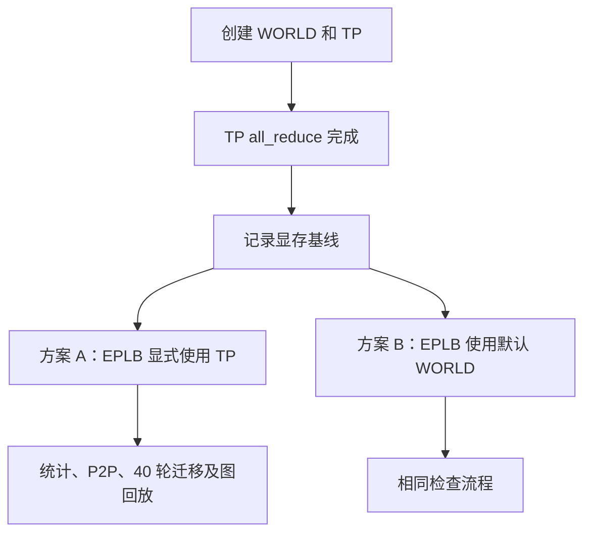

# 复用 TP 通信组到底省在哪里？一次 WORLD 与 HCCL 显存分配追踪

给 Ascend 上的动态 EPLB 接入通信时，一个很自然的想法是：PyTorch 已经创建了默认 WORLD，直接用它就行，何必再传一个 TP 通信组？从 Python 看，甚至还能少改几行公共代码。

实际跑起来，一次很小的专家负载统计，却让设备占用跳了几个 GiB。统计张量没有那么大，模型权重和 KV Cache 也没变。继续往下查，问题落在通信资源的初始化时机上：**创建 WORLD 对象和真正使用 WORLD 做设备通信，是两个阶段。TP 已经付过的初始化成本，也不会自动抵扣到 WORLD 上。**

这次追踪做了两组互相补充的实验。完整服务回答“关闭 EPLB 后，TP 资源最终会不会分配”；独立通信实验回答“TP 已经启用，再选 WORLD 会多花多少”。后者完成 40 轮迁移与图回放后，复用 TP 比使用默认 WORLD 每芯片少占 P **4.04 GiB**、D **2.39 GiB**。这笔收益来自避免激活另一套通信资源。

## 一、同一批 rank，可以有两个通信组

先把几个名字放回代码里。PyTorch 的 `dist.init_process_group()` 创建默认进程组，后续的 `group=None` 指向它。SGLang 又通过自己的并行组管理创建 TP、MoE 等组。WORLD 和 TP 即使都包含 rank 0～15，也可以是两个独立的 ProcessGroup 对象。

这里的“组”包含了参与者，也承载通信上下文。它不只是一份 rank 名单。给一个通信操作传入 `group=None`，框架选择的是默认组；它不会检查所有已有的组，再挑一个“成员相同、缓冲区已经分配”的组替你复用。

可以把这次实验里的两条路径写成下面这样：

```python
# 两组实验都已经完成这些准备，以下是调用关系示意。
dist.init_process_group(backend="hccl", pg_options=world_options)
tp_group = dist.new_group(backend="hccl", pg_options=tp_options)
dist.all_reduce(warmup_tensor, group=tp_group)

# A：明确使用刚才已经参与通信的 TP 组。
dist.all_reduce(expert_counts, group=tp_group)

# B：选择默认 WORLD。
dist.all_reduce(expert_counts, group=None)
```

A、B 使用相同数量的 rank，传输相同的统计数据，区别只在最后一个参数。B 仍然能够给出正确结果，但它第一次使用了另一条设备通信路径。

这也解释了“WORLD 明明早就创建了，为什么还会分配显存”。初始化进程组之后，Python 对象已经存在，rank 信息也能查询；设备通信器、缓冲区和相关运行时资源还会在实际通信时初始化。单看对象存在，无法判断这笔资源是否已经分配。

## 二、先把 OFF 后面的流程看完

追踪中最容易算错的一笔，出现在模型加载阶段。

早期的 ON/OFF 快照里，ON 比 OFF 多出约 P 524 MiB、D 2525 MiB。ON 更早执行了 TP 通信，于是这两个数很容易被写成“开启 EPLB 新增的通信显存”。但沿着 OFF 的启动过程继续看，后面还有一次原生预热。

在这次 DeepSeek-V4 服务使用的 `f6ad2f4f` 版本中，[`Scheduler.maybe_init_hccl_dp_prewarm`](https://github.com/AkiYangDev/sglang/blob/f6ad2f4f922d0df111dc66153f543a453267455c/python/sglang/srt/managers/scheduler.py) 会在 NPU、DeepSeek-V4 条件下，对同一个 TP 组执行 `all_reduce`，该路径不依赖 `enable_eplb`。OFF 两端各 16 个 rank 的日志都记录了这次预热，而且发生在服务 READY 和正式请求之前。

因此，早期快照比较的是“ON 已经分配，OFF 还没走到分配点”。等 OFF 继续启动，它也要付这笔成本。

为了确认后续状态，我们让 OFF 完成 512 个请求，再在原进程里对同一个 TP 组执行通信。模型是 DeepSeek-V4-Flash-0731 W8A8，P、D 各 16 个 Ascend 910C 逻辑设备；并发 128，输入 16,388 token，输出 8,192 token，512 个请求全部成功。

| OFF 完成负载后执行的操作 | P 新增，MiB/芯片 | D 新增，MiB/芯片 |
| --- | ---: | ---: |
| 同一 TP 组再次 `all_reduce` | 0.00 | 0.00 |
| 随后首次批量 P2P | 32.31 | 32.13 |

表中取每端 16 个 rank 的平均值；再次 `all_reduce` 的 32 个 rank 全部为零增量。这个结果和启动日志对应起来，结论就明确了：**这套服务在关闭 EPLB 时也已经激活 TP 的集合通信资源。提前激活它，改变了分配时间，不构成稳态下再多一份大缓冲区。**

首次 P2P 仍然增加了约 32 MiB。复用组以后，过去没用过的收发路径还会初始化相关资源。“组已经用过”和“这个组的所有通信路径都已经用过”，仍然有区别。

这里的 32 MiB 是设备占用的实测增量。它不是给通信组设置了 `hccl_buffer_size=32`，也不是恢复了早期的专用小缓冲组方案。把观测值当成配置值，会再次把几种实现混在一起。

## 三、WORLD 的几个 GiB 从哪来

接着看独立实验中的配置。P 与 D 沿用了服务对应的环境参数，但默认 WORLD 和 TP 并没有拿到完全相同的显式选项。

当时 SGLang 的 `get_torch_distributed_pg_options` 中，决定这件事的代码是：

```python
# 摘录：省略平台检查及 Options 对象创建。
if group_name is not None and "moe" not in group_name:
    return None

hccl_buffer_size = int(
    os.environ.get("DEEPEP_HCCL_BUFFSIZE")
    or os.environ.get("HCCL_BUFFSIZE")
    or 200
)
options.hccl_config = {"hccl_buffer_size": hccl_buffer_size}
```

默认 WORLD 初始化时没有传入组名，继续向下读取缓冲区配置；TP 传入 `"tp"`，提前返回 `None`。后者表示没有通过这段函数显式覆盖后端选项，HCCL 仍会按自己的环境配置和默认值工作。

| 实验配置 | P | D |
| --- | --- | --- |
| `DEEPEP_HCCL_BUFFSIZE` | 2048 | 未设置 |
| `HCCL_BUFFSIZE` | 未设置 | 1200 |
| WORLD 显式 `hccl_buffer_size` | 2048 MiB | 1200 MiB |
| TP 的 `pg_options` | `None` | `None` |
| 通信展开模式 | AIV | AIV |

有个容易忽略的细节：变量名虽然叫 `DEEPEP_HCCL_BUFFSIZE`，这段代码却也在默认 WORLD 的选项构造中读取它。只按环境变量的名字推测作用范围，就会漏掉 WORLD 的 2048 MiB 配置。

默认 WORLD 第一次执行统计通信后，P 每芯片增加约 4098 MiB，D 增加约 2402 MiB，数量级分别与 `2 × 2048 MiB`、`2 × 1200 MiB` 加少量运行时资源吻合。表里的测量对象是设备总占用；缓冲配置解释了主要规模，余量也一起计入结果。

这次同时记录了 PyTorch 的 allocated、reserved 和设备 free memory。统计张量在通信前一个测点已经创建；首次统计前后，allocated、reserved 都没有变化，设备空闲显存却减少了几个 GiB。也就是说，只看 PyTorch 张量分配器，恰好会漏掉这次排查的主要变化。

## 四、让 TP 先热起来，再比较 WORLD

确认 OFF 自己会用 TP 之后，对照实验的基准就应该放在“TP 已经完成通信”这个时刻。

我们分别运行 P 配置、D 配置下的 TP 与 WORLD 两种方案，总共四次独立的 16-rank 进程运行。每次都先创建 WORLD，再创建 TP，完成 TP `all_reduce`，随后记录自己的显存零点。之后才开始 EPLB 统计、P2P 和权重迁移。



TP 首次启用自身也有开销，P 约 479 MiB、D 约 2479 MiB。两种方案都已经付出了这笔开销，所以它被包含在各自的基线中。下面只列基线之后的增量。

| 配置与测点 | 复用 TP | 使用 WORLD | WORLD 多占 |
| --- | ---: | ---: | ---: |
| P：首次统计完成 | 0.00 | 4097.94 | 4097.94 |
| P：全 peer P2P 预热完成 | 48.72 | 4186.23 | 4137.51 |
| P：全部迁移及图回放完成 | 140.18 | 4278.42 | 4138.24 |
| D：首次统计完成 | 0.00 | 2401.98 | 2401.98 |
| D：全 peer P2P 预热完成 | 49.08 | 2491.89 | 2442.81 |
| D：全部迁移及图回放完成 | 140.38 | 2582.83 | 2442.45 |

单位为 MiB/芯片，取每次 16 个 rank 的平均值，通过 `torch.npu.mem_get_info()` 的空闲字节差计算。这里的“芯片”指逻辑设备，不是服务器或物理卡总量。

首次统计时，复用 TP 的所有 rank 都没有新增占用。WORLD 组的 P 范围是 4097.52～4099.48 MiB，D 是 2401.75～2402.49 MiB；差异并非某一个 rank 的异常峰值。更重要的是，差距一直保留到完整迁移和图回放之后，P 仍多 4138.24 MiB，D 仍多 2442.45 MiB。

功能检查也一起做完了：`all_reduce`、`reduce`、`broadcast` 覆盖 int64、int32、float32；权重迁移覆盖不变布局、环形搬迁、仅两 rank 交换、卡内交换、冗余专家和重复目标。每个 rank 执行 40 轮布局检查，真实 NZ29 的 int8、bfloat16 主权重经过 NZ→ND、迁移、ND→NZ、原位写回，ND float32 辅助权重一起验证。

每轮检查权重数值、存储地址和格式，再回放读取原权重地址的 grouped matmul 与 TP `all_reduce` 图，校验输出。四次运行均为 16/16 rank 通过。这组实验说明，改用默认 WORLD 可以把功能跑通，同时也确实多占了一套资源。

小实验中全 peer 预热的约 49 MiB，与完整服务首次批量 P2P 的约 32 MiB，来自不同的执行历史和测点。两者都说明复用以后仍有路径初始化开销；文章采用各自的原始测量值，不把它们拼成同一条时间线。

## 五、真正接入时，不能随手拿一个 TP 组

显存收益明确之后，剩下的问题是怎样把复用写进通用代码。EPLB 的迁移计划按 rank 寻找专家，统计也包含指定根节点的通信。选择通信组时，必须保留这些 rank 的含义。

例如 WORLD 有 32 个 rank，TP 被切成两个 16-rank 子组。原计划要把专家从全局 rank 3 搬到 rank 20，直接换成一个 TP 子组，就无法覆盖这次迁移。即使成员数量相同，组内顺序不同，原来的映射也不能直接照搬。

因此，整理后的选择逻辑只复用与 WORLD 等价的 TP 设备组：成员列表恰好是 `0..world_size-1`，顺序一致，后端一致；弹性 EP 和 TP 子组继续走原来的 WORLD 路径。其核心判断可以读成：

```python
if (
    elastic_ep_enabled
    or tp_group is None
    or tp_group.ranks != list(range(dist.get_world_size()))
    or dist.get_backend(tp_group.device_group) != dist.get_backend()
):
    return None
return tp_group.device_group
```

这样，调用方继续使用现有根节点、peer ID 和专家槽位映射，通信上下文在满足条件时得到复用。对应实现见固定版本的 [`communication.py`](https://github.com/AkiYangDev/sglang/blob/0c947c997d747b1fb1805fccdcdc093100dfde8d/python/sglang/srt/eplb/communication.py)。

还要处理首次批量 P2P。一次真实重平衡中，有些 rank 没有专家需要发送或接收，会跳过搬运。如果把第一次通信初始化留到这里，不同 rank 的参与情况就取决于当次布局。因此实现把所有 peer 的小张量收发放到启动阶段，完成等待后再进入服务。

预热的作用是提前完成初始化、让各 rank 走齐首次通信流程。它仍然要占显存，也仍然要花时间。复用带来的节省来自少启用另一套资源，预热只是把剩余的初始化放到了可控的位置。

同样，通信组的复用不会替权重更新建立执行顺序。旧 forward 用完权重、迁移完成、原位写回、后续图回放读取新值，这些 stream 和事件依赖仍然要由更新流程保证。

## 六、把两本账分开，结论就不矛盾了

回头看这次排查，最困扰人的其实是两句话：“TP 本来就有，为什么还增加显存？”以及“OFF 后来也分配，那复用到底省了什么？”它们分别在问不同的对照关系。

| 对照 | 已经确认的结果 |
| --- | --- |
| 同一服务的 OFF 与 ON，都使用 TP | OFF 在原生预热阶段也激活 TP；早期 524/2525 MiB 差值不能直接记成稳态 EPLB 新增 |
| TP 已经激活，再用 TP 或首次用 WORLD | WORLD 另外分配资源；完整小实验结束时相差 P 4.04 GiB、D 2.39 GiB/芯片 |
| 已用 TP 集合通信，再首次用 TP P2P | 完整服务实测仍新增约 32 MiB/芯片 |
| 权重迁移产生临时张量 | 属于 staging 和分配器生命周期，另行分析 |

专用的小缓冲 HCCL 组提供了另一种选择：可以独立设置缓冲区和展开模式，但也引入独立的通信上下文。对于本次拓扑，已有 TP 覆盖所有参与 rank，相关集合通信资源又是 OFF 必须初始化的，直接复用就能利用已经付出的成本。

这个判断也给出了清楚的核查方法：从完整应用找出哪些组确实执行设备通信，记录它们首次使用的时间，再比较新增路径。若另一个应用本来就持续使用 WORLD，WORLD 的大缓冲区已经包含在基线中，就应按那个应用的基线重新计算。通信组的名字和创建次数，本身算不出显存收益。

这次最终省下的是额外激活 WORLD 的成本。与此同时，EPLB 的统计张量、首次 P2P 资源、权重中转和分配器缓存各有自己的账。上一篇[逐层处理为何仍堆出多层临时张量](ascend-eplb-memory-bounded-staging.md)讨论的是后面一类；把两类问题分开，才能知道每一处改动到底减少了什么。

## 实验版本与数据

完整服务证据来自 2026-10-29 的 `f6ad2f4f922d0df111dc66153f543a453267455c`，包括启动阶段、512 请求完成后的同进程通信检查。独立通信实验执行于 2026-10-30，使用 PyTorch 2.10.0+cpu、torch_npu 2.10.0.post6、Ascend 910C；提取当时工作区的通信选项、单层迁移和 staging 实现，冻结源码标识为 `f6d3a584ce239d4cbc713996663a7de181d3bfdc6f4862bf52a6dc1e75efee65`。工作区基于 `796ec868` 并包含当时的 staging 优化，具体源文件校验值随数据保存。

数值、源文件校验值和测量口径见[证据说明](../../assets/ascend-eplb-tp-world-memory/evidence.json)，逐 rank、逐阶段数据见[通信实验 CSV](../../assets/ascend-eplb-tp-world-memory/memory-per-rank.csv)，完整服务后续通信结果见[OFF 后续激活记录](../../assets/ascend-eplb-tp-world-memory/off-late-results.json)。两份数据保留各自的基线和测点，可从逐 rank 结果重新计算文中的均值与范围。
