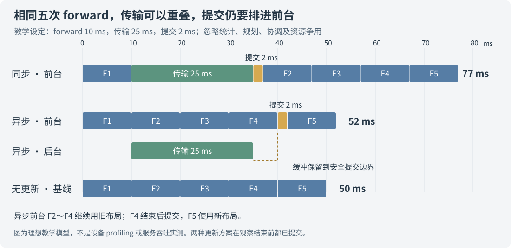

# 让 EPLB 在后台搬权重，前台推理就不用等了吗？

后台搬运能把一部分迁移时间藏进正常推理，但前台仍然要参与新布局的切换。新专家收到以后，还要等旧计算安全结束，把数据写进实际使用的权重槽位，更新路由，并让其他 rank 按同一套约定继续执行。

因此，评价异步 EPLB，要看前台还承担哪些工作，以及后台传输有没有拖慢正常 forward。Python 主线程很快返回，只说明它没有一直守着传输，设备上的依赖和带宽开销仍然存在。

这里的前台，指正常推进模型推理的主流程；后台，指独立的迁移 worker 及其传输队列。两边都包含 CPU 代码，也都会向设备提交任务。把一段工作放进后台，改变的是执行与等待的位置。

下面先用 DeepSeek 一层 MoE 的两个专家槽位走完这个过程，再对照实际源码。SGLang 部分固定在 [`2914be60`](https://github.com/sgl-project/sglang/tree/2914be608009b65099c4c52ba118a597bf1b1421/python/sglang/srt/eplb)，异步实现分别参考 vLLM [`0fab1aa4`](https://github.com/vllm-project/vllm/tree/0fab1aa459bd5bdfee4950f6a8752870e71810cb/vllm/distributed/eplb)与 vLLM-Ascend [`d476b009`](https://github.com/vllm-project/vllm-ascend/tree/d476b009777343b1b5e4a3550e4a34f43108ed8e/vllm_ascend/distributed/eplb)。文中的时间线数字采用教学设定，配套 CPU 示例用于复算执行顺序和算术。

## 一、开一个后台线程，为什么还不够

先假设 rank 0 的某个槽位放专家 A，rank 1 的某个槽位放专家 B。EPLB 准备交换它们的位置：

```text
原布局：rank 0 的槽位放 A，rank 1 的槽位放 B
新布局：rank 0 的槽位放 B，rank 1 的槽位放 A
```

这是摆放位置发生变化。A、B 各自的逻辑权重仍然相同，没有训练出另一版模型。真正要维护的关系是：token 根据路由找到的物理槽位，里面必须放着它需要的那个专家。

如果迁移期间还有 token 按旧映射来找 A，后台却直接把 rank 0 的 A 改成 B，就会出错。更糟的是，写入通常由多个设备操作完成：某一时刻，上半部分已经是 B，下半部分还是 A。算子读到的甚至不是任何一位完整专家。

把权重缩成两个数更容易看清：教学例子里，A 是 `[2,3]`，B 是 `[5,7]`，计算暂时用求和表示。完整 A 得到 5，完整 B 得到 12；如果只写完第一段，读到 `[5,3]`，结果就变成 8。运算仍能执行，也没有非法数值，但它已经不对应任何一位专家。真实 MoE 的矩阵计算需要保护的正是这种读写交错。

只加 Python 锁也解决不了这个问题。Host 线程提交完 forward，设备计算还可能在执行；锁保护的是 Host 上的代码区间，不会自动等设备读完权重。切到另一个 stream，只是换了任务队列，也没有自动建立“旧读结束后才能新写”的顺序。

在我们此前分析的 SGLang 路径里，manager 从 forward 结束回调进入重平衡，调用权重 updater，完成更新后再回到后续执行。普通整轮分支还在计时前后做设备同步。即使设置分层 chunk，manager 也只是把若干层的更新分到不同回调中执行；这段代码没有因此变成独立后台传输 worker。[manager 的调用流程](https://github.com/sgl-project/sglang/blob/2914be608009b65099c4c52ba118a597bf1b1421/python/sglang/srt/eplb/eplb_manager.py#L115-L189)能直接看到两种分支。

通信 API 的名字也容易造成误会。这条迁移路径使用 `batch_isend_irecv()`，随后逐个调用 `req.wait()`，继续完成本轮更新。异步提交一个通信操作，与让整个迁移过程在后台和后续 forward 重叠，是两个层次的设计。需要沿调用者看等待与写回发生在哪里，不能只凭 `isend` 中的字母 i 判断服务已经异步化。[通信提交与等待](https://github.com/sgl-project/sglang/blob/2914be608009b65099c4c52ba118a597bf1b1421/python/sglang/srt/eplb/expert_location_updater.py#L560-L570)就在同一段更新流程里。

要让正常 forward 与搬运同时推进，首先需要给新来的数据找一个不会破坏旧计算的位置。

## 二、新专家先住缓冲区，旧专家继续服务

异步实现会准备独立的专家缓冲区。后台把 B 传到 rank 0 的缓冲区，把 A 传到 rank 1 的缓冲区。此时模型真正使用的槽位和路由都保持旧布局，前台照常执行。

以 rank 0 为例，状态分成三段：

| 阶段 | 模型实际读取的槽位 | 路由认为槽位里是谁 | 独立接收缓冲 |
| --- | --- | --- | --- |
| 传输之前 | A | A | 可用 |
| 后台传输完成 | A | A | 完整的 B |
| 前台安全提交之后 | B | B | 等待消费确认后复用 |

关键在中间那一行：**B 已经收到，前台仍然使用 A。** “收到权重”和“启用新布局”是两个状态。

这时前台若又收到一个选择 A 的 token，仍按旧路由读取原槽位里的 A；接收缓冲中的 B 暂时不参加计算。等本轮旧计算结束，并且各 rank 满足提交条件，前台才把 B 写进实际槽位、切换对应映射。缓冲区让“准备新数据”和“开始用新数据”可以分开安排。

vLLM 的后台 worker 就沿着这条路径工作：计算新映射，调用 `transfer_layer()` 把一层的新数据准备到 `expert_buffer`，等待相应 stream 的写入完成，再发布 `pending_result`。这份结果里包含层号、新映射、迁移元数据和一个消费确认事件。[后台 worker](https://github.com/vllm-project/vllm/blob/0fab1aa459bd5bdfee4950f6a8752870e71810cb/vllm/distributed/eplb/async_worker.py#L163-L224)与[结果对象](https://github.com/vllm-project/vllm/blob/0fab1aa459bd5bdfee4950f6a8752870e71810cb/vllm/distributed/eplb/rebalance_execute.py#L48-L66)明确区分了这两步。

它发布结果以后，也不能立刻往同一个缓冲区写下一层。前台还要从这里复制 B；后台过早复用，就会把前台尚未读取的数据覆盖掉。所以这一层形成一个往返交接：

```text
后台：准备新权重 → 等待写入完成 → 发布本层结果 → 等待消费确认
前台：发现各 rank 就绪 → 安装本层权重与映射 → 发出消费确认
后台：确认本次读取完成 → 复用缓冲区，准备下一层
```

在这些实现里，缓冲区承担了“新数据已经到达，但尚未启用”的状态。它让传输可以与旧布局的推理重叠，也使前台不必在新数据尚未到齐时改写模型。

这不等于复制两份完整模型。vLLM 的普通缓冲分支按第一层专家权重的各张张量分配 `empty_like`，由逐层传输复用；部分通信器也可以提供自己拥有的缓冲区。额外显存还包括映射、统计和后端通信资源，具体数量需要按选中的通信器和权重布局计算。[分配位置](https://github.com/vllm-project/vllm/blob/0fab1aa459bd5bdfee4950f6a8752870e71810cb/vllm/distributed/eplb/eplb_state.py#L521-L534)给出了这个生命周期。

## 三、本卡收到 B，还要确认别人读完了 A

回到两卡交换。rank 0 想把 A 的槽位改写成 B，必须同时满足两种条件：本卡接收的 B 已经完整可用，其他需要 A 的 rank 也已读完或传完本卡作为源的 A。

如果传输采用单边远程读取，rank 1 还在从 rank 0 读取 A，rank 0 却先改写了源地址，rank 1 的读取就会碰上变化中的数据。即使 rank 0 自己的 B 已经完整收到，也不能据此释放旧 A。

当前 Ascend HIXL 路径会等待本地传输请求完成，再执行所有 rank 的传输结果确认，之后才允许本层结果向前台发布。源码中的注释直接说明了目的：等所有单边 READ 完成以后再发布这一层。[`AscendHixlEplbCommunicator.execute()`](https://github.com/vllm-project/vllm-ascend/blob/d476b009777343b1b5e4a3550e4a34f43108ed8e/vllm_ascend/distributed/eplb/eplb_communicator.py#L696-L730)是这条依赖的具体实现。

前台还需要做组内就绪判断。rank 0 不能自己先改路由，让发往 rank 1 的 token 使用新坐标，而 rank 1 仍按旧坐标解释。vLLM 的 `step()` 会检查参与 rank 是否都有可消费的结果，满足条件后才调用 `_move_to_workspace()`。[前台入口](https://github.com/vllm-project/vllm/blob/0fab1aa459bd5bdfee4950f6a8752870e71810cb/vllm/distributed/eplb/eplb_state.py#L713-L746)与[组内检查](https://github.com/vllm-project/vllm/blob/0fab1aa459bd5bdfee4950f6a8752870e71810cb/vllm/distributed/eplb/eplb_state.py#L1147-L1163)对应这一步。

“大家都就绪”也不是要求几颗芯片在同一个物理时刻改写内存。需要保证的是：各 rank 在相同的执行边界采用相容的本层布局，设备队列又把旧计算、新写入和下一次使用排好顺序。某个 rank 在 Host 上先执行了一条语句，并不意味着它可以绕过其他 rank 的迁移状态。

这里也能看出为什么整套模型不必一次切完。EPLB 移动的是逻辑专家的副本，没有改变专家本身的函数。一层已经使用新位置，另一层仍使用旧位置，可以正常组成同一个模型；每层内部的路由、数据和参与 rank 必须彼此一致。异步逐层更新缩小了每次提交的范围，同时拉长了整轮布局完全安装的时间。

## 四、前台真正还要做什么

数据都准备好以后，前台仍有一段不能漏掉的工作：把接收缓冲中的数据写进模型实际读取的权重槽位，再更新该层的映射和副本计数。

vLLM 的 `_move_to_workspace()` 顺序很清楚，省略参数后可以读成：

```text
move_from_buffer：把准备好的专家写入实际权重张量
    ↓
_commit_eplb_maps_for_layer：更新该层的映射与副本数
    ↓
清除 pending_result，并发出 consumed_event
```

这里是在原张量的存储中复制数据。被图捕获的权重地址继续有效，不需要靠替换 Python 属性让图去寻找新张量。[原始提交函数](https://github.com/vllm-project/vllm/blob/0fab1aa459bd5bdfee4950f6a8752870e71810cb/vllm/distributed/eplb/eplb_state.py#L1533-L1559)与[缓冲区写回](https://github.com/vllm-project/vllm/blob/0fab1aa459bd5bdfee4950f6a8752870e71810cb/vllm/distributed/eplb/rebalance_execute.py#L503-L571)记录了这部分操作；地址与图回放的关系见[图捕获与权重存储](graph-capture-tensor-storage.md)。

Ascend 还有后端使用的专家副本路由表。因此，在上游提交函数完成以后，它会刷新相应层的路由表，再真正放行消费确认。实现使用 `_DeferredConsumedEvent` 暂存上游发出的确认，等 Ascend 的提交钩子结束后再 `flush()`。如果提前确认，后台就可能在后端状态尚未处理完时进入下一层。[提交包装](https://github.com/vllm-project/vllm-ascend/blob/d476b009777343b1b5e4a3550e4a34f43108ed8e/vllm_ascend/patch/platform/patch_eplb.py#L821-L893)把这个顺序补在了原生命周期上。

### Python 收到确认，不等于设备已经读完

这里的消费确认最终会在相应设备队列中记录事件。Host 已经执行到 `consumed_event.record()`，事件前面的设备复制仍可能在执行。后台复用缓冲时，需要等这次设备消费完成。

vLLM 的 `CpuGpuEvent` 同时维护 Host 线程事件和设备事件：Host 事件保证“先记录、后等待”的跨线程调用顺序，设备事件保证相关 stream 上的执行依赖。它们各自解决一层问题。[事件实现](https://github.com/vllm-project/vllm/blob/0fab1aa459bd5bdfee4950f6a8752870e71810cb/vllm/distributed/eplb/eplb_utils.py#L35-L82)说明了两者为什么需要组合。

HIXL 的传输又使用自己的内部 stream，不能只依靠 EPLB stream 上的等待就认定所有写入都已串行。因此，Ascend 路径在下一次复用接收缓冲之前，会等待上一层的消费事件完成，再启动新的 READ。这个等待由后台传输路径承担，保护的是前台尚在读取的缓冲数据。[缓冲复用前的等待](https://github.com/vllm-project/vllm-ascend/blob/d476b009777343b1b5e4a3550e4a34f43108ed8e/vllm_ascend/distributed/eplb/eplb_communicator.py#L702-L713)就在启动传输之前。

### 就绪检查也会占用前台时间

有了接收缓冲，结果没有准备好时，前台可以继续使用旧布局，等下一次检查。但“检查有没有准备好”本身也有通信成本。

该 Ascend 版本把就绪 all-reduce 做成流水：本轮提交异步检查，后续一轮读取上一轮结果。代码仍会对上一份 `work` 调用 `wait()`，并累计 `_eplb_foreground_wait_ms`。这比“每轮都立即等本轮检查”多了重叠机会，却没有保证等待永远为零。如果上一份检查仍未完成，前台还是会等。[流水式就绪检查](https://github.com/vllm-project/vllm-ascend/blob/d476b009777343b1b5e4a3550e4a34f43108ed8e/vllm_ascend/distributed/eplb/eplb_state.py#L689-L724)保留了这个明确的计时位置。

因此，前台的时间账要单独列出来：检查是否就绪用了多久，真正安装权重和刷新路由用了多久，是否因上一轮检查未完成而等待。后台传输持续多久，则是另一项记录。两条时间线有了对应事件，才能看见到底藏住了多少传输，又留下了多少前台工作。

统计整理也要计入这笔账。所读 vLLM 的 `rearrange()` 会先把物理负载整理成逻辑专家负载，执行跨 rank 归约，再复制一份统计快照供后台使用，最后用事件唤醒 worker。Ascend 的自定义统计分支也在收集全局统计后才发布快照。后台计算布局和搬运，并没有把这些前置操作一并移走。[上游统计与发布](https://github.com/vllm-project/vllm/blob/0fab1aa459bd5bdfee4950f6a8752870e71810cb/vllm/distributed/eplb/eplb_state.py#L904-L940)、[快照交接](https://github.com/vllm-project/vllm/blob/0fab1aa459bd5bdfee4950f6a8752870e71810cb/vllm/distributed/eplb/eplb_state.py#L1077-L1093)和[Ascend 统计入口](https://github.com/vllm-project/vllm-ascend/blob/d476b009777343b1b5e4a3550e4a34f43108ed8e/vllm_ascend/distributed/eplb/eplb_state.py#L621-L649)能分别看到这条顺序。

## 五、能重叠多少，要把完整时间线画出来

用一组容易复算的教学数字：正常 forward 每次 10 ms，一次传输 25 ms，安装权重和映射需要 2 ms。我们观察五次 forward，第一轮结束后触发更新，并要求观察结束时更新已经提交。

同步执行时，第一轮在 10 ms 结束，接着传输和提交占用 27 ms。后四轮再花 40 ms，全部完成于第 77 ms。

理想异步情况下，后台从第 10 ms 传到第 35 ms；前台继续执行第 2、3、4 轮，它们分别在 20、30、40 ms 结束。我们选择每轮末尾的安全边界检查：第 35 ms 数据已到，但第 4 轮仍在执行，于是在第 40 ms 才提交，提交后第 5 轮从 42 ms 跑到 52 ms。



| 教学模型中的同一批工作 | 完成时间 |
| --- | ---: |
| 五次 forward，不做更新 | 50 ms |
| 同步传输并提交，再完成剩余 forward | 77 ms |
| 后台传输，前台在安全边界提交 | 52 ms |

这张图只比较传输与安装，统计、布局规划和就绪检查的成本暂不计入，并假定各 rank 已协调好、后台没有让 forward 变慢。25 ms 的传输被其他计算覆盖了，2 ms 的提交仍在前台。数据准备好的第 35 ms 到允许提交的第 40 ms 之间，缓冲区还要保留结果，后台不能提前覆盖它。

真实系统会偏离这张理想图。后台通信会读写设备内存，前台 Attention、MoE 也要访问内存；通信链路、执行资源和 Host CPU 还可能共享。即使两个 stream 的条带在 trace 上重叠，正常 forward 从 10 ms 拉长到 12 ms，也是在支付迁移成本。

因此，异步方案需要同时看两件事：多少搬运没有阻挡后续计算，重叠期间的普通计算又增加了多少时间。只看后台传输区间缩短，或者只看前台函数很快返回，都回答不了最终吞吐是否提高。

如果要估算后台争用造成的损失，可以先统计迁移活跃期内的 forward，按相同 batch、上下文与图路径，对照未迁移时的对应计算。多个 rank 的耗时先在各自时间线上配对；设备区间重叠时，也不要把它们的长度直接加成前台停顿。

## 六、前台可以不等，代价是新布局晚一点生效

异步设计提供了一种选择：结果还没准备好，就继续运行旧布局。这样能减少集中停顿，但热点已经变化时，旧布局仍然要多服务一段时间。

而且逐层提交会产生一串生效时刻。第一层可能较早切换，最后一层要经过前面各层的传输、就绪检查和消费确认后才完成。不能拿第一层的完成时间，代表整套模型都已采用新布局。

vLLM 的这份实现会检查异步重排是否还在进行；上轮没有结束时，不会直接再启动一轮相互覆盖的重排。最后一层提交完成后，重新开始计算下一段更新间隔，让负载窗口在新布局下积累。[步数与重排状态](https://github.com/vllm-project/vllm/blob/0fab1aa459bd5bdfee4950f6a8752870e71810cb/vllm/distributed/eplb/eplb_state.py#L724-L753)明确处理了这两件事。

这也改变了参数的实际含义：间隔之外，还有一段持续中的异步更新。分析热点响应时，要分别保存统计截止时间、各层提交时间和整轮完成时间。[旧热点那篇文章](dynamic-eplb-stale-hotspots.md)讨论了统计窗口带来的历史延迟；后台迁移进一步影响这些历史何时被真正采用。

多准备几个缓冲区，可以让后台更早处理后面的层，但也会增加在途数据和显存占用。它还要求维护更多层的就绪状态，确保缓冲区、源权重和提交顺序始终正确。改动的收益应当来自减少实际阻塞，而不是仅仅让后台队列变长。

## 七、怎样确认异步 EPLB 对服务确实有帮助

我会先检查提交过程是否正确，再看它有没有省时间。正确性上，至少要能沿一层对齐：使用哪份旧映射，哪些源权重被读取，接收缓冲何时写完，各 rank 何时同意提交，模型权重与后端路由何时更新，以及缓冲什么时候允许复用。

就绪协议还需要区分“仍在传输”和“已经失败”。前者可以继续沿用旧布局并稍后检查，后者若一直当作未就绪处理，前台就可能永久停留在旧状态。所读 vLLM 实现在就绪归约中同时汇总后台异常标记，任一 rank 失败便报告错误，把问题交给故障处理流程。

性能证据则需要放在同一段服务时间里：

| 观察位置 | 要记录的内容 |
| --- | --- |
| 后台传输 | 每层准备与传输区间、字节数、等待源数据或缓冲复用的时间 |
| 前台统计与协调 | 统计整理和归约、就绪检查耗时、延后轮数、权重复制与路由表刷新区间 |
| 正常计算 | 更新活跃与非活跃期间的实际 batch、上下文和普通 forward 耗时 |
| 布局采用 | 统计截止、每层提交、整轮完成，以及后续真实均衡度 |
| 客户端 | TTFT、TPOT、ITL、E2E、输出吞吐、失败数及延迟分布 |

比较同步和异步实现时，先做固定迁移方案的局部实验，才能看出传输、提交和重叠的成本差别。再恢复各自的真实更新节奏，做同模型、同设备、同实际 KV 容量、同冗余预算和同流量的服务对照。开启 DSpark 时，还要保存接受长度与实际接受计数，避免把候选行为变化当成 EPLB 收益。

采 profiling 时尤其要区分同步发生在哪个线程、哪条 stream 上。后台的 `stream.synchronize()` 会阻塞后台线程，不等于前台主线程当场停住；前台虽没调用设备全局同步，也可能被 CPU 就绪通信或资源争用拖慢。沿着提交、执行和消费事件找到依赖，再判断哪段进入了请求的延迟。

我们此前采到的 P 端 665.44 ms、D 端 515.90 ms，是另一份 SGLang 实验中 updater 的 CPU 标注范围，见[一轮 EPLB 更新的时间](eplb-update-time-breakdown.md)。那份实测用于分析同步 updater 的组成；这里的 25 ms 与 2 ms 是独立的教学设定，用来推演传输怎样与推理重叠。异步服务的实际收益，需要由上述同负载对照给出。

最终把三段时间放在一起：从触发到最后一层采用新布局，前台为协调和提交额外花的时间，以及新布局随后节省的计算。后台可以慢慢传，让整轮安装持续更久，同时减少前台的集中停顿；若安装拖得太久，新布局又可能错过热点。服务结果取决于这两种影响，以及重叠期间正常 forward 是否被争用拖慢。

### 配套示例与源码依据

[CPU 交接示例](../../examples/async-eplb-foreground-wait/async_handoff_demo.py)使用两段小数组演示提前改写权重、提前切换映射和安全提交，并复算图中的五轮时间线。脚本在 CPU 上逐步执行数据交接，并输出各检查点的数组内容与时间线算术：

```bash
python examples/async-eplb-foreground-wait/async_handoff_demo.py --output results
```

结果见[交接检查](../../assets/async-eplb-foreground-wait/data/handoff_checks.json)、[时间线 CSV](../../assets/async-eplb-foreground-wait/data/timeline.csv)和[完成时间](../../assets/async-eplb-foreground-wait/data/completion.csv)。[evidence.json](../../assets/async-eplb-foreground-wait/evidence.json)记录固定源码版本、引用位置与算例前提。下载[可运行示例包](https://raw.githubusercontent.com/AkiYangDev/llm-inference-notes/main/assets/async-eplb-foreground-wait/examples.zip)，解压后可在包的根目录执行上面的命令。

常驻专家副本与临时迁移缓冲会怎样挤占 KV，见[多放一份专家，还是多留一点 KV Cache？显存应该花在哪里](eplb-expert-kv-memory-budget.md)。

[返回 EPLB 专题](../distributed/eplb-study-guide.md)。
