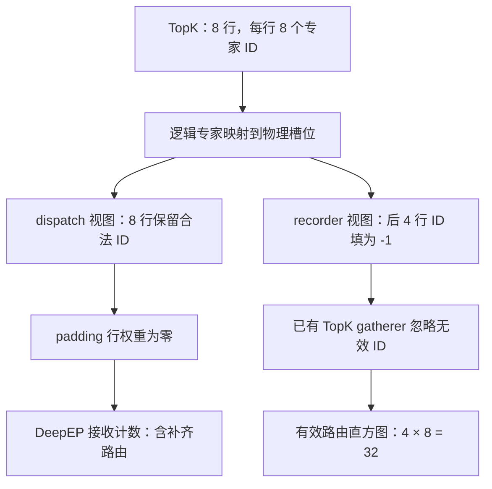

# DeepEP 收到了多少路由，不等于模型真正执行了多少有效路由

两张 Ascend 910C 逻辑设备，每张都收到了 64 条专家路由。只看 DeepEP 的接收计数，负载正好一半一半。但把图执行时补齐的行去掉，真实 token 的 64 条路由全部落在 rank 0，rank 1 是零。

这两个结果来自同一次通信。DeepEP 统计接收了多少条目，EPLB 要知道真实 token 选择了哪些专家。图 padding 进入 dispatch 以后，两种计数就可能分开。

标题里的“有效”，指真实 token 对专家的路由需求。padding 可以占用通信、缓冲区，甚至进入后续计算；它的路由权重被清零，也不会因此自动从接收计数中消失。把这些条目一起交给 EPLB，调度器看到的就混入了图执行为固定形状付出的开销。

这次我们沿着 SGLang 的 NPU TopK、DeepEP low-latency dispatch 和统计工厂走了一遍，又用真实两卡通信验证了差异。最后的改动落在统计来源的选择上：沿用已有的 TopK 计数器，让它读取屏蔽了 padding 的专家 ID。

## 一、一行 token，会变成多条专家路由

先把“token 数”和“路由数”分开。以 TopK 8 为例，一个真实 token 选择八个路由专家，就形成八条 token→expert 关系。四个真实 token 对应 32 条有效路由。这里数的是专家分配次数，不是请求数，也不是生成出来的 token 数。

Decode 使用图回放时，执行形状可能大于当前真实 token 数。例如，当前只有四个 token，实际采用的图桶却容纳八行。模型侧张量仍有八行，后四行用于补齐。TopK 的输出也按这个形状组织：每行八个专家 ID，以及八个对应的路由权重。

| 每卡的行 | 行数 | TopK 槽位数 | 是否属于真实 token |
| --- | ---: | ---: | --- |
| 有效区域 | 4 | 32 | 是 |
| padding 区域 | 4 | 32 | 否 |
| 分配的完整形状 | 8 | 64 | 包含两者 |

对这一步，应该交给 EPLB 的专家需求是 32 条。若 dispatch 保留完整八行的专家 ID，接收侧却可能数到 64 条。这个差额可以由 padding 产生，无须发生丢包、重复发送或路由算法错误。

本文讨论的正是这种有明确有效行边界的 NPU 路径。有效边界由 `num_token_non_padded` 提供，不能靠观察 hidden state 是否全零，也不能靠给路由权重设一个阈值来猜。真实 token 的路由权重大小，与它是不是 padding，是两件事。

## 二、把权重清零，为什么接收计数还在

NPU TopK 的后处理先把逻辑专家映射到物理专家，再返回 dispatch 使用的专家 ID 和权重。动态 EPLB 会调整专家放在哪张卡、哪个槽位，dispatch 最终需要的是这轮布局中的物理位置。

对 padding 行，这条路径保留合法的专家 ID，同时把路由权重清零。保留 ID 有实际的后端约束：把补齐行的路由全部改到专家 0，会把无效条目集中到同一个专家，触碰融合 dispatch 的每专家容量限制。相关处理见固定版本的 [NPU TopK 后处理](https://github.com/AkiYangDev/sglang/blob/9f037d735636e56efc2b2fb372900404bcbc3a25/python/sglang/srt/hardware_backend/npu/moe/topk.py)。

因此，dispatch 看到的 padding 行仍然长这样：

```text
专家 ID：  [0, 1, 2, 3, 32, 33, 34, 35]
路由权重：[0, 0, 0, 0,  0,  0,  0,  0]
```

ID 决定条目发往哪些专家；权重参与结果的加权合并。两者承担不同职责。路由权重为零，并不等价于向通信层发出“这条路由不存在”的指令。

接收侧的统计入口也能看出这种区别。SGLang 的 low-latency dispatcher 在接收完成后，把返回的每专家计数 `masked_m` 交给 `on_deepep_dispatch_low_latency`。接收计数器把它累加到当前层的统计中。这个计数器读取的是 dispatch 的结果，没有原始 token 的有效行边界。

如果 padding 的 ID 仍然进入 dispatch，接收侧就失去了仅凭数量把它们分离出来的信息。即使 combine 最终得到符合预期的输出，EPLB 的直方图也可能已经把 padding 记了进去。

所以，输出正确和统计语义正确需要分别验证。接收计数描述了本次通信交付的专家条目；有效路由计数描述了真实 token 的专家需求。它们还都不能直接换算成实际发送字节数或某个 kernel 的 FLOPs，后者还取决于打包、对齐、量化和执行实现。

## 三、同一份 TopK，给 dispatch 和 recorder 两个视图

修正统计，并不要求把 dispatch 使用的 ID 一起改掉。NPU TopK 已经为 recorder 准备了另一个视图：有效行保留物理专家 ID，padding 行填成 `-1`。

```python
# 摘录关键关系：routed_ids 已完成逻辑到物理专家映射。
recorder_ids = routed_ids
if num_token_non_padded is not None:
    rows = torch.arange(topk_ids.shape[0], device=topk_ids.device)
    recorder_ids = routed_ids.masked_fill(
        (rows >= num_token_non_padded)[:, None], -1
    )

recorder.on_select_experts(topk_ids=recorder_ids)
# 返回给 dispatch 的仍是原来的 topk_ids 和已处理的 topk_weights。
```

`masked_fill` 生成 recorder 使用的结果，dispatch 的专家 ID 保持自己的语义。对八行、四行有效的例子，两条路径可以画成这样：



已有的 `_SelectExpertsSinglePassGatherer` 正好能消费这个结果。在 NPU 路径上，它展开 TopK ID，只给合法范围内的物理专家累加一。`-1` 的累加贡献为零。这里虽然为了索引安全会把无效索引替换成 0，但同时加到专家 0 上的值也是零，不会把 padding 重新算给专家 0。

源端统计的是每个 rank 的真实 token 发起了多少次专家选择。后续继续使用社区已有的 accumulator：缓存统计窗口内的物理专家计数，按当前物理到逻辑专家映射合并副本，再跨 rank 求和，得到 planner 使用的逻辑专家负载。物理统计负责描述当前放置，逻辑统计负责描述专家需求；迁移后仍可按新的放置处理下一段窗口。

TopK 中的 shared slots 也不能混着数。该后处理先取出 routed 部分，再做映射和 recorder 统计；shared slots 按自己的路径保留。本文实验的 TopK 8 全部用于路由专家，所以可以直接用“有效行数 × 8”核对总数。

## 四、两卡实验：形状不变，有效行数改变

我们把问题缩到一个能逐元素检查的小实验。两张 Ascend 910C 逻辑设备，各自分配八行 hidden state；hidden size 为 7168，共 64 个专家，TopK 8。rank 0 持有前 32 个专家，rank 1 持有后 32 个。

第一组固定每行选择 `[0, 1, 2, 3, 32, 33, 34, 35]`，两端收到的条目天然对称。保持分配形状和专家 ID 不变，只把每 rank 的有效行数依次设成 8、4、0、2，并把其余行的权重置零。

有效 TopK 计数使用实际生产 gatherer 的 NPU 方法：捕获一次计数图，改变设备上的有效行数后回放。通信部分运行安装环境中的真实 DeepEP 默认 low-latency dispatch 和 combine，以 eager 方式执行。它们一起验证“计数图能随有效行数变化”和“通信接收了什么、合并结果是否正确”。

| 每 rank 有效行数 | 每 rank 分配行数 | 两 rank 接收总数 | 两 rank 有效 TopK 总数 |
| ---: | ---: | ---: | ---: |
| 8 | 8 | 128 | 128 |
| 4 | 8 | 128 | 64 |
| 0 | 8 | 128 | 0 |
| 2 | 8 | 128 | 32 |

满桶时两种口径完全一致：`2 × 8 × 8 = 128`。有效行减半后，真实路由降为 `2 × 4 × 8 = 64`，接收总数仍是 128。有效行变成零后差别最清楚：没有真实 token 的专家需求，dispatch 依然返回了 128 条接收记录。

同时，每个 case 的 combine 输出都做了精确比较。输入为全一张量，有效行的八个权重都是 `1/8`；实验把收到的 hidden state 直接交给 combine，期望有效行还原为全一、padding 行为全零。两 rank、两组布局共 16 条 rank-case 记录全部通过。

这项输出检查验证 dispatch/combine 的加权往返：中间把专家变换视为恒等映射，方便逐元素核对通信和合并。实际专家 MLP 的执行时间需要在模型 profiling 中单独观察；本次记录提供的是计数语义和加权往返的设备证据。

## 五、总数偏大，还会把倾斜看成均衡

第一组里，即使把接收总数从 64 误记成 128，两卡的相对负载仍然对称。单看这种例子，很容易觉得只是多乘了一个系数，归一化以后就没影响。

第二组专门检验这个判断。它让前四行的有效路由全部指向 rank 0 的专家，后四行补齐路由指向 rank 1。每个 rank 都只有四行真实 token，仍然各自分配八行。

| 统计口径 | rank 0 的专家收到的路由 | rank 1 的专家收到的路由 | 描述的状态 |
| --- | ---: | ---: | --- |
| DeepEP 接收计数 | 64 | 64 | 两端接收条目相同 |
| 有效 TopK 计数 | 64 | 0 | 真实专家需求全部落在 rank 0 |

这里的 `64/64` 是两个 rank 上所有本地专家的合计，不是“两个专家各 64 条”。逐专家的 64 维向量随实验数据保存，可以按前后 32 个槽位重新求和。

用两个 rank 的平均负载除以最大负载，接收口径得到 `64/64 = 1`；有效口径得到 `32/64 = 0.5`。这只是展示该 case 的算术差异，却足以说明 padding 会改变均衡度，而不只是抬高统计总量。

EPLB 要据此安排专家副本和位置。若它读取 `64/64`，就看不到这轮真实需求集中在 rank 0；读取 `64/0`，才有机会把热专家的副本或放置安排到另一端。是否真的迁移、迁移哪些专家，还由窗口、布局和 planner 决定，实验直接确认的是输入统计的差别。

反过来说，`64/64` 对排查 dispatch 本身仍有价值。两端确实接收了这些条目，通信开销也不会因 recorder 忽略 padding 自动消失。优化统计输入和减少 padding 的执行开销，是两个可以分别开展的工作。

## 六、选择 TopK 计数，不会把 low-latency 改成 normal

最后回到代码评审中最容易误解的那一行。在原来的 gatherer 工厂中，DeepEP `normal` 选择 TopK 统计，`low_latency` 选择接收侧统计。NPU 的有效 TopK 视图已经准备好了，但 low-latency 分支没有选择消费它的 gatherer。

这次把 NPU 的常规聚合统计接到已有 TopK gatherer：

```python
# 位于 DeepEP 的统计 gatherer 选择分支。
if get_platform().is_npu or get_exec().moe.deepep_mode == "normal":
    return _SelectExpertsSinglePassGatherer(metadata, rank)
elif get_exec().moe.deepep_mode == "low_latency":
    return _DeepepLowLatencySinglePassGatherer(metadata, rank)
```

这段条件选择“谁来提供统计”，没有选择“谁来发数据”。NPU 配 `low_latency`，仍执行 low-latency dispatch/combine；配 `auto`，通信模式仍由 dispatcher 在运行时选择。变化的是这些模式都能使用有效 TopK ID 生成 EPLB 的常规聚合统计。

工厂前面的 `per_token`、`stat_approx` 和其他后端分支保留各自的规则。GPU 原有的选择也保留。因此，不能把这处 NPU 适配读成“所有平台的接收计数都有错”，也不能把它读成“打开 EPLB 后强制走 normal 通信”。完整分支见 [`expert_distribution.py`](https://github.com/AkiYangDev/sglang/blob/9f037d735636e56efc2b2fb372900404bcbc3a25/python/sglang/srt/eplb/expert_distribution.py)。

这次没有另造一个 NPU recorder，也没有增加一套 planner。有效 ID 在 TopK 后处理里产生，现有 gatherer 负责直方图，现有 accumulator 负责窗口、映射和全局聚合。改动的目的，是让这条现成的数据链路接到正确的输入。

以后再看到“每个专家收到了多少 token”，先沿着这个数字找回计数点：它数的是源端有效选择，还是接收侧含 padding 的条目？每 rank 的真实行数是多少，图桶又是多少？在这些关系核对清楚之后，均衡度才对应我们准备优化的那份负载。

## 源码与实验记录

实验执行于 2026-10-31，统计实现来自 `950433a6fdb7c378c132f6cf38fba95d47e3f30e`；文中工厂代码链接固定到后续整理版本 `9f037d73`。环境为 PyTorch 2.10.0+cpu、torch_npu 2.10.0.post6、sgl-kernel-npu 2026.9.0、DeepEP `1.0.0+00db6cd6.cann.9.1.0.b243`。设备为 Ascend 910C，2 ranks，64 experts，TopK 8，hidden size 7168，每 rank 分配 8 行。

[完整实验记录](../../assets/deepep-received-vs-valid-routes/deepep-counts.json)包含每个 case 的逐专家接收向量、有效 TopK 向量、图回放与 combine 校验结果，以及原始材料校验值；[汇总 CSV](../../assets/deepep-received-vs-valid-routes/count-summary.csv)可直接重算表格。每个 rank 的回执都保存了同一份全局归约向量，读取时取一份即可，不能再把两个副本相加。已有公开证据也保存在[固定提交的数据目录](https://github.com/AkiYangDev/sglang/blob/b091064f791ab77afd47b9ffb2e8f49b58dd4c67/eplb-micro-20261031/deepep_counts.json)。
