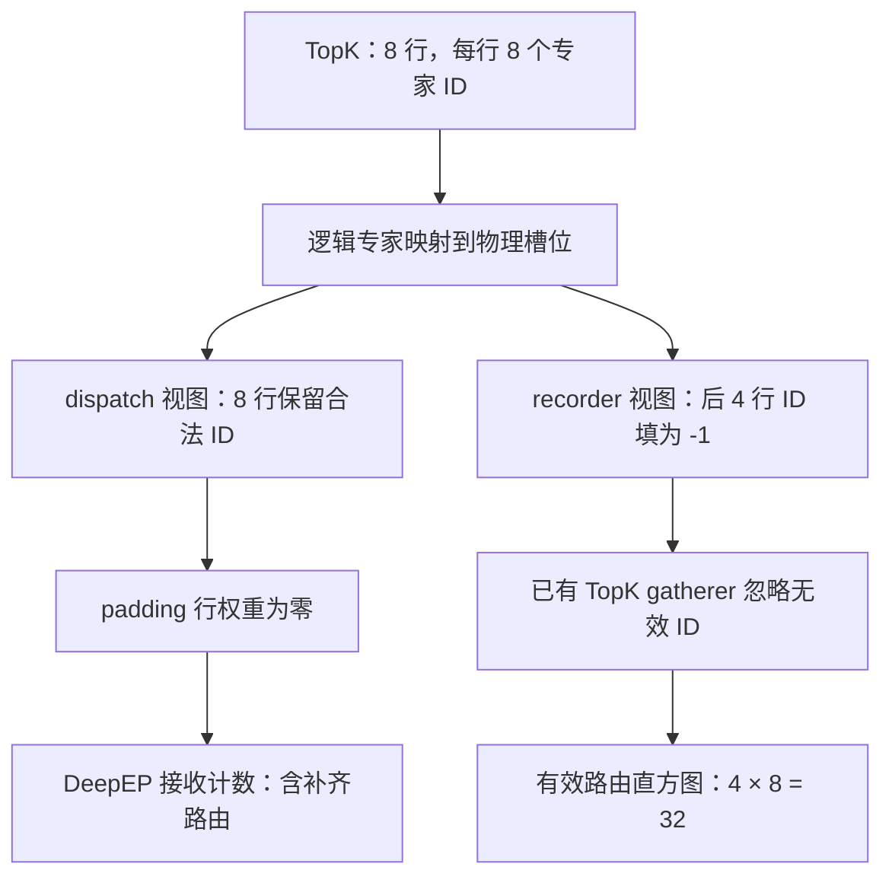

# DeepEP 收到了多少路由，不等于模型真正执行了多少有效路由

两个 Ascend 910C 逻辑设备各收到 64 条专家路由，DeepEP 的接收计数看起来完全均衡。但在同一次实验里，真实 token 的 64 条路由全部指向 rank 0，rank 1 一条也没有。

差别来自图 padding。DeepEP 数的是交付到接收端的条目，EPLB 规划要看真实 token 选择了哪些专家。补齐行也进入 dispatch 后，这两个数量就不再相等。

下文把真实 token 的专家需求称为“有效路由”。padding 即使路由权重为零，仍可能占通信和缓冲区，甚至继续参与计算；因此接收计数有它自己的用途，但直接拿去规划专家布局，会把固定图形状带来的条目也算作需求。

我们沿 NPU TopK、DeepEP low-latency dispatch 和统计工厂查到这两份计数的来源，再用真实双 rank 通信逐项比较。最后复用已有 TopK 计数器，让 recorder 读取屏蔽 padding 后的专家 ID。

## 一、一行 token，会变成多条专家路由

TopK 8 意味着一个真实 token 选择八个路由专家，形成八条 token→expert 关系。四个真实 token 就有 32 条有效路由。这里数的是专家分配次数，请求数和生成 token 数还在另一层。

Decode 图回放却可能为这四个 token 选一个八行的图桶。张量按八行分配，后四行是 padding；TopK 按完整形状执行，每行照样产生八个专家 ID 和八个路由权重。

| 每逻辑设备的行 | 行数 | TopK 槽位数 | 是否属于真实 token |
| --- | ---: | ---: | --- |
| 有效区域 | 4 | 32 | 是 |
| padding 区域 | 4 | 32 | 否 |
| 分配的完整形状 | 8 | 64 | 包含两者 |

所以本例的专家需求是 32 条，dispatch 若保留全部八行 ID，接收端可能数到 64 条。仅 padding 就足以解释差额，不必先假设丢包或重发。

这条 NPU 路径由 `num_token_non_padded` 明确提供有效行边界。全零 hidden state 不能替代这个边界，小路由权重也不代表 padding，真实 token 同样可能得到很小的权重。

## 二、把权重清零，为什么接收计数还在

TopK 后处理先把逻辑专家映射成物理专家，再把 ID、权重交给 dispatch。动态 EPLB 会改槽位和设备位置，dispatch 因而要使用当前布局对应的物理 ID。

padding 权重在这里清零，ID 却继续保持合法。若把所有补齐行都改指专家 0，无效条目会集中起来，可能超过融合 dispatch 的每专家容量限制，所以 [NPU TopK 后处理](https://github.com/AkiYangDev/sglang/blob/9f037d735636e56efc2b2fb372900404bcbc3a25/python/sglang/srt/hardware_backend/npu/moe/topk.py)保留了这些 ID。

dispatch 因而可能拿到这样的 padding 行：

```text
专家 ID：  [0, 1, 2, 3, 32, 33, 34, 35]
路由权重：[0, 0, 0, 0,  0,  0,  0,  0]
```

ID 决定往哪里发，权重决定结果怎样合并。权重为零并不等于通信层已经跳过这条路由。

接收完成后，low-latency dispatcher 将每专家计数 `masked_m` 交给 `on_deepep_dispatch_low_latency`，接收计数器再累加到当前层。这个入口只拿到 dispatch 返回值，没有原始 token 的有效行边界。

于是 padding ID 只要参与了 dispatch，单看接收条目就分不出它与真实 token。combine 输出仍然可能正确，EPLB 直方图却已经混入了 padding。

这也解释了为什么输出校验还不够。接收数说明交付了多少专家条目，有效数说明真实 token 的专家选择；若要继续换算通信字节或 kernel FLOPs，还需知道打包、对齐、量化和执行方式。

## 三、同一份 TopK，给 dispatch 和 recorder 两个视图

NPU TopK 其实已经给 recorder 准备了独立视图：有效行保留物理专家 ID，padding 行写成 `-1`。只需让计数器消费它，dispatch 就可以继续使用原 ID。

```python
# 摘录关键关系：routed_ids 已完成逻辑到物理专家映射。
recorder_ids = routed_ids
if num_token_non_padded is not None:
    rows = torch.arange(topk_ids.shape[0], device=topk_ids.device)
    recorder_ids = routed_ids.masked_fill(
        (rows >= num_token_non_padded)[:, None], -1
    )

recorder.on_select_experts(topk_ids=recorder_ids)
# 返回给 dispatch 的仍是原来的 topk_ids 和已处理的 topk_weights。
```

`masked_fill` 生成统计输入，没有原位改掉 dispatch 的 ID。八行中四行有效时，两份视图如下：



已有 `_SelectExpertsSinglePassGatherer` 能处理这个视图：NPU 方法展开 TopK ID，给合法物理专家加一，`-1` 贡献零。实现为了索引安全暂时把无效索引换成 0，但对应加值也是零，并未把 padding 转记给专家 0。

源 rank 先统计真实 token 的选择，accumulator 保存窗口内的物理专家计数，再按当前映射合并逻辑副本、跨 rank 求和。planner 最后拿到逻辑专家需求；迁移之后，下一段统计再按新放置解释物理槽位。

shared slots 另外处理：后处理先取 routed 部分，再映射、计数。本实验的 TopK 8 全是路由专家，因此可直接用“有效行数 × 8”核总数。

## 四、双逻辑设备实验：形状不变，有效行数改变

实验使用两个 Ascend 910C 逻辑设备，每设备分配八行、hidden size 7168，共 64 专家、TopK 8。前 32 个专家放 rank 0，后 32 个放 rank 1。

第一组让各行固定选择 `[0, 1, 2, 3, 32, 33, 34, 35]`，两端接收条目因此对称。形状和 ID 都不动，只把每 rank 的有效行数依次改为 8、4、0、2，其余行权重清零。

计数使用生产 gatherer 的真实 NPU 方法，捕获一次图，再修改设备上的有效行数回放。通信则用已安装 DeepEP 的默认 low-latency dispatch/combine，以 eager 执行。前者核对计数图能否跟随有效行数，后者核对接收条目与加权合并结果。

| 每 rank 有效行数 | 每 rank 分配行数 | 两 rank 接收总数 | 两 rank 有效 TopK 总数 |
| ---: | ---: | ---: | ---: |
| 8 | 8 | 128 | 128 |
| 4 | 8 | 128 | 64 |
| 0 | 8 | 128 | 0 |
| 2 | 8 | 128 | 32 |

八行全有效时，两种总数都是 `2 × 8 × 8 = 128`。有效行减半，TopK 统计变成 `2 × 4 × 8 = 64`，接收总数仍是 128。即使有效行降到零，dispatch 依然交付 128 条记录，尽管此时已无真实 token 需求。

每个 case 还逐元素检查 combine。hidden state 全一，有效行八个权重各为 `1/8`，接收值直接送回 combine；预期有效行恢复全一，padding 行为全零。两 rank、两组布局共 16 条 rank-case 记录均通过。

这里刻意把专家变换设成恒等映射，以便精确检查加权往返。它验证了计数语义和通信合并，没有测实际专家 MLP 的耗时。

## 五、总数偏大，还会把倾斜看成均衡

第一组始终对称，接收数从 64 放大成 128，比例也不变。要判断是否会掩盖倾斜，还得让真实需求与 padding 指向不同位置。

第二组仍为每 rank 八行、四行有效：前四行真实路由全部去 rank 0，后四行 padding 去 rank 1。结果如下：

| 统计口径 | rank 0 的专家收到的路由 | rank 1 的专家收到的路由 | 描述的状态 |
| --- | ---: | ---: | --- |
| DeepEP 接收计数 | 64 | 64 | 两端接收条目相同 |
| 有效 TopK 计数 | 64 | 0 | 真实专家需求全部落在 rank 0 |

`64/64` 是两个 rank 各自本地专家的合计，不是两个专家各有 64 条。原记录有完整 64 维向量，可以对前后 32 个槽位分别求和。

按 rank 平均负载除以最大负载，接收计数得到 `64/64 = 1`，有效计数却是 `32/64 = 0.5`。padding 改变了相对分布，把倾斜变成了看似均衡。

若把 `64/64` 交给 EPLB，planner 就看不到真实需求集中在 rank 0。`64/0` 才能提供这条信息，至于是否迁移、给谁加副本，仍由当前布局和统计窗口共同决定。本实验直接比较到的是规划输入。

排查通信时，`64/64` 仍应留下：两端确实收到了这些条目，recorder 忽略它们也不会消除通信成本。修正统计与减少 padding 执行开销，是后续两项不同的工作。

## 六、选择 TopK 计数，不会把 low-latency 改成 normal

原 gatherer 工厂给 DeepEP `normal` 选择 TopK 统计，给 `low_latency` 选择接收统计。NPU 虽已生成有效 ID 视图，low-latency 分支却没有接上能读取它的 gatherer。

修改于是落在工厂的 NPU 常规聚合统计分支：

```python
# 位于 DeepEP 的统计 gatherer 选择分支。
if get_platform().is_npu or get_exec().moe.deepep_mode == "normal":
    return _SelectExpertsSinglePassGatherer(metadata, rank)
elif get_exec().moe.deepep_mode == "low_latency":
    return _DeepepLowLatencySinglePassGatherer(metadata, rank)
```

这个条件只选统计来源。配置 `low_latency` 仍走 low-latency dispatch/combine，配置 `auto` 仍由 dispatcher 运行时选择通信模式；常规 EPLB 聚合则统一读取有效 TopK ID。

前面的 `per_token`、`stat_approx` 分支，以及其他后端、GPU 的规则照旧。具体条件可看 [`expert_distribution.py`](https://github.com/AkiYangDev/sglang/blob/9f037d735636e56efc2b2fb372900404bcbc3a25/python/sglang/srt/eplb/expert_distribution.py)，本次结果不能扩展成所有平台的接收统计都有问题。

TopK 后处理、gatherer、accumulator 已经分别具备屏蔽、计数、窗口映射与聚合能力。这次把它们接起来就能修正输入，无需再做一套 NPU recorder 或 planner。

以后再看专家均衡度，我会把计数位置、真实行数、图桶大小一起核对。否则，接收端“分得一样多”可能只说明 padding 恰好补齐了差额。

## 源码与实验记录

实验于 2026-10-31 执行，统计实现来自 `950433a6fdb7c378c132f6cf38fba95d47e3f30e`，工厂链接固定在后续整理版 `9f037d73`。环境为 PyTorch 2.10.0+cpu、torch_npu 2.10.0.post6、sgl-kernel-npu 2026.9.0、DeepEP `1.0.0+00db6cd6.cann.9.1.0.b243`。使用 Ascend 910C，2 ranks、64 experts、TopK 8、hidden size 7168，每 rank 分配 8 行。

[完整实验记录](../../assets/deepep-received-vs-valid-routes/deepep-counts.json)保留逐专家接收向量、有效 TopK 向量、图回放和 combine 校验结果、原材料校验值，[汇总 CSV](../../assets/deepep-received-vs-valid-routes/count-summary.csv)可重算各表。各 rank 回执都存了同一份全局归约向量，读取一份即可，不能把两个副本再相加。公开材料另存于[固定提交的数据目录](https://github.com/AkiYangDev/sglang/blob/b091064f791ab77afd47b9ffb2e8f49b58dd4c67/eplb-micro-20261031/deepep_counts.json)。
