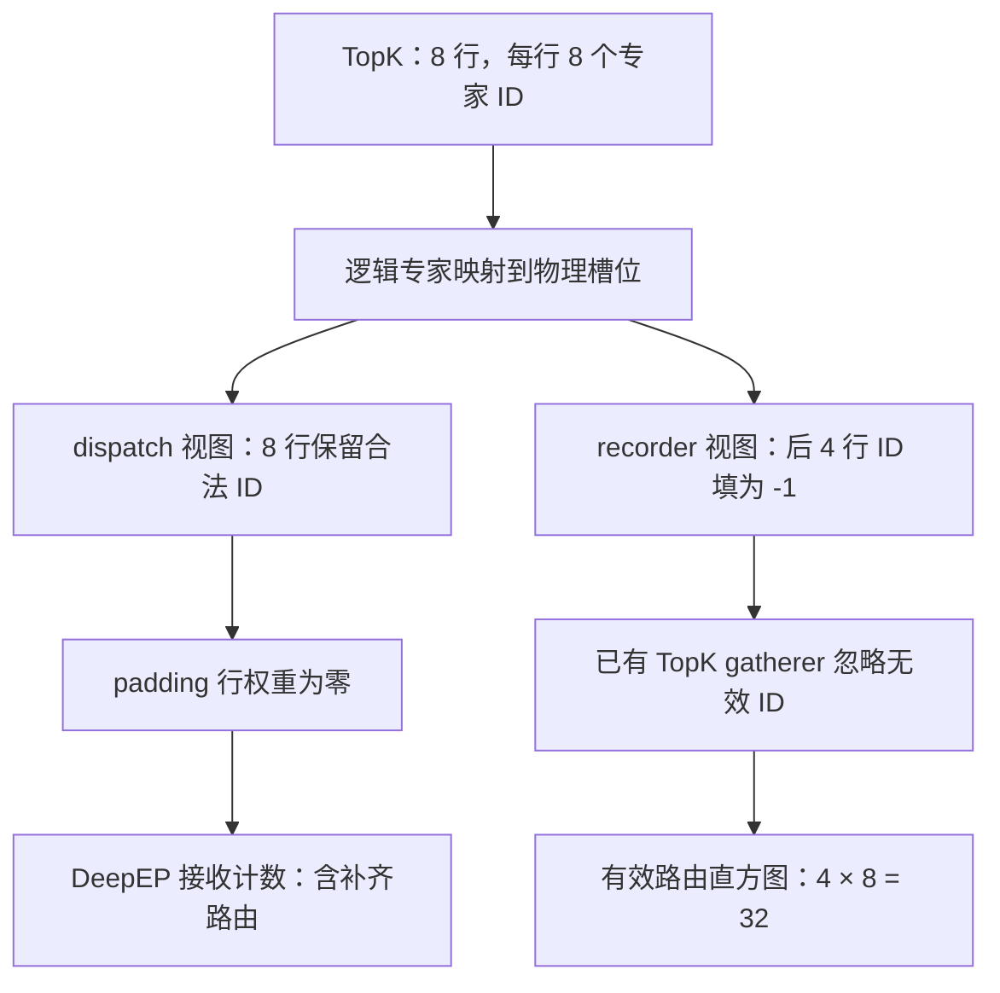

# DeepEP 收到了多少路由，不等于模型真正执行了多少有效路由

一次双逻辑设备实验中，两个 Ascend 910C 逻辑设备各收到 64 条专家路由，DeepEP 接收计数显示两端负载相同。核对图执行的有效行后，却得到另一组结果：真实 token 的 64 条路由全在 rank 0，rank 1 为零。

两组数字来自同一次通信，计数对象却不同。DeepEP 接收计数包含通信交付的条目；EPLB 规划需要的是实际 token 的专家选择。图 padding 进入 dispatch 后，接收条目便可能多于有效路由。

本文用“有效路由”表示真实 token 对专家的需求。padding 仍可能占用通信和缓冲区，甚至进入后续计算。即使它的路由权重已清零，接收计数也可能包含这些条目。若直接交给 EPLB，固定图形状引入的额外条目就会影响专家负载统计。

我们先沿 SGLang 的 NPU TopK、DeepEP low-latency dispatch 和统计工厂追踪计数来源，再用真实双 Rank 通信核对结果。修复使用已有的 TopK 计数器，读取为 recorder 屏蔽 padding 后的专家 ID，调整的是统计输入。

## 一、一行 token，会变成多条专家路由

TopK 8 表示一个真实 token 会选中八个路由专家，产生八条 token→expert 关系；四个真实 token 共对应 32 条有效路由。这是在数专家分配次数，不能与请求数或生成 token 数混用。

Decode 图回放的分配形状可能大于当前有效 token 数。例如当前有四个 token，却使用容纳八行的图桶，模型张量仍有八行，后四行为 padding。TopK 同样按完整形状返回，每行各有八个专家 ID 和八个路由权重。

| 每逻辑设备的行 | 行数 | TopK 槽位数 | 是否属于真实 token |
| --- | ---: | ---: | --- |
| 有效区域 | 4 | 32 | 是 |
| padding 区域 | 4 | 32 | 否 |
| 分配的完整形状 | 8 | 64 | 包含两者 |

在这个例子中，EPLB 应统计 32 条专家需求。如果 dispatch 保留八行的全部专家 ID，接收侧就可能数到 64 条。仅凭这项差额，无须假设丢包、重发或路由算法错误；padding 已足以产生它。

下面只讨论具有明确有效行边界的 NPU 路径，边界由 `num_token_non_padded` 提供。不能根据 hidden state 是否全零判断 padding，也不能用路由权重阈值替代有效行数，因为真实 token 也可能具有很小的路由权重。

## 二、把权重清零，为什么接收计数还在

NPU TopK 后处理先将逻辑专家映射到物理专家，再返回 dispatch 所用的 ID 与权重。动态 EPLB 会调整专家所在的设备和槽位，因此 dispatch 需要读取本轮布局对应的物理位置。

padding 行的权重在这条路径中被清零，专家 ID 则保留合法值。这与后端容量约束有关：如果把补齐行全改到专家 0，无效条目会集中到同一专家，可能触及融合 dispatch 的每专家容量限制。处理代码见固定版本的 [NPU TopK 后处理](https://github.com/AkiYangDev/sglang/blob/9f037d735636e56efc2b2fb372900404bcbc3a25/python/sglang/srt/hardware_backend/npu/moe/topk.py)。

因此，送给 dispatch 的 padding 行可以保持下面的形式：

```text
专家 ID：  [0, 1, 2, 3, 32, 33, 34, 35]
路由权重：[0, 0, 0, 0,  0,  0,  0,  0]
```

专家 ID 决定条目的目的地，权重则用于结果合并。将权重设为零，并没有告诉通信层跳过这条专家路由。

low-latency dispatcher 的统计入口反映了这一点。接收完成后，它将每专家计数 `masked_m` 传给 `on_deepep_dispatch_low_latency`，由接收计数器累加到当前层。这个入口只有 dispatch 的返回结果，没有原始 token 的有效行边界。

padding ID 一旦参与 dispatch，接收侧就无法仅凭条目数量区分它与真实 token。combine 输出可能仍然正确，而 EPLB 直方图已包含 padding。

因此，验证时既要检查输出，也要核对统计对象。接收计数能说明通信交付了多少专家条目，有效路由计数能说明真实 token 选择了哪些专家。两者都不足以直接推算发送字节数或 kernel FLOPs，还需考虑打包、对齐、量化和执行方式。

## 三、同一份 TopK，给 dispatch 和 recorder 两个视图

NPU TopK 已经准备了一份独立的 recorder 视图：有效行保留物理专家 ID，padding 行写为 `-1`。统计可以读取这份结果，而 dispatch 继续使用原 ID。

```python
# 摘录关键关系：routed_ids 已完成逻辑到物理专家映射。
recorder_ids = routed_ids
if num_token_non_padded is not None:
    rows = torch.arange(topk_ids.shape[0], device=topk_ids.device)
    recorder_ids = routed_ids.masked_fill(
        (rows >= num_token_non_padded)[:, None], -1
    )

recorder.on_select_experts(topk_ids=recorder_ids)
# 返回给 dispatch 的仍是原来的 topk_ids 和已处理的 topk_weights。
```

`masked_fill` 生成 recorder 的输入，不改变 dispatch 所用专家 ID。八行中只有四行有效时，两条路径分别如下：



现有 `_SelectExpertsSinglePassGatherer` 可以处理这份视图。在 NPU 上，它展开 TopK ID，对合法范围内的物理专家加一，`-1` 的贡献为零。实现为保证索引安全，会把无效索引临时替换成 0；对应累加值也为零，因此没有把 padding 算给专家 0。

源端先统计本 rank 真实 token 的专家选择。已有 accumulator 随后保存窗口内的物理专家计数，按当前物理到逻辑映射合并副本，再跨 rank 求和，供 planner 使用。这样既保留了当前放置的信息，也能汇总出逻辑专家需求；布局迁移后，下一段窗口按新放置继续统计。

shared slots 与 routed slots 也要区分。该后处理先取 routed 部分，再映射并统计，shared slots 继续走自身路径。本次 TopK 8 全部属于路由专家，所以总数可以直接按“有效行数 × 8”核对。

## 四、双逻辑设备实验：形状不变，有效行数改变

为了逐元素核对，我们使用两个 Ascend 910C 逻辑设备，每个设备分配八行 hidden state，hidden size 为 7168，共 64 个专家、TopK 8。前 32 个专家放在 rank 0，后 32 个放在 rank 1。

第一组让每行固定选择 `[0, 1, 2, 3, 32, 33, 34, 35]`，因此两端收到的条目对称。分配形状和专家 ID 不变，只依次将每 rank 的有效行数设为 8、4、0、2，并将其余行的权重置零。

计数使用生产 gatherer 的真实 NPU 方法：捕获一次计数图，再改变设备上的有效行数并回放。通信使用安装环境中的真实 DeepEP 默认 low-latency dispatch 和 combine，以 eager 方式执行。两部分分别检查计数图是否响应有效行数变化，以及接收条目和加权合并输出是否符合预期。

| 每 rank 有效行数 | 每 rank 分配行数 | 两 rank 接收总数 | 两 rank 有效 TopK 总数 |
| ---: | ---: | ---: | ---: |
| 8 | 8 | 128 | 128 |
| 4 | 8 | 128 | 64 |
| 0 | 8 | 128 | 0 |
| 2 | 8 | 128 | 32 |

满桶时，两种计数均为 `2 × 8 × 8 = 128`。有效行数减半后，TopK 计数降为 `2 × 4 × 8 = 64`，接收总数仍为 128。有效行数为零时，已没有真实 token 的专家需求，dispatch 却仍返回 128 条接收记录。

每个 case 还精确比较了 combine 输出。输入是全一张量，有效行的八个权重均为 `1/8`；收到的 hidden state 直接送入 combine，预期有效行恢复全一、padding 行输出全零。两 rank、两组布局共 16 条 rank-case 记录全部通过。

这个检查把专家变换设为恒等映射，以便逐元素验证 dispatch/combine 的加权往返。它提供了计数语义与通信合并的设备证据；实际专家 MLP 花多少时间，需要另看模型 profiling。

## 五、总数偏大，还会把倾斜看成均衡

第一组两个 Rank 始终对称，接收总数即使从 64 变成 128，归一化比例也不变。但这种对称情况不能说明 padding 总能按同一系数放大负载。

第二组保留每 rank 八行分配、四行有效，让前四行的真实路由全部指向 rank 0 专家，后四行 padding 路由指向 rank 1。这样可以检查有效需求与 padding 需求分布不同时，均衡度会怎样变化。

| 统计口径 | rank 0 的专家收到的路由 | rank 1 的专家收到的路由 | 描述的状态 |
| --- | ---: | ---: | --- |
| DeepEP 接收计数 | 64 | 64 | 两端接收条目相同 |
| 有效 TopK 计数 | 64 | 0 | 真实专家需求全部落在 rank 0 |

`64/64` 表示两个 rank 各自所有本地专家的合计。实验还保存了逐专家的 64 维向量，可分别对前后 32 个槽位求和；这里并非两个专家各收到 64 条。

用 rank 平均负载除以最大负载，接收计数给出 `64/64 = 1`，有效计数给出 `32/64 = 0.5`。这组算例中，padding 连相对分布也改变了，因此会让均衡度看起来更高。

EPLB 若读取 `64/64`，便看不到本轮真实需求集中在 rank 0。读取 `64/0` 后，planner 才能据此考虑调整热专家副本或位置。具体是否迁移、迁移哪些专家，还取决于窗口和当前布局；本实验直接确认的是规划输入存在差别。

排查通信时仍应保留 `64/64`：两端确实接收了这些条目，recorder 忽略 padding 也不会消除相应开销。修正统计之后，减少 padding 通信与执行开销仍是独立的优化工作。

## 六、选择 TopK 计数，不会把 low-latency 改成 normal

在原 gatherer 工厂中，DeepEP `normal` 选择 TopK 统计，`low_latency` 选择接收统计。NPU TopK 已生成有效 ID 视图，但 low-latency 分支没有使用能够消费它的 gatherer。

这次将 NPU 的常规聚合统计改接已有 TopK gatherer：

```python
# 位于 DeepEP 的统计 gatherer 选择分支。
if get_platform().is_npu or get_exec().moe.deepep_mode == "normal":
    return _SelectExpertsSinglePassGatherer(metadata, rank)
elif get_exec().moe.deepep_mode == "low_latency":
    return _DeepepLowLatencySinglePassGatherer(metadata, rank)
```

该条件只选择统计来源。NPU 配置 `low_latency` 时，仍执行 low-latency dispatch/combine；配置 `auto` 时，dispatcher 仍在运行时选择通信模式。上述模式的常规 EPLB 聚合统计，改为读取有效 TopK ID。

工厂前面的 `per_token`、`stat_approx`、其他后端分支以及 GPU 选择均保持原规则。结论应限于这处 NPU 适配：它既没有判定所有平台的接收统计错误，也没有强制 normal 通信。完整条件见 [`expert_distribution.py`](https://github.com/AkiYangDev/sglang/blob/9f037d735636e56efc2b2fb372900404bcbc3a25/python/sglang/srt/eplb/expert_distribution.py)。

修复复用了原有组件：TopK 后处理产生有效 ID，gatherer 生成直方图，accumulator 管理窗口、映射和全局聚合。无需增加 NPU recorder 或 planner，已有统计流程缺的是正确输入。

判断专家负载前，可以先核对计数位置和有效行数。源端有效选择与接收侧含 padding 条目适用于不同问题；每 rank 的真实行数和图桶大小，也应与计数同时保存。否则，一项看似均衡的接收结果，可能掩盖真实专家需求的倾斜。

## 源码与实验记录

实验执行于 2026-10-31，统计实现来自 `950433a6fdb7c378c132f6cf38fba95d47e3f30e`；文中工厂代码链接固定到后续整理版本 `9f037d73`。环境为 PyTorch 2.10.0+cpu、torch_npu 2.10.0.post6、sgl-kernel-npu 2026.9.0、DeepEP `1.0.0+00db6cd6.cann.9.1.0.b243`。设备为 Ascend 910C，2 ranks，64 experts，TopK 8，hidden size 7168，每 rank 分配 8 行。

[完整实验记录](../../assets/deepep-received-vs-valid-routes/deepep-counts.json)包含每个 case 的逐专家接收向量、有效 TopK 向量、图回放与 combine 校验结果，以及原始材料校验值；[汇总 CSV](../../assets/deepep-received-vs-valid-routes/count-summary.csv)可直接重算表格。每个 rank 的回执都保存了同一份全局归约向量，读取时取一份即可，不能再把两个副本相加。已有公开证据也保存在[固定提交的数据目录](https://github.com/AkiYangDev/sglang/blob/b091064f791ab77afd47b9ffb2e8f49b58dd4c67/eplb-micro-20261031/deepep_counts.json)。
