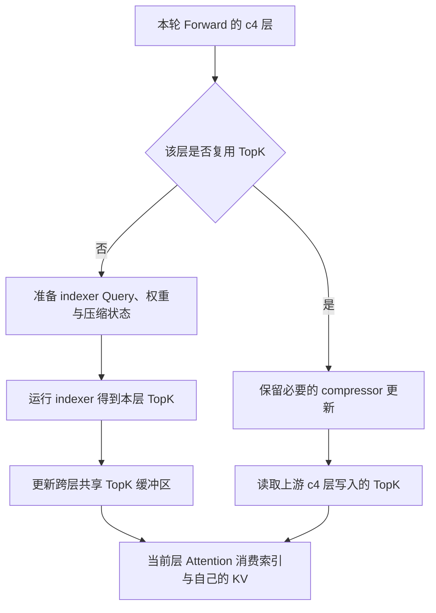

# DeepSeek-V4 IndexCache freq2：跨层 TopK 复用省了什么，又改变了什么

在 DeepSeek-V4-Flash、Ascend 910C 的一次配对中，我们同时将 P、D 的 IndexCache 从关闭改为 `freq2`，保持 N640、C64、3 req/s 和数据不变。native 每卡输出由 164.10 增至 172.99 tok/s，提高 5.41%，mean TPOT 从 18.9ms 降至 17.7ms；whole 吞吐提高 3.45%。每卡均以 P8+D8、16 张物理卡归一化。

这项候选减少了部分 c4 层的稀疏索引计算，改用前面层的历史位置选择。因而需要一起核对性能和行为：省去哪些计算，复用又改变了当前层原本独立作出的哪些选择。

实现来自 [Ascend/sglang PR #1332](https://github.com/Ascend/sglang/pull/1332)，本次绑定历史提交 `63bc1055c89aabcb62cb70f42032b8639053b94c` 及安装源一致性记录，没有采用该 PR 后来的更新。功能本身已有，本次完成启用、生效核查和同负载对照。

## 1. 先分清楚：这里缓存的是哪一种 TopK

MoE Router 选专家，稀疏 Attention indexer 选历史位置，Prefix Cache 复用请求前缀。IndexCache freq2 缓存的是第二种选择，需要与另两种机制区分。

本 NPU 实现中，压缩比为 4 的 c4 层会运行 indexer，返回 TopK 历史位置。它们经 `c4_topk_indices` 传递，再作为 Attention 的 `cmp_sparse_indices`，决定当前 Query 读取哪些压缩历史。完整寻址可对照[Attention 文章](../sglang/deepseek-v4-attention-source-analysis.md)。

共享的是索引清单。Attention 输出仍需计算，KV 仍按 `layer.layer_id` 读取当前层。复用层沿用前层选出的位置，在本层自己的历史表示上继续计算。

例如前层选出 `[7, 18, 39, …]`，后层直接使用这组位置，而它独立运行 indexer 时可能选出另一组。跳过选择节省工作，也改变计算行为，后面仍需验证质量。

这与请求缓存没有冲突。本轮 `cache0` 表示未通过前缀复用减少 Prefill，并不要求关闭模型内部跨层索引复用，因此不能据 cache0 排除 IndexCache 的作用。

## 2. freq2 按 c4 层计数，不按 Token 计数

[`csa_layer_skips_topk`](https://github.com/Ascend/sglang/blob/63bc1055c89aabcb62cb70f42032b8639053b94c/python/sglang/srt/configs/model_config.py#L391)先检查 `use_index_cache`，再判断 `compress_ratios[layer_id]` 是否为 4。只有符合条件的 c4 层参与调度。

核心计数 `indexer_seq_idx` 表示此前已有多少 c4 层。省略参数检查后，可用下面的等价示意说明，完整逻辑仍以源码为准：

```python
indexer_seq_idx = sum(r == 4 for r in compress_ratios[:layer_id])
skip_topk = indexer_seq_idx % index_topk_freq != 0
```

频率 2 将连续 c4 层两两分组，前层重新选择，后层复用。计数既不按 token，也不按 Transformer 原始层号的奇偶。

本模型有 21 个符合条件的 c4 层，原层号从 0 开始，其调度为：

| c4 序号 | 原始层号 | freq2 动作 | 使用的选择 |
| --- | --- | --- | --- |
| 0 | 2 | 重新计算 | 第 2 层自己的 TopK |
| 1 | 4 | 复用 | 第 2 层的 TopK |
| 2 | 6 | 重新计算 | 第 6 层自己的 TopK |
| 3 | 8 | 复用 | 第 6 层的 TopK |
| … | … | 按同一规则继续 | … |
| 20 | 42 | 重新计算 | 第 42 层自己的 TopK |

因此静态层序列中有 11 层计算、10 层复用。它只表示选择调用的分配，不代表整模型工作量减少 47.62%；实际调用还依赖分块、batch 与运行模式，其他模型计算照常存在。

若设置 `index_topk_pattern`，模式优先于频率：首字符须为 `F`，相应 `S` 位置复用，超出模式长度后恢复计算。所以设置 `index_topk_freq=2` 还需检查 pattern。本次未指定 pattern，走纯频率路径。

[C4Indexer 构造函数](https://github.com/Ascend/sglang/blob/63bc1055c89aabcb62cb70f42032b8639053b94c/python/sglang/srt/layers/attention/dsv4/indexer.py#L1204)排除了 MTP/NextN。上述 21 层属于主干，不能因为启用 DSpark，就把同一调度表也套到 Draft。

## 3. 沿一次 Forward 看：省掉选择，保留状态更新

[NPU forward_c4_indexer](https://github.com/Ascend/sglang/blob/63bc1055c89aabcb62cb70f42032b8639053b94c/python/sglang/srt/hardware_backend/npu/attention/ascend_dsv4_backend.py#L944)在需要重新选择的 c4 层准备 Query、权重与压缩状态，再调用 `_forward_indexer`。启用 IndexCache 时，将结果写入共享 `_index_cache_topk`。

后续复用层由 `_forward_prepare` 及多流版本检查 `skip_topk`，跳过 indexer Query、权重投影和相关缩放。随后不执行 `_forward_indexer`，直接将共享缓冲的对应切片交给 `forward_metadata.c4_topk_indices`。



但 compressor 仍有工作。`skip_compressor=False` 时，即使复用 TopK，分支也会调用 `c4_indexer.compressor(x, forward_batch)`，更新当前层的 indexer 压缩状态。

这些状态可能在后续 batch 或 forward 被读取。省去本轮索引选择，并不允许当前层历史停止更新；若连模块一起跳过，就会从索引复用变成状态缺失。

`skip_compressor=True` 则可能说明 CP full-metadata 已通过 `forward_indexer_compressor` 完成更新，避免这里重复。补丁允许它与 `skip_topk` 同时成立，是为了兼容前序已执行的状态操作。

入口只对 IDLE 提前返回，没有限于 Decode 或 Target Verify，Prefill/EXTEND 也可进入复用。具体 CP 协议和 token 量由运行配置决定。因此本功能不只属于 Decode，本次两端同时启用，结果也只能归于 P、D 联合设置。

## 4. Graph 下为什么还要管缓冲区的生命周期

Eager 下按需分配或扩容 `[num_tokens,index_topk]` 的 int32 缓冲，由重新选择的 c4 层写入，复用层读取。本次 `index_topk=512` 控制每行索引宽度，`freq2` 控制重新选择的层序，两项不能混用。

Graph 则要求稳定存储。补丁在图元数据初始化时，将 `_index_cache_topk` 绑定到 `c4_topk_indices` 的固定图缓冲切片，同时取消刷新时无条件填 `-1`。只更换 Python Tensor 引用并不能建立图内正确读写。

前层写出的结果必须保留到下游消费，不能提前清空。同样，也不能让下一批读取上一批选择：首个符合条件的 c4 层会重新计算，后续复用依赖本轮写入。

因此主要复用发生在一次 Forward 的 c4 层序列内。物理存储可以跨轮保留，内容有效性仍由当前顺序保证。批次大小、请求排列或图档位改变时，切片与刷新必须匹配，常驻 Tensor 不等于跨请求命中。

移植时需将层调度、前向和图元数据一起核对。复制 `skip_topk` 条件，却遗漏共享存储绑定，仍无法保证复用正确。

## 5. 同负载实测提高了多少，哪些指标没有一起变好

性能配对使用相同 DeepSeek-V4-Flash W8A8、真实 PD，P8+D8 共 16 张卡。正文 16384、Chat 输入 16388、输出 1024 token，缓存 0；各发 640 条，C64、3 req/s，草稿 3/验证 4 及其他约定配置一致，仅切换两端 IndexCache。

whole 覆盖全部正式请求，native 使用 AISBench 稳态选样，各有自己的请求和时间分母：

| 指标 | OFF native | freq2 native | OFF whole | freq2 whole |
| --- | ---: | ---: | ---: | ---: |
| 发送 / 纳入请求数 | 640 / 569 | 640 / 576 | 640 / 640 | 640 / 640 |
| 区间时长（s） | 221.913 | 213.104 | 278.622 | 269.333 |
| TTFT 平均（ms） | 5234.1 | 5412.7 | 5251.2 | 5460.6 |
| TPOT 平均（ms） | 18.9 | 17.7 | 18.9 | 17.8 |
| E2E 平均（s） | 24.6021 | 23.5485 | 24.6208 | 23.6867 |
| 系统输出吞吐（tok/s） | 2625.6091 | 2767.7697 | 2352.1481 | 2433.2707 |
| PD16 单卡输出（tok/s） | 164.1006 | 172.9856 | 147.0093 | 152.0794 |
| D8 单卡输出（tok/s） | 328.2011 | 345.9712 | 294.0185 | 304.1588 |
| AL（whole 计数代理） | 未采对应窗口 | 未采对应窗口 | 3.1367 | 3.1786 |
| 严格 Draft 接受率 | NOT_OBSERVED | NOT_OBSERVED | NOT_OBSERVED | NOT_OBSERVED |

两轮 whole 都是 640 成功、0 失败、缓存 0%。系统总吞吐与 D8 值由保存的 PD16 原值按卡数换算，更多原值及口径见[配套 CSV](../../assets/deepseek-v4-indexcache-freq2/matched-results.csv)。

native 尾部同样有得有失：TTFT P90 从 6419.9ms 升至 6559.1ms，TPOT P90 从 21.2ms 降至 20.0ms，ITL P90 从 72.4ms 降至 70.3ms。ITL 按流式事件间隔统计，未测量独立 Draft 或 Verify 阶段。

当前负载中，生成延迟和输出吞吐改善，TTFT 则未改善。native +5.41%、whole +3.45% 方向一致，但每臂只跑一次，native 选样也不同，尚不足以称为多次复现的通用收益。

whole AL 代理为 `655360 / 208933`、`655360 / 206180`，仅使用生成总数与 Verify 次数。没有逐请求严格 Draft 分母，不能以 `(AL-1)/gamma` 补实测接受率或 native AL；AL 略升也未验证精度。

TPOT 下降与减少 indexer 的机制相容，但未做 P-only、D-only 或隔离算子计时，无法量化两端各贡献多少。后续叠加其他优化的成绩，也不能全部归给 IndexCache。

## 6. 为什么少算近一半 indexer 层，只换来约 5% 吞吐

被省去的是部分 c4 选择。当前层 Attention、必要 compressor、Dense/MoE、通信、KV 传输和调度仍执行，计算层还会写新 TopK。因此不能把 10 个复用层理解为 10 个完整模型层都被跳过。

局部减少能否提高系统产出，还取决于关键路径。P 供给不足时，D 少做选择未必增加活跃请求；原本与别流重叠的工作减少后，也不会按累计算子时间直接增加吞吐。

freq4 等更高频率因此不能按 5.41% 线性外推。跨层距离扩大可能减少更多选择，也可能扩大质量差异，而性能会逐渐受其他阶段限制。下一档需同时看任务质量与实际耗时。

这次加载与两轮 MF 约 621.33s，64 条 typed route 约 335.21s，正式约 269.33s，全程约 1352.00s。它们是本环境的实际成本，不是固定流程；已有有效配对后，是否值得重复长测，应看结果会不会改变保留决定。

## 7. 配置可以很短，验收必须包含行为变化

P、D 当时传入以下模型覆盖片段，经已有覆盖入口合入启动参数，没有直接修改权重目录配置：

```json
{
  "use_index_cache": true,
  "index_topk_freq": 2
}
```

运行时核对最终 `json_model_override_args` 及日志 `c4_layers`、`skip_layers`、`skip_layer_ids`。本次为 21 个 c4、10 个复用层，原层号 `[4, 8, 12, 16, 20, 24, 28, 32, 36, 40]`。脚本出现 `freq2` 并不能单独证明模型按此执行。

基线应使用关闭状态。开启 freq1 虽不跳过选择，后端仍可能写共享缓冲，不一定等同 OFF。历史快照未设 `use_index_cache` 时默认为关闭；升级后需重查默认和 pattern。

质量验收更不能省略。复用替换了当前层本来独立选择的稀疏位置，权重与量化未变、HTTP 全成功都不足以证明输出等价。投机验证按当前 Target 正确执行，也未证明启用和关闭的 Target 相同。

本轮精度状态仍为 NOT_EVALUATED，只能保留为有性能依据的候选，不能称作无损。业务验收可固定权重、采样和输入，覆盖长上下文检索、答案正确性、可容忍差异，以及 Prefill、Verify、Graph 状态切换。这些是待做建议，本文未声称完成。

目前能确认的是：freq2 复用相邻 c4 层的历史位置，减少部分选择工作，本次 native 提高约 5.41%，compressor 更新和本层 Attention 继续执行。是否设为默认，还需补充质量对照。

## 源码与配套材料

- [Ascend/sglang PR #1332](https://github.com/Ascend/sglang/pull/1332)：公开功能入口；本文使用历史提交而非随后更新版本。
- [固定提交的 model_config.py](https://github.com/Ascend/sglang/blob/63bc1055c89aabcb62cb70f42032b8639053b94c/python/sglang/srt/configs/model_config.py)：c4 层调度与 pattern 优先级。
- [固定提交的 ascend_dsv4_backend.py](https://github.com/Ascend/sglang/blob/63bc1055c89aabcb62cb70f42032b8639053b94c/python/sglang/srt/hardware_backend/npu/attention/ascend_dsv4_backend.py)：准备路径、共享 TopK、Graph 存储与稀疏 Attention 消费。
- [固定提交的 indexer.py](https://github.com/Ascend/sglang/blob/63bc1055c89aabcb62cb70f42032b8639053b94c/python/sglang/srt/layers/attention/dsv4/indexer.py)：层级启用与 MTP/NextN 排除。
- [同负载原值与派生指标 CSV](../../assets/deepseek-v4-indexcache-freq2/matched-results.csv)、[调度与证据说明 JSON](../../assets/deepseek-v4-indexcache-freq2/evidence.json)：仅公开性能数字、源码标识与口径，不包含请求正文或内部部署信息。
- [调优总复盘](ascend-910c-inference-tuning-effective-optimizations-and-costs.md)、[负例与停止条件](ascend-910c-inference-tuning-negative-results-and-stop-rules.md)：把这项收益放回完整调优过程。

[返回性能分析](README.md)
