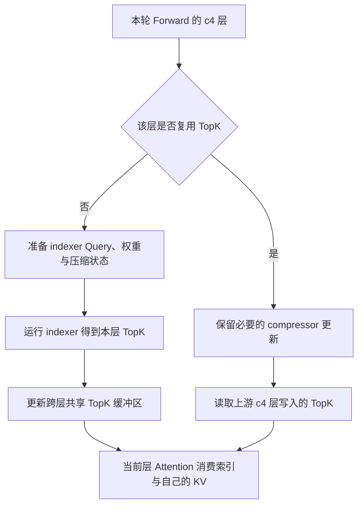

# DeepSeek-V4 IndexCache freq2：跨层 TopK 复用省了什么，又改变了什么

21 个 c4 层，freq2 让 11 层重新选 TopK、10 层复用。省掉的是这些层的索引选择，Attention、必要状态更新继续执行。本轮 DeepSeek-V4-Flash、Ascend 910C 配对，native 每卡 164.10→172.99 tok/s、约+5.41%，mean TPOT 18.9→17.7ms，whole 约+3.45%。

两端同时开启，固定 N640、C64、3 req/s 及数据，每卡除以 P8+D8 共 16 张物理卡。复用还改变当前层读取哪些历史，所以这篇一起追节省的工作、行为变化和未完成的质量验证。

实现为[Ascend/sglang PR #1332](https://github.com/Ascend/sglang/pull/1332)的历史提交`63bc1055c89aabcb62cb70f42032b8639053b94c`，已核安装源一致，没有采用后来更新。本次是启用、生效核查、同负载对照。

## 1. 先分清楚：这里缓存的是哪一种 TopK

MoE TopK 选专家，稀疏 Attention indexer 选历史，Prefix Cache 复用请求前缀。freq2 复用的是历史位置清单。

NPU c4 indexer在压缩比4的层选TopK，经`c4_topk_indices`传给Attention的`cmp_sparse_indices`，决定Query读取哪些压缩历史。寻址见[Attention 文章](../sglang/deepseek-v4-attention-source-analysis.md)。

位置清单共享，KV 仍按`layer.layer_id`取本层内容，Attention 也仍在本层计算。

前层若选`[7, 18, 39, …]`，后层沿用它。本层独立选择本可能得到另一组，这就是省计算时引入的行为变化。

本轮 cache 0 只规定没有前缀复用，模型内部跨层索引复用照常可以开启。

## 2. freq2 按 c4 层计数，不按 Token 计数

[`csa_layer_skips_topk`](https://github.com/Ascend/sglang/blob/63bc1055c89aabcb62cb70f42032b8639053b94c/python/sglang/srt/configs/model_config.py#L391)先检查`use_index_cache`，再筛`compress_ratios[layer_id] == 4`，调度只统计符合条件的c4层。

`indexer_seq_idx`数此前 c4 层，用下面的等价示意看计数：

```python
indexer_seq_idx = sum(r == 4 for r in compress_ratios[:layer_id])
skip_topk = indexer_seq_idx % index_topk_freq != 0
```

频率 2 把 c4 层两两分组，前一个选、后一个复用，与 Token 轮次、原 Transformer 层号奇偶都无关。

本模型 21 个 c4 层，原层号从 0 起，调度为：

| c4 序号 | 原始层号 | freq2 动作 | 使用的选择 |
| --- | --- | --- | --- |
| 0 | 2 | 重新计算 | 第 2 层自己的 TopK |
| 1 | 4 | 复用 | 第 2 层的 TopK |
| 2 | 6 | 重新计算 | 第 6 层自己的 TopK |
| 3 | 8 | 复用 | 第 6 层的 TopK |
| … | … | 按同一规则继续 | … |
| 20 | 42 | 重新计算 | 第 42 层自己的 TopK |

层序中 11 次选择、10 次复用。实际调用还随 chunk、batch、模式变化，更没有跳过 10 个完整模型层。

`index_topk_pattern`优先于频率，首字符要求 F，S 位置复用，超出 pattern 再计算。本次没设 pattern，使用纯 freq2。

[C4Indexer 构造函数](https://github.com/Ascend/sglang/blob/63bc1055c89aabcb62cb70f42032b8639053b94c/python/sglang/srt/layers/attention/dsv4/indexer.py#L1204)排除了MTP/NextN，21层属于主干，DSpark开启也不把同一表套给Draft。

## 3. 沿一次 Forward 看：省掉选择，保留状态更新

[NPU forward_c4_indexer](https://github.com/Ascend/sglang/blob/63bc1055c89aabcb62cb70f42032b8639053b94c/python/sglang/srt/hardware_backend/npu/attention/ascend_dsv4_backend.py#L944)在计算层准备Query、权重、压缩状态，运行`_forward_indexer`，再将结果写入共享`_index_cache_topk`。

复用层的`_forward_prepare`及多流路径检查`skip_topk`，省掉 indexer Query、权重投影、相关缩放及`_forward_indexer`，将共享切片交给`forward_metadata.c4_topk_indices`。



`skip_compressor=False`时，仍调用`c4_indexer.compressor(x, forward_batch)`，更新本层 indexer 压缩状态。

这些状态以后还会读取。少选一次历史，不意味着本层可以停止更新历史。

若`skip_compressor=True`，可能是 CP full-metadata 早已经`forward_indexer_compressor`更新，补丁让它与`skip_topk`兼容，避免重复处理。

入口仅对 IDLE 早退，Prefill/EXTEND 同样可复用，具体 CP 与 Token 量取决于配置。因此这轮 P、D 联合开启，只能得到联合收益。

## 4. Graph 下为什么还要管缓冲区的生命周期

Eager 按需分配、扩容`[num_tokens,index_topk]` int32 buffer。本次`index_topk=512`规定每行位置数，freq2 规定哪些层重新选择。

Graph 在 metadata 初始化时，将`_index_cache_topk`绑到固定`c4_topk_indices`切片，并取消刷新时无条件填`-1`，让图内写入、读取共享稳定地址。

上游写后，下游读取前，结果不能清空；下一批也不能直接读取旧内容。首个 c4 层重新计算，后续依赖本轮写入。

因此复用主要在一次 Forward 的层序中发生。存储可以常驻，内容随当前批次刷新，batch、请求排列、Graph 档位改变时切片也要对应。

移植需要一起核层调度、forward、Graph 存储绑定，单独复制`skip_topk`还没有接完整条读写链。

## 5. 同负载实测提高了多少，哪些指标没有一起变好

性能配对为相同 Flash W8A8、真实 PD16 卡，正文 16384/Chat 16388、输出 1024、cache 0；N640/C64/r3，草稿 3/Verify 4 及其余配置匹配，只切两端 IndexCache。

whole 统计正式全部请求，native 由 AISBench 选择各自请求、时间：

| 指标 | OFF native | freq2 native | OFF whole | freq2 whole |
| --- | ---: | ---: | ---: | ---: |
| 发送 / 纳入请求数 | 640 / 569 | 640 / 576 | 640 / 640 | 640 / 640 |
| 区间时长（s） | 221.913 | 213.104 | 278.622 | 269.333 |
| TTFT 平均（ms） | 5234.1 | 5412.7 | 5251.2 | 5460.6 |
| TPOT 平均（ms） | 18.9 | 17.7 | 18.9 | 17.8 |
| E2E 平均（s） | 24.6021 | 23.5485 | 24.6208 | 23.6867 |
| 系统输出吞吐（tok/s） | 2625.6091 | 2767.7697 | 2352.1481 | 2433.2707 |
| PD16 单卡输出（tok/s） | 164.1006 | 172.9856 | 147.0093 | 152.0794 |
| D8 单卡输出（tok/s） | 328.2011 | 345.9712 | 294.0185 | 304.1588 |
| AL（whole 计数代理） | 未采对应窗口 | 未采对应窗口 | 3.1367 | 3.1786 |
| 严格 Draft 接受率 | NOT_OBSERVED | NOT_OBSERVED | NOT_OBSERVED | NOT_OBSERVED |

whole均640成功、0失败、cache0%。系统总量、D8归一值由PD16原值换算，见[配套 CSV](../../assets/deepseek-v4-indexcache-freq2/matched-results.csv)。

native TTFT P90 反而 6419.9→6559.1ms；TPOT P90 为 21.2→20.0ms，ITL P90 为 72.4→70.3ms。ITL 来自流式事件，没有独立 Draft/Verify 阶段计时。

本负载生成延迟、吞吐改善，TTFT 没有。两窗口吞吐方向相同，每臂却只有一次、native 样本不同，通用收益还需更多证据。

whole AL 代理用`655360 / 208933`、`655360 / 206180`，分母 Verify 次数。实际 Draft 严格分母缺失，`(AL-1)/gamma`无法补实测或 native AL。

结果与减少 indexer 工作的机制相符，缺 P-only、D-only、隔离计时，无法拆贡献。后续叠加配置的成绩也不能全算给它。

## 6. 为什么少算近一半 indexer 层，只换来约 5% 吞吐

复用省 c4 选择，当前层 Attention、必要 compressor、Dense/MoE、通信、KV 交接、调度继续运行，计算层还要写新 TopK。

减少的工作还要位于关键路径。P 供给不足，D 少算未必多出活跃请求；原本已与其他流重叠的工作，减掉也不直接增加同等吞吐。

因此 freq4 不宜按 5.41% 线性外推。更远跨层可能扩大质量差异，其他阶段也会逐渐限制速度，下一档要同时测质量、耗时。

本环境加载及两轮 MF 约 621.33s，64 条 typed route 约 335.21s，正式 269.33s，全程 1352.00s。已有有效配对后，重复长测是否值得，取决于结果会不会改变保留决定。

## 7. 配置可以很短，验收必须包含行为变化

P、D 将以下覆盖片段经已有入口合入启动，没有直接改权重目录：

```json
{
  "use_index_cache": true,
  "index_topk_freq": 2
}
```

最终`json_model_override_args`、日志`c4_layers`、`skip_layers`、`skip_layer_ids`用于核生效。本次 21 层、10 复用，原层号`[4, 8, 12, 16, 20, 24, 28, 32, 36, 40]`。

基线使用 OFF。freq1 虽不跳选择，仍可能写共享缓冲，执行未必等同 OFF。历史快照缺`use_index_cache`时默认关，升级还需核默认、pattern。

同权重、量化、HTTP 全成功，仍不证明两个 Target 等价：当前层的稀疏位置已经替换。投机 Verify 正确执行，也只对当前 Target 负责。

质量仍为 NOT_EVALUATED，本次只能保留性能候选。后续可固定权重、采样、数据，覆盖长上下文检索、答案、容忍差异和 Prefill/Verify/Graph 切换，尚未完成这些验收。

当前确认 freq2 少做部分 c4 选择，必要状态更新、本层 Attention 保留。是否成为默认配置，下一项要补的是质量对照。

## 源码与配套材料

- [Ascend/sglang PR #1332](https://github.com/Ascend/sglang/pull/1332)：公开功能入口；本文使用历史提交而非随后更新版本。
- [固定提交的 model_config.py](https://github.com/Ascend/sglang/blob/63bc1055c89aabcb62cb70f42032b8639053b94c/python/sglang/srt/configs/model_config.py)：c4 层调度与 pattern 优先级。
- [固定提交的 ascend_dsv4_backend.py](https://github.com/Ascend/sglang/blob/63bc1055c89aabcb62cb70f42032b8639053b94c/python/sglang/srt/hardware_backend/npu/attention/ascend_dsv4_backend.py)：准备路径、共享 TopK、Graph 存储与稀疏 Attention 消费。
- [固定提交的 indexer.py](https://github.com/Ascend/sglang/blob/63bc1055c89aabcb62cb70f42032b8639053b94c/python/sglang/srt/layers/attention/dsv4/indexer.py)：层级启用与 MTP/NextN 排除。
- [同负载原值与派生指标 CSV](../../assets/deepseek-v4-indexcache-freq2/matched-results.csv)、[调度与证据说明 JSON](../../assets/deepseek-v4-indexcache-freq2/evidence.json)：仅公开性能数字、源码标识与口径，不包含请求正文或内部部署信息。
- [调优总复盘](ascend-910c-inference-tuning-effective-optimizations-and-costs.md)、[负例与停止条件](ascend-910c-inference-tuning-negative-results-and-stop-rules.md)：把这项收益放回完整调优过程。

[返回性能分析](README.md)
