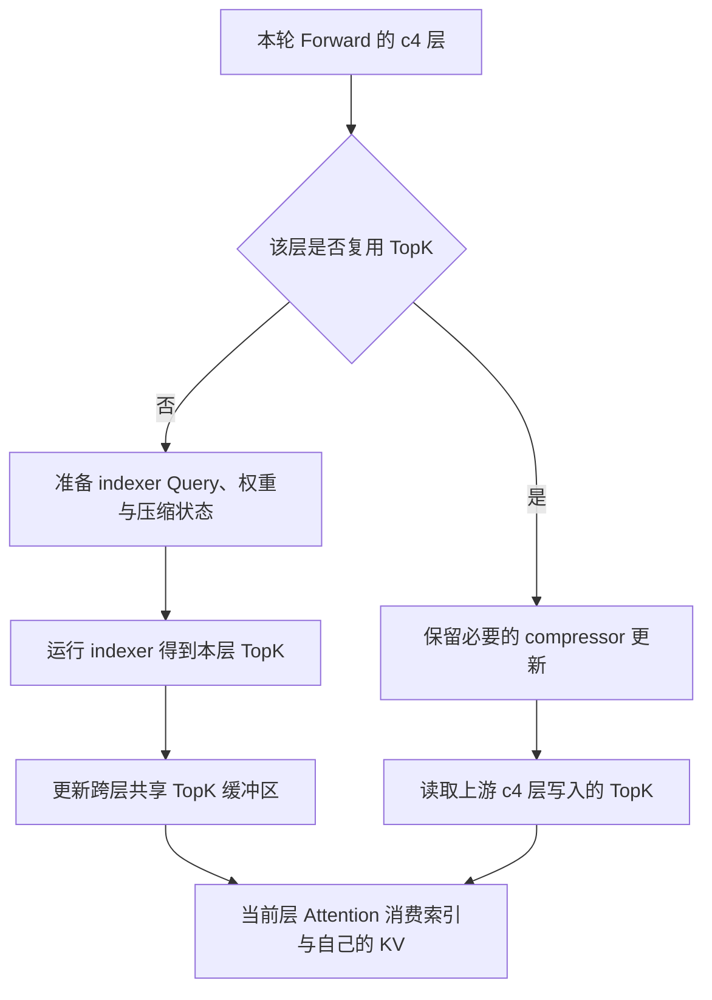

# DeepSeek-V4 IndexCache freq2：跨层 TopK 复用省了什么，又改变了什么

在一次 DeepSeek-V4-Flash / Ascend 910C 调优中，我们把 P、D 两端的 IndexCache 从关闭改为 `freq2`，保持 N640、C64、3 req/s 和原数据不变。AISBench native 区间的单卡输出吞吐从 **164.10 提高到 172.99 tok/s**，增幅 **5.41%**；mean TPOT 从 18.9ms 降到 17.7ms。完整请求区间的吞吐也提高了 3.45%。这里的单卡按 P8+D8 共 16 张物理卡计算。

这组收益值得保留，但需要先理解它的来源。IndexCache 跳过了部分层本来会重新计算的稀疏 Attention 索引，转而沿用上游层的选择。因此，解释这次优化要同时回答两个问题：哪些工作确实少做了，以及模型的计算行为发生了什么变化。

本文沿实际使用的源码快照展开。对应公开实现是 [Ascend/sglang PR #1332](https://github.com/Ascend/sglang/pull/1332)，实验绑定的是该 PR 的历史提交 `63bc1055c89aabcb62cb70f42032b8639053b94c`，不是其后续更新版本。以下源码结论以这个快照及当时安装源的一致性记录为准。这项能力来自已有实现；本次工作的重点是启用、核对生效路径并完成同负载对照。

## 1. 先分清楚：这里缓存的是哪一种 TopK

DeepSeek-V4 的推理路径里有几种容易混淆的“选择”。MoE Router 选择执行哪些专家，稀疏 Attention 的 indexer 选择读取哪些历史位置，Prefix Cache 则复用已算过的请求前缀。IndexCache freq2 作用于第二种选择。

在本文对应的 NPU 实现中，压缩比为 4 的 c4 层会运行 indexer，得到 TopK 历史位置索引，交给后续稀疏 Attention。可以把一次选择想成“当前这个 Query 值得看哪些压缩历史位置”。后端通过 `c4_topk_indices` 传递这些位置，Attention 消费它们作为 `cmp_sparse_indices`。理解完整寻址路径可以先读 [DeepSeek-V4 Attention：Query、缓存写入与历史寻址](../sglang/deepseek-v4-attention-source-analysis.md)。

IndexCache 保存的是这份位置清单。它不保存最终 Attention 输出，也没有把一层的 KV 值搬给另一层使用。源码里的压缩 KV 仍按 `layer.layer_id` 取出；复用层把上游选出的“位置”用于当前层自己的历史表示，然后继续执行当前层 Attention。

例如，上游 c4 层认为位置 `[7, 18, 39, …]` 重要，下游复用层直接采用这组位置。下游若独立运行 indexer，原本可能选出另一组位置。这就是性能机会，也是后面必须讨论精度边界的原因。

所以，这轮实验的请求前缀命中率仍然可以为 0。`cache0` 说明没有通过请求前缀复用减少 Prefill；它并不要求关闭模型内部的跨层索引复用。将两种缓存混在一起，会误判收益来源。

## 2. freq2 按 c4 层计数，不按 Token 计数

调度规则位于 [`csa_layer_skips_topk`](https://github.com/Ascend/sglang/blob/63bc1055c89aabcb62cb70f42032b8639053b94c/python/sglang/srt/configs/model_config.py#L391)。它先检查 `use_index_cache`，再检查当前层的 `compress_ratios[layer_id]` 是否等于 4。只有满足条件的层，才进入复用调度。

决定 `freq2` 行为的核心变量是 `indexer_seq_idx`：当前层之前有多少个 c4 层。下面是省略参数检查后的等价调度示意，不能替代完整实现：

```python
indexer_seq_idx = sum(r == 4 for r in compress_ratios[:layer_id])
skip_topk = indexer_seq_idx % index_topk_freq != 0
```

当频率为 2 时，每两个 c4 层组成一组：前一个重新选择，后一个复用。因此，“每两个 Token 更新一次索引”和“Transformer 原始层号逢偶数就跳过”都不符合这里的实现。

本次模型共有 21 个符合条件的 c4 层，原始层号从 0 开始计数。生效调度如下：

| c4 序号 | 原始层号 | freq2 动作 | 使用的选择 |
| --- | --- | --- | --- |
| 0 | 2 | 重新计算 | 第 2 层自己的 TopK |
| 1 | 4 | 复用 | 第 2 层的 TopK |
| 2 | 6 | 重新计算 | 第 6 层自己的 TopK |
| 3 | 8 | 复用 | 第 6 层的 TopK |
| … | … | 按同一规则继续 | … |
| 20 | 42 | 重新计算 | 第 42 层自己的 TopK |

最终是 **11 个 c4 层计算、10 个 c4 层复用**。这个数字表示静态层访问中的选择次数，不能直接翻译成模型计算量减少 47.62%。实际调用还受 Prefill 分块、批次和运行模式影响，模型也有大量不属于 indexer 的计算。

实现还支持 `index_topk_pattern`：模式字符串存在时，它优先于频率，首字符必须是 `F`，相应位置的 `S` 表示复用，超出字符串的层恢复计算。因此配置里即使写了 `index_topk_freq=2`，也要确认没有另一个 pattern 改变调度。本次使用的是无显式 pattern 的频率路径。

另一条重要边界在 [C4Indexer 构造函数](https://github.com/Ascend/sglang/blob/63bc1055c89aabcb62cb70f42032b8639053b94c/python/sglang/srt/layers/attention/dsv4/indexer.py#L1204)：MTP/NextN 层被排除。不能因为服务使用 DSpark，就推断 Target 和 Draft 都按相同层表跳过计算。这里的 21 层统计针对符合条件的模型主干 c4 层。

## 3. 沿一次 Forward 看：省掉选择，保留状态更新

真正决定收益范围的是 [NPU 后端的 `forward_c4_indexer`](https://github.com/Ascend/sglang/blob/63bc1055c89aabcb62cb70f42032b8639053b94c/python/sglang/srt/hardware_backend/npu/attention/ascend_dsv4_backend.py#L944)。普通层先准备 indexer 所需的 Query、权重和压缩状态，再执行 `_forward_indexer`；启用 IndexCache 后，结果会写入跨层共享缓冲区 `_index_cache_topk`。

到下一个需要复用的 c4 层，路径发生分叉。`_forward_prepare` 和多流版本都检查 `skip_topk`，直接省掉供 indexer 使用的 Query 计算、权重投影及相关缩放；随后不再运行 `_forward_indexer`，而是把共享缓冲区的当前切片放到 `forward_metadata.c4_topk_indices`。



这里最容易被“跳过 indexer”一句话掩盖的是 compressor。源码并没有允许复用层把它一并取消：若 `skip_compressor=False`，复用分支仍调用 `c4_indexer.compressor(x, forward_batch)`，完成当前层所需的 indexer 压缩状态更新。

为什么还要维护这份状态？因为后续批次或后续 Forward 可能需要读取当前层的历史；本轮省掉一次选择，并不意味着当前层历史可以停止前进。把“暂时不算 TopK”误改成“整个模块什么都不做”，会把局部复用变成状态缺失。

`skip_compressor=True` 有另一种来源：CP full-metadata 路径可能已经通过 `forward_indexer_compressor` 执行过 compressor，此处应避免重复执行。历史补丁允许 `skip_topk` 与 `skip_compressor` 同时存在，正是为了兼容这个先后关系。它表达的是“状态已在前面更新”，不能理解成“复用层不需要更新状态”。

这条路径也解释了为什么不能把 IndexCache 限定为 Decode 优化。实际调用链从模型的 indexer 进入后端，入口只对 IDLE 提前返回，没有把功能限制在 Decode 或 Target Verify。Prefill/EXTEND 同样可以到达复用分支；是否进入 CP 协议、一次处理多少 Token，则由相应运行配置决定。本轮 P、D 同时开启，因此最终收益也不能只归给 D。

## 4. Graph 下为什么还要管缓冲区的生命周期

跨层复用需要一份共享存储，缓存的生存范围也必须说清。在 eager 路径中，后端按需要分配或扩容 `[num_tokens, index_topk]` 的 int32 缓冲区，普通计算层写入，后面的复用层读取。本次 `index_topk` 为 512，它控制每行索引的宽度；`freq2` 控制哪些层重新计算，两者是不同维度。

Graph 路径不能只把 Python 属性重新指向任意新 Tensor。补丁在图元数据初始化时，把 `_index_cache_topk` 绑定到稳定的 `c4_topk_indices` 图缓冲切片，相关算子才能按图中的存储关系读写。图元数据刷新处也不再无条件把这份共享索引填成 `-1`。

这处变化的重点是写入和读取之间的关系。如果刚写好的索引在下游消费前被重置，复用层读到的就不是前面选择的结果。反过来，保留存储也不意味着可以把上一批的选择直接拿给下一批：调度保证首个符合条件的 c4 层重新计算，后续复用依赖本轮上游写入。

因此，IndexCache 的主要复用范围是**一次 Forward 内的 c4 层序列**。物理缓冲区可以跨次存在，内容的有效性却来自当前 Forward 的计算顺序。批次行数、请求排列和图档位变化时，正确的切片与刷新关系必须继续成立。仅看到一个常驻 Tensor，不能推导出“跨请求缓存命中”。

这也是移植该能力时应一起核对层调度、前向路径和 Graph 元数据的原因。只复制 `skip_topk` 的条件表达式，会漏掉真正承载数据的存储关系。

## 5. 同负载实测提高了多少，哪些指标没有一起变好

这轮对照使用 DeepSeek-V4-Flash W8A8、真实 PD 分离，P8+D8 共 16 张物理卡。正文 16384 Token，实际 Chat 输入 16388 Token，固定输出 1024 Token；请求前缀命中率为 0。双方都发送 640 条请求，C64、到达速率 3 req/s，保持草稿 3 个、验证宽度 4 的投机配置及其他约定参数不变，只切换 P、D 的 IndexCache 设置。

native 是 AISBench 所选稳定区间，whole 是全部正式请求区间。两者各保留自己的分母；不能拿其中更好的数字替代另一种区间。

| 指标 | OFF native | freq2 native | OFF whole | freq2 whole |
| --- | ---: | ---: | ---: | ---: |
| 发送 / 纳入请求数 | 640 / 569 | 640 / 576 | 640 / 640 | 640 / 640 |
| 区间时长（s） | 221.913 | 213.104 | 278.622 | 269.333 |
| TTFT 平均（ms） | 5234.1 | 5412.7 | 5251.2 | 5460.6 |
| TPOT 平均（ms） | 18.9 | 17.7 | 18.9 | 17.8 |
| E2E 平均（s） | 24.6021 | 23.5485 | 24.6208 | 23.6867 |
| 系统输出吞吐（tok/s） | 2625.6091 | 2767.7697 | 2352.1481 | 2433.2707 |
| PD16 单卡输出（tok/s） | 164.1006 | 172.9856 | 147.0093 | 152.0794 |
| D8 单卡输出（tok/s） | 328.2011 | 345.9712 | 294.0185 | 304.1588 |
| AL（whole 计数代理） | 未采对应窗口 | 未采对应窗口 | 3.1367 | 3.1786 |
| 严格 Draft 接受率 | NOT_OBSERVED | NOT_OBSERVED | NOT_OBSERVED | NOT_OBSERVED |

whole 两轮均为 640 成功、0 失败、前缀缓存命中率 0%。表中 whole 系统吞吐及 D8 数值由保存的 PD16 原值乘相应卡数得到；[配套 CSV](../../assets/deepseek-v4-indexcache-freq2/matched-results.csv)保留更多原值与计算口径。

尾部时延也能帮助理解变化：native TTFT P90 从 6419.9ms 增至 6559.1ms，TPOT P90 从 21.2ms 降至 20.0ms，ITL P90 从 72.4ms 降至 70.3ms。ITL 是流式到达间隔，不能用它替代 TPOT，也不能把它当成 Draft 或 Verify 的阶段耗时。

这组数据支持的判断是：在这套负载下，开启 freq2 后，输出吞吐和生成阶段时延改善，TTFT 没有同步改善。native 提升 5.41%，whole 提升 3.45%，两个区间方向一致；但它们仍来自各一次对照，native 纳入的请求集合也不同，不能写成多次复现的普遍收益。

接受指标还有额外限制。whole AL 代理分别来自 `655360 / 208933` 和 `655360 / 206180`，即保存的生成 Token 总计数与 Verify 调用计数之比。它没有提供逐请求严格 Draft 分母，不能通过 `(AL-1)/gamma` 换算成实测接受率，更不能凭 AL 略升就宣布精度改善。本文不据此重建 native AL。

P、D 同时切换也意味着归因只能停在这项联合设置。端到端 TPOT 下降与减少 indexer 工作的机制相符，但本轮没有独立 P-only、D-only 对照，也没有隔离的算子耗时，无法给出“收益有多少来自 P”的百分比。后续多个优化叠加后取得的更高成绩，不能全部记到 IndexCache 账上。

## 6. 为什么少算近一半 indexer 层，只换来约 5% 吞吐

首先，被跳过的是一部分 c4 层的选择工作。当前层的 Attention、必要 compressor 更新、Dense/MoE 计算、通信、KV 传输和调度仍然存在；计算层还需要把新 TopK 写入共享缓冲区。没有一条源码路径支持“跳过 indexer 就跳过了这一层”。

其次，局部工作减少能否转化为系统吞吐，取决于它是否处在当时的关键路径。P 供给不足时，D 少做一些选择并不自动增加可生成的请求数；如果减少的工作原本与其他流重叠，收益也不会等于那段算子时间。本文没有用局部跳过次数反推端到端时间。

因此，freq4 或更高频率也不能沿 5.41% 线性外推。更多复用层意味着更少的新选择，也意味着更长的跨层复用距离；性能收益可能受别的阶段限制，质量变化则可能扩大。下一档应当由当前性能和任务质量共同决定，不能只按“跳得更多”排序。

这轮还有真实实验成本：加载与两轮 MF 合计约 621.33s，64 条 typed route 验证约 335.21s，正式负载约 269.33s，总生命周期约 1352.00s。它们是本次执行记录，不能写成所有环境必需的固定流程；但保留这些数字，才能看见一次约 5% 的性能判断花了多少时间。已经得到有效对照后，重复相同长测是否值得，要看它能否改变保留决策。

## 7. 配置可以很短，验收必须包含行为变化

本次启用时向 P、D 两端传入的模型覆盖内容如下。它是 JSON 配置片段，需要通过当前版本已支持的模型覆盖入口合入实际启动参数，而不是直接改写原权重目录的配置文件：

```json
{
  "use_index_cache": true,
  "index_topk_freq": 2
}
```

运行时应核对最终 `json_model_override_args`，并检查日志给出的 `c4_layers`、`skip_layers` 和 `skip_layer_ids`。本次对应 21 个 c4 层、10 个复用层，复用原始层号为 `[4, 8, 12, 16, 20, 24, 28, 32, 36, 40]`。只看到基础脚本里出现 `freq2`，不足以证明最终加载的模型采用了该调度。

对照侧使用关闭状态。不要未经核对就把“开启且 freq1”当成完全相同的 OFF：freq1 虽然不跳过 c4 选择，后端的启用分支仍可能执行共享缓冲更新，运行路径不必完全相同。升级版本时也应重新核对默认值和有效 pattern，本文历史快照中未设置 `use_index_cache` 的默认行为是关闭。

更关键的验收是任务质量。这里沿用了上游层的选择，当前层本应独立计算的稀疏索引发生了替换。模型权重没变、量化没变、请求全部成功，都不能证明替换前后输出等价。投机验证即便按当前 Target 正确工作，也不能证明启用 IndexCache 的 Target 与关闭时相同。

本轮完整精度状态是 **NOT_EVALUATED**。因此保留的是一个有同负载性能证据的候选，不能称为无损加速。若要用于实际业务，下一步应在同权重、同采样和同输入条件下比较有代表性的任务：关注长上下文检索、答案正确率及业务容忍的输出差异；状态路径还应覆盖 Prefill、Verify 和 Graph 切换。上述内容是质量验收建议，本文没有宣称已经完成这些测试。

这次实验留下的经验很具体：freq2 通过复用相邻 c4 层的历史位置选择，省掉部分 indexer 工作，获得了约 5.41% 的 native 吞吐收益；compressor 状态更新和当前层 Attention 仍然继续执行。理解这个边界，才能既解释为什么它有效，也知道在把它变成默认配置前还缺哪一份证据。

## 源码与配套材料

- [Ascend/sglang PR #1332](https://github.com/Ascend/sglang/pull/1332)：公开功能入口；本文使用历史提交而非随后更新版本。
- [固定提交的 model_config.py](https://github.com/Ascend/sglang/blob/63bc1055c89aabcb62cb70f42032b8639053b94c/python/sglang/srt/configs/model_config.py)：c4 层调度与 pattern 优先级。
- [固定提交的 ascend_dsv4_backend.py](https://github.com/Ascend/sglang/blob/63bc1055c89aabcb62cb70f42032b8639053b94c/python/sglang/srt/hardware_backend/npu/attention/ascend_dsv4_backend.py)：准备路径、共享 TopK、Graph 存储与稀疏 Attention 消费。
- [固定提交的 indexer.py](https://github.com/Ascend/sglang/blob/63bc1055c89aabcb62cb70f42032b8639053b94c/python/sglang/srt/layers/attention/dsv4/indexer.py)：层级启用与 MTP/NextN 排除。
- [同负载原值与派生指标 CSV](../../assets/deepseek-v4-indexcache-freq2/matched-results.csv)、[调度与证据说明 JSON](../../assets/deepseek-v4-indexcache-freq2/evidence.json)：仅公开性能数字、源码标识与口径，不包含请求正文或内部部署信息。
- [调优总复盘](ascend-910c-inference-tuning-effective-optimizations-and-costs.md)、[负例与停止条件](ascend-910c-inference-tuning-negative-results-and-stop-rules.md)：把这项收益放回完整调优过程。

[返回性能分析](README.md)
