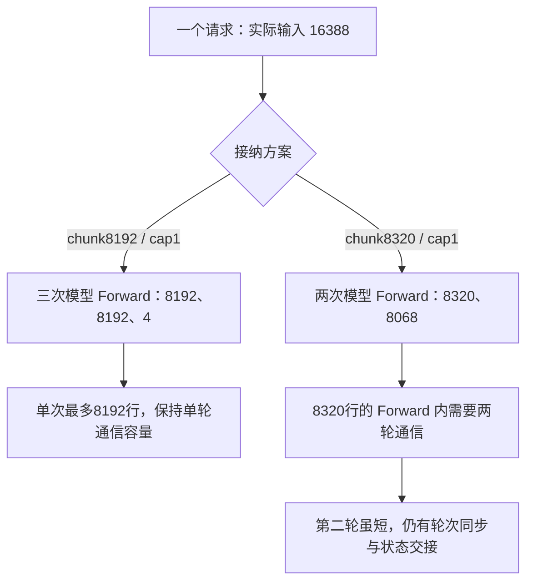

# Prefill chunk 应该怎么选：从 DP 折算、页对齐到通信轮次与尾块合批

DeepSeek-V4-Flash / Ascend 910C 调优时，我们遇到过一组很容易选错方向的结果：实际输入 16388 Token，有效 chunk 为 8192，需要分三次做 Prefill；把 chunk 增到 8320 后，只需要两次，吞吐却略降。后来保留 8192，把每个 Prefill 批次的请求上限从 1 改为 2，同负载 native 吞吐反而提高了 32.27%。

这说明选择 chunk 时，单看一条请求要分几块还不够。请求进入 Scheduler 后，会先经过页对齐和预算检查；模型执行时，又会受到 DP/CP 布局、MoE 通信容量和实际通信轮次约束。一处少一轮，另一处可能多一轮；单请求少分块，也不等于整条队列更快处理完。

本文把这些约束连起来，回答三个实际问题：启动参数里的 chunk 到底作用在哪一级，为什么“稍微加大一点”可能跨过成本边界，以及什么时候应当先调请求槽而不是继续增大 chunk。此前的 [Decode 很快但吞吐上不去](decode-fast-throughput-limited-by-prefill.md) 主要分析 Pcap 收益；这里侧重 chunk 的选择方法与失败假设。

证据来自 2026 年 10 月 20—21 日冻结的 SGLang/Ascend 适配源码和原始实验，源码文件 SHA、配置几何及数值见[配套材料](../../assets/deepseek-v4-prefill-chunk-selection/evidence.json)。文中的参数折算和 native 容量限制属于该版本，不作为所有 SGLang 版本的默认行为。

## 1. chunk 参数至少要经过三次解释

先看一条实际使用过的配置：全局 `--chunked-prefill-size 131072`，P 端开启 DP Attention，`--dp-size 16`，不启用 Prefill CP。如果把 CLI 里的 131072 当成单个 DP 实例的一批输入量，就会从第一步算错。

当时的 `arg_groups/parallel_hook.py` 在 `_handle_data_parallelism` 中执行：

```python
# 摘录关键折算，省略配置解析与日志。
chunked_prefill_size = chunked_prefill_size // dp_size
```

因此运行时有效预算为 `131072 / 16 = 8192`。全局 CLI 与折算后的值都要保存，避免调整 DP 后仍以为 chunk 没变。这不是简单的显示差异，后面的接纳逻辑实际会使用折算结果。

第二层是 Scheduler 的接纳预算。`PrefillAdder` 判断能放多少新 Token，同时还要检查请求槽、KV 资源和页计费；chunk 不表示每一批必定装满。第三层才是模型和通信看到的实际 Token 行数：CP 会进一步分散计算，某些路径还会补齐行数，DeepEP 则有自己每轮处理的上限。

| 层次 | 本次要核对的对象 | 8192 配置中的例子 |
| --- | --- | --- |
| 启动配置 | 全局 CLI、DP Attention 是否生效 | 131072、DP16 |
| 接纳预算 | 每 DP 实例有效 chunk、页大小、请求槽 | 8192、page128、Pcap1 |
| 执行形状 | 实际新 Token、CP 分片及 padding | noCP 下本例最多 8192 行 |
| 通信分轮 | 每轮容量、可用轮数、实际轮数 | 每轮 8192、单轮配置 |

这几级数字有时相等，有时差很多。只看基础启动脚本不够；本次实验就出现过基础脚本写 DP16、外层追加参数最终改成 DP4/CP4 的情况。解释性能必须使用最终参数、派生配置与对应源码。

还要区分混部与独立 P 服务。混部服务可以通过分块，让长 Prefill 与 Decode 交错；本次 P、D 已分离，P 端的分块主要影响执行形状、内存和交付粒度。写作时查阅的 [SGLang Ascend 参数指南](https://github.com/sgl-project/sglang/blob/main/docs/docs/hardware-platforms/ascend-npus/optimization/parameter_tuning.mdx#prefill-optimizations)以 DeepSeek-V3.2 为参考，列出独立长上下文 P 服务关闭分块的建议。这提供了一种候选方向，却不是本次 Flash/DeepEP 组合已验证的最优配置。

`--chunked-prefill-size -1` 关闭的是 Scheduler 分块，不会取消 native 通信容量检查。若 noCP 下把完整 16388 行交给同一次 Forward，按本次每轮8192的实现仍需要容纳三轮通信，并重新考虑中间张量和 workspace。不能只把 CLI 改成 -1，就宣称尾块成本已被无条件消除。

## 2. 16384 和 16388 的差别，足以多出一轮

“16K 输入”在这组负载里指正文 16384 Token。经过实际聊天编码，请求送入模型的是 16388 Token，固定输出仍是 1024 Token。那额外的 4 个 Token 不能为了凑整数而删掉，否则已经换了输入场景。

有效 chunk 8192、单请求独占批次时，实际分解是：

```text
16388 = 8192 + 8192 + 4
```

最后 4 个 Token 仍要走当前层的 Attention、MoE 和分布式执行。它的新输入很少，但前向调用、元数据准备和通信协调不会按 Token 数同比缩到接近零。由此产生了一个合理假设：把 chunk 稍微增大，让它变成两块，能否省掉这轮很小的前向？

在提出候选前，还要处理页计费。历史 `PrefillAdder` 使用 page128，且没有开启 exact-chunk-fill。新请求的接纳会对输入长度按页向上计费；截断路径通常又要向页边界取整。已经进入分块状态的请求，则通过 `add_chunked_req` 继续推进。初次接纳与后续 continuation 的具体判断不能混成一条整数除法。

我们保存了三个值在实际接纳方法上的 CPU 验证：

| 有效 chunk | DP16 对应全局 CLI | 该单请求的实际分块 | 关键观察 |
| --- | ---: | --- | --- |
| 8192 | 131072 | 8192 + 8192 + 4 | 三次 Prefill |
| 8256 | 132096 | 8192 + 8196 | 尾批按页计费 8320，记录中剩余预算为 -64 |
| 8320 | 133120 | 8320 + 8068 | 两次 Prefill，最大页计费 8320 |

8256 的结果尤其值得注意：看到两块，并不表示预算关系已经成立。它在这个历史 CPU fixture 中出现了页计费超过预算的状态，因此没有被当成可直接使用的候选。这是主机接纳路径的边界记录，不是已经发生的 NPU 错误，也没有被当成性能收益。

8320 是页对齐的候选，CPU 验证说明它确实改变了想改变的分块形状。但“接纳合法”和“系统更快”是后面两步，不能由这张表替代。

## 3. 多出的 128 行，为什么可能多付整轮通信

本次 DeepEP normal 路径还有独立约束：冻结的 native 实现中，每轮 Token 容量最大为 8192。`DEEPEP_NORMAL_LONG_SEQ_PER_ROUND_TOKENS` 和 `DEEPEP_NORMAL_LONG_SEQ_ROUND` 控制分轮容量，不能把 Scheduler 的有效 chunk 直接当成每轮通信容量。

noCP 下，把实际前向行数从 8192 增到 8320，会跨过这个边界。在候选配置中，一次模型 Forward 内的通信需要按 `8192 + 128` 两轮处理。这里出现了两种不同的“轮”：



源码里的 round 循环包含输入写入共享区、状态设置、等待与结果读取，多轮还存在相应的协调。最后 128 行当然不等于又计算完整的 8192 行，但不能因此把第二轮协调成本记作零。模型 Forward 次数减少与通信分轮增加，正好在这次候选里同时发生。

CP 也会改变这个边界。原 CP4/DP4、有效 chunk32768、Pcap1 配置下，一条完整 16388-token 请求经 CP4 分摊为每 rank 逻辑 4097 行，按当时路径对齐后为 4104 行。改成 CP2 后，逻辑行数是 8194；按已绑定 zigzag 源码的 `2×CP` 规则，4行对齐后为 8196，已经超过单轮 8192；即便完全消除 padding，8194 仍然超限。

2026年10月24日复核更正：上一版沿用旧候选算术，把 CP2 也按8行对齐写成8200；现按原 padding 方法纠正为8196。原测量未重跑，仍需两轮通信的判断不变，详见 [CP2/CP4同负载专题](ascend-910c-cp2-vs-cp4-prefill-throughput.md)。

为了让 CP2/DP8 一次接纳完整请求，历史候选还把有效 chunk 设为 16512，对应全局 CLI132096，因为完整输入的 page128 计费就是 16512。这个变化同时改变了 DP 请求分布、CP 计算分片和 normal 通信轮数。不能把它描述成只改了一个 chunk，更不能期待 DP 组数翻倍就等于吞吐翻倍。

扩大通信容量还涉及临时 Tensor、接收端路由分布和 workspace。源码容量合法只说明可以进入对应路径，不说明真实峰值内存已被测量；同样，主机前置拒绝的非法配置，也不能记成模型性能负例。

## 4. 两组负例：分块更少，TPOT 更低，吞吐仍没升

先看最直接的 8192→8320。双方都是高 AL 复制负载、N320/C128/6 req/s、Chat16388/输出1024、零前缀命中，保持相同 P 布局、D8be 静态布局、G5/verify6 和 IndexCache freq2。Pcap 都为 1，变化是 chunk8192/normal round1 → chunk8320/normal round2，当时尚未叠加后来的 Compact/P7804 配置。

| 指标 | 8192 / round1 | 8320 / round2 |
| --- | ---: | ---: |
| whole 成功 / 失败 | 320 / 0 | 320 / 0 |
| native 纳入请求 / 时长（s） | 182 / 70.6463 | 176 / 68.9845 |
| native TTFT 平均（ms） | 42650.1 | 43837.8 |
| native TPOT 平均（ms） | 7.8 | 7.0 |
| native E2E 平均（s） | 50.5922 | 50.9622 |
| native 输出 / PD16 卡（tok/s） | 164.8777 | 163.2830 |
| whole 输出 / PD16 卡（tok/s） | 145.7180 | 144.7582 |
| whole AL：输出数 / Verify 次数 | 5.7711 | 5.7737 |
| whole 严格 Draft 接受率 | 95.7266% | 95.7702% |

严格接受率使用保存的实际响应计数：分别是 `271763/283895` 与 `271767/283770`；AL 分母分别为 56779 和 56754 次 Verify。它们属于 whole，不能填入 native 接受指标。两轮 native 都满足当时至少 128 请求、60 秒的筛选门槛，但仍只是一组对照，没有重复实验的置信区间。

8320 的 native 吞吐下降约 0.97%，whole 下降约 0.66%。这个幅度不支持宣布稳定的性能劣化规律，但足以说明当时没有看到值得长测确认的收益。TPOT 降到 7.0ms，也没有补回请求在首 Token 前的等待。AL 与严格接受率接近，不能把吞吐不升解释成“草稿接受率塌了”。

另一组是普通原基准上的 CP4/DP4→CP2/DP8/round2，对齐 N480/C88/4 req/s、16K/1K、cache0 和 D 配置。native 吞吐从 181.2029 降到 179.5582 tok/s/PD16 卡，whole 从 164.6732 降到 161.9804；native TPOT 从 19.3ms 降到 17.2ms，TTFT 却从 10.570s 升到 12.828s。它同样没有实现更高吞吐。

这些结果与跨越通信边界、并行工作形状变化的成本相容，但没有完整设备阶段计时，不能把损失逐毫秒归给第二轮通信。更准确的结论是：消除尾块和降低 TPOT 这两个局部目标，都没能在相应对照里转化为整体吞吐收益。两组负载和模型状态不同，绝对吞吐也不应跨组排名。

## 5. 保留 8192，为什么增加请求槽反而有效

前面是在一条请求内部消除尾块，另一种办法是利用队列中的下一条请求。Pcap1 时，批次放入 A 的 4-token 尾块，请求槽已经用完，即便还剩大量 Token 预算，也不能接 B。改成 Pcap2，chunk 仍为 8192，就可以形成：

```text
一批：A 尾块 4 + B 新输入 8064
下一批：B 新输入 8192
再下一批：B 尾块 132 + C 新输入 7936
```

8064 不是随便取的：A 的 4 个 Token 按一页计费，余下 `8192-128=8064`；B 的 132-token 尾块按两页计费，又给 C 留下 `8192-256=7936`。扩大的是请求槽，Token 上限没有翻倍，也没有要求单次通信容纳超过 8192 行。

在同一套 320 请求的实际 `PrefillAdder` CPU 验证中，总输入保持 5244160 Token，调度批次从 960 降到 645。这说明新的接缝能减少孤立小批次，不是通过少算输入换取收益。它仍不等于真实多 DP 队列的每一批都会按这个序列出现，后者需要实际日志和性能测量。

后来在固定的 P7804/D8be 静态布局、Compact6/自动 SPS/G5、IndexCache freq2 上完成了 N640/C128/6 req/s 同负载对照，唯一配置差异是 Pcap1→2：

| 指标 | Pcap1 | Pcap2 |
| --- | ---: | ---: |
| 有效 chunk / normal round | 8192 / 1 | 8192 / 1 |
| whole 输出 / PD16 卡（tok/s） | 166.2402 | 216.5483 |
| native 输出 / PD16 卡（tok/s） | 179.0441 | 236.8268 |
| native 纳入请求 / 时长（s） | 496 / 177.2971 | 493 / 133.2282 |
| whole TPOT 平均（ms） | 8.7 | 9.4 |
| whole AL | 5.7483 | 5.7494 |

两轮各 640 成功、0 失败、cache0，native 提高 32.27%，whole 提高 30.26%。这一阶段 Compact 的实际生成 proposal 分母未采全，严格接受率保持 `NOT_OBSERVED`，没有用 AL 换算。完整时延、ITL 与接受口径见[这组对照的专题](decode-fast-throughput-limited-by-prefill.md)。

这里保留下来的思路是：有效 chunk 接近通信单轮容量，而短尾块能够与后继请求拼接时，可以先验证跨请求合批。它不要求所有场景都用 Pcap2；我们在更早普通负载和另一套 CP 布局上也测到过 Pcap2 负向结果。真正有效的是当前场景里的预算组合，而不是参数名本身。

## 6. 换成 128K、90% Prefix Cache，chunk 应该按什么算

输入正文变成 128K 后，不能直接把 chunk 也改成 128K，更不能沿用 16K 的尾块判断。首先要把“请求总上下文”和“本轮还需要做 Prefill 的输入”分开。

后来实际测得的另一场景是：正文 131072 Token、Chat131076、输出1024，每条命中的前缀为 118784 Token，命中率约 90.6222%。因此未命中的输入长度是：

```text
131076 - 118784 = 12292
```

若按单请求、有效 chunk8192 推导，且没有其他预算提前截断，未命中部分会是 `8192+4100`；冷 seed 的完整输入则是 `16×8192+4`。这是按已测长度进行的形状推导，不是新采集的完整批次日志。warm 与 cold 显然不是同一种执行形状。

但前缀命中也没有把 Attention 的历史长度变成 12292。新输入仍要处理与既有上下文相关的计算和缓存状态；总 KV 容量、历史读取及并行布局仍然重要。将“九成前缀命中”直接理解成所有计算和内存都减少九成，会误导 chunk 和并发选择。

所以，换场景后应先保留总输入长度、实际 cached_tokens 和未命中长度分布，再看每批次的实际填充与通信边界。seed 成本和 warm 测量分开，缓存命中必须逐请求核验。16K 零缓存下得到的最优 chunk，只能作为起点，不能自动充当 128K warm 场景的最优结论。

## 7. 选择 chunk 时，先问下一轮能证伪什么

这次实验之后，一个 chunk 候选至少要回答三件事：它改变了哪一种批次形状，是否跨越页对齐或通信轮次边界，以及为什么这种变化可能作用于当前瓶颈。单纯说“chunk 更大、调用更少”，还不足以支持一次昂贵重启。

如果日志里大量批次都是一个很短的尾块，而队列里有后继请求，就先核对 Pcap 与剩余 Token 预算；如果每批接近满载，仍然供给不足，再看增大 chunk 会不会触发第二轮通信或更高 workspace。客户端 C、`max-running-requests`、Pcap 与 chunk 分属不同限制，提高 C 不会自动突破本批次的请求槽和 Token 预算。

有了机制依据，先用现有接纳方法检查输入守恒、页计费、实际分块和每批行数，检查本次变化即可。CPU 证明支持“参数确实改变预期路径”，性能结论仍由同负载压测给出。8320 候选与 CP2 候选都完成了合法运行，没有收益就关闭；不需要为证明自己选对方向而连续扫更多档位。

成本也应该进入下一轮决策。8320 这轮加载、两次 MF、路由与配套检查合计约 764.81s，正式负载约 141.48s；CP2 轮总生命周期约 1329.43s。它们是历史执行成本，不代表所有实验都需要照搬。已经验证的热参数实验应复用服务，不为改 N/C/r 再付一次启动成本。

最后，比较时同时看 TTFT、TPOT、E2E、吞吐、失败、缓存和接受指标。native 与 whole 分开，短筛与长窗口分开；同时改变 chunk 和通信轮数，就把两者作为一个联合候选报告。当前证据支持保留 8192 与对应的尾块合批组合，没有证明 8192 是所有输入长度、缓存状态和并行拓扑下的最优常数。

chunk 的选择，最终落在“每次前向到底处理哪些 Token、为它们付了多少执行与协调成本”上。把这些实际形状看清，比继续沿着 8K、16K、32K 的整数档位盲扫，更容易得到有用的下一步。

## 配套材料与延伸阅读

- [配置几何与源码 SHA](../../assets/deepseek-v4-prefill-chunk-selection/evidence.json)：DP 折算、页对齐、通信容量和各实验的适用范围。
- [各组同负载结果 CSV](../../assets/deepseek-v4-prefill-chunk-selection/matched-results.csv)：保留 native/whole、请求数、时长、时延与接受指标；不同组不构成可直接排名的横向基准。
- [Decode 已经很快了，吞吐为什么上不去？](decode-fast-throughput-limited-by-prefill.md)：完整展开尾块合批与 Pcap1→2 的 640 请求对照。
- [Ascend 910C 推理调优负例分析](ascend-910c-inference-tuning-negative-results-and-stop-rules.md)：更多低收益、负收益假设及停止条件。
- [P 端场景静态 EPLB](ascend-910c-prefill-scenario-static-eplb.md)：布局与执行分布的另一条优化路径。
- [SGLang Scheduler 源码](../sglang/sglang-scheduler-source-analysis.md)：请求、批次与接纳预算的完整上下文。

[返回性能分析](README.md)
