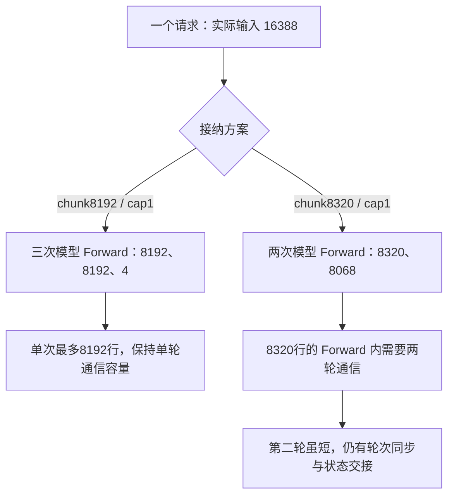

# Prefill chunk 应该怎么选：从 DP 折算、页对齐到通信轮次与尾块合批

调优 DeepSeek-V4-Flash、Ascend 910C 时，我们试过用更大 chunk 消除短尾块。实际输入 16388 token，在有效 chunk8192 下分三次 Prefill；改为 8320 后只需两次，吞吐却略降。后来保留 8192，将 Prefill 请求上限从 1 调为 2，同负载 native 吞吐提高了 32.27%。

分块次数只是其中一项成本。Scheduler 先按页和预算接纳，模型再按 DP/CP 布局执行，MoE 通信还有每轮容量。减少一次 Prefill 可能同时增加通信分轮，也未必减少整个队列的完成时间。

下面按配置到执行的顺序，解释 chunk 在哪一级生效、增大时会跨哪些边界，以及何时更适合增加请求槽。[此前文章](decode-fast-throughput-limited-by-prefill.md)展开了 Pcap 收益，这里主要讨论候选怎样选择与排除。

本文使用 2026 年 10 月 20—21 日冻结的 SGLang/Ascend 适配和原始实验。文件 SHA、形状与结果见[配套材料](../../assets/deepseek-v4-prefill-chunk-selection/evidence.json)。参数折算与通信实现的每轮容量均按该版本解释，不代表其他版本的默认行为。

## 1. chunk 参数至少要经过三次解释

当时 P 使用全局 `--chunked-prefill-size 131072`，启用 DP Attention、`--dp-size 16`，未开启 Prefill CP。这个 131072 还需要折算，不能直接用作单个 DP 实例的批次预算。

该版 `arg_groups/parallel_hook.py` 的 `_handle_data_parallelism` 执行：

```python
# 摘录关键折算，省略配置解析与日志。
chunked_prefill_size = chunked_prefill_size // dp_size
```

有效预算因此为 `131072 / 16 = 8192`。全局和派生值都需记录，因为后续接纳实际使用折算值，调整 DP 后有效 chunk 也会随之改变。

接着由 `PrefillAdder` 检查新 token、请求槽、KV 资源和页计费，预算有余也不表示批次一定装满。模型与通信最终看到的行数还要经过 CP 分片和可能的 padding，DeepEP 再按自己的容量分轮。

| 层次 | 本次要核对的对象 | 8192 配置中的例子 |
| --- | --- | --- |
| 启动配置 | 全局 CLI、DP Attention 是否生效 | 131072、DP16 |
| 接纳预算 | 每 DP 实例有效 chunk、页大小、请求槽 | 8192、page128、Pcap1 |
| 执行形状 | 实际新 Token、CP 分片及 padding | noCP 下本例最多 8192 行 |
| 通信分轮 | 每轮容量、可用轮数、实际轮数 | 每轮 8192、单轮配置 |

这些值有时相等、有时差别很大，必须按最终生效配置核对。本次就出现过基础脚本写 DP16，外层追加参数覆盖成 DP4/CP4 的情况，仅看基础文件会解释错实验。

混部与独立 P 的分块目的也不同。混部用它交错长 Prefill 和 Decode，本次 PD 分离则主要调整 P 的形状、内存和交付粒度。[SGLang Ascend 指南](https://github.com/sgl-project/sglang/blob/main/docs/docs/hardware-platforms/ascend-npus/optimization/parameter_tuning.mdx#prefill-optimizations)以 DeepSeek-V3.2 为参考，建议某些独立长上下文 P 关闭分块；对本次 Flash/DeepEP 组合，这只能作为待测候选。

`--chunked-prefill-size -1` 关闭 Scheduler 分块后，native 容量检查仍在。noCP 一次处理完整 16388 行，按本版每轮 8192 上限仍需三轮通信，还要重算中间张量和 workspace。不能由关掉分块直接推导执行成本全部消失。

## 2. 16384 和 16388 的差别，足以多出一轮

本例正文“16K”为 16384 token，聊天编码后输入为 16388，输出固定 1024。多出的 4 token 属于实际请求，删去它们会改变场景。

当有效 chunk8192 且批次只接一条请求时，分块如下：

```text
16388 = 8192 + 8192 + 4
```

最后 4 token 仍需经过各层 Attention、MoE 和分布式执行，调用、元数据与协调成本不会随新行数同比趋近零。因此可以提出一个候选：略增 chunk，减少这次很短的 forward。

提出候选前，需先经过页计费。本版 `PrefillAdder` 使用 page128、关闭 exact-chunk-fill，新请求按页向上计费，截断路径通常向页边界取整；已有分块请求由 `add_chunked_req` 继续。初次接纳和 continuation 的分支不能合成一条简单除法。

实际接纳方法的 CPU 检查保存了三种预算结果：

| 有效 chunk | DP16 对应全局 CLI | 该单请求的实际分块 | 关键观察 |
| --- | ---: | --- | --- |
| 8192 | 131072 | 8192 + 8192 + 4 | 三次 Prefill |
| 8256 | 132096 | 8192 + 8196 | 尾批按页计费 8320，记录中剩余预算为 -64 |
| 8320 | 133120 | 8320 + 8068 | 两次 Prefill，最大页计费 8320 |

8256 在 CPU fixture 中虽分为两块，尾批页计费却超过预算，因此没有作为合法候选进入实机。它属于主机接纳边界，未发生对应 NPU 故障，也没有性能成绩。

8320 则通过页对齐检查，并改变了预期分块。到这里仅说明接纳和形状符合候选目标，速度仍需后续测量。

## 3. 多出的 128 行，为什么可能多付整轮通信

DeepEP normal 的冻结 native 实现每轮最多 8192 token。`DEEPEP_NORMAL_LONG_SEQ_PER_ROUND_TOKENS` 和 `DEEPEP_NORMAL_LONG_SEQ_ROUND` 管理这层容量，与 Scheduler 有效 chunk 是不同限制。

noCP 从 8192 行增加到 8320 行，就会跨过单轮上限。同一次 Forward 的通信改为 `8192 + 128` 两轮，于是 Prefill 与通信出现不同的分轮：



round 循环包含共享区写入、状态交接、等待和读取，每轮都有协调成本。尾部 128 行不等于再做完整 8192 行计算，但仍需走完第二轮通信。这个候选减少了模型 Forward 次数，却让其中 8320 行的那次 Forward 需要两轮通信；两种次数应分别核算。

CP 会再次改变实际行数。原 CP4/DP4、有效 chunk32768、Pcap1 将完整 16388-token 输入分为每 rank 4097 逻辑行，补齐为 4104。CP2 则为 8194 逻辑行，按 zigzag `2×CP` 的 4 行规则补至 8196。即使去掉 padding，仍超出单轮 8192。

2026 年 10 月 24 日的源码复核还修正了旧算术：此前误将 CP2 按 8 行对齐写成 8200，执行原方法后应为 8196。没有重跑历史压测，仍需两轮的判断不变，详见[CP2/CP4 同负载专题](ascend-910c-cp2-vs-cp4-prefill-throughput.md)。

CP2/DP8 为完整接纳，还将有效 chunk 设为 16512，对应全局 CLI132096，因为 page128 计费恰为 16512。DP 请求分布、CP 分片和 normal 轮数一并改变，不能将结果归于单个 chunk 参数，也不能由 DP 翻倍预测吞吐翻倍。

通过通信容量检查，只说明这个形状可以进入相应路径。临时张量、接收路由分布和 workspace 的实际峰值仍要测量；在主机接纳阶段就被拒绝的非法配置，则没有进入模型性能测试。

## 4. 两组负例：分块更少，TPOT 更低，吞吐仍没升

8192→8320 对照使用相同高 AL 复制任务，N320/C128/6 req/s、Chat16388、输出 1024、零前缀命中，P 布局、D8be 静态布局、G5/verify6、IndexCache freq2 均相同，Pcap 均为 1。改变的是 chunk8192/round1→chunk8320/round2，尚未加入后来 Compact/P7804 配置。

| 指标 | 8192 / round1 | 8320 / round2 |
| --- | ---: | ---: |
| whole 成功 / 失败 | 320 / 0 | 320 / 0 |
| native 纳入请求 / 时长（s） | 182 / 70.6463 | 176 / 68.9845 |
| native TTFT 平均（ms） | 42650.1 | 43837.8 |
| native TPOT 平均（ms） | 7.8 | 7.0 |
| native E2E 平均（s） | 50.5922 | 50.9622 |
| native 输出 / PD16 卡（tok/s） | 164.8777 | 163.2830 |
| whole 输出 / PD16 卡（tok/s） | 145.7180 | 144.7582 |
| whole AL：输出数 / Verify 次数 | 5.7711 | 5.7737 |
| whole 严格 Draft 接受率 | 95.7266% | 95.7702% |

whole 的严格接受计数分别为 `271763/283895`、`271767/283770`，AL 分母为 56779、56754 次 Verify，不能移到 native 一行。native 两轮均达到当时至少 128 请求、60 秒的筛选要求，但只有一次配对，没有重复实验置信区间。

8320 native 吞吐约降 0.97%，whole 约降 0.66%。这个幅度不足以推导稳定退化，却没有提供继续长测的收益依据。TPOT 降到 7.0ms 后，首 token 前的等待仍未补回；AL 与严格接受率接近，也不支持草稿接受率下降的解释。

另一组普通原基准比较 CP4/DP4 与 CP2/DP8/round2，保持 N480/C88/4 req/s、16K/1K、cache0 和 D 配置。native 由 181.2029 降至 179.5582 tok/s/PD16 卡，whole 由 164.6732 降至 161.9804；native TPOT 从 19.3ms 降至 17.2ms，TTFT 则由 10.570s 升至 12.828s。

两项结果都未将减少分块或降低 TPOT 转为更高系统吞吐。它们与通信边界、并行形状成本相容，但缺少完整设备阶段计时，无法逐毫秒拆给第二轮。两组负载及状态也不同，绝对吞吐不能直接横向排名。

## 5. 保留 8192，为什么增加请求槽反而有效

还可以保留短尾块，再与队列后续请求合批。Pcap1 时，A 的 4-token 尾块占满唯一请求槽，剩余 token 预算无法接纳 B；Pcap2 配合原 chunk8192，可以形成如下序列：

```text
一批：A 尾块 4 + B 新输入 8064
下一批：B 新输入 8192
再下一批：B 尾块 132 + C 新输入 7936
```

其中 8064 来自页预算：A 的 4 token 按一页收费，B 可用 `8192-128=8064`；B 剩余 132-token 尾块收费两页，给 C 留下 `8192-256=7936`。只增加请求槽，token 上限与单轮通信容量都没有翻倍。

在相同 320 请求的实际 `PrefillAdder` CPU 检查中，总输入均为 5244160 token，批次数由 960 降至 645。短批次减少，输入没有少算。不过这只是接纳方法验证，真实多 DP 队列还需日志和实测，不能假定每批都按示例排列。

随后在固定 P7804/D8be 静态布局、Compact6/自动 SPS/G5、IndexCache freq2 上做 N640/C128/6 req/s 配对，仅改变 Pcap1→2：

| 指标 | Pcap1 | Pcap2 |
| --- | ---: | ---: |
| 有效 chunk / normal round | 8192 / 1 | 8192 / 1 |
| whole 输出 / PD16 卡（tok/s） | 166.2402 | 216.5483 |
| native 输出 / PD16 卡（tok/s） | 179.0441 | 236.8268 |
| native 纳入请求 / 时长（s） | 496 / 177.2971 | 493 / 133.2282 |
| whole TPOT 平均（ms） | 8.7 | 9.4 |
| whole AL | 5.7483 | 5.7494 |

两轮均为 640 成功、0 失败、cache0，native 提高 32.27%，whole 提高 30.26%。这阶段未采全 Compact 实际 proposal 分母，严格接受率保留 `NOT_OBSERVED`。完整时延、ITL 和接受口径见[配对专题](decode-fast-throughput-limited-by-prefill.md)。

当 chunk 已接近单轮容量，队列又能提供后继请求时，先检查尾块合批往往更有针对性。这不表示所有场景都用 Pcap2：更早普通负载和另一套 CP 布局也有负向记录，效果来自当前预算与负载组合。

## 6. 换成 128K、90% Prefix Cache，chunk 应该按什么算

输入改为 128K 后，要重新区分总上下文与本轮新增 Prefill。总长度变大，不意味着 chunk 也应直接改为 128K，原来 16K 输入的尾块规律也需要重新计算。

后来的另一组实测为正文 131072 token、Chat131076、输出 1024，逐请求命中 118784，比例约 90.6222%。名义未命中长度为：

```text
131076 - 118784 = 12292
```

若只看单请求、chunk8192 且无其他截断，warm 新输入可分为 `8192+4100`，冷 seed 完整输入则为 `16×8192+4`。这是根据实测长度推导的形状，未另采完整批次日志，不能当作两种状态的设备计时。

命中前缀后，Attention 仍使用长历史，逻辑上下文没有缩成 12292。新 Query、缓存状态和历史读取仍受并行与容量影响，不能按命中比例同比缩减全部计算和内存。

所以换场景时先保存总长度、实际 cached_tokens 和未命中分布，再查每批填充与通信边界。seed 成本另列，正式命中逐条核验；16K 零缓存下的配置只能作为起点。

## 7. 选择 chunk 时，先问下一轮能证伪什么

决定试一个新 chunk 前，先确认它将改变的批次形状、跨过的页或通信边界，以及这些变化是否针对当前瓶颈。仅凭调用次数减少，还不值得直接付出重启成本。

日志里若有大量短尾块且队列非空，先查 Pcap 与剩余预算；批次接近满载仍供给不足，再评估更大 chunk 是否增加通信轮次和 workspace。客户端 C、`max-running-requests`、Pcap、chunk 各限制不同对象，提高 C 不会自动增加本批槽位和 token 预算。

有候选后，复用实际接纳方法核对本次变化：输入守恒、页计费、分块和行数。CPU 可以确认预期路径，吞吐仍由同负载压测决定。8320 与 CP2 都合法完成，无收益就停止，无须继续扫档寻找正向结果。

这些历史试验也有成本。8320 的加载、两轮 MF、路由及配套约 764.81s，正式约 141.48s；CP2 全程约 1329.43s。它们不是所有测试的固定流程，已经支持的热 N/C/r 变更应直接复用服务。

最终一起比较 TTFT、TPOT、E2E、吞吐、失败、缓存与接受计数，区分 whole/native 和短筛/长窗。若同时改 chunk 与通信轮数，就按联合候选报告。当前保留的是 8192 配合相应尾块合批，没有证据将 8192 定为所有长度、缓存和拓扑的最优值。

选择 chunk 时，最有用的信息是每次前向实际处理哪些 token，以及相应执行和协调成本。下一轮据此选择要验证的形状，通常比按 8K、16K、32K 整数档位继续扫描更容易解释结果。

## 配套材料与延伸阅读

- [配置几何与源码 SHA](../../assets/deepseek-v4-prefill-chunk-selection/evidence.json)：DP 折算、页对齐、通信容量和各实验的适用范围。
- [各组同负载结果 CSV](../../assets/deepseek-v4-prefill-chunk-selection/matched-results.csv)：保留 native/whole、请求数、时长、时延与接受指标；不同组不构成可直接排名的横向基准。
- [Decode 已经很快了，吞吐为什么上不去？](decode-fast-throughput-limited-by-prefill.md)：完整展开尾块合批与 Pcap1→2 的 640 请求对照。
- [Ascend 910C 推理调优负例分析](ascend-910c-inference-tuning-negative-results-and-stop-rules.md)：更多低收益、负收益假设及停止条件。
- [P 端场景静态 EPLB](ascend-910c-prefill-scenario-static-eplb.md)：布局与执行分布的另一条优化路径。
- [SGLang Scheduler 源码](../sglang/sglang-scheduler-source-analysis.md)：请求、批次与接纳预算的完整上下文。

[返回性能分析](README.md)
