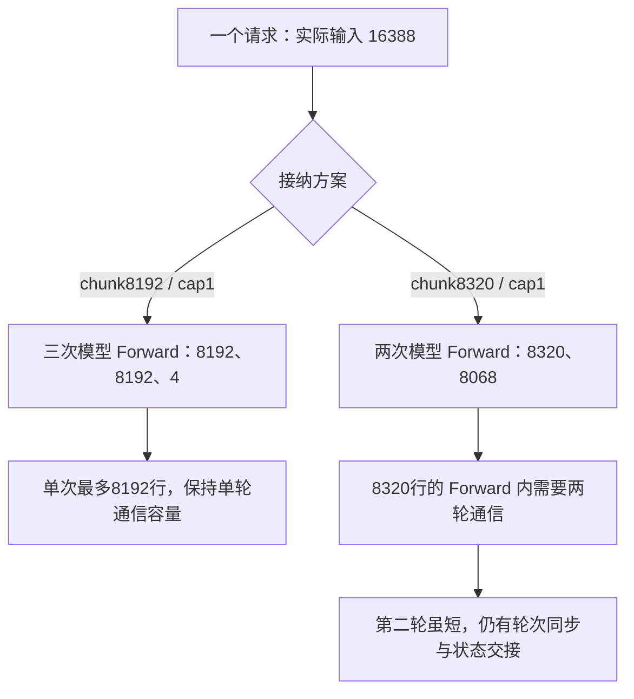

# Prefill chunk 应该怎么选：从 DP 折算、页对齐到通信轮次与尾块合批

16388 个输入 Token，chunk 8192 要做三次 Prefill，chunk 8320 只做两次。后者吞吐却略降。DeepSeek-V4-Flash、Ascend 910C 这轮最后保留 8192，把请求接纳上限 1 改 2，同负载 native 提高 32.27%。

少一次模型调用，没有同时少掉其他成本。页计费、DP/CP 行数、MoE 通信容量都在解释这个 chunk，跨过其中一个边界，省下的尾块就可能换成第二轮通信。

这里沿参数到执行展开候选选择。[此前文章](decode-fast-throughput-limited-by-prefill.md)详讲Pcap收益，本篇追chunk改变了哪些具体形状。

数据、适配为2026年10月20—21日冻结快照，SHA、形状、结果见[配套材料](../../assets/deepseek-v4-prefill-chunk-selection/evidence.json)。折算和通信每轮容量按该版本说明。

## 1. chunk 参数至少要经过三次解释

P 设置全局`--chunked-prefill-size 131072`、DPA、`--dp-size 16`，无 Prefill CP。单 DP 实例用的预算还需折算。

`arg_groups/parallel_hook.py` 的 `_handle_data_parallelism` 执行：

```python
# 摘录关键折算，省略配置解析与日志。
chunked_prefill_size = chunked_prefill_size // dp_size
```

因此有效值为`131072 / 16 = 8192`。调整 DP 会改变它，记录要同时保留全局、派生值。

`PrefillAdder`再核新 Token、请求槽、KV 和页预算；模型、通信还会看到 CP 分片、padding 后的行数，DeepEP 按自身容量分轮。

| 层次 | 本次要核对的对象 | 8192 配置中的例子 |
| --- | --- | --- |
| 启动配置 | 全局 CLI、DP Attention 是否生效 | 131072、DP16 |
| 接纳预算 | 每 DP 实例有效 chunk、页大小、请求槽 | 8192、page128、Pcap1 |
| 执行形状 | 实际新 Token、CP 分片及 padding | noCP 下本例最多 8192 行 |
| 通信分轮 | 每轮容量、可用轮数、实际轮数 | 每轮 8192、单轮配置 |

本轮曾出现基础 DP16 被外层末尾覆盖成 DP4/CP4，只有最终生效值才能解释实际几何。

混部用chunk交错Prefill、Decode，独立P则调输入形状、内存、交付粒度。[SGLang Ascend 指南](https://github.com/sgl-project/sglang/blob/main/docs/docs/hardware-platforms/ascend-npus/optimization/parameter_tuning.mdx#prefill-optimizations)以V3.2建议部分长上下文P关闭分块，对这次Flash/DeepEP仍需验证。

`--chunked-prefill-size -1`只关闭 Scheduler 分块。noCP 完整 16388 行，按本版 8192/轮仍需三轮通信，中间 Tensor、workspace 也要重新评估。

## 2. 16384 和 16388 的差别，足以多出一轮

16K 正文 16384，经 Chat 为 16388，输出固定 1024。多出的 4 个也是原请求内容。

chunk 8192、只接一条时：

```text
16388 = 8192 + 8192 + 4
```

尾部 4 行照样走 Attention、MoE、分布式协调，所以提出略增 chunk、少一次短 Forward。

候选先过页计费。page128、exact-chunk-fill 关闭，新请求向上计页，截断通常向页边界取整，continuation 走`add_chunked_req`。两个分支不能合成一次简单除法。

实际接纳方法的 CPU 结果为：

| 有效 chunk | DP16 对应全局 CLI | 该单请求的实际分块 | 关键观察 |
| --- | ---: | --- | --- |
| 8192 | 131072 | 8192 + 8192 + 4 | 三次 Prefill |
| 8256 | 132096 | 8192 + 8196 | 尾批按页计费 8320，记录中剩余预算为 -64 |
| 8320 | 133120 | 8320 + 8068 | 两次 Prefill，最大页计费 8320 |

8256 fixture 虽能拆两块，尾批页计费却超预算，没进入实机。它在 Host 接纳阶段不合法，没有对应 NPU 故障或性能结果。

8320 通过页对齐，达到了预期分块形状，下一步才是性能。

## 3. 多出的 128 行，为什么可能多付整轮通信

冻结的 DeepEP normal native 每轮最多 8192 Token，`DEEPEP_NORMAL_LONG_SEQ_PER_ROUND_TOKENS`、`DEEPEP_NORMAL_LONG_SEQ_ROUND`控制这层容量。

noCP 的 8320 行跨过上限，Forward 内通信变成`8192 + 128`两轮：



round 要共享区写入、状态交接、等待、读取。128 行没有重复 8192 行的全部计算，却要再承担一次协调。这里减少模型 Forward 次数，同时增加了 8320 行那次 Forward 内的通信轮数。

CP 还会分片。CP4/DP4、有效 chunk 32768、Pcap1 完整接纳后，每 Rank 4097 个逻辑行、补齐为 4104；CP2 是 8194 行，按 zigzag 的`2×CP`即 4 行对齐，成为 8196。未填充也已超 8192。

2026年10月24日复核原方法，将旧文误写的CP2按8行对齐8200修成8196。没有重跑历史压测，两轮通信判断不变，见[CP2/CP4 同负载专题](ascend-910c-cp2-vs-cp4-prefill-throughput.md)。

CP2/DP8 为完整接纳，设有效 chunk 16512、全局 CLI132096，page128 计费正好 16512。请求分布、CP 行数、通信轮数一起变，评价的是联合配置。

通过容量检查，说明形状能进这条路径。临时 Tensor、接收路由、workspace 实际峰值仍要量，Host 阶段已拒绝的则没有模型性能结果。

## 4. 两组负例：分块更少，TPOT 更低，吞吐仍没升

8192→8320 固定高 AL 复制集、N320/C128/r6、Chat 16388、输出 1024、cache 0，P 布局、D8be、G5/Verify 6、IndexCache freq2、Pcap1 一致，只改 chunk 8192/round1→8320/round2，尚未加入后来的 Compact/P7804。

| 指标 | 8192 / round1 | 8320 / round2 |
| --- | ---: | ---: |
| whole 成功 / 失败 | 320 / 0 | 320 / 0 |
| native 纳入请求 / 时长（s） | 182 / 70.6463 | 176 / 68.9845 |
| native TTFT 平均（ms） | 42650.1 | 43837.8 |
| native TPOT 平均（ms） | 7.8 | 7.0 |
| native E2E 平均（s） | 50.5922 | 50.9622 |
| native 输出 / PD16 卡（tok/s） | 164.8777 | 163.2830 |
| whole 输出 / PD16 卡（tok/s） | 145.7180 | 144.7582 |
| whole AL：输出数 / Verify 次数 | 5.7711 | 5.7737 |
| whole 严格 Draft 接受率 | 95.7266% | 95.7702% |

whole 严格接受数`271763/283895`、`271767/283770`，AL 分母 56779、56754 次 Verify。两 native 都满足 128 请求、60 秒，但仅一组配对，whole 接受数不移给 native。

8320 native 约−0.97%、whole 约−0.66%，未提供继续长测的正向依据，也不足以证明稳定退化。TPOT 到 7.0ms，首 Token 前等待仍未补回，AL、严格接受率接近。

普通原基准另测 CP4/DP4→CP2/DP8/round2，固定 N480/C88/r4、16K/1K、cache 0、D。native 181.2029→179.5582、whole 164.6732→161.9804 tok/s/PD16 卡；native TPOT 19.3→17.2ms，TTFT 10.570→12.828s。

两组都没把少分块、低 TPOT 变成吞吐增益。结果与通信、并行形状成本相容，缺完整设备计时，还不能将差值逐毫秒分给第二轮。负载不同，两组绝对值也不横排。

## 5. 保留 8192，为什么增加请求槽反而有效

保留 chunk 后还可以合批。Pcap1 时 A 尾部 4 Token 占唯一名额；Pcap2 让剩余预算接 B：

```text
一批：A 尾块 4 + B 新输入 8064
下一批：B 新输入 8192
再下一批：B 尾块 132 + C 新输入 7936
```

A 按一页收费，B 可用`8192-128=8064`；B 再剩 132 行、收两页，给 C 留`8192-256=7936`。加请求槽，没有加倍 Token 预算、通信容量。

实际 PrefillAdder CPU 同 320 请求，总输入 5244160，batch 960→645。接纳路径验证成立，多 DP 真实队列仍需日志、压测，未保证各批恰好按例排列。

固定 P7804/D8be、Compact6/自动 SPS/G5、IndexCache freq2，N640/C128/r6 只改 Pcap1→2：

| 指标 | Pcap1 | Pcap2 |
| --- | ---: | ---: |
| 有效 chunk / normal round | 8192 / 1 | 8192 / 1 |
| whole 输出 / PD16 卡（tok/s） | 166.2402 | 216.5483 |
| native 输出 / PD16 卡（tok/s） | 179.0441 | 236.8268 |
| native 纳入请求 / 时长（s） | 496 / 177.2971 | 493 / 133.2282 |
| whole TPOT 平均（ms） | 8.7 | 9.4 |
| whole AL | 5.7483 | 5.7494 |

两轮640成功、0失败、cache0，native+32.27%、whole+30.26%。这阶段实际proposal分母缺，严格接受率`NOT_OBSERVED`，详细时延、ITL见[配对专题](decode-fast-throughput-limited-by-prefill.md)。

接近单轮容量、队列又有后继请求时，合尾块比继续放大 chunk 更有针对性。早期普通负载、别的 CP 布局也有 Pcap2 负向，仍按当前组合决定。

## 6. 换成 128K、90% Prefix Cache，chunk 应该按什么算

128K 先区分总上下文、本轮新输入，再算 chunk 形状。

后来的实测正文 131072、Chat 131076、输出 1024，每条命中 118784、约 90.6222%，名义未命中为：

```text
131076 - 118784 = 12292
```

只看单请求、chunk 8192、没有其他截断，warm 新输入为`8192+4100`，冷 seed 为`16×8192+4`。这是从长度推导，未另采完整 batch 日志或设备阶段时间。

Prefix 命中后，Attention 还读长历史，上下文并未缩成 12292。Query、缓存、历史的成本不能统一乘非命中比例。

因此先记录总长、实际 cached_tokens、未命中分布，再看批次、通信。seed 成本单列，正式命中逐条验，旧 16K 配置只作起点。

## 7. 选择 chunk 时，先问下一轮能证伪什么

新 chunk 具体改变哪个 shape、越过哪条页/通信边界，应在重启前算清。减少调用只是候选动机。

短尾多、队列非空，先查 Pcap、剩余预算；batch 接近满载仍缺供给，再评估更大 chunk 的轮数、workspace。C、max-running、Pcap、chunk 分别限制不同对象。

复用实际接纳方法，核输入守恒、页计费、分块、行数，CPU 确认路径，再用匹配压测判断。8320、CP2 都合法完成但未提速，本轮因此停止。

8320 加载、两轮 MF、路由、配套约 764.81s，正式 141.48s；CP2 全程 1329.43s。准备不是所有候选固定成本，热 N/C/r 继续复用服务。

结果一起保留 TTFT、TPOT、E2E、吞吐、失败、缓存、接受计数，按 whole/native、短筛/长窗填写。chunk 与 round 同改就报联合候选，本轮 8192 有效也未证明它普遍最优。

最终选择依据是每次 Forward 实际处理了哪些 Token、花了多少执行和协调时间。下一轮据此选择要验证的形状。

## 配套材料与延伸阅读

- [配置几何与源码 SHA](../../assets/deepseek-v4-prefill-chunk-selection/evidence.json)：DP 折算、页对齐、通信容量和各实验的适用范围。
- [各组同负载结果 CSV](../../assets/deepseek-v4-prefill-chunk-selection/matched-results.csv)：保留 native/whole、请求数、时长、时延与接受指标；不同组不构成可直接排名的横向基准。
- [Decode 已经很快了，吞吐为什么上不去？](decode-fast-throughput-limited-by-prefill.md)：完整展开尾块合批与 Pcap1→2 的 640 请求对照。
- [Ascend 910C 推理调优负例分析](ascend-910c-inference-tuning-negative-results-and-stop-rules.md)：更多低收益、负收益假设及停止条件。
- [P 端场景静态 EPLB](ascend-910c-prefill-scenario-static-eplb.md)：布局与执行分布的另一条优化路径。
- [SGLang Scheduler 源码](../sglang/sglang-scheduler-source-analysis.md)：请求、批次与接纳预算的完整上下文。

[返回性能分析](README.md)
