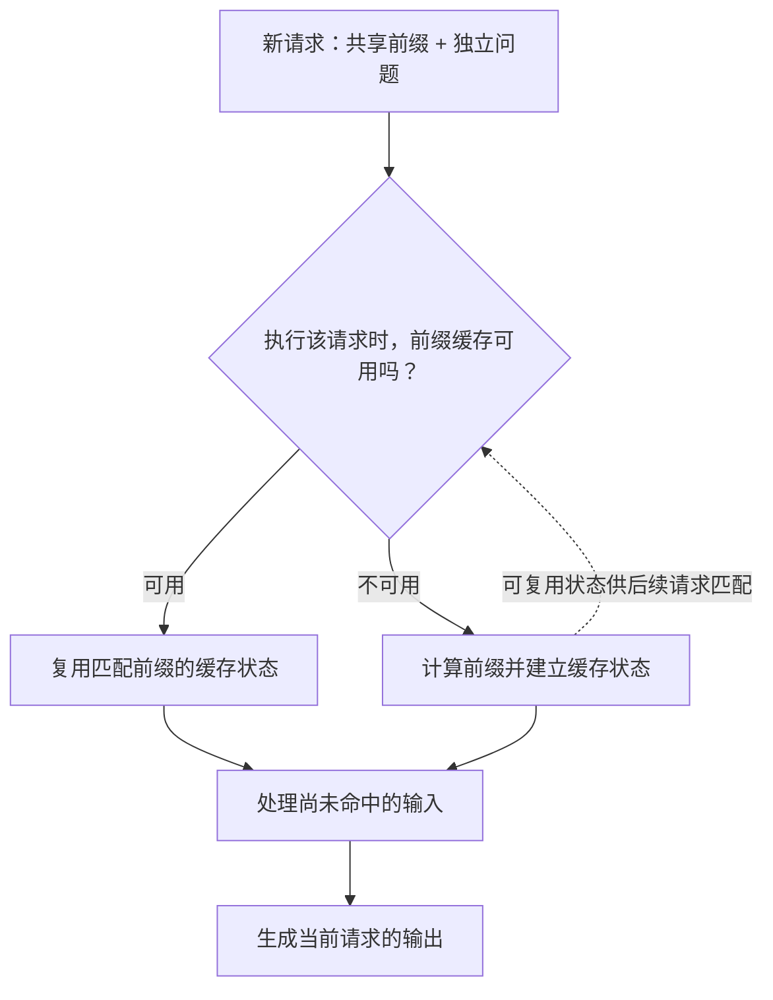
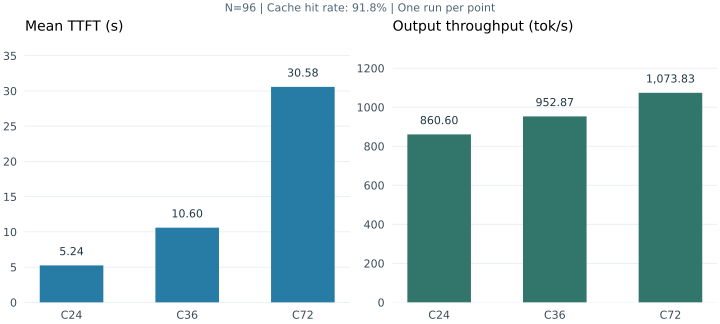

# 从缓存校准到并发取舍：DeepSeek-V4-Pro 在 Ascend 910C 上的一次 32k/1k 调优记录

这轮测试使用 DeepSeek-V4-Pro-W4A8、双节点 Ascend 910C，目标是 32K 输入、1K 输出、约 90% 缓存命中，在平均 TPOT 不超过 50 ms 的条件下提高吞吐。

并发 32 的首轮结果是 817.58 tok/s、TPOT 24.90 ms，但实测缓存命中率只有 85.8%。先校准前缀，再测试并发后，并发 72 达到 1073.83 tok/s、TPOT 20.10 ms；并发 24 的 TPOT 为 20.55 ms，平均 TTFT 则从并发 72 时的 30.58 s 降到 5.24 s。

这组记录的重点是吞吐与等待时间的取舍。服务端并行策略和 Kernel 没有在这些轮次之间变化，下面按缓存校准、并发实验、指标解释的顺序展开。

实测数据来自 2026-09-29 的压测记录，环境为双节点 Ascend 910C、DeepSeek-V4-Pro-W4A8、SGLang Ascend 定制分支。服务配置和客户端日志见下文；当轮服务源码的完整 commit 未随结果归档。文中的指标与数据生成机制另按 `sgl-project/sglang @ d8c5eca3ac76456e923e76f55dd74bddc0e67404` 核对，检索日期为 2026-10-10。以下按这个公开快照解释统计口径，部署参数则以当轮留存脚本为准。

## 一、固定负载、服务配置与验收目标

“32k/1k、90% Cache、TPOT 50 ms”同时包含了输入规模、输出规模、缓存状态和时延约束。只要其中一项变了，得到的吞吐就可能属于另一种负载。

32k 在这里按 32,768 个输入 Token 设置，1k 按 1,024 个输出 Token 设置。缓存命中率按输入 Token 统计。也就是说，90% 命中描述的是输入中有多少 Token 对应的历史计算状态可以复用，并不表示 90% 的请求完全不需要 Prefill。

服务端沿用已经跑通的 DP8 双机混部配置。混部指 Prefill 和 Decode 使用同一套服务资源，本轮没有拆成独立的 P、D 服务。

| 项目 | 本轮设置 |
| --- | --- |
| 设备 | 2 个节点，每节点 16 个可见 NPU 设备，共 32 个；Ascend 910C |
| 模型 | DeepSeek-V4-Pro-W4A8，ModelSlim 量化 |
| 运行时 | CANN 9.1.0，B070 环境中的 SGLang Ascend 定制分支 |
| 并行 | TP32、DP8，开启 DP Attention |
| MoE 通信 | DeepEP，`deepep-mode=auto` |
| 投机推理 | DSpark |
| Prefill 分块 | `chunked-prefill-size=16384` |
| 静态内存预算 | `mem-fraction-static=0.80` |
| 基线脚本的请求参数 | `max-running-requests=32` |
| 客户端 | `backend=sglang`，流式响应，`request-rate=inf` |
| 数据集 | `generated-shared-prefix`，1 个共享前缀组，单轮请求 |
| 生成与预热 | `temperature=0`，目标输出 1,024 Token，8 条预热请求，seed 42 |

TP32 和 DP8 需要放在 DP Attention 的语境里理解。TP 描述张量并行的总体宽度；DP Attention 让不同请求在不同 Attention 分组中处理。按公开源码中的维度关系，在 Attention CP 为 1 时，Attention TP 宽度为 `32 / 8 = 4`。这 32 个 Rank 在 Attention 中分成 8 组，每组宽度为 4；MoE 另按其专家布局组织。[维度推导源码](https://github.com/sgl-project/sglang/blob/d8c5eca3ac76456e923e76f55dd74bddc0e67404/python/sglang/srt/runtime_context.py#L73-L92) 给出了这层关系；具体 Target、Draft 与 MoE 的执行路径仍由目标分支决定。

客户端的并发 72，则是另一层参数。它限制客户端同时发出的在途请求数，请求仍可能在服务内部等待。基线脚本的 `max-running-requests=32` 控制服务侧执行，客户端并发控制整条链路中的在途请求。比较后面的 TTFT 时，需要把服务内等待也算进去。

本轮主要追求输出吞吐，同时验收平均 TPOT≤50 ms。TTFT 没有单独设硬阈值，但它会影响实际使用体验，因此每轮都一起记录。已有完整日志的轮次同时保留 P95、P99，用于观察尾延迟。

## 二、校准实际缓存命中率

第一轮用了一个很直观的拆分：共享前缀 30,000 Token，独立问题 2,768 Token，相加正好是 32,768。假如共享部分都能命中缓存，占比就是 `30000 / 32768 ≈ 91.6%`。

实际跑完只有 85.8%。共享前缀长度决定输入构造，85.8% 则描述这轮运行实际复用了多少输入。

Prefix Cache 复用的是相同输入前缀对应的计算状态。新请求匹配到已有前缀后，可以复用这一段缓存，再计算后面的新输入。假设请求 A 和 B 都以相同的长系统提示词开头，A 已建立并留下可复用缓存，B 就有机会少做这一段 Prefill。B 的独立问题仍然需要处理，随后 Decode 也还需要生成自己的输出。

下面是这层关系的概念示意，不表示具体函数调用或设备执行时间：

前缀复用取决于请求到达的缓存域、已有前缀是否就绪以及是否仍驻留。它们共同决定实际命中量。本轮保留了汇总命中率，差额在各因素之间的分布尚未记录。

校准时先保持目标总输入长度不变，把共享前缀从 30,000 增到 31,900，独立问题从 2,768 减到 868。这个数来自前一轮的经验修正：暂时假设其他损失比例大致不变，`85.8% × 31900 / 30000 ≈ 91.2%`。它是下一轮试验的估计，最后仍看服务返回的缓存统计。

| 阶段 | 目标共享前缀 | 目标独立问题 | 两者合计 | 实测命中率 |
| --- | ---: | ---: | ---: | ---: |
| 初始配置，C32/N64 | 30,000 | 2,768 | 32,768 | 85.8% |
| 校准后，C48/N64 | 31,900 | 868 | 32,768 | 91.8% |
| 后续 C72、C36、C24，均为 N96 | 31,900 | 868 | 32,768 | 91.8% |

校准后的 C48 日志显示，共有 2,143,110 个输入 Token，命中 1,968,128 个。因此命中率为 `1968128 / 2143110 ≈ 91.84%`，终端显示为 91.8%。C36 和 C24 的完整日志中，总输入均为 3,214,586，缓存 Token 均为 2,951,168，对应约 91.81%。

这里用的是总缓存 Token 除以总输入 Token。输入长度不一致时，这个口径与“先算每条请求命中率，再取平均”可能不同。日志中的 `Device: 100.0%` 还有另一层分母：它表示命中的 Token 全部来自设备缓存。整个输入的命中率仍然是 91.8%，剩下的输入没有因为这行 100% 就消失。[缓存统计实现](https://github.com/sgl-project/sglang/blob/d8c5eca3ac76456e923e76f55dd74bddc0e67404/python/sglang/benchmark/serving.py) 可以核对这两个分母。

输入长度也有偏差。C48 的数据集统计里，目标 31,900 的系统前缀实际为 32,597，目标 868 的独立问题平均为 888.1；完整请求平均约 33,486 Token，比 32,768 高约 2.2%。公开数据生成实现会先选 Token、解码成文本，再将组合后的文本重新编码统计长度，解码再编码会改变 Token 边界。可查 [生成文本的 `gen_prompt`](https://github.com/sgl-project/sglang/blob/d8c5eca3ac76456e923e76f55dd74bddc0e67404/python/sglang/benchmark/datasets/common.py#L79-L83) 和 [完整提示词的长度统计](https://github.com/sgl-project/sglang/blob/d8c5eca3ac76456e923e76f55dd74bddc0e67404/python/sglang/benchmark/datasets/generated_shared_prefix.py#L280-L298)。本轮因此采用“目标 32k，实测平均约 33.5k”的长度口径。定长测试可以在最终编码后检查并控制输入长度。

每轮操作顺序也固定下来：等待服务空闲，清缓存，执行 8 条预热，再开始正式计时。预热本身会请求模型，也可能建立前缀缓存，所以正式阶段属于经过预热的缓存负载。预热覆盖了哪些 DP 分组，由这 8 条请求的实际路由决定。

这个顺序对缓存场景有实际影响。所核对的公开客户端中，命令行 `--flush-cache` 会在预热后执行清理；本轮使用的是预热前单独调用 `/flush_cache`，没有加该参数。照搬命令到别的版本时，应先核对清缓存的位置，避免把准备好的负载改变了。

## 三、按实验条件比较并发结果

整个过程分成两段。前半段先构造接近目标的缓存负载；后半段固定负载，看提高并发能换来多少吞吐、要付出多少等待时间。

先看每轮负载条件：

| 轮次 | 并发 C | 请求数 N | 共享前缀 / 独立问题 | Cache |
| --- | ---: | ---: | --- | ---: |
| R1 · 初始场景 | 32 | 64 | 30000 / 2768 | 85.8% |
| R2 · 校准后提高并发 | 48 | 64 | 31900 / 868 | 91.8% |
| R3 · 继续提高并发 | 72 | 96 | 31900 / 868 | 91.8% |
| R4 · 降低并发做对照 | 36 | 96 | 31900 / 868 | 91.8% |
| R5 · 再降低并发 | 24 | 96 | 31900 / 868 | 91.8% |

再按同一实验编号对照结果：

| 轮次 | TTFT（ms） | TPOT（ms） | E2E（ms） | 输出吞吐（tok/s） |
| --- | ---: | ---: | ---: | ---: |
| R1 | — | 24.90 | — | 817.58 |
| R2 | 15,283.01 | 20.33 | 36,079.04 | 934.30 |
| R3 | 30,578.72 | 20.10 | 51,145.44 | 1,073.83 |
| R4 | 10,597.34 | 21.58 | 32,677.36 | 952.87 |
| R5 | 5,240.74 | 20.55 | 26,265.41 | 860.60 |

初始 C32 和 C72 的数值取自当轮留存汇总，C48、C36、C24 另有完整终端记录。表中没有保留的字段用“—”表示，没有根据其他字段反推填入。C72 的 P95、P99 也未补录。数据表的可下载版本见 [实验记录 CSV](../../assets/deepseek-v4-pro-32k-tuning/measurements.csv)。

从 C32 到 C48，输出吞吐由 817.58 升到 934.30 tok/s，约高 14.3%，同时 TPOT 下降。这一段同时调整了共享前缀和并发，实测命中率提高了 6 个百分点。结果反映两项变化的合计收益，各自的贡献没有单独测量。

C48 到 C72 的缓存命中都是 91.8%，但正式请求数从 64 变成 96。这次增加 N，是为了让请求数超过并发上限，避免设置 C72 却最多只发出 64 条请求。代价是测试持续时间和收尾阶段的占比也随之改变。后面的 N96 实验将请求总量固定，便于比较并发收益。

条件对齐的一组是 C24、C36、C72：都是 N96、同一组输入设置、seed 42、预热 8 条、约 91.8% 命中，服务端设置保持不变。它们更适合用来观察并发取舍。每个并发点各测一轮，表中的 1～2 ms TPOT 差异是这轮观测值。

本轮测到 C72，它是已测点中输出吞吐最高的一点。C128/N160 只准备了命令，随后停止加压，因此没有纳入结果表。

## 四、TPOT 为什么不随并发单调变化

C72→C36 时，平均 TPOT 从 20.10 变成 21.58 ms，升了约 7.4%。客户端并发降低后，生成阶段的实际 Batch 和调度安排也会变化，下面结合请求时长看这一差异。

先看 TPOT 的定义。对输出长度大于 1 的请求，客户端按下面的关系计算，然后在成功请求之间取平均：

$$
\mathrm{TPOT}_i = \frac{\mathrm{E2E}_i-\mathrm{TTFT}_i}{O_i-1}
$$

其中 O 是输出 Token 数。本轮每条目标输出都是 1,024，所以分母为 1,023。TTFT 是从实际发起请求到收到首个输出的时间；它包含服务侧等待、输入处理及客户端可观察到的传输时间。E2E 是同一请求的完整耗时。客户端等待并发槽位的时间发生在发请求之前，不包含在这个 E2E 中。TPOT 则把首个输出之后剩下的时间摊到后续 Token 上。[`calculate_metrics`](https://github.com/sgl-project/sglang/blob/d8c5eca3ac76456e923e76f55dd74bddc0e67404/python/sglang/benchmark/serving.py#L1130-L1190) 可以核对这个计算。

用 C36 代入：`(32677.36 - 10597.34) / 1023 ≈ 21.58 ms`。C72 的 TTFT 比它多了近 20 秒，但首个 Token 之后的生成阶段反而略短。两个指标回答的是请求生命周期中的不同问题，在 TPOT 接近时，额外的首 Token 等待会直接拉长完整响应。

这套服务混用同一组资源处理 Prefill 和 Decode。即使前缀命中，新的输入仍需要 Prefill；旧请求继续生成时，新请求会陆续进入。客户端并发改变以后，服务端看到的批次大小、请求补入节奏、DP 分组的活跃情况都可能改变。某条请求的生成阶段遇到多少新输入处理，也未必相同。

`chunked-prefill-size=16384` 与这个过程有关。Chunked Prefill 把较长输入的处理分成受 Token 预算限制的批次，让调度有机会在输入处理与已有请求生成之间安排工作。它可能缩短单次输入处理占据执行资源的时间，也可能增加调度轮次和额外开销。每条请求实际分几块，由缓存命中后剩余的新输入和该 DP 分组的调度预算决定。选择分块大小时，应观察每轮实际处理的 Token 行数。

这些机制提供了检查方向：对齐 C36 与 C72 的执行时间线，比较生成 Batch、Prefill 插入和通信等待。本轮未采集对应 Timeline，1.48 ms 的具体来源仍未定位。

DSpark 又让“一个生成步”与“一个输出 Token”之间多了一层关系。投机推理先提出候选，再由目标模型验证；一次完成的迭代可能推进多个 Token。因此每 Token 时间同时取决于一次迭代的耗时和实际推进量。接受长度高，如果 Draft、Verify、通信或缓存处理的成本也高，最终仍可能更慢。

C48、C36、C24 的日志里，Accept length 分别为 5.68、5.73、5.68，变化不大。三轮的接受长度接近，TPOT 却仍有差异，5.73 对应的 C36 也没有得到最低 TPOT。接受长度描述产出，步骤耗时描述成本，两者一起决定生成速度。

流式返回的长间隔也被平均 TPOT 压缩了。C24 的平均 TPOT 是 20.55 ms，ITL 中位数 15.88 ms，但 P99 ITL 为 133.55 ms，最大值 1,570.04 ms。C36 的平均 TPOT 为 21.58 ms，P99 ITL 已到 215.98 ms。投机输出可能一次返回多个 Token；所核对的公开 `sglang` 客户端会把一次流式更新的间隔除以新增 Token 数，再把这个值记入 ITL 样本，见 [流式间隔处理](https://github.com/sgl-project/sglang/blob/d8c5eca3ac76456e923e76f55dd74bddc0e67404/python/sglang/benchmark/serving.py#L778-L801)。因此，这里的 ITL 描述经过客户端折算的流式间隔。长尾要沿调度、计算、通信和输出时间线继续定位；本轮记录到了现象，尚未定位具体阶段。

所以，这轮能确认的是：三个固定 N96 的并发点平均 TPOT 都在约 20～22 ms；降低并发显著改善了首 Token 和完整响应时间，但没有得到严格单调的 TPOT 曲线。

## 五、吞吐提高时，等待时间怎样变化

把 C24、C36、C72 单独放在一起看，比只追逐一个最高吞吐数字更容易做决定。

图中每个点只有一次实验，柱上的值是当轮测量结果，未展示误差区间。

| 对照项 | C24 | C36 | C72 |
| --- | ---: | ---: | ---: |
| 平均 TTFT（秒） | 5.24 | 10.60 | 30.58 |
| 平均生成阶段时间，E2E−TTFT（秒） | 21.02 | 22.08 | 20.57 |
| 平均 E2E（秒） | 26.27 | 32.68 | 51.15 |
| 平均 TPOT（ms） | 20.55 | 21.58 | 20.10 |
| 输出吞吐（tok/s） | 860.60 | 952.87 | 1,073.83 |

从 C24 增到 C72，输出吞吐提高约 24.8%；平均 TTFT 却变成约 5.8 倍，平均 E2E 接近翻倍。首个 Token 之后的生成阶段仍在 21 秒左右，增长最明显的是拿到首个 Token 前的那段时间。

这把下一步调查范围缩小了。相比继续研究为什么 TPOT 有 1 ms 左右的差异，先拆开 TTFT 的服务内排队、新输入 Prefill 和输出路径，可能更容易找到影响完整响应时间的大头。客户端记录给出的是总 TTFT，分解三项耗时还需要服务端的阶段时间戳。

整轮输出吞吐按“成功生成的总 Token 数 / 正式测试耗时”计算。C24 的日志里，总输出为 98,304，正式耗时约 114.23 秒，对应约 860.6 tok/s；耗时打印值有舍入，重算末位可能稍有差异。这个指标包含正式测试期间的输入处理、等待与收尾，所以它和活跃 Decode 请求的平均生成速度也不同。

还有一个关系可以用来检查自己的理解。公开客户端中的 `Concurrency` 按成功请求 E2E 时间之和除以正式测试耗时计算。把请求吞吐记为 λ、平均 E2E 记为 W，就有：

$$
L = \frac{\sum_i \mathrm{E2E}_i}{T} = \frac{N_{\mathrm{success}}}{T}\,\overline{\mathrm{E2E}} = \lambda W
$$

这与 Little's Law 的形式一致；这里的等式也直接来自客户端的统计定义，描述的是有限测试窗口内的平均量。[计算位置](https://github.com/sgl-project/sglang/blob/d8c5eca3ac76456e923e76f55dd74bddc0e67404/python/sglang/benchmark/serving.py#L1258-L1302) 同时给出了吞吐与平均并发的口径。

C24 中，汇总的 98,304 个输出 Token 分布在 96 条成功请求中，平均输出长度为 1,024。因此请求吞吐约为 `860.60 / 1024 = 0.8404 req/s`；乘以平均 E2E 26.26541 秒，得到约 22.07，与日志中的 `Concurrency: 22.07` 一致。C36 同样得到约 30.41。

这两个数都低于命令行里的 24 和 36。测试开始时请求尚在填入，结束时请求陆续完成，整段测量的平均在途数本来就不必等于客户端上限。用“并发上限 / TPOT”直接估算整轮输出吞吐，会忽略正在等待和处理输入的请求，也会忽略启动、收尾阶段。

如果只按本轮已测点选择，在 TPOT≤50 ms 的要求下，C72 得到最高输出吞吐；如果更重视完整响应和首 Token 等待，C24 的取舍更合适。C36 的吞吐介于两者之间，但平均 TTFT 已是 C24 的约两倍。两种选择分别对应吞吐优先与响应时间优先。

## 六、日志中的几种统计口径

日志里有一个很醒目的现象：C24 打印的峰值并发是 35，C36 是 44，C48 是 57。它们都超过命令行设置。如果把这一项直接读成“某一时刻客户端真的同时发送了这么多请求”，就会怀疑限流失效。

所核对的公开实现按秒分桶统计峰值并发：一条请求覆盖了哪几个秒桶，就给这些桶各加一次，起始秒和结束秒都包括在内。假设某个秒桶的前半段有 24 条请求，其中一些结束后，后半段又补入新请求；这个桶接触过的请求可以超过 24，尽管任一精确时刻的在途数都没有超过 24。[峰值统计源码](https://github.com/sgl-project/sglang/blob/d8c5eca3ac76456e923e76f55dd74bddc0e67404/python/sglang/benchmark/serving.py#L1194-L1236) 支持这种解释。

按这种统计方式，同一秒内先后进入的请求会一起计入峰值桶。核对精确在途数时，可以用各请求的开始、结束时间重建；服务端 running batch 则从执行日志读取。

Input token throughput 也容易让成绩看起来格外高。C36 报告 31,159.39 tok/s 的输入吞吐，分子包含全部输入 Token，其中 91.8% 命中了缓存。它描述服务完成输入的速率，其中包括缓存复用。若粗看未命中的部分，这轮是 `3214586 - 2951168 = 263418` 个 Token；除以测试耗时后，得到整轮的非命中输入速率。测量纯 Prefill 计算能力则要单独界定设备执行窗口。

输出完整性需要独立检查。C48 的正式输出长度分布为 `{1024: 64}`，C36 为 `{1024: 96}`，两轮都没有非空错误；C72 汇总同样记录了 96 条请求各输出 1,024。C24 终端报告 96 条成功、总输出 98,304，该终端摘要未逐请求检查长度，这部分可从原始 JSONL 核对提前结束与长度分布。

日志还同时提供生成 Token 数和重新分词后的 Token 数。比如 C48 为 65,536 与 65,456，C24 为 98,304 与 98,222。文本重新编码会改变 Token 边界，因此这里分别保留生成计数与重分词计数。本文吞吐统一使用客户端报告的生成 Token 口径，并把重分词计数保留为辅助检查。

这些测试使用合成共享前缀，目的在于控制性能负载。这组测试记录服务性能与输出完整性。回答质量由独立精度评测检查；扩展到多前缀、冷热混合或真实会话时，再同时记录前缀组数与请求分布。

最后是测试时长。N96 对 C72 只够在初始请求之后补入 24 条，整轮仍包含明显的填充与收尾。现有结果足以展示这次有限长度压测中的取舍，称为持续满载稳态性能则证据不足。后续若要精确比较 20.10 与 21.58 ms，应先固定同一份数据和 N，重复几轮；若要研究稳态，再延长测量，并单独观察稳定区间。

## 七、保留两种配置选择

最终保留下来的负载构造是：一个共享前缀组，`system/question=31900/868`，目标输出 1,024，seed 42，预热 8 条，正式测试前按相同顺序清缓存。C24、C36、C72 都保持 N96，实测命中约 91.8%。其中 C72 作为本轮最高吞吐点留档，C24 作为较低响应时间的对照。

这轮确定了一个可以继续分析的现象：并发增加带来的吞吐收益，远小于 TTFT 的涨幅；生成阶段的平均每 Token 时间则比较接近。继续优化时，先对 C24 与 C72 做同负载 Profiling，沿请求等待、非命中输入处理、Draft/Verify、通信等待与流式输出对齐时间线，比继续盲目提高并发更容易回答“多出的时间花在哪里”。这些是下一轮验证方向，还没有在本轮被定位为具体瓶颈。

TP/DP、分块大小、内存预算和 DeepEP 模式都保留在固定基线上。本轮比较的是并发与缓存构造，TP/DP、分块大小、内存预算和 DeepEP 模式可作为后续独立对照项。复现使用当轮适配的 Ascend 分支与固定配置。

配套的 [测试脚本与结果检查](../../examples/deepseek-v4-pro-32k-tuning/README.md) 保留了本轮客户端参数，服务地址和模型目录通过变量传入；脚本只请求已有服务，结果保存为独立的日志与 JSONL。换到其他环境时，先核对 `--help` 和缓存清理顺序。归档时还应记录实际导入的 SGLang 路径、服务与客户端完整 commit、镜像摘要和启动参数，避免只剩一个脚本文件名。

回看这次过程，最初的缓存占比估算需要靠实测校准，早期同时改变两项参数也留下了归因上的缺口。后面固定 N96，再从高并发退回低并发，才看清吞吐和等待时间之间的代价。最终选择可以保留两个：吞吐优先时记录 C72 的 1,073.83 tok/s；响应时间优先时记录 C24 的 860.60 tok/s、5.24 秒平均 TTFT。平均 TPOT 都满足原目标，但它们提供的是两种不同的服务体验。
