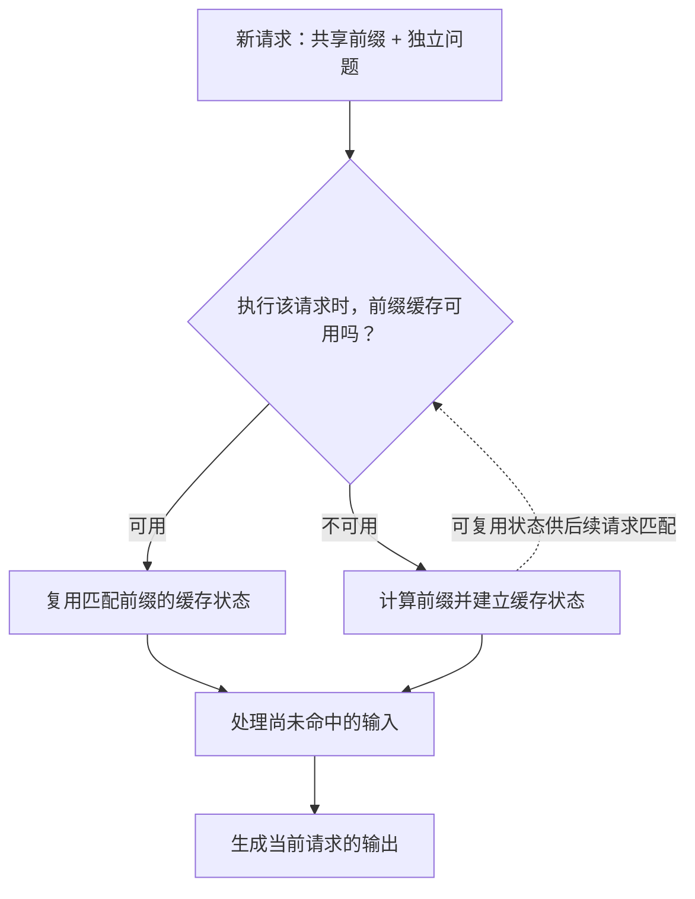
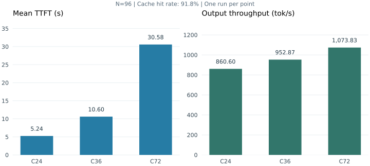

# 从缓存校准到并发取舍：DeepSeek-V4-Pro 在 Ascend 910C 上的一次 32k/1k 调优记录

这轮最高吞吐点是 C72：1073.83 tok/s，平均 TPOT 20.10 ms。降到 C24，吞吐为 860.60 tok/s，平均 TTFT 却从 30.58 s 降到 5.24 s，TPOT 仍为 20.55 ms。两组都满足目标，业务能接受多长等待，决定保留哪组。

目标是在双节点 Ascend 910C 上运行 DeepSeek-V4-Pro-W4A8，约 32K 输入、1K 输出、90% 缓存命中，平均 TPOT 不超过 50 ms，再争取输出吞吐。最初 C32 为 817.58 tok/s、TPOT 24.90 ms，但命中只有 85.8%，得先校准负载。

本轮没改服务并行策略、Kernel。变量先是共享前缀，再是客户端并发；下面把这两段分开，最后对照客户端的指标计算。

实测来自 2026-09-29，双节点 Ascend 910C、DeepSeek-V4-Pro-W4A8、SGLang Ascend 定制分支。当轮服务完整 commit 未归档，部署以留存脚本为准。指标、数据生成机制另按 `sgl-project/sglang @ d8c5eca3ac76456e923e76f55dd74bddc0e67404` 核对，检索日期为 2026-10-10，以下据该公开快照解释统计。

## 一、固定负载、服务配置与验收目标

共享前缀如何生成、请求路由到哪组 DP、正式请求前缓存是否就绪，都会改变“32K/1K、90% Cache”实际要算的工作。

目标输入 32,768 Token，输出 1,024 Token。90% 指输入中可复用的比例，剩余部分每请求仍要处理。

服务采用 DP8，P、D 在同一组双节点服务中共置执行。结果对应这套部署。

| 项目 | 本轮设置 |
| --- | --- |
| 设备 | 2 个节点，每节点 16 个可见 NPU 设备，共 32 个；Ascend 910C |
| 模型 | DeepSeek-V4-Pro-W4A8，ModelSlim 量化 |
| 运行时 | CANN 9.1.0，B070 环境中的 SGLang Ascend 定制分支 |
| 并行 | TP32、DP8，开启 DP Attention |
| MoE 通信 | DeepEP，`deepep-mode=auto` |
| 投机推理 | DSpark |
| Prefill 分块 | `chunked-prefill-size=16384` |
| 静态内存预算 | `mem-fraction-static=0.80` |
| 基线脚本的请求参数 | `max-running-requests=32` |
| 客户端 | `backend=sglang`，流式响应，`request-rate=inf` |
| 数据集 | `generated-shared-prefix`，1 个共享前缀组，单轮请求 |
| 生成与预热 | `temperature=0`，目标输出 1,024 Token，8 条预热请求，seed 42 |

TP32、DP8 使用 DPA 语义。CP 为 1 时，Attention TP 为 `32 / 8 = 4`，32 Rank 分成 8 组、每组 4 Rank；MoE 再按专家布局组织。[维度推导源码](https://github.com/sgl-project/sglang/blob/d8c5eca3ac76456e923e76f55dd74bddc0e67404/python/sglang/srt/runtime_context.py#L73-L92) 给出派生关系，Target、Draft、MoE 的实际路径仍由目标分支决定。

C72 是客户端最多 72 条在途请求。服务基线 `max-running-requests=32`，请求可能在内部排队，设备未必同时执行 72 条。

验收只限定平均 TPOT≤50 ms，以输出吞吐为主，没有 TTFT 硬门槛。日志保留的部分 P95、P99 也列出，缺失分位数不由均值补算。

## 二、校准实际缓存命中率

初始共享前缀 30,000 Token，独立问题 2,768，合计 32,768。按配置长度，共享比例约 91.6%。

实测却只有 85.8%。最终命中量要从实际输入、缓存 Token 计数取得。

请求 A、B 可以共享系统前缀，各自的问题后缀仍要 Prefill。命中前缀只省掉对应计算。

负载构造为：

复用还需要路由到可访问缓存的范围，预热状态已可用且未被逐出。本轮没有逐项测这些因素，先按最终命中率校准。

随后将前缀改成 31,900，独立问题改成 868。按首轮比例粗估，`85.8% × 31900 / 30000 ≈ 91.2%`，用于选择下一组长度，再由实测确认。

| 阶段 | 目标共享前缀 | 目标独立问题 | 两者合计 | 实测命中率 |
| --- | ---: | ---: | ---: | ---: |
| 初始配置，C32/N64 | 30,000 | 2,768 | 32,768 | 85.8% |
| 校准后，C48/N64 | 31,900 | 868 | 32,768 | 91.8% |
| 后续 C72、C36、C24，均为 N96 | 31,900 | 868 | 32,768 | 91.8% |

C48 实际总输入 2,143,110 Token，缓存 1,968,128，命中 91.84%。C36、C24 都为输入 3,214,586、缓存 2,951,168，约 91.81%，才接近预定条件。

这里计算总缓存 Token / 总输入 Token，与逐请求命中率平均可能不同。`Device: 100.0%` 则只说明命中的 Token 全来自设备，整个输入命中仍约 91.8%。[缓存统计实现](https://github.com/sgl-project/sglang/blob/d8c5eca3ac76456e923e76f55dd74bddc0e67404/python/sglang/benchmark/serving.py) 可核对两个分母。

实际长度也偏离目标。C48 中，31,900 的系统前缀变为 32,597，868 的问题均值为 888.1，完整请求平均约 33,486，比 32,768 高 2.2%。公开生成器先选 Token、解码为文本，再把完整文本编码统计，边界会变化，见 [生成文本的 `gen_prompt`](https://github.com/sgl-project/sglang/blob/d8c5eca3ac76456e923e76f55dd74bddc0e67404/python/sglang/benchmark/datasets/common.py#L79-L83)、[完整提示词的长度统计](https://github.com/sgl-project/sglang/blob/d8c5eca3ac76456e923e76f55dd74bddc0e67404/python/sglang/benchmark/datasets/generated_shared_prefix.py#L280-L298)。因此本轮按“目标 32k，实际约 33.5k”报告；定长测试应在最终编码后控制长度。

每轮等服务空闲，清缓存，预热 8 条，再发正式请求。路由是否被这些预热覆盖，也会影响最后命中。

所核对 CLI 的 `--flush-cache` 在预热之后清理。本轮先调用 `/flush_cache`，再预热，正式命令不带该 CLI 选项。复现需要保留这个顺序。

## 三、按实验条件比较并发结果

命中接近目标后再提高并发。前几轮同时改变请求总数，后续固定 N96，缩小比较条件的差别。

各轮条件为：

| 轮次 | 并发 C | 请求数 N | 共享前缀 / 独立问题 | Cache |
| --- | ---: | ---: | --- | ---: |
| R1 · 初始场景 | 32 | 64 | 30000 / 2768 | 85.8% |
| R2 · 校准后提高并发 | 48 | 64 | 31900 / 868 | 91.8% |
| R3 · 继续提高并发 | 72 | 96 | 31900 / 868 | 91.8% |
| R4 · 降低并发做对照 | 36 | 96 | 31900 / 868 | 91.8% |
| R5 · 再降低并发 | 24 | 96 | 31900 / 868 | 91.8% |

客户端结果为：

| 轮次 | TTFT（ms） | TPOT（ms） | E2E（ms） | 输出吞吐（tok/s） |
| --- | ---: | ---: | ---: | ---: |
| R1 | — | 24.90 | — | 817.58 |
| R2 | 15,283.01 | 20.33 | 36,079.04 | 934.30 |
| R3 | 30,578.72 | 20.10 | 51,145.44 | 1,073.83 |
| R4 | 10,597.34 | 21.58 | 32,677.36 | 952.87 |
| R5 | 5,240.74 | 20.55 | 26,265.41 | 860.60 |

C32、C72 来自当轮汇总，C48、C36、C24 还保留完整终端记录。未留存字段记“—”，C72 P95、P99 同样缺失。数据另见 [实验记录 CSV](../../assets/deepseek-v4-pro-32k-tuning/measurements.csv)。

C32→C48 吞吐提高约 14.3%，命中也增加约 6 个百分点。这段同时改变负载、并发，无法将增益全记到并发上。

C48 使用 N64，C72 使用 N96，让请求总数超过并发上限。N 同时影响填充、收尾，所以后面的比较固定 N96。

C24、C36、C72 均为 N96、seed 42、预热 8 条、命中约 91.8%。每点只测一次，TPOT 的 1–2 ms 差异只代表当轮。

C72 是本轮测完的最高吞吐点；C128/N160 在执行前停止，只完成准备。

## 四、TPOT 为什么不随并发单调变化

C72 降到 C36，平均 TPOT 却由 20.10 ms 升至 21.58 ms，约增加 7.4%。客户端请求更少，并不直接给出设备 batch 是否更合适，需要先看 TPOT 的时间范围。

每请求 TPOT 为：

$$
\mathrm{TPOT}_i = \frac{\mathrm{E2E}_i-\mathrm{TTFT}_i}{O_i-1}
$$

O 为输出数，目标 1,024，分母为 1,023。TTFT 从实际发请求到首个输出，包括服务侧等待、输入处理、客户端可见传输；E2E 到请求完成。客户端等待并发槽发生在发请求前，不在这里的 E2E 内。[`calculate_metrics`](https://github.com/sgl-project/sglang/blob/d8c5eca3ac76456e923e76f55dd74bddc0e67404/python/sglang/benchmark/serving.py#L1130-L1190) 给出了计算。

C36 的 `(32677.36 - 10597.34) / 1023 ≈ 21.58 ms`。C72 首 Token 多等约 20 s，首 Token 后生成略快，两种时间变化因此可以同时发生。

共置部署中，非命中 Prefill 继续占计算、调度资源。并发也改变 batch 形成和各 DP 请求节奏，Decode 耗时不能只由 C 推出。

`chunked-prefill-size=16384` 控制每轮输入块，影响未命中输入的穿插和调度次数。各 DP 剩余输入量不同，具体代价也可能不同。

本轮没有可对齐的时间线，还不能把这 1.48 ms 定位到具体阶段。

DSPARK 一轮还可能推进多枚 Token，TPOT 同时依赖周期耗时、有效推进。

C48、C36、C24 的 AL 为 5.68、5.73、5.68。C36 AL 略高，TPOT 却不是最低，成本端仍需一起测量。

C24 平均 TPOT 20.55 ms、ITL 中位数 15.88 ms，P99 ITL 133.55 ms、最大 1,570.04 ms；C36 P99 ITL 为 215.98 ms。公开客户端把一次流式间隔除以新增 Token 数再记 ITL，见 [流式间隔处理](https://github.com/sgl-project/sglang/blob/d8c5eca3ac76456e923e76f55dd74bddc0e67404/python/sglang/benchmark/serving.py#L778-L801)，所以这里已经折算了投机多 Token 更新。长尾现象已记录，调度、计算、通信、输出各占多少仍待时间线定位。

N96 几轮的平均 TPOT 都约 20–22 ms，降低 C 主要改善首 Token 和完整请求等待。

## 五、吞吐提高时，等待时间怎样变化

将同为 N96、命中约 91.8% 的三组放在一起：

各点只有单次结果，因此没有重复实验的误差范围。

| 对照项 | C24 | C36 | C72 |
| --- | ---: | ---: | ---: |
| 平均 TTFT（秒） | 5.24 | 10.60 | 30.58 |
| 平均生成阶段时间，E2E−TTFT（秒） | 21.02 | 22.08 | 20.57 |
| 平均 E2E（秒） | 26.27 | 32.68 | 51.15 |
| 平均 TPOT（ms） | 20.55 | 21.58 | 20.10 |
| 输出吞吐（tok/s） | 860.60 | 952.87 | 1,073.83 |

C24→C72，吞吐增约 24.8%，TTFT 变为约 5.8 倍，E2E 近翻倍。首 Token 后仍约 21 s，大部分新增时间在首 Token 之前。

下一步值得拆的是这段 TTFT，需要服务时间戳区分排队、输入处理及其他等待。

输出吞吐以成功输出总数除以正式时长。C24 的 98,304 Token / 约 114.23 s，约为 860.6 tok/s；展示值舍入会造成复算小差异。

同窗口的平均在途数还可按请求耗时之和计算：

$$
L = \frac{\sum_i \mathrm{E2E}_i}{T} = \frac{N_{\mathrm{success}}}{T}\,\overline{\mathrm{E2E}} = \lambda W
$$

它与 Little's Law 形式相同，也直接来自客户端统计定义，描述有限窗口内的平均量。实现见 [计算位置](https://github.com/sgl-project/sglang/blob/d8c5eca3ac76456e923e76f55dd74bddc0e67404/python/sglang/benchmark/serving.py#L1258-L1302)。

C24 的 96 条各输出 1,024，共 98,304。`860.60 / 1024 ≈ 0.8404` 请求/s，再乘平均 E2E `26.26541` s，约为 22.07，与报告 Concurrency 一致。C36 同理得到 30.41。

均值低于 C24、C36，因为窗口包含填充、收尾。用 C/TPOT 推容量会遗漏这两段。

在本轮目标下，C72 保留吞吐优势，C24 保留首 Token 响应优势；C36 居中，TTFT 已约为 C24 两倍。

## 六、日志中的几种统计口径

报告中的峰值却为 C24→35、C36→44、C48→57，超过客户端上限。

公开实现按秒分桶，一条请求覆盖起始、结束所在秒，都给桶加计数。一秒内旧请求结束、新请求补入，桶接触过的请求数可以超过 24，即使每一瞬间都未超过 24。[峰值统计源码](https://github.com/sgl-project/sglang/blob/d8c5eca3ac76456e923e76f55dd74bddc0e67404/python/sglang/benchmark/serving.py#L1194-L1236) 支持这一解释。

精确瞬时并发要由请求开始、结束时间重建，再对照服务 running 日志。

C36 输入吞吐 31,159.39 tok/s，分子包含约 91.8% 命中的输入。未命中共 `3214586 - 2951168 = 263418`，除以整轮时长可得非命中输入平均处理速率。纯 Prefill 算力仍需另定设备执行窗口。

完整性方面，C48 输出长度 `{1024: 64}`、C36 `{1024: 96}`，均无非空错误；C72 汇总为 96 条各 1,024。C24 摘要为 96 成功、98,304 输出，但未逐条核长度，分布、提前结束可继续查原 JSONL。

生成计数、文本重分词分别为 C48 的 65,536 / 65,456，C24 的 98,304 / 98,222。编码边界会变化，吞吐沿用生成数，重分词只辅助检查。

合成共享前缀用来控制性能负载，回答质量另作精度评测。换多前缀、冷热混合、真实会话，还要记录前缀组数、请求分布。

C72/N96 首批后只剩 24 条补入，有限窗口仍有明显填充、收尾。精确比较 20.10、21.58 ms 要先固定数据、N 重复；研究持续满载，则延长测量并观察稳定区间。

## 七、保留两种配置选择

保留的负载为单共享前缀组，`system/question=31900/868`、输出 1,024、seed 42、预热 8 条，清理顺序相同。N96 的 C24、C36、C72 命中约 91.8%，其中 C72、C24 分别留下吞吐、响应时间对照。

未解释的问题是：C 增大，TTFT 为何比吞吐涨得更多，而首 Token 后的平均生成相近。后续可在 C24、C72 同负载 Profile 中对齐等待、非命中输入、Draft/Verify、通信、流式输出，本轮尚无这项定位。

TP、DP、chunk、内存、DeepEP 在本轮保持不变，之后改动需要另建同口径对照。

[测试脚本与结果检查](../../examples/deepseek-v4-pro-32k-tuning/README.md) 留有客户端参数，服务地址、模型目录由变量输入，只请求已有服务，结果另存日志、JSONL。换环境先核 `--help` 和缓存顺序；归档还应包括实际导入路径、两端 commit、镜像摘要、启动参数。

这轮先校准了命中，再得到 N96 下的并发取舍。C72 和 C24 都已满足 TPOT 门槛，后续应补上的，是业务可以接受的首 Token 等待上限。
