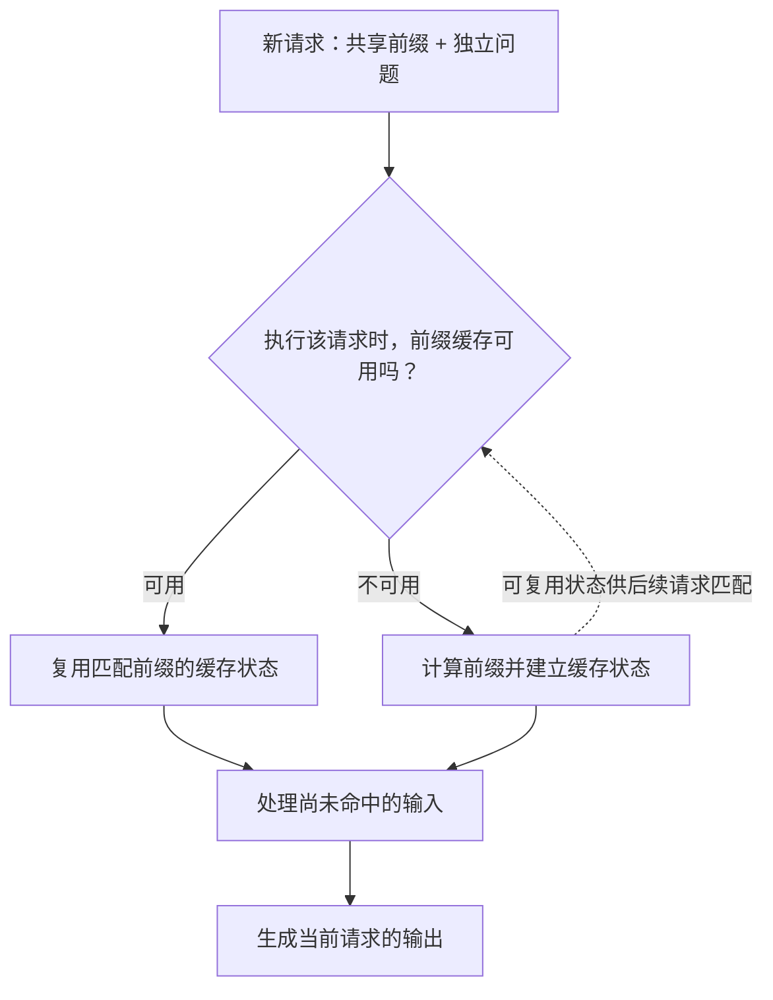

# 从缓存校准到并发取舍：DeepSeek-V4-Pro 在 Ascend 910C 上的一次 32k/1k 调优记录

这轮调优给 DeepSeek-V4-Pro-W4A8 设了一个明确目标：在双节点 Ascend 910C 上，以约 32K 输入、1K 输出和 90% 缓存命中率运行，平均 TPOT 控制在 50 ms 以内，再寻找更高的输出吞吐。

第一轮并发为 32，输出吞吐 817.58 tok/s、TPOT 24.90 ms，已经满足 TPOT 目标。不过，日志里的缓存命中率只有 85.8%，还没达到预定负载。校准前缀后继续测试，并发 72 得到本轮最高的 1073.83 tok/s、TPOT 20.10 ms；并发降到 24 后，TPOT 为 20.55 ms，平均 TTFT 则从 30.58 s 降到 5.24 s。两种并发对应着不同的吞吐和响应时间取舍。

这几轮没有改服务端并行策略或 Kernel。要解释结果，得先看前缀命中是否符合目标，再比较并发，最后核对客户端究竟怎样计算这些指标。

实测数据来自 2026-09-29 的压测记录，环境为双节点 Ascend 910C、DeepSeek-V4-Pro-W4A8、SGLang Ascend 定制分支。服务配置和客户端日志见下文；当轮服务源码的完整 commit 未随结果归档。文中的指标与数据生成机制另按 `sgl-project/sglang @ d8c5eca3ac76456e923e76f55dd74bddc0e67404` 核对，检索日期为 2026-10-10。以下按这个公开快照解释统计口径，部署参数则以当轮留存脚本为准。

## 一、固定负载、服务配置与验收目标

“32K/1K、90% Cache”还不足以复现这组负载。共享前缀如何构造、请求分到哪个 DP 组、正式测试前缓存是否就绪，都会影响实际执行量。

目标输入长度是 32,768 Token，目标输出长度是 1,024 Token。约 90% 的缓存命中率指输入 Token 中可复用的比例；每条请求仍然需要处理自己的非命中部分。

服务采用 DP8，Prefill 与 Decode 在同一组双节点服务中执行。这些结果对应共置部署，不能直接当作 P、D 独立部署后的成绩。

| 项目 | 本轮设置 |
| --- | --- |
| 设备 | 2 个节点，每节点 16 个可见 NPU 设备，共 32 个；Ascend 910C |
| 模型 | DeepSeek-V4-Pro-W4A8，ModelSlim 量化 |
| 运行时 | CANN 9.1.0，B070 环境中的 SGLang Ascend 定制分支 |
| 并行 | TP32、DP8，开启 DP Attention |
| MoE 通信 | DeepEP，`deepep-mode=auto` |
| 投机推理 | DSpark |
| Prefill 分块 | `chunked-prefill-size=16384` |
| 静态内存预算 | `mem-fraction-static=0.80` |
| 基线脚本的请求参数 | `max-running-requests=32` |
| 客户端 | `backend=sglang`，流式响应，`request-rate=inf` |
| 数据集 | `generated-shared-prefix`，1 个共享前缀组，单轮请求 |
| 生成与预热 | `temperature=0`，目标输出 1,024 Token，8 条预热请求，seed 42 |

TP32 和 DP8 需要放在 DP Attention 的语境里理解。TP 描述张量并行的总体宽度；DP Attention 让不同请求在不同 Attention 分组中处理。按公开源码中的维度关系，在 Attention CP 为 1 时，Attention TP 宽度为 `32 / 8 = 4`。这 32 个 Rank 在 Attention 中分成 8 组，每组宽度为 4；MoE 另按其专家布局组织。[维度推导源码](https://github.com/sgl-project/sglang/blob/d8c5eca3ac76456e923e76f55dd74bddc0e67404/python/sglang/srt/runtime_context.py#L73-L92) 给出了这层关系；具体 Target、Draft 与 MoE 的执行路径仍由目标分支决定。

后文的 C72 表示客户端最多允许 72 条请求同时在途。服务端基线的 `max-running-requests` 为 32，客户端发出的请求可能在内部等待，不能据此认为设备同时执行了 72 条请求。

本轮以输出吞吐为主要目标，只给平均 TPOT 设了不超过 50 ms 的门槛，没有给 TTFT 设硬限制。保留下来的日志还允许观察部分 P95、P99，缺失的分位数则无法从均值补出。

## 二、校准实际缓存命中率

最初把输入拆成 30,000 Token 的共享前缀和 2,768 Token 的独立问题。两者相加正好是 32,768，按配置长度估算，共享部分约占 91.6%。

正式运行却只测到 85.8%。配置中的共享长度只能给出预期；最终缓存了多少，要回到客户端记录的实际输入和缓存 Token 数。

可以把两条请求想成 A、B：它们复用相同的系统前缀，各自的问题后缀仍需计算。即使前缀已经命中，也不能把整条请求当成零 Prefill 开销。

下面用这个共同前缀与独立后缀的关系说明负载构造：

复用还要求请求落到能访问相应缓存的范围内，且预热产生的缓存已经可用、没有被挤出。本轮未逐项记录这些因素的占比，因此只能先校准最终命中结果。

随后把共享前缀改为 31,900、独立问题改为 868。沿用首轮比例粗估，`85.8% × 31900 / 30000 ≈ 91.2%`，预计可以接近目标；这个计算只用于选择下一组长度，仍需实测确认。

| 阶段 | 目标共享前缀 | 目标独立问题 | 两者合计 | 实测命中率 |
| --- | ---: | ---: | ---: | ---: |
| 初始配置，C32/N64 | 30,000 | 2,768 | 32,768 | 85.8% |
| 校准后，C48/N64 | 31,900 | 868 | 32,768 | 91.8% |
| 后续 C72、C36、C24，均为 N96 | 31,900 | 868 | 32,768 | 91.8% |

C48 的总输入为 2,143,110 Token，缓存 1,968,128 Token，命中率为 91.84%。C36 与 C24 都记录到总输入 3,214,586、缓存 2,951,168，命中约 91.81%。校准后的负载才接近预定条件。

这里用的是总缓存 Token 除以总输入 Token。输入长度不一致时，这个口径与“先算每条请求命中率，再取平均”可能不同。日志中的 `Device: 100.0%` 还有另一层分母：它表示命中的 Token 全部来自设备缓存。整个输入的命中率仍然是 91.8%，剩下的输入没有因为这行 100% 就消失。[缓存统计实现](https://github.com/sgl-project/sglang/blob/d8c5eca3ac76456e923e76f55dd74bddc0e67404/python/sglang/benchmark/serving.py) 可以核对这两个分母。

输入长度也有偏差。C48 的数据集统计里，目标 31,900 的系统前缀实际为 32,597，目标 868 的独立问题平均为 888.1；完整请求平均约 33,486 Token，比 32,768 高约 2.2%。公开数据生成实现会先选 Token、解码成文本，再将组合后的文本重新编码统计长度，解码再编码会改变 Token 边界。可查 [生成文本的 `gen_prompt`](https://github.com/sgl-project/sglang/blob/d8c5eca3ac76456e923e76f55dd74bddc0e67404/python/sglang/benchmark/datasets/common.py#L79-L83) 和 [完整提示词的长度统计](https://github.com/sgl-project/sglang/blob/d8c5eca3ac76456e923e76f55dd74bddc0e67404/python/sglang/benchmark/datasets/generated_shared_prefix.py#L280-L298)。本轮因此采用“目标 32k，实测平均约 33.5k”的长度口径。定长测试可以在最终编码后检查并控制输入长度。

每轮按相同顺序准备缓存：等服务空闲，清理缓存，预热 8 条，再开始正式请求。预热能否覆盖后续路由也影响命中结果，因此保留预热数和顺序。

这里还有一个容易复现错的顺序问题。所核对公开版本的 CLI `--flush-cache` 会在预热之后清缓存；本轮则先调用 `/flush_cache`，再预热，正式命令没有带这个 CLI 选项。换客户端版本时需要核对实际调用顺序。

## 三、按实验条件比较并发结果

缓存命中接近目标后，才继续提高并发。前几轮还调整过请求总数，后面则固定 N96，让并发比较有更接近的负载条件。

先列出各轮客户端条件，区分负载校准、请求总数与并发变化：

| 轮次 | 并发 C | 请求数 N | 共享前缀 / 独立问题 | Cache |
| --- | ---: | ---: | --- | ---: |
| R1 · 初始场景 | 32 | 64 | 30000 / 2768 | 85.8% |
| R2 · 校准后提高并发 | 48 | 64 | 31900 / 868 | 91.8% |
| R3 · 继续提高并发 | 72 | 96 | 31900 / 868 | 91.8% |
| R4 · 降低并发做对照 | 36 | 96 | 31900 / 868 | 91.8% |
| R5 · 再降低并发 | 24 | 96 | 31900 / 868 | 91.8% |

各轮客户端结果汇总如下：

| 轮次 | TTFT（ms） | TPOT（ms） | E2E（ms） | 输出吞吐（tok/s） |
| --- | ---: | ---: | ---: | ---: |
| R1 | — | 24.90 | — | 817.58 |
| R2 | 15,283.01 | 20.33 | 36,079.04 | 934.30 |
| R3 | 30,578.72 | 20.10 | 51,145.44 | 1,073.83 |
| R4 | 10,597.34 | 21.58 | 32,677.36 | 952.87 |
| R5 | 5,240.74 | 20.55 | 26,265.41 | 860.60 |

初始 C32 和 C72 的数值取自当轮留存汇总，C48、C36、C24 另有完整终端记录。表中没有保留的字段用“—”表示，没有根据其他字段反推填入。C72 的 P95、P99 也未补录。数据表的可下载版本见 [实验记录 CSV](../../assets/deepseek-v4-pro-32k-tuning/measurements.csv)。

C32 到 C48 的输出吞吐提高了约 14.3%，但缓存命中率也增加了约 6 个百分点。这一段变化同时包含负载校准和并发调整的影响，无法单独归因于并发。

C48 用 N64，C72 用 N96，目的是让请求总数超过并发上限。但总数变化也会改变填充和收尾的占比，后面的比较因此固定请求数。

C24、C36、C72 都使用 N96、seed 42、预热 8 条，命中约 91.8%。每个点只跑了一次，TPOT 相差 1–2 ms 是当轮观察，还不能当作稳定的排序。

C72 是已经测完的最高吞吐点。C128/N160 只完成了准备，测试在执行前停止，没有可用于比较的结果。

## 四、TPOT 为什么不随并发单调变化

并发从 C72 降到 C36 后，平均 TPOT 从 20.10 ms 变成 21.58 ms，反而增加约 7.4%。较少的客户端请求未必形成更有利的设备 batch，得先看这个均值包含哪些时间。

客户端按每条请求计算 TPOT：

$$
\mathrm{TPOT}_i = \frac{\mathrm{E2E}_i-\mathrm{TTFT}_i}{O_i-1}
$$

其中 O 是输出 Token 数。本轮每条目标输出都是 1,024，所以分母为 1,023。TTFT 是从实际发起请求到收到首个输出的时间；它包含服务侧等待、输入处理及客户端可观察到的传输时间。E2E 是同一请求的完整耗时。客户端等待并发槽位的时间发生在发请求之前，不包含在这个 E2E 中。TPOT 则把首个输出之后剩下的时间摊到后续 Token 上。[`calculate_metrics`](https://github.com/sgl-project/sglang/blob/d8c5eca3ac76456e923e76f55dd74bddc0e67404/python/sglang/benchmark/serving.py#L1130-L1190) 可以核对这个计算。

以 C36 为例，`(32677.36 - 10597.34) / 1023 ≈ 21.58 ms`。C72 的首 Token 等待多了约 20 s，但首 Token 后的平均生成时间稍短，因此 TTFT 大幅增加的同时，TPOT 仍然可以下降。

共置部署中，非命中输入的 Prefill 会继续占用计算和调度资源。客户端并发变化还会改变组批方式及不同 DP 组收到请求的节奏，不能仅凭并发大小判断 Decode 会更快还是更慢。

`chunked-prefill-size=16384` 也参与这个过程：它限制每轮处理的输入块，既影响剩余非命中输入如何穿插，也可能增加调度次数。实际代价还取决于各 DP 组剩下多少输入需要计算。

本轮没有采集可对齐的时间线，因而还无法解释这 1.48 ms 具体花在哪个阶段。

DSPARK 又增加了一层关系：一次迭代可能提交多个 Token，最终 TPOT 同时受每轮耗时和实际推进长度影响。只看接受长度 AL，无法判断迭代成本是否一起增长。

C48、C36、C24 的 AL 分别是 5.68、5.73、5.68。C36 的 AL 略高，平均 TPOT 却没有最低，正好说明这两个指标需要结合周期成本看。

流式返回的长间隔也被平均 TPOT 压缩了。C24 的平均 TPOT 是 20.55 ms，ITL 中位数 15.88 ms，但 P99 ITL 为 133.55 ms，最大值 1,570.04 ms。C36 的平均 TPOT 为 21.58 ms，P99 ITL 已到 215.98 ms。投机输出可能一次返回多个 Token；所核对的公开 `sglang` 客户端会把一次流式更新的间隔除以新增 Token 数，再把这个值记入 ITL 样本，见 [流式间隔处理](https://github.com/sgl-project/sglang/blob/d8c5eca3ac76456e923e76f55dd74bddc0e67404/python/sglang/benchmark/serving.py#L778-L801)。因此，这里的 ITL 描述经过客户端折算的流式间隔。长尾要沿调度、计算、通信和输出时间线继续定位；本轮记录到了现象，尚未定位具体阶段。

固定 N96 的几轮中，平均 TPOT 都在 20–22 ms 附近。降低并发主要改善了首 Token 等待和完整请求耗时，TPOT 没有随并发单调变化。

## 五、吞吐提高时，等待时间怎样变化

把同为 N96、命中约 91.8% 的三轮放在一起，取舍会更清楚：

图中每个点都来自单次测试，尚无重复实验可画误差范围。

| 对照项 | C24 | C36 | C72 |
| --- | ---: | ---: | ---: |
| 平均 TTFT（秒） | 5.24 | 10.60 | 30.58 |
| 平均生成阶段时间，E2E−TTFT（秒） | 21.02 | 22.08 | 20.57 |
| 平均 E2E（秒） | 26.27 | 32.68 | 51.15 |
| 平均 TPOT（ms） | 20.55 | 21.58 | 20.10 |
| 输出吞吐（tok/s） | 860.60 | 952.87 | 1,073.83 |

C24 到 C72 的吞吐增加约 24.8%，平均 TTFT 却变为约 5.8 倍，E2E 接近翻倍。首 Token 后的生成时间仍约 21 s，大部分新增等待发生在首 Token 之前。

这使 TTFT 成为下一步值得拆解的部分。需要服务端时间戳，才能继续区分排队、输入处理及其他首 Token 前开销。

表里的输出吞吐用全部成功请求的输出 Token 除以正式测试时长。C24 的 98,304 Token 分布在约 114.23 s 内，得到约 860.6 tok/s；展示值有舍入，复算时会有细小差异。

同一个测试窗口里，平均在途请求数还可以用请求耗时之和计算：

$$
L = \frac{\sum_i \mathrm{E2E}_i}{T} = \frac{N_{\mathrm{success}}}{T}\,\overline{\mathrm{E2E}} = \lambda W
$$

这与 Little's Law 的形式一致；这里的等式也直接来自客户端的统计定义，描述的是有限测试窗口内的平均量。[计算位置](https://github.com/sgl-project/sglang/blob/d8c5eca3ac76456e923e76f55dd74bddc0e67404/python/sglang/benchmark/serving.py#L1258-L1302) 同时给出了吞吐与平均并发的口径。

C24 共输出 98,304 Token，96 条请求平均每条 1,024。由 `860.60 / 1024 ≈ 0.8404` 得到每秒完成请求数，再乘平均 E2E `26.26541` s，结果约为 22.07，与报告的 Concurrency 22.07 一致。C36 同样得到约 30.41。

这两个平均值低于客户端上限 24、36，是因为统计窗口也包含开始填充和最后收尾的时间。用 C 除以 TPOT 直接估算系统容量，会漏掉这些因素。

因此，本轮若优先要更高吞吐，可以选 C72；若更在意首 Token 响应，可以选 C24。C36 位于两者之间，但其 TTFT 已约为 C24 的两倍。

## 六、日志中的几种统计口径

报告中还有一个看似冲突的数值：C24 的峰值并发为 35，C36 为 44，C48 为 57，都超过客户端设置的上限。

所核对的公开实现按秒分桶统计峰值并发：一条请求覆盖了哪几个秒桶，就给这些桶各加一次，起始秒和结束秒都包括在内。假设某个秒桶的前半段有 24 条请求，其中一些结束后，后半段又补入新请求；这个桶接触过的请求可以超过 24，尽管任一精确时刻的在途数都没有超过 24。[峰值统计源码](https://github.com/sgl-project/sglang/blob/d8c5eca3ac76456e923e76f55dd74bddc0e67404/python/sglang/benchmark/serving.py#L1194-L1236) 支持这种解释。

若要核对精确的瞬时在途数，需要用实际请求的开始、结束时间重建，并结合服务端 running 日志判断。

C36 的输入吞吐达到 31,159.39 tok/s，这个分子包括全部输入，其中约 91.8% 已复用缓存。它衡量服务完成这些输入的速率。未命中输入共 `3214586 - 2951168 = 263418` Token，除以整轮时间可以得到非命中输入的平均处理速率；要测纯 Prefill 计算能力，还需另行界定设备实际执行的窗口。

输出是否完整需要另查。C48 的正式输出长度分布是 `{1024: 64}`，C36 是 `{1024: 96}`，两轮均无非空错误；C72 汇总记录了 96 条请求各输出 1,024。C24 的终端摘要记录 96 条成功、总输出 98,304，但未在摘要中逐请求核对长度，提前结束及长度分布仍可从原始 JSONL 检查。

生成计数与文本重新分词的计数也不同：C48 分别为 65,536、65,456，C24 为 98,304、98,222。重新编码可能改变 Token 边界，本文吞吐沿用客户端的生成计数，重分词结果用于辅助检查。

合成共享前缀便于控制负载，这组记录关注服务性能和输出完整性，回答质量仍需独立精度评测。扩展到多前缀、冷热混合或真实会话时，还要记录前缀组数和请求分布，避免只用一个命中率概括负载。

N96 对 C72 而言，在初始请求后只剩 24 条补入，填充和收尾仍占明显比例。这些数据能展示有限测试时长内的取舍，还不足以代表持续满载的稳态。若要精确比较 20.10 ms 与 21.58 ms，应先固定数据和 N 重复测试；研究稳态时，则需要延长测量并单独观察稳定区间。

## 七、保留两种配置选择

本轮保留的负载为一个共享前缀组：`system/question=31900/868`、目标输出 1,024、seed 42、预热 8 条，正式测试前按相同顺序清缓存。C24、C36、C72 均保持 N96，实测命中约 91.8%。C72 留作最高吞吐点，C24 留作低响应时间的对照。

后续最需要回答的是：为什么并发增加后的 TTFT 涨幅远大于吞吐收益，而生成阶段的平均每 Token 时间又相近。可以在 C24、C72 的同负载 Profiling 中，对齐请求等待、非命中输入、Draft/Verify、通信和流式输出的时间线。本轮尚未把新增时间定位到其中某一阶段。

TP、DP、chunk、内存及 DeepEP 配置在本轮比较中保持一致。后续调整这些参数时，应各自建立对照，并保留相同的数据来源与统计口径。

配套的 [测试脚本与结果检查](../../examples/deepseek-v4-pro-32k-tuning/README.md) 保留了本轮客户端参数，服务地址和模型目录通过变量传入；脚本只请求已有服务，结果保存为独立的日志与 JSONL。换到其他环境时，先核对 `--help` 和缓存清理顺序。归档时还应记录实际导入的 SGLang 路径、服务与客户端完整 commit、镜像摘要和启动参数，避免只剩一个脚本文件名。

这轮先用实测纠正了共享前缀的长度估算，再在 N96 下比较并发。保留下来的两个点都满足 TPOT 目标：C72 输出吞吐 1073.83 tok/s，C24 输出吞吐 860.60 tok/s、平均 TTFT 5.24 s。具体选择哪一个，取决于业务愿意为这部分吞吐多等多久。
