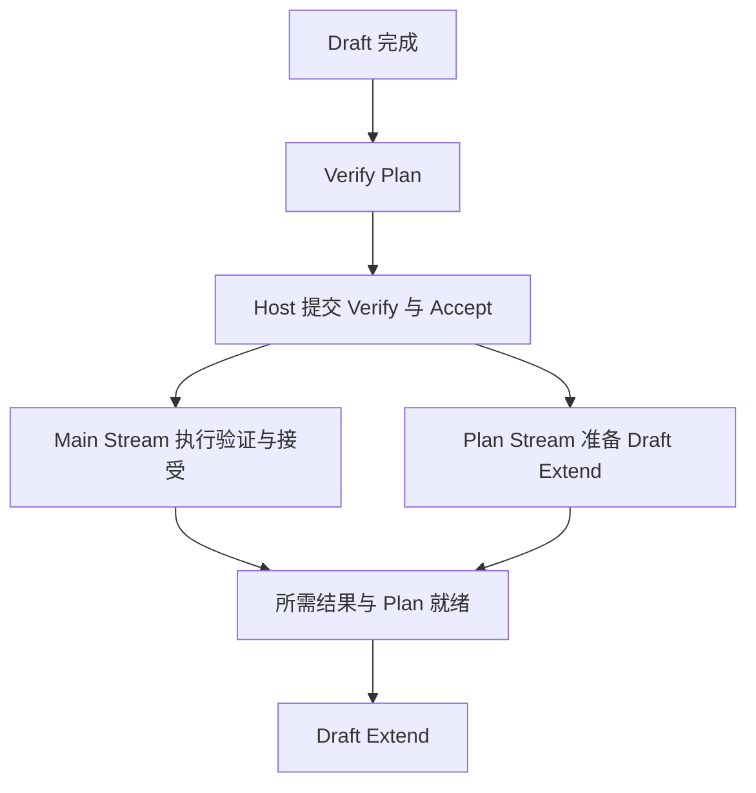

# Ascend 910C 投机解码：Graph、多流与通信的执行依赖

Ascend 910C 的一次投机周期需要 Draft、Verify、Accept 和提交。Graph 减少重复提交，多流利用独立工作，但下阶段仍需等待候选、缓存和通信结果。

下面沿 V4 EAGLE/NextN 标出这些依赖：各 Graph 捕获什么，Plan Stream 等在哪里，DeepEP 结果何时被消费。源码能确定调用关系，哪段真正最长仍需设备时间线。

<details markdown="1">
<summary>源码版本与阅读范围</summary>

> 源码固定到 `sgl-project/sglang @ 5c69e32abe013fa1b913022682a3104c79105f37`，核对日期为 2026-09-21。主线是 V4、EAGLE/NextN、Ascend 910C、dsv4。图由 Stream、Event、Wait、Graph 调用推导，仅表达依赖，时长与重叠比例需另测。

</details>

## 一、Graph、Stream 与通信各自负责什么

先把各机制放回周期中的职责：

| 机制 | 本文对应的执行方式 |
| --- | --- |
| Draft Graph | 捕获完整 `draft_forward()`，执行 `num_steps - 1` 次 NextN Forward |
| Verify Graph | 按请求数选择档位，每请求保留固定 Verify 宽度 |
| Plan Stream | Verify Prep 等待 Draft；Draft-Extend Prep 可与已提交的主流尾部重叠 |
| Target 多流 | 重叠 Q、KV 与 Indexer 等独立工作；NextN 未接入这组 alt streams |
| DeepEP 异步通信 | 分开发起与等待，在中间安排独立计算 |
| Draft-Extend Graph | 用重复启动成本的节省，交换捕获与 workspace 内存开销 |

下文按捕获宽度、等待边界和配置入口展开。

稳态骨架为：

```text
上一轮 confirmed state
        │
        ▼
Draft Graph
(num_steps - 1 次 NextN forward)
        │
        ▼
Verify Planning
        │
        ▼
Target Verify Graph
        │
        ▼
Accept / Commit
        │
        ├──────── Draft-Extend Planning
        │           可与 main-stream tail overlap
        ▼
Draft Extend Forward / Graph
        │
        ▼
下一轮 candidate1
```

沿这条链，重点寻找各分支汇合时仍在等待谁，以及哪些规划、通信已被独立工作覆盖。


## 二、Draft Graph 捕获哪些 NextN Forward

NPU Draft 使用 `EAGLEDraftNpuGraphRunner`，入口见 [`eagle_draft_npu_graph_runner.py`](https://github.com/sgl-project/sglang/blob/5c69e32abe013fa1b913022682a3104c79105f37/python/sglang/srt/hardware_backend/npu/graph_runner/eagle_draft_npu_graph_runner.py)。


它继承 CUDA 命名的通用 Runner，但实际底层为 `torch.npu.NPUGraph`。

先看 Capture Body。

捕获目标为：

```python
def run_once():
    ...
    ret = self.eagle_worker.draft_forward(
        forward_batch
    )
    ...
    return ret
```

一次 Replay 覆盖整个 draft_forward，而不是单独一回模型 forward。


对应实现见 [`EAGLEDraftCudaGraphRunner.capture_one_shape()`](https://github.com/sgl-project/sglang/blob/5c69e32abe013fa1b913022682a3104c79105f37/python/sglang/srt/speculative/eagle_draft_cuda_graph_runner.py)。

### `draft_forward()` 的 NextN Forward 次数

rollout 循环的关键顺序为：

```python
for i in range(self.speculative_num_steps):
    ...
    select_top_k_tokens(...)

    if i == self.speculative_num_steps - 1:
        break

    logits_output = self.draft_runner.forward(
        forward_batch
    ).logits_output
```


入口见 [`EagleDraftWorker.draft_forward()`](https://github.com/sgl-project/sglang/blob/5c69e32abe013fa1b913022682a3104c79105f37/python/sglang/srt/speculative/eagle_worker_v2.py#L778-L951)。

循环先选择候选，到最后一次迭代便退出，因此 Graph 内的 NextN Forward 次数为 `speculative_num_steps - 1`。首候选由前一阶段 Draft Extend 产生，成本不在当前 Draft Graph 内。

以常见的 `num_steps=2, topk=1, num_draft_tokens=3` 为例，进入 Replay 前已有 candidate1，Graph 只需再执行一次 NextN 得到 candidate2，随后整理结果。若 num_steps=3，就需要两次 NextN，依次得到 candidate2 和 candidate3。

| num_steps | Graph 内候选阶段数 | Graph 内 NextN Forward 次数 |
| ---: | ---: | ---: |
| 2 | 2 | 1 |
| 3 | 3 | 2 |

候选阶段数与模型调用数相差一，是因为循环第一次选择候选时已经有了 seed。

### Draft Graph 的静态宽度是什么

Draft Decode 的逐请求宽度由下列函数决定。[`resolve_num_tokens_per_req()`](https://github.com/sgl-project/sglang/blob/5c69e32abe013fa1b913022682a3104c79105f37/python/sglang/srt/speculative/spec_utils.py#L90-L119)

`resolve_num_tokens_per_req(phase="draft_decode")`

它返回 `speculative_eagle_topk`。


所以 topk=1 时每次 NextN 每请求一行，Graph 内再顺序运行 num_steps−1 次。

NextN 较轻时，Python、launch 和 metadata 的固定开销容易占较大比重。捕获整个小循环，可以合并这部分重复提交；收益仍需看实际执行时间。

### Graph/Eager 选择本身也可能是分布式一致性状态

特定 DSA IndexShare+DPA 下，can_run_graph 将本地可运行且 seed_ready 的结果在 model TP 组归约：

```python
torch.distributed.all_reduce(
    decision,
    op=MIN,
    group=tp_group,
)
```

Draft 仍有 TP/EP collective。

若同一次 Forward 中 Rank0 选 Graph、Rank1 选 Eager，就可能破坏通信次序，因此 Graph/Eager 路由也需要协作一致。


## 三、Verify Graph 的 Batch Bucket 与 Token 宽度

Draft 后，Target 进入通用 Decode / NPU Graph Runner。


NPU 入口见 [`NPUGraphRunner`](https://github.com/sgl-project/sglang/blob/5c69e32abe013fa1b913022682a3104c79105f37/python/sglang/srt/hardware_backend/npu/graph_runner/npu_graph_runner.py)。

初始化设置：

```python
self.captured_req_width
=
model_runner.decode_num_tokens_per_req(
    num_draft_tokens=...
)
```

普通 EAGLE Target 的 `captured_req_width = speculative_num_draft_tokens`。


- [`ModelRunner.decode_num_tokens_per_req()`](https://github.com/sgl-project/sglang/blob/5c69e32abe013fa1b913022682a3104c79105f37/python/sglang/srt/model_executor/model_runner.py#L825-L846)
- [`resolve_num_tokens_per_req()`](https://github.com/sgl-project/sglang/blob/5c69e32abe013fa1b913022682a3104c79105f37/python/sglang/srt/speculative/spec_utils.py#L90-L119)

例如 `num_draft_tokens=3`，每请求 Verify 固定三行。

### 当前 EAGLE 不是 Ragged Verify

这里需与 DSpark Ragged 分开。

算法能力判断为：

```python
return self.is_dspark()
```


实现见 [`spec_info.py`](https://github.com/sgl-project/sglang/blob/5c69e32abe013fa1b913022682a3104c79105f37/python/sglang/srt/speculative/spec_info.py#L160-L164)。

因此本篇 EAGLE 每请求仍执行固定的 num_draft_tokens 行，不会把 Req0/1/2 的 Verify 长度 2/3/1 压紧成六行，再按总 Token 数选择 bucket。接受长度在 Verify 后才得到，只影响提交，无法减少已经执行的窗口。

### 普通 EAGLE Graph 首先按 Request Batch Size 选 Bucket

non-ragged load_batch 首先按请求数选档：

```python
raw_num_token
=
raw_bs * captured_req_width

bs
=
_pad_to_bucket(
    raw_bs,
    capture_bs,
)

padded_num_tokens
=
bs * captured_req_width
```


实现见 [`DecodeCudaGraphRunner.load_batch()`](https://github.com/sgl-project/sglang/blob/5c69e32abe013fa1b913022682a3104c79105f37/python/sglang/srt/model_executor/runner/decode_cuda_graph_runner.py)。

例如 raw_bs=5、num_draft_tokens=3，请求 bucket 为 1、2、4、8：真实 Verify 有 `5 × 3 = 15` 行，选中 bucket=8 后，Replay 执行 `8 × 3 = 24` 行，其中九行为 padding。Graph 节省 launch、Python 和控制开销，也付出了这些额外行的执行成本。

### DP Attention 下 admission 甚至不是本 Rank 的 raw_bs

需要 MLP TP gather 时，准入还使用：

```python
cuda_graph_bs
=
max(
    forward_batch.original_global_num_tokens_cpu
)
```

即相关 Attention-DP 的 raw 请求计数最大值。

各参与者据此进入兼容 global-max 几何的 bucket。

padding 也为 captured collective 提供兼容形状，不能只按本地利用率评价。


核算时先取相关 DP 参与者中的最大请求数，再将它向上匹配 Capture bucket，最后乘固定 Verify Width。bucket 是请求数对齐后的结果，不应再与最大请求数相乘。

### `--cuda-graph-bs-decode` 在这里是 Request Bucket，不是 EAGLE Verify Token Bucket

固定 best-practice 有 `--cuda-graph-bs-decode 1 2 4 8`，另有 `1 2 4 8 10`。


这些 key 在普通 EAGLE 中首先计请求槽位。

宽度为 3 时，Token 行数才是 `bucket_bs × 3`。

DSpark Ragged 的支持路径另按 graph_num_tokens tier，具体设备适用性见对应专题。

## 四、Plan Stream 与计算的依赖关系

`SGLANG_ENABLE_OVERLAP_PLAN_STREAM=1` 通过 `torch.get_device_module(device).Stream()` 创建独立 Plan Stream。


入口见 [`get_plan_stream()`](https://github.com/sgl-project/sglang/blob/5c69e32abe013fa1b913022682a3104c79105f37/python/sglang/srt/speculative/spec_utils.py#L1132-L1140)。

独立 Stream 提供执行位置，能否并发取决于具体 wait。


### Verify Planning 等待 Draft 结果

`run_eagle_verify` 先取 `fwd_stream = current_stream()`，随后让 planning 等待当前流已提交的工作：

```python
with plan_stream_ctx:
    plan_stream.wait_stream(
        fwd_stream
    )

    eagle_prepare_for_verify(...)
```

Prep 要读取 Draft Tree metadata，必须等 frontier 完成。

planning 完成后，main 又等待：

```python
current_stream().wait_stream(
    plan_stream
)
```

之后才能启动 Target。


实现见 [`run_eagle_verify()`](https://github.com/sgl-project/sglang/blob/5c69e32abe013fa1b913022682a3104c79105f37/python/sglang/srt/speculative/eagle_worker_common.py#L462-L675)。

设备顺序为 `Draft → Verify Plan → Target Verify`。Draft compute 与 Verify Prep 在这条路径没有设备重叠。

Plan Stream 主要提供以下组织方式：

- 将规划工作放到独立流；
- 避免不必要的 Host 阻塞；
- 明确 metadata 交接；
- 用流依赖表达顺序。

必要依赖依然在关键路径上。

### Draft-Extend Planning：这里反而真的可以跨阶段 overlap

Verify 后，Draft Extend 先构造输入、select_index 和 next_token_ids，再直接进入计划流：

```python
with self.plan_stream_ctx:
    forward_batch = prepare_for_draft_extend(...)
```

这里 planning 前没有调用 `plan_stream.wait_stream(current_stream)`。


入口见 [`_draft_extend_for_decode()`](https://github.com/sgl-project/sglang/blob/5c69e32abe013fa1b913022682a3104c79105f37/python/sglang/srt/speculative/eagle_worker_v2.py)。

Python 返回不代表已入队 NPU 工作完成。因此只要 Prep 不读取尚未 ready 的值，就可能与 main 上剩余 Verify/Accept tail 并发。

实现先在主流处理 `next_token_ids = batch_result.next_token_ids.to(torch.int64)`，再进入 Plan Stream，避免在其中引入额外跨流同步或 data race。

而 Extend 模型执行前还会等待：

```python
current_stream().wait_stream(
    self.plan_stream
)
```

两种规划的差别在于开始前的依赖：

| 规划阶段 | 开始前等待 | 模型执行前等待 | 可重叠的部分 |
| --- | --- | --- | --- |
| Verify Prep | Plan 等 Draft 所在流 | Target 等 Plan | 此路径的 Draft compute 与 Verify Prep 串行 |
| Draft-Extend Prep | 此处没有先等主流尾部 | Extend 等 Plan 与所需结果 | 可能与已提交的 Verify/Accept 主流尾部并发 |

这里描述源码允许的依赖关系，实际重叠区间仍需在 NPU 时间线上确认。

## 五、Target 与 Draft 的多流路径

`SGLANG_NPU_USE_MULTI_STREAM=1` 控制单模型层内部工作，与跨阶段 Plan Stream 的范围不同。

Target 初始化开启该选项后，建立 alt_streams 并传给各 Decoder Layer。


入口见 [`DeepseekV4Model.__init__()`](https://github.com/sgl-project/sglang/blob/5c69e32abe013fa1b913022682a3104c79105f37/python/sglang/srt/models/deepseek_v4.py)。

Attention 还按以下条件准入：

```python
_is_npu
and SGLANG_NPU_USE_MULTI_STREAM
and self.alt_streams is not None
and x.shape[0] <= self._multi_stream_bs_limit
and not forward_batch.forward_mode
    .is_extend_or_draft_extend_or_mixed()
```


实现见 [`DeepSeek-V4 Attention forward`](https://github.com/sgl-project/sglang/blob/5c69e32abe013fa1b913022682a3104c79105f37/python/sglang/srt/models/deepseek_v4.py)。

需连同模式 helper 和模型传参一起看。

### `TARGET_VERIFY` 没有被排除

is_extend() 将 TARGET_VERIFY 归为 extend-family。

多流条件却调用 `is_extend_or_draft_extend_or_mixed()`。

它默认 `include_draft_extend_v2 = False`。

因而这一层排除 `EXTEND`、`MIXED`、`SPLIT_PREFILL`，没有排除 `TARGET_VERIFY`。


helper 定义见 [`ForwardMode`](https://github.com/sgl-project/sglang/blob/5c69e32abe013fa1b913022682a3104c79105f37/python/sglang/srt/model_executor/forward_batch_info.py#L176-L275)。

所以 Target 的 `DECODE` 与 `TARGET_VERIFY` 均可满足这一模式条件，还需检查环境、行数及层条件。

### `DRAFT_EXTEND_V2` 也没有被 helper 默认排除，但 NextN 自己没有 alt streams

DRAFT_EXTEND_V2 默认也未被 helper 排除。

最终可达性还取决于模型是否传入 alt_streams。

NextN 创建唯一层时明确设置：

```python
self.decoder = DeepseekV4DecoderLayer(
    ...,
    alt_streams=None,
    ...
)
```


入口见 [`deepseek_v4_nextn.py`](https://github.com/sgl-project/sglang/blob/5c69e32abe013fa1b913022682a3104c79105f37/python/sglang/srt/models/deepseek_v4_nextn.py#L97-L105)。

所以 NextN 的 alt_streams=None，不能只从 helper 判断它已走多流。

各阶段可对照为：

| Phase | ForwardMode | Model | Attention NPU Multi-Stream |
| --- | --- | --- | --- |
| 普通 Target Decode | `DECODE` | Target | **可达**，还需 env / token rows / layer 条件满足 |
| EAGLE Target Verify | `TARGET_VERIFY` | Target | **可达** |
| EAGLE Draft Decode | `DECODE` | NextN | **不可达**，NextN decoder 的 `alt_streams=None` |
| EAGLE Draft Extend | `DRAFT_EXTEND_V2` | NextN | **不可达**，同上 |
| 普通 Prefill | `EXTEND` | Target | 该 NPU Attention Multi-Stream path 被 mode 条件排除 |

### Target 多流中的独立计算分支

Target 将准备工作分到三条流：

| 流 | 工作 |
| --- | --- |
| `stream_kv` | KV projection、Norm、RoPE、KV cache store |
| `stream_q` | Q projection、RMSNorm、RoPE |
| current stream | Indexer / Compressor |

最后汇合：

```python
current_stream.wait_stream(stream_kv)
current_stream.wait_stream(stream_q)
```

才执行 Attention。


实现见 [`_forward_prepare_multi_stream_npu()`](https://github.com/sgl-project/sglang/blob/5c69e32abe013fa1b913022682a3104c79105f37/python/sglang/srt/models/deepseek_v4.py#L1537-L1635)。

局部理想模型为：

```text
T_prepare
≈
T_prefix
+
max(
  T_Q,
  T_KV,
  T_indexer/compressor
)
```

不会简单相加三个分支。

实际重叠还受 Cube/Vector 争用、HBM、occupancy、CANN 调度、行数影响，需从开始、结束和 join 量暴露等待。

固定非 Blackwell 分支的 row limit 为 64，检查的是当前 x.shape[0]，不是 max_running_requests。

## 六、DeepEP 从异步 Launch 到等待结果

Verify 还进入 MoE，官方 recipe 采用：


```text
--moe-a2a-backend deepep
--deepep-mode auto
```

创建 Dispatcher 时传入：

```python
async_finish=True
return_recv_hook=True
```


入口见 [`fused_moe_triton/layer.py`](https://github.com/sgl-project/sglang/blob/5c69e32abe013fa1b913022682a3104c79105f37/python/sglang/srt/layers/moe/fused_moe_triton/layer.py)。

异步 Launch 不会解除 Dispatch 与 Routed Expert GEMM 的数据依赖，后者必须拿到接收的 Token。


### Normal DeepEP：通信异步 Launch，但 Expert 前仍必须 Wait

Normal 执行顺序为：

```python
previous_event = Buffer.capture()

buffer.dispatch(
    ...,
    async_finish=True,
    allocate_on_comm_stream=True,
)
```

通信可在 Comm Stream 启动。

消费专家输入前，dispatch_b 仍调用：

```python
event.current_stream_wait()
```

等待接收完成。


实现见 [`_DeepEPDispatcherImplNormal`](https://github.com/sgl-project/sglang/blob/5c69e32abe013fa1b913022682a3104c79105f37/python/sglang/srt/layers/moe/token_dispatcher/deepep.py#L537-L735)。

`async_finish` 分开 Launch 与 Wait，专家 GEMM 仍在接收完成后执行。Combine 同样先异步发起，再由 `event.current_stream_wait()` 保证后续 hidden consumer 能读到结果。

因此能覆盖多少通信，取决于等待前可安排多少独立工作。


### Shared Expert 正好是一个独立 branch

shared expert 未融合时，可以放到 alt stream：

```python
self.alt_stream.wait_stream(
    current_stream
)

with alt_stream:
    shared_output
    =
    _forward_shared_experts(...)
```

主路径继续执行 TopK、Dispatch、Routed Experts 和 Combine，最终与 shared 输出相加前再等待 shared branch。


实现见 [`DeepseekV2MoE.forward_deepep()`](https://github.com/sgl-project/sglang/blob/5c69e32abe013fa1b913022682a3104c79105f37/python/sglang/srt/models/deepseek_v2.py#L1418-L1665)。

两路可能形成：

```text
Routed path
Router
  ↓
Dispatch ───────── Expert ───── Combine
██████████████████████████████████████

Shared side stream
Shared Expert
████████████████
```

Shared Expert 可覆盖 routed 路径的一部分，其中可能包含通信。分析时既要记录通信总时长，也要量出汇合点暴露的等待：通信结束后，究竟还有多少尾部没有被独立计算覆盖。

### Low-Latency DeepEP：`recv_hook` 把 Wait 推迟到 Consumer Boundary

low_latency 采用：

```python
buffer.low_latency_dispatch(
    ...,
    async_finish=False,
    return_recv_hook=True,
)
```

它返回 event 与 hook。外层依次调用 `dispatch_a()`、`deepep_dispatch_hooks`、`dispatch_b()`，到 dispatch_b 才执行 `hook()`，完成接收后允许专家消费。

实现见 [`_DeepEPDispatcherImplLowLatency`](https://github.com/sgl-project/sglang/blob/5c69e32abe013fa1b913022682a3104c79105f37/python/sglang/srt/layers/moe/token_dispatcher/deepep.py)。

从 `low_latency_dispatch` 发起到 `recv_hook()` 执行之间，可插入不依赖接收结果的工作；SBO 可利用这个空隙安排 Shared Expert。

因此 recv_hook 移动的是消费等待点，通信仍需在结果使用前完成。


Combine 的 overlap_args 也可协调 overlap stream，最终仍要 join。

### 应该看 Exposed Communication，不是 Total Communication

理想情况下，总通信 T_comm 与独立计算 T_independent 的关系为：

```text
T_exposed_comm
=
max(
  0,
  T_comm - T_independent
)
```

若 launch 后立刻等，`T_independent = 0`，暴露部分近似等于 T_comm。


所以异步接口存在，尚不能证明收益。

## 七、Draft-Extend Graph 的配置与版本差异

固定 best-practice 某些负载还写有：

```bash
export SGLANG_DISABLE_DRAFT_EXTEND_GRAPH=1
```

并配置：

```bash
export SGLANG_ENABLE_OVERLAP_PLAN_STREAM=1
export SGLANG_NPU_USE_MULTI_STREAM=1
```

同时使用 EAGLE、NPU Graph、DeepEP。

但这不能直接解释成该旧变量已生效，或对应负载已测得关闭更快。


### Runtime 读取的环境变量名

Runtime 真正注册的是 `SGLANG_DISABLE_DRAFT_EXTEND_CUDA_GRAPH`。

注释说明其用途：

> 当捕获内存池的成本超过 Graph 节省时，可用此开关回退，例如按完整 Dispatch 容量捕获 DeepEP MoE workspace 的情况。


定义见 [`environ.py`](https://github.com/sgl-project/sglang/blob/5c69e32abe013fa1b913022682a3104c79105f37/python/sglang/srt/environ.py#L1371-L1375)。

创建 Graph 也检查该名称：

```python
not envs
    .SGLANG_DISABLE_DRAFT_EXTEND_CUDA_GRAPH
    .get()
```


调用处见 [`EagleDraftWorker._capture_cuda_graphs()`](https://github.com/sgl-project/sglang/blob/5c69e32abe013fa1b913022682a3104c79105f37/python/sglang/srt/speculative/eagle_worker_v2.py)。

文档却使用 `SGLANG_DISABLE_DRAFT_EXTEND_GRAPH`，少了 `_CUDA_`。


该提交未发现旧名的 alias、consumer 或 translation。

因此确认的是文档与 Runtime 名称漂移。

此版本控制应使用 Runtime 名称，并在启动日志查实际 Graph 状态，不能只看脚本变量。

### 但“为什么需要这个 Kill Switch”有明确源码依据

NextN Extend 较短时，Graph 省下的 launch/control 时间可能有限；某些 DeepEP MoE workspace 却会按完整 Dispatch 容量捕获，增加常驻内存占用。判断是否启用，应分别比较时间、padding/replay preparation 和显存代价。

如果捕获内存过大，而 Extend 本身很短，可以保留 Draft Decode Graph 与 Target Verify Graph，让 Draft Extend 回到 Eager。这个组合有源码动机，仍需在目标负载下比较，不能据此断言文档旧变量已生效或关闭已经更快。

### Draft-Extend Graph 自己也有独立静态宽度

Draft-Extend Runner 的静态宽度也需单独看：

捕获使用：

```python
captured_req_width
=
resolve_num_tokens_per_req(
    phase="draft_extend"
)
```

即 `speculative_num_draft_tokens`，而不是自行用 num_steps+1 代入。


入口见 [`EAGLEDraftExtendCudaGraphRunner`](https://github.com/sgl-project/sglang/blob/5c69e32abe013fa1b913022682a3104c79105f37/python/sglang/srt/speculative/eagle_draft_extend_cuda_graph_runner.py)。

即使接受较短，buffer、capture 仍按完整窗口，后续 LM Head 再选择最后有效行。

应将节省的启动时间与捕获、workspace 的占用一起比较。

## 八、将执行依赖与实测时间线对齐

下图只标依赖，线长不代表时长：



| 层内分支 | 独立工作 | 汇合依赖 |
| --- | --- | --- |
| Target Attention | Q、KV、Indexer / Compressor 的对应分支 | Attention 消费前等待所需结果 |
| Routed MoE | Dispatch、Expert GEMM、Combine | GEMM 等待收到 Token；后续消费等待 Combine |
| Shared Expert | 可独立执行的专家计算 | 与 routed 输出合并前完成 |

Plan 是否跨阶段并发需看 wait 位置，NextN 又未接入 Target alt_streams，应各自沿执行路径核对。

对齐 Profile 时可依次检查：

| 观察点 | 对应源码问题 |
| --- | --- |
| Draft | Graph replay 还是 eager？`num_steps` 对应几次 NextN forward？ |
| Draft Graph | raw request count pad 到哪个 bucket？ |
| Verify seam | Draft 结束到 Verify start 中间，Verify Plan gap 多长？这段不能与 Draft overlap。 |
| Target Verify | 固定 Verify width 是多少？`bucket_bs × num_draft_tokens` 有多少 padding rows？ |
| Plan overlap | Draft-Extend Plan 是否真的与 Verify / Accept tail 同时出现在 NPU timeline？ |
| Attention | Q / KV / Indexer 三条 branch 哪条最长？Multi-Stream Join 最终等谁？ |
| MoE | DeepEP 总 duration 中，有多少被 Shared Expert / SBO 覆盖？ exposed tail 是多少？ |
| Rank control | 是否因为某 Rank Graph fallback 导致整个 TP group 一起 eager？ |
| Draft Extend | Graph 还是 eager？Capture memory / workspace 是否值得？ |

同一批次下，每输出 Token 成本近似等于周期关键路径除以有效推进。Graph、多流、异步通信分别减少提交、安排独立工作、延后等待，最终收益取决于汇合点仍需等多久。

因此同时保留候选宽度、bucket、接受长度和依赖等待，不把接受率或各流 duration 累加当作端到端性能。

### 源码阅读入口

| 目标 | 固定版本源码 |
| --- | --- |
| EAGLE Worker | [`eagle_worker_v2.py`](https://github.com/sgl-project/sglang/blob/5c69e32abe013fa1b913022682a3104c79105f37/python/sglang/srt/speculative/eagle_worker_v2.py) |
| Draft NPU Graph Runner | [`EAGLEDraftNpuGraphRunner`](https://github.com/sgl-project/sglang/blob/5c69e32abe013fa1b913022682a3104c79105f37/python/sglang/srt/hardware_backend/npu/graph_runner/eagle_draft_npu_graph_runner.py) |
| Draft Graph Capture Body | [`EAGLEDraftCudaGraphRunner`](https://github.com/sgl-project/sglang/blob/5c69e32abe013fa1b913022682a3104c79105f37/python/sglang/srt/speculative/eagle_draft_cuda_graph_runner.py) |
| Draft Multi-Step Loop | [`EagleDraftWorker.draft_forward()`](https://github.com/sgl-project/sglang/blob/5c69e32abe013fa1b913022682a3104c79105f37/python/sglang/srt/speculative/eagle_worker_v2.py#L778-L951) |
| Spec Phase Static Width | [`resolve_num_tokens_per_req()`](https://github.com/sgl-project/sglang/blob/5c69e32abe013fa1b913022682a3104c79105f37/python/sglang/srt/speculative/spec_utils.py#L90-L119) |
| Target NPU Graph | [`NPUGraphRunner`](https://github.com/sgl-project/sglang/blob/5c69e32abe013fa1b913022682a3104c79105f37/python/sglang/srt/hardware_backend/npu/graph_runner/npu_graph_runner.py) |
| Target Graph Fixed Width / Bucket | [`DecodeCudaGraphRunner`](https://github.com/sgl-project/sglang/blob/5c69e32abe013fa1b913022682a3104c79105f37/python/sglang/srt/model_executor/runner/decode_cuda_graph_runner.py) |
| EAGLE / DSpark Ragged Verify 边界 | [`SpeculativeAlgorithm.supports_ragged_verify()`](https://github.com/sgl-project/sglang/blob/5c69e32abe013fa1b913022682a3104c79105f37/python/sglang/srt/speculative/spec_info.py#L160-L164) |
| Verify Preparation | [`eagle_prepare_for_verify()`](https://github.com/sgl-project/sglang/blob/5c69e32abe013fa1b913022682a3104c79105f37/python/sglang/srt/speculative/eagle_utils.py#L520-L622) |
| Verify + Plan Stream Dependency | [`run_eagle_verify()`](https://github.com/sgl-project/sglang/blob/5c69e32abe013fa1b913022682a3104c79105f37/python/sglang/srt/speculative/eagle_worker_common.py#L462-L675) |
| Plan Stream Creation | [`get_plan_stream()`](https://github.com/sgl-project/sglang/blob/5c69e32abe013fa1b913022682a3104c79105f37/python/sglang/srt/speculative/spec_utils.py#L1132-L1140) |
| Draft-Extend Planning Overlap | [`_draft_extend_for_decode()`](https://github.com/sgl-project/sglang/blob/5c69e32abe013fa1b913022682a3104c79105f37/python/sglang/srt/speculative/eagle_worker_v2.py) |
| Draft-Extend NPU Graph | [`EAGLEDraftExtendNpuGraphRunner`](https://github.com/sgl-project/sglang/blob/5c69e32abe013fa1b913022682a3104c79105f37/python/sglang/srt/hardware_backend/npu/graph_runner/eagle_draft_extend_npu_graph_runner.py) |
| Draft-Extend Graph Buffer / Width | [`EAGLEDraftExtendCudaGraphRunner`](https://github.com/sgl-project/sglang/blob/5c69e32abe013fa1b913022682a3104c79105f37/python/sglang/srt/speculative/eagle_draft_extend_cuda_graph_runner.py) |
| Target NPU Multi-Stream Pool | [`DeepseekV4Model.__init__()`](https://github.com/sgl-project/sglang/blob/5c69e32abe013fa1b913022682a3104c79105f37/python/sglang/srt/models/deepseek_v4.py) |
| NPU Attention Multi-Stream | [`_forward_prepare_multi_stream_npu()`](https://github.com/sgl-project/sglang/blob/5c69e32abe013fa1b913022682a3104c79105f37/python/sglang/srt/models/deepseek_v4.py#L1537-L1635) |
| NextN Explicit `alt_streams=None` | [`deepseek_v4_nextn.py`](https://github.com/sgl-project/sglang/blob/5c69e32abe013fa1b913022682a3104c79105f37/python/sglang/srt/models/deepseek_v4_nextn.py#L97-L105) |
| ForwardMode Boundary | [`ForwardMode`](https://github.com/sgl-project/sglang/blob/5c69e32abe013fa1b913022682a3104c79105f37/python/sglang/srt/model_executor/forward_batch_info.py#L176-L275) |
| DeepEP Normal Async Boundary | [`_DeepEPDispatcherImplNormal`](https://github.com/sgl-project/sglang/blob/5c69e32abe013fa1b913022682a3104c79105f37/python/sglang/srt/layers/moe/token_dispatcher/deepep.py#L537-L735) |
| DeepEP Low-Latency Recv Hook | [`_DeepEPDispatcherImplLowLatency`](https://github.com/sgl-project/sglang/blob/5c69e32abe013fa1b913022682a3104c79105f37/python/sglang/srt/layers/moe/token_dispatcher/deepep.py) |
| DeepSeek Shared-Expert Overlap | [`DeepseekV2MoE.forward_deepep()`](https://github.com/sgl-project/sglang/blob/5c69e32abe013fa1b913022682a3104c79105f37/python/sglang/srt/models/deepseek_v2.py#L1418-L1665) |
| Draft-Extend Graph Kill Switch | [`environ.py`](https://github.com/sgl-project/sglang/blob/5c69e32abe013fa1b913022682a3104c79105f37/python/sglang/srt/environ.py#L1371-L1375) |
| Ascend DeepSeek-V4 Best Practice | [`deepseek_v4_flash.mdx`](https://github.com/sgl-project/sglang/blob/5c69e32abe013fa1b913022682a3104c79105f37/docs/docs/hardware-platforms/ascend-npus/model-deployment/best-practices/deepseek_v4_flash.mdx) |
