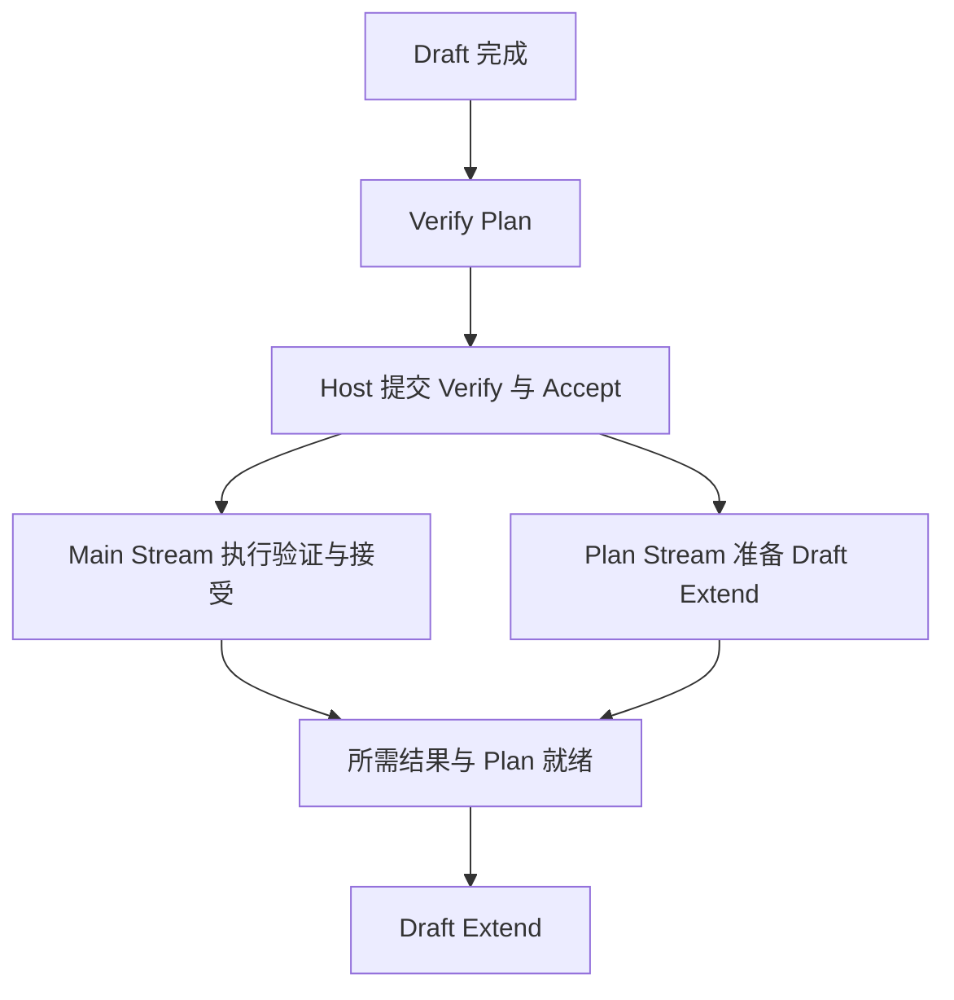

# Ascend 910C 投机解码：Graph、多流与通信的执行依赖

以 5 条请求为例，每条 Verify 3 行，真实工作是 15 行。Graph 选中请求 bucket=8，却会执行 24 行。少了 Python、launch 开销，也多了 padding；判断是否划算，最终还要看完整周期花多久。

Ascend 910C 的 V4 EAGLE/NextN 还使用 Plan Stream、层内多流、DeepEP。它们分别捕获工作、提前准备、推迟等待。下面沿实际调用追到各个汇合点，看候选、metadata、专家结果在哪里被消费。

<details markdown="1">
<summary>源码版本与阅读范围</summary>

源码固定为 `sgl-project/sglang @ 5c69e32abe013fa1b913022682a3104c79105f37`，核对日期为 2026-09-21。主线为 V4、EAGLE/NextN、Ascend 910C、dsv4。图根据 Stream、Event、Wait、Graph 调用表达依赖，时长和重叠比例需与设备时间线对照。

</details>

## 一、Graph、Stream 与通信各自负责什么

这些机制在一轮周期中各有职责：

| 机制 | 本文对应的执行方式 |
| --- | --- |
| Draft Graph | 捕获完整 `draft_forward()`，执行 `num_steps - 1` 次 NextN Forward |
| Verify Graph | 按请求数选择档位，每请求保留固定 Verify 宽度 |
| Plan Stream | Verify Prep 等待 Draft；Draft-Extend Prep 可与已提交的主流尾部重叠 |
| Target 多流 | 重叠 Q、KV 与 Indexer 等独立工作；NextN 未接入这组 alt streams |
| DeepEP 异步通信 | 分开发起与等待，在中间安排独立计算 |
| Draft-Extend Graph | 用重复启动成本的节省，交换捕获与 workspace 内存开销 |

捕获范围决定一次 replay 做多少工作，wait 位置决定这些工作还能与谁并发。

稳态调用为：

```text
上一轮 confirmed state
        │
        ▼
Draft Graph
(num_steps - 1 次 NextN forward)
        │
        ▼
Verify Planning
        │
        ▼
Target Verify Graph
        │
        ▼
Accept / Commit
        │
        ├──────── Draft-Extend Planning
        │           可与 main-stream tail overlap
        ▼
Draft Extend Forward / Graph
        │
        ▼
下一轮 candidate1
```

从 Draft 向后追，分支汇合处的等待才能说明还有多少工作暴露在周期上。

## 二、Draft Graph 捕获哪些 NextN Forward

NPU Draft 由 `EAGLEDraftNpuGraphRunner` 承接。[`eagle_draft_npu_graph_runner.py`](https://github.com/sgl-project/sglang/blob/5c69e32abe013fa1b913022682a3104c79105f37/python/sglang/srt/hardware_backend/npu/graph_runner/eagle_draft_npu_graph_runner.py)

类名继承自 CUDA 通用 Runner，实际底层使用 `torch.npu.NPUGraph`。

它捕获的调用为：

```python
def run_once():
    ...
    ret = self.eagle_worker.draft_forward(
        forward_batch
    )
    ...
    return ret
```

一次 Replay 覆盖整个 draft_forward。

捕获入口见 [`EAGLEDraftCudaGraphRunner.capture_one_shape()`](https://github.com/sgl-project/sglang/blob/5c69e32abe013fa1b913022682a3104c79105f37/python/sglang/srt/speculative/eagle_draft_cuda_graph_runner.py)。

### `draft_forward()` 的 NextN Forward 次数

rollout 循环先选择候选，再判断是否继续模型调用：

```python
for i in range(self.speculative_num_steps):
    ...
    select_top_k_tokens(...)

    if i == self.speculative_num_steps - 1:
        break

    logits_output = self.draft_runner.forward(
        forward_batch
    ).logits_output
```

实现见 [`EagleDraftWorker.draft_forward()`](https://github.com/sgl-project/sglang/blob/5c69e32abe013fa1b913022682a3104c79105f37/python/sglang/srt/speculative/eagle_worker_v2.py#L778-L951)。

最后一次迭代选完即退出，Graph 内因此只有 `speculative_num_steps - 1` 次 NextN forward。首候选早已在 Draft Extend 产生，那部分成本位于当前 Draft Graph 之前。

例如 `num_steps=2, topk=1, num_draft_tokens=3`，Replay 前已有 candidate1，Graph 再运行一次 NextN 得到 candidate2。num_steps=3，则依次用两次 NextN 生成 candidate2、candidate3。

| num_steps | Graph 内候选阶段数 | Graph 内 NextN Forward 次数 |
| ---: | ---: | ---: |
| 2 | 2 | 1 |
| 3 | 3 | 2 |

候选阶段比本轮模型调用多一次，差在已经传入的 seed。

<a id="draft-graph"></a>

### Draft Decode 的逐请求宽度

[`resolve_num_tokens_per_req()`](https://github.com/sgl-project/sglang/blob/5c69e32abe013fa1b913022682a3104c79105f37/python/sglang/srt/speculative/spec_utils.py#L90-L119) 确定 Draft Decode 每请求的行数。

调用为 `resolve_num_tokens_per_req(phase="draft_decode")`。

返回值是 `speculative_eagle_topk`。

因此 topk=1 时，每次 NextN 为每请求处理一行，Graph 内顺序运行 num_steps−1 次。

NextN 较轻，Python、launch、metadata 的固定开销就可能相对显眼。捕获整个小循环，让这些步骤以 replay 提交，实际节省仍从执行时间测量。

<a id="grapheager"></a>

### TP 组内协调 Graph 与 Eager 路由

特定 DSA IndexShare+DPA 分支，把本地 can_run_graph、seed_ready 的判断在 model TP 组归约：

```python
torch.distributed.all_reduce(
    decision,
    op=MIN,
    group=tp_group,
)
```

Draft 内部仍会执行 TP/EP collective。

同一次 forward 若 Rank0 走 Graph、Rank1 走 Eager，通信次序可能不一致，所以执行路由本身也需要协作。

## 三、Verify Graph 的 Batch Bucket 与 Token 宽度

Draft 完成后，Target 进入通用 Decode / NPU Graph Runner。

NPU 实现为 [`NPUGraphRunner`](https://github.com/sgl-project/sglang/blob/5c69e32abe013fa1b913022682a3104c79105f37/python/sglang/srt/hardware_backend/npu/graph_runner/npu_graph_runner.py)。

初始化设置：

```python
self.captured_req_width
=
model_runner.decode_num_tokens_per_req(
    num_draft_tokens=...
)
```

普通 EAGLE Target 的 `captured_req_width = speculative_num_draft_tokens`。

- [`ModelRunner.decode_num_tokens_per_req()`](https://github.com/sgl-project/sglang/blob/5c69e32abe013fa1b913022682a3104c79105f37/python/sglang/srt/model_executor/model_runner.py#L825-L846)
- [`resolve_num_tokens_per_req()`](https://github.com/sgl-project/sglang/blob/5c69e32abe013fa1b913022682a3104c79105f37/python/sglang/srt/speculative/spec_utils.py#L90-L119)

设置 `num_draft_tokens=3`，每请求固定验证三行。

<a id="eagle-ragged-verify"></a>

### EAGLE 使用固定 Verify 窗口

本篇 EAGLE 与 DSpark Ragged 在这里分流。

算法能力判断为：

```python
return self.is_dspark()
```

定义见 [`spec_info.py`](https://github.com/sgl-project/sglang/blob/5c69e32abe013fa1b913022682a3104c79105f37/python/sglang/srt/speculative/spec_info.py#L160-L164)。

EAGLE 每请求执行 num_draft_tokens 行。Req0/1/2 最后接受 2/3/1 行，也不会把已经运行的窗口变成六行；接受长度是在 Verify 后得到，用于后续提交。

<a id="eagle-graph-request-batch-size-bucket"></a>

### EAGLE Graph 按请求数选 bucket

non-ragged load_batch 先按请求数匹配：

```python
raw_num_token
=
raw_bs * captured_req_width

bs
=
_pad_to_bucket(
    raw_bs,
    capture_bs,
)

padded_num_tokens
=
bs * captured_req_width
```

实现见 [`DecodeCudaGraphRunner.load_batch()`](https://github.com/sgl-project/sglang/blob/5c69e32abe013fa1b913022682a3104c79105f37/python/sglang/srt/model_executor/runner/decode_cuda_graph_runner.py)。

raw_bs=5、num_draft_tokens=3，请求 bucket 为 1、2、4、8。真实 Verify 是 `5 × 3 = 15` 行，bucket=8 的 Replay 执行 `8 × 3 = 24` 行，额外九行 padding。Graph 的提交收益要覆盖这部分执行代价。

<a id="dp-attention-admission-rank-raw_bs"></a>

### DP Attention 使用参与者中的最大请求数

需要 MLP TP gather 时，admission 读取：

```python
cuda_graph_bs
=
max(
    forward_batch.original_global_num_tokens_cpu
)
```

这个值取相关 Attention-DP 的 raw 请求计数最大值。

各参与者据此匹配兼容 global-max 几何的 bucket。

这些 padding 还为 captured collective 提供兼容形状，具有跨 Rank 的用途。

计算时先找相关 DP 的最大请求数，向上选 Capture bucket，再乘固定 Verify Width。bucket 已是对齐后的请求数，无需再乘一次最大请求数。

<a id="-cuda-graph-bs-decode-request-bucket-eagle-verify-token-bucket"></a>

### cuda-graph-bs-decode 配置请求槽位

固定 best-practice 中有 `--cuda-graph-bs-decode 1 2 4 8`，也有 `1 2 4 8 10`。

普通 EAGLE 将这些 key 解释为请求 bucket。

宽度为 3，Token 行数才是 `bucket_bs × 3`。

支持 DSpark Ragged 的路径另按 graph_num_tokens tier 选档，设备范围见对应专题。

## 四、Plan Stream 与计算的依赖关系

`SGLANG_ENABLE_OVERLAP_PLAN_STREAM=1` 通过 `torch.get_device_module(device).Stream()` 创建 Plan Stream。

入口为 [`get_plan_stream()`](https://github.com/sgl-project/sglang/blob/5c69e32abe013fa1b913022682a3104c79105f37/python/sglang/srt/speculative/spec_utils.py#L1132-L1140)。

独立流给了规划工作执行位置；开始、结束处的 wait 再限定并发范围。

### Verify Planning 等待 Draft 结果

`run_eagle_verify` 取得 `fwd_stream = current_stream()`，让 planning 等待当前流已提交工作：

```python
with plan_stream_ctx:
    plan_stream.wait_stream(
        fwd_stream
    )

    eagle_prepare_for_verify(...)
```

Prep 读取 Draft Tree metadata，必须等 frontier 完成。

planning 结束后，main 又执行：

```python
current_stream().wait_stream(
    plan_stream
)
```

然后才启动 Target。

实现见 [`run_eagle_verify()`](https://github.com/sgl-project/sglang/blob/5c69e32abe013fa1b913022682a3104c79105f37/python/sglang/srt/speculative/eagle_worker_common.py#L462-L675)。

因此这里的设备顺序仍是 `Draft → Verify Plan → Target Verify`，Draft compute 与 Verify Prep 没有设备重叠。

Plan Stream 在这条路径中负责独立组织规划、明确 metadata 交接，并通过流依赖避免不必要的 Host 阻塞。

Draft 到 Target 的必要依赖仍保留在周期中。

<a id="draft-extend-planning-overlap"></a>

### Draft-Extend Planning 可以提前开始

Verify 后，Draft Extend 准备输入、select_index、next_token_ids，再进入计划流：

```python
with self.plan_stream_ctx:
    forward_batch = prepare_for_draft_extend(...)
```

进入前没有 `plan_stream.wait_stream(current_stream)`。

入口为 [`_draft_extend_for_decode()`](https://github.com/sgl-project/sglang/blob/5c69e32abe013fa1b913022682a3104c79105f37/python/sglang/srt/speculative/eagle_worker_v2.py)。

Python 返回时，已入队的 NPU 工作可能还在执行。只要 Prep 不读取尚未 ready 的值，它就能与 main 剩余的 Verify/Accept tail 并发。

代码先在主流运行 `next_token_ids = batch_result.next_token_ids.to(torch.int64)`，再进 Plan Stream，避免在计划流中引入额外跨流同步或 data race。

真正执行 Extend 模型前，再等待：

```python
current_stream().wait_stream(
    self.plan_stream
)
```

两类规划的起始依赖为：

| 规划阶段 | 开始前等待 | 模型执行前等待 | 可重叠的部分 |
| --- | --- | --- | --- |
| Verify Prep | Plan 等 Draft 所在流 | Target 等 Plan | 此路径的 Draft compute 与 Verify Prep 串行 |
| Draft-Extend Prep | 此处没有先等主流尾部 | Extend 等 Plan 与所需结果 | 可能与已提交的 Verify/Accept 主流尾部并发 |

这些 wait 说明允许的并发范围，实际重叠区间还要从 NPU 时间线读出。

## 五、Target 与 Draft 的多流路径

`SGLANG_NPU_USE_MULTI_STREAM=1` 则安排单模型层内部的工作，与跨阶段 Plan Stream 分别控制不同范围。

Target 开启该选项后，初始化 alt_streams，传给各 Decoder Layer。

调用见 [`DeepseekV4Model.__init__()`](https://github.com/sgl-project/sglang/blob/5c69e32abe013fa1b913022682a3104c79105f37/python/sglang/srt/models/deepseek_v4.py)。

Attention 再检查准入条件：

```python
_is_npu
and SGLANG_NPU_USE_MULTI_STREAM
and self.alt_streams is not None
and x.shape[0] <= self._multi_stream_bs_limit
and not forward_batch.forward_mode
    .is_extend_or_draft_extend_or_mixed()
```

实现见 [`DeepSeek-V4 Attention forward`](https://github.com/sgl-project/sglang/blob/5c69e32abe013fa1b913022682a3104c79105f37/python/sglang/srt/models/deepseek_v4.py)。

模式 helper、环境条件、模型传参共同决定能否到达多流路径。

### TARGET_VERIFY 通过这层模式判断

`is_extend()` 将 TARGET_VERIFY 归入 extend-family。

多流条件实际使用的却是 `is_extend_or_draft_extend_or_mixed()`。

该 helper 默认 `include_draft_extend_v2 = False`。

本层因此排除 `EXTEND`、`MIXED`、`SPLIT_PREFILL`，保留 `TARGET_VERIFY`。

定义见 [`ForwardMode`](https://github.com/sgl-project/sglang/blob/5c69e32abe013fa1b913022682a3104c79105f37/python/sglang/srt/model_executor/forward_batch_info.py#L176-L275)。

Target 的 `DECODE`、`TARGET_VERIFY` 都能通过模式条件，之后仍受环境、行数和层条件限制。

<a id="draft_extend_v2-helper-nextn-alt-streams"></a>

### NextN 没有传入 alt_streams

DRAFT_EXTEND_V2 默认也没有被 helper 排除。

但模型还必须实际传入 alt_streams。

NextN 创建唯一层时设置：

```python
self.decoder = DeepseekV4DecoderLayer(
    ...,
    alt_streams=None,
    ...
)
```

位置见 [`deepseek_v4_nextn.py`](https://github.com/sgl-project/sglang/blob/5c69e32abe013fa1b913022682a3104c79105f37/python/sglang/srt/models/deepseek_v4_nextn.py#L97-L105)。

它的 alt_streams=None，所以这份 NextN 没有进入 Target 的层内多流。

各阶段对应为：

| Phase | ForwardMode | Model | Attention NPU Multi-Stream |
| --- | --- | --- | --- |
| 普通 Target Decode | `DECODE` | Target | **可达**，还需 env / token rows / layer 条件满足 |
| EAGLE Target Verify | `TARGET_VERIFY` | Target | **可达** |
| EAGLE Draft Decode | `DECODE` | NextN | **不可达**，NextN decoder 的 `alt_streams=None` |
| EAGLE Draft Extend | `DRAFT_EXTEND_V2` | NextN | **不可达**，同上 |
| 普通 Prefill | `EXTEND` | Target | 该 NPU Attention Multi-Stream path 被 mode 条件排除 |

### Target 多流中的独立计算分支

Target 将准备分到三条流：

| 流 | 工作 |
| --- | --- |
| `stream_kv` | KV projection、Norm、RoPE、KV cache store |
| `stream_q` | Q projection、RMSNorm、RoPE |
| current stream | Indexer / Compressor |

三路在这里汇合：

```python
current_stream.wait_stream(stream_kv)
current_stream.wait_stream(stream_q)
```

随后进入 Attention。

实现为 [`_forward_prepare_multi_stream_npu()`](https://github.com/sgl-project/sglang/blob/5c69e32abe013fa1b913022682a3104c79105f37/python/sglang/srt/models/deepseek_v4.py#L1537-L1635)。

理想情况下，这段耗时近似为：

```text
T_prepare
≈
T_prefix
+
max(
  T_Q,
  T_KV,
  T_indexer/compressor
)
```

三路存在并发，不应把 duration 直接相加。

实际重叠受 Cube/Vector 竞争、HBM、occupancy、CANN 调度、行数影响。量各分支开始、结束和 join，才能得到汇合点暴露的等待。

固定非 Blackwell 分支的 row limit 为 64，判断当前 x.shape[0]，与 max_running_requests 含义不同。

## 六、DeepEP 从异步 Launch 到等待结果

Verify 的 MoE 使用官方 recipe：

```text
--moe-a2a-backend deepep
--deepep-mode auto
```

Dispatcher 创建参数为：

```python
async_finish=True
return_recv_hook=True
```

位置见 [`fused_moe_triton/layer.py`](https://github.com/sgl-project/sglang/blob/5c69e32abe013fa1b913022682a3104c79105f37/python/sglang/srt/layers/moe/fused_moe_triton/layer.py)。

Dispatch 接收 Token 后，Routed Expert GEMM 才有输入。异步 launch 让通信先发起，这项消费依赖仍然存在。

<a id="normal-deepep-launch-expert-wait"></a>

### Normal DeepEP 在专家消费前等待

执行顺序为：

```python
previous_event = Buffer.capture()

buffer.dispatch(
    ...,
    async_finish=True,
    allocate_on_comm_stream=True,
)
```

通信可在 Comm Stream 发起。

dispatch_b 在专家使用输入前调用：

```python
event.current_stream_wait()
```

等待接收完成。

实现见 [`_DeepEPDispatcherImplNormal`](https://github.com/sgl-project/sglang/blob/5c69e32abe013fa1b913022682a3104c79105f37/python/sglang/srt/layers/moe/token_dispatcher/deepep.py#L537-L735)。

`async_finish` 把 launch、wait 分开。Combine 同样异步发起，再通过 `event.current_stream_wait()` 保证后续 hidden consumer 读到结果。

两者之间若有独立工作，就有机会覆盖通信。

<a id="shared-expert-branch"></a>

### Shared Expert 可独立于 routed 路径计算

未融合的 shared expert 可以放在 alt stream：

```python
self.alt_stream.wait_stream(
    current_stream
)

with alt_stream:
    shared_output
    =
    _forward_shared_experts(...)
```

主路径同时执行 TopK、Dispatch、Routed Experts、Combine，直到相加前才等待 shared 输出。

实现为 [`DeepseekV2MoE.forward_deepep()`](https://github.com/sgl-project/sglang/blob/5c69e32abe013fa1b913022682a3104c79105f37/python/sglang/srt/models/deepseek_v2.py#L1418-L1665)。

两路时间关系可能为：

```text
Routed path
Router
  ↓
Dispatch ───────── Expert ───── Combine
██████████████████████████████████████

Shared side stream
Shared Expert
████████████████
```

Shared Expert 可以覆盖 routed 路径中的部分通信。通信总长与汇合点的等待都要测量，后者才说明有多少工作没被这条独立分支覆盖。

<a id="low-latency-deepeprecv_hook-wait-consumer-boundary"></a>

### Low-Latency DeepEP 在 recv_hook 消费接收结果

low_latency 调用：

```python
buffer.low_latency_dispatch(
    ...,
    async_finish=False,
    return_recv_hook=True,
)
```

它返回 event、hook。外层依次运行 `dispatch_a()`、`deepep_dispatch_hooks`、`dispatch_b()`，到 dispatch_b 才调用 `hook()`，接收完成后交给专家消费。

实现见 [`_DeepEPDispatcherImplLowLatency`](https://github.com/sgl-project/sglang/blob/5c69e32abe013fa1b913022682a3104c79105f37/python/sglang/srt/layers/moe/token_dispatcher/deepep.py)。

从 `low_latency_dispatch` 发起到 `recv_hook()` 执行，可以安排不依赖接收结果的工作，SBO 就能在这里插入 Shared Expert。

recv_hook 延后了等待位置，结果仍须在使用前到达。

Combine 的 overlap_args 也可协调 overlap stream，最后仍要 join。

<a id="exposed-communication-total-communication"></a>

### DeepEP 汇合点的通信等待

理想化地，通信 T_comm 与独立计算 T_independent 的关系为：

```text
T_exposed_comm
=
max(
  0,
  T_comm - T_independent
)
```

发起后立刻等待，`T_independent = 0`，暴露部分就近似为 T_comm。

所以异步接口的价值，要从等待被覆盖了多少来判断。

## 七、Draft-Extend Graph 的配置与版本差异

固定 best-practice 某些负载设置了：

```bash
export SGLANG_DISABLE_DRAFT_EXTEND_GRAPH=1
```

并同时配置：

```bash
export SGLANG_ENABLE_OVERLAP_PLAN_STREAM=1
export SGLANG_NPU_USE_MULTI_STREAM=1
```

这些参数与 EAGLE、NPU Graph、DeepEP 一起出现。

旧变量是否被 Runtime 读取，需要再核实际 consumer。

### Runtime 读取的环境变量名

Runtime 注册的是 `SGLANG_DISABLE_DRAFT_EXTEND_CUDA_GRAPH`。

用途注释为：

> 当捕获内存池的成本超过 Graph 节省时，可用此开关回退，例如按完整 Dispatch 容量捕获 DeepEP MoE workspace 的情况。

定义见 [`environ.py`](https://github.com/sgl-project/sglang/blob/5c69e32abe013fa1b913022682a3104c79105f37/python/sglang/srt/environ.py#L1371-L1375)。

创建 Graph 时检查同一名称：

```python
not envs
    .SGLANG_DISABLE_DRAFT_EXTEND_CUDA_GRAPH
    .get()
```

调用见 [`EagleDraftWorker._capture_cuda_graphs()`](https://github.com/sgl-project/sglang/blob/5c69e32abe013fa1b913022682a3104c79105f37/python/sglang/srt/speculative/eagle_worker_v2.py)。

文档却写成 `SGLANG_DISABLE_DRAFT_EXTEND_GRAPH`，少了 `_CUDA_`。

这份提交中没有找到旧名的 alias、consumer、translation。

可确认的是文档与 Runtime 名称发生漂移。

控制本版本应使用 Runtime 名称，再从启动日志确认 Graph 状态。旧文档变量本身不能证明已关闭。

<a id="kill-switch"></a>

### Draft-Extend Graph 的 workspace 代价

NextN Extend 较短，Graph 省下的 launch/control 时间可能有限；某些 DeepEP MoE workspace 却按完整 Dispatch 容量捕获，增加常驻内存。比较时要一并看时间、padding/replay preparation、显存。

这也是单独关闭 Draft Extend Graph 的动机：保留 Draft Decode、Target Verify Graph，只让 Extend 回到 Eager。哪个组合更快，仍要在目标负载下比较，文档里的旧变量不能充当结果。

### Draft-Extend Graph 的捕获宽度

Extend Runner 自己设置逐请求静态宽度：

捕获值为：

```python
captured_req_width
=
resolve_num_tokens_per_req(
    phase="draft_extend"
)
```

即 `speculative_num_draft_tokens`，直接使用窗口配置。

实现见 [`EAGLEDraftExtendCudaGraphRunner`](https://github.com/sgl-project/sglang/blob/5c69e32abe013fa1b913022682a3104c79105f37/python/sglang/srt/speculative/eagle_draft_extend_cuda_graph_runner.py)。

接受长度较短，buffer、capture 仍按完整窗口准备，后续 LM Head 再选最后有效行。

这份完整窗口的占用，也应计入 Graph 的保留决策。

## 八、将执行依赖与实测时间线对齐

下图只表示依赖，线长没有时间含义：



| 层内分支 | 独立工作 | 汇合依赖 |
| --- | --- | --- |
| Target Attention | Q、KV、Indexer / Compressor 的对应分支 | Attention 消费前等待所需结果 |
| Routed MoE | Dispatch、Expert GEMM、Combine | GEMM 等待收到 Token；后续消费等待 Combine |
| Shared Expert | 可独立执行的专家计算 | 与 routed 输出合并前完成 |

Plan Stream 的跨阶段等待、NextN 的单流准备、Target 的层内多流，在图中分别沿各自调用衔接。

对齐 Profile 时，可以检查这些实际交接：

| 观察点 | 对应源码问题 |
| --- | --- |
| Draft | Graph replay 还是 eager？`num_steps` 对应几次 NextN forward？ |
| Draft Graph | raw request count pad 到哪个 bucket？ |
| Verify seam | Draft 结束到 Verify start 中间，Verify Plan gap 多长？这段不能与 Draft overlap。 |
| Target Verify | 固定 Verify width 是多少？`bucket_bs × num_draft_tokens` 有多少 padding rows？ |
| Plan overlap | Draft-Extend Plan 是否真的与 Verify / Accept tail 同时出现在 NPU timeline？ |
| Attention | Q / KV / Indexer 三条 branch 哪条最长？Multi-Stream Join 最终等谁？ |
| MoE | DeepEP 总 duration 中，有多少被 Shared Expert / SBO 覆盖？ exposed tail 是多少？ |
| Rank control | 是否因为某 Rank Graph fallback 导致整个 TP group 一起 eager？ |
| Draft Extend | Graph 还是 eager？Capture memory / workspace 是否值得？ |

同一批次中，每输出 Token 成本近似为周期关键路径除以有效推进。Graph 减少提交，多流安排独立工作，异步通信推迟等待，最终都体现为这条周期变长或变短。

结合候选宽度、请求 bucket、接受长度与 join 处等待，才能解释时间线上的变化。

### 源码阅读入口

| 目标 | 固定版本源码 |
| --- | --- |
| EAGLE Worker | [`eagle_worker_v2.py`](https://github.com/sgl-project/sglang/blob/5c69e32abe013fa1b913022682a3104c79105f37/python/sglang/srt/speculative/eagle_worker_v2.py) |
| Draft NPU Graph Runner | [`EAGLEDraftNpuGraphRunner`](https://github.com/sgl-project/sglang/blob/5c69e32abe013fa1b913022682a3104c79105f37/python/sglang/srt/hardware_backend/npu/graph_runner/eagle_draft_npu_graph_runner.py) |
| Draft Graph Capture Body | [`EAGLEDraftCudaGraphRunner`](https://github.com/sgl-project/sglang/blob/5c69e32abe013fa1b913022682a3104c79105f37/python/sglang/srt/speculative/eagle_draft_cuda_graph_runner.py) |
| Draft Multi-Step Loop | [`EagleDraftWorker.draft_forward()`](https://github.com/sgl-project/sglang/blob/5c69e32abe013fa1b913022682a3104c79105f37/python/sglang/srt/speculative/eagle_worker_v2.py#L778-L951) |
| Spec Phase Static Width | [`resolve_num_tokens_per_req()`](https://github.com/sgl-project/sglang/blob/5c69e32abe013fa1b913022682a3104c79105f37/python/sglang/srt/speculative/spec_utils.py#L90-L119) |
| Target NPU Graph | [`NPUGraphRunner`](https://github.com/sgl-project/sglang/blob/5c69e32abe013fa1b913022682a3104c79105f37/python/sglang/srt/hardware_backend/npu/graph_runner/npu_graph_runner.py) |
| Target Graph Fixed Width / Bucket | [`DecodeCudaGraphRunner`](https://github.com/sgl-project/sglang/blob/5c69e32abe013fa1b913022682a3104c79105f37/python/sglang/srt/model_executor/runner/decode_cuda_graph_runner.py) |
| EAGLE / DSpark Ragged Verify 边界 | [`SpeculativeAlgorithm.supports_ragged_verify()`](https://github.com/sgl-project/sglang/blob/5c69e32abe013fa1b913022682a3104c79105f37/python/sglang/srt/speculative/spec_info.py#L160-L164) |
| Verify Preparation | [`eagle_prepare_for_verify()`](https://github.com/sgl-project/sglang/blob/5c69e32abe013fa1b913022682a3104c79105f37/python/sglang/srt/speculative/eagle_utils.py#L520-L622) |
| Verify + Plan Stream Dependency | [`run_eagle_verify()`](https://github.com/sgl-project/sglang/blob/5c69e32abe013fa1b913022682a3104c79105f37/python/sglang/srt/speculative/eagle_worker_common.py#L462-L675) |
| Plan Stream Creation | [`get_plan_stream()`](https://github.com/sgl-project/sglang/blob/5c69e32abe013fa1b913022682a3104c79105f37/python/sglang/srt/speculative/spec_utils.py#L1132-L1140) |
| Draft-Extend Planning Overlap | [`_draft_extend_for_decode()`](https://github.com/sgl-project/sglang/blob/5c69e32abe013fa1b913022682a3104c79105f37/python/sglang/srt/speculative/eagle_worker_v2.py) |
| Draft-Extend NPU Graph | [`EAGLEDraftExtendNpuGraphRunner`](https://github.com/sgl-project/sglang/blob/5c69e32abe013fa1b913022682a3104c79105f37/python/sglang/srt/hardware_backend/npu/graph_runner/eagle_draft_extend_npu_graph_runner.py) |
| Draft-Extend Graph Buffer / Width | [`EAGLEDraftExtendCudaGraphRunner`](https://github.com/sgl-project/sglang/blob/5c69e32abe013fa1b913022682a3104c79105f37/python/sglang/srt/speculative/eagle_draft_extend_cuda_graph_runner.py) |
| Target NPU Multi-Stream Pool | [`DeepseekV4Model.__init__()`](https://github.com/sgl-project/sglang/blob/5c69e32abe013fa1b913022682a3104c79105f37/python/sglang/srt/models/deepseek_v4.py) |
| NPU Attention Multi-Stream | [`_forward_prepare_multi_stream_npu()`](https://github.com/sgl-project/sglang/blob/5c69e32abe013fa1b913022682a3104c79105f37/python/sglang/srt/models/deepseek_v4.py#L1537-L1635) |
| NextN Explicit `alt_streams=None` | [`deepseek_v4_nextn.py`](https://github.com/sgl-project/sglang/blob/5c69e32abe013fa1b913022682a3104c79105f37/python/sglang/srt/models/deepseek_v4_nextn.py#L97-L105) |
| ForwardMode Boundary | [`ForwardMode`](https://github.com/sgl-project/sglang/blob/5c69e32abe013fa1b913022682a3104c79105f37/python/sglang/srt/model_executor/forward_batch_info.py#L176-L275) |
| DeepEP Normal Async Boundary | [`_DeepEPDispatcherImplNormal`](https://github.com/sgl-project/sglang/blob/5c69e32abe013fa1b913022682a3104c79105f37/python/sglang/srt/layers/moe/token_dispatcher/deepep.py#L537-L735) |
| DeepEP Low-Latency Recv Hook | [`_DeepEPDispatcherImplLowLatency`](https://github.com/sgl-project/sglang/blob/5c69e32abe013fa1b913022682a3104c79105f37/python/sglang/srt/layers/moe/token_dispatcher/deepep.py) |
| DeepSeek Shared-Expert Overlap | [`DeepseekV2MoE.forward_deepep()`](https://github.com/sgl-project/sglang/blob/5c69e32abe013fa1b913022682a3104c79105f37/python/sglang/srt/models/deepseek_v2.py#L1418-L1665) |
| Draft-Extend Graph Kill Switch | [`environ.py`](https://github.com/sgl-project/sglang/blob/5c69e32abe013fa1b913022682a3104c79105f37/python/sglang/srt/environ.py#L1371-L1375) |
| Ascend DeepSeek-V4 Best Practice | [`deepseek_v4_flash.mdx`](https://github.com/sgl-project/sglang/blob/5c69e32abe013fa1b913022682a3104c79105f37/docs/docs/hardware-platforms/ascend-npus/model-deployment/best-practices/deepseek_v4_flash.mdx) |
