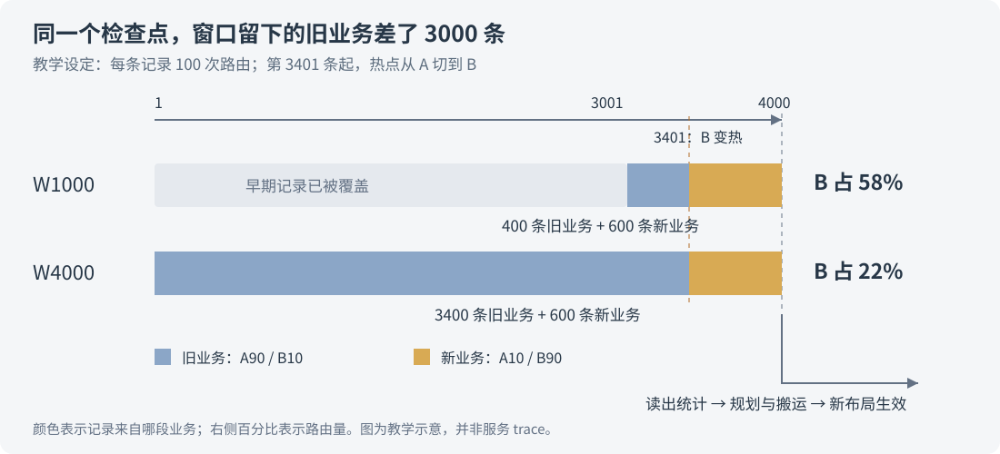

# 动态负载均衡会不会追着旧热点跑？

动态 EPLB 确实会追着旧热点跑：规划时 A 最热，等权重搬完，业务却已经集中访问 B。根据旧负载生成的布局，开始服务另一种负载。

这段延迟来自一条完整的执行链。EPLB 先收集已经发生的专家路由，到检查点再决定是否更新，最后把权重和映射安装好。热点在这期间发生变化，新布局就会落后于当前需求。

但看到 update 后没有提速，还不能直接归因于“热点过期”。先前就已经均衡、实际 batch 变小、Attention 占比变大，都会让布局收益不明显。要确认是不是追着旧热点跑，需要把**记录对应的时间、新布局生效的时间，以及生效后的真实负载**放在一起看。

这篇沿着 SGLang 的实现讲这个时间差。源码固定在 [`2914be60`](https://github.com/sgl-project/sglang/tree/2914be608009b65099c4c52ba118a597bf1b1421/python/sglang/srt/eplb)，讨论普通 `stat` 统计、固定 EP 拓扑、整轮更新的路径。文中的 A/B 热点、35 ms 和 600 ms 都是教学设定；配套脚本可以在 CPU 上复算。它们用来解释参数怎样影响信息的新鲜程度。

## 一、先把“热点”说清楚

以 DeepSeek 的一层 MoE 为例，router 会为输入 token 选择若干专家。某个逻辑专家收到的 token 多，我们就说它比较热。

逻辑专家表示一份确定的计算和权重。为了分担它的负载，部署可以保留多个副本，把它们放在不同设备的物理槽位上。EPLB 根据路由统计调整副本数量和位置，再搬运权重，让计算负载分散一些。[副本与物理布局](../distributed/eplb-redundant-expert-allocation.md)一文展开了这层关系。

因此，“专家 A 热”与“某张卡忙”需要分开看。A 虽然很热，但已有多个副本分担，设备之间仍可以比较均匀；几个各自不算最热的专家挤在同一张卡，也会形成瓶颈。EPLB 需要决定的是整个布局，不能只给热度榜第一名搬个家。

下面先用两个逻辑专家 A、B 来看统计的变化。为了让数字容易复算，假设每条记录只有 100 次路由：

```text
旧业务：A 收到 90 次，B 收到 10 次
新业务：A 收到 10 次，B 收到 90 次
```

旧业务持续了一段时间，当前布局也已经适应了 A。随后请求组成变了，B 开始变热。EPLB 要完成的事情包括：先在统计中看见 B，再在下一次检查中采用这些统计，最后把对应的布局安装好。任何一环跟不上，都能让当前计算继续使用偏向 A 的布局。

## 二、I 管什么时候检查，W 管检查时看见什么

在我们之前的实验中，经常出现这样的参数组合：

```text
I = 4000：--eplb-rebalance-num-iterations 4000
W = 1000：--expert-distribution-recorder-buffer-size 1000
```

I 控制 manager 的检查节奏。W 控制统计环形缓冲区有多少个位置。正常填满之后，旧记录会被新记录覆盖，所以 I4000/W1000 表示：走到检查点时，planner 使用最近保留下来的 1000 条记录。

**这 4000 次推进期间，记录仍持续写入；前面的记录只是被覆盖了。** W1000 不表示只在最后 1000 次才打开统计，也不表示每隔 1000 次做一次更新。

配置上还有一个容易遗漏的联动：该版本未显式设置 W 时，会用 I 作为它的值。只把 I 从 1000 改成 4000，W 也会随之成为 4000。要比较 I4000/W1000，就需要把这两个参数都写明。对应的[参数解析](https://github.com/sgl-project/sglang/blob/2914be608009b65099c4c52ba118a597bf1b1421/python/sglang/srt/arg_groups/parallel_hook.py#L829-L841)明确执行了这个赋值。

源码中，`ModelRunner` 在相应 forward 结束后推进 manager。manager 的核心控制流很短，下面保留原函数的主体：

```python
def _entrypoint(self):
    while True:
        for _ in range(self._rebalance_num_iterations):
            yield

        yield from self.rebalance()
```

这里的 `yield` 把控制权还给 forward 流程，下一次回调再继续。生成器第一次启动也有一个相位差：I=4 时，前四次推进都停在 `yield`，第五次才进入第一次 rebalance；随后是第九次、第十三次。后面的教学时间线采用稳定阶段相隔 I 次的检查点，便于比较参数，不拿启动时的偏移解释性能。[调用位置](https://github.com/sgl-project/sglang/blob/2914be608009b65099c4c52ba118a597bf1b1421/python/sglang/srt/model_executor/model_runner.py#L1978-L1980)和[生成器](https://github.com/sgl-project/sglang/blob/2914be608009b65099c4c52ba118a597bf1b1421/python/sglang/srt/eplb/eplb_manager.py#L89-L94)对应这两个行为。

W 也有自己的计数单位。`stat` accumulator 每收到一条有效的单次统计，就往环形缓冲写一次。它保存的结构可以理解为：

```text
[W 条记录，每层 MoE，每个物理专家的路由计数]
```

导出时，物理槽位的计数会按映射汇总到逻辑专家，并跨参与 rank 归约。普通 `deepseek` 算法接着沿记录维求和，用各专家的累计路由量规划布局。[统计导出](https://github.com/sgl-project/sglang/blob/2914be608009b65099c4c52ba118a597bf1b1421/python/sglang/srt/eplb/expert_distribution.py#L980-L1045)与[算法入口](https://github.com/sgl-project/sglang/blob/2914be608009b65099c4c52ba118a597bf1b1421/python/sglang/srt/eplb/eplb_algorithms/__init__.py#L19-L47)连起来，才是一次规划真正看见的数据。

这里有两个需要记住的实现细节。第一，`dump_record()` 先读出统计，再 reset，最后把结果返回给 manager。即使 manager 随后因均衡度较好而跳过规划，这次重置也已经发生。第二，有限环形缓冲的 `get_all()` 返回整块存储，reset 会清零，写入下标继续循环。它没有额外返回“这 W 个位置里有多少条有效记录”。

所以，把它理解为“最近 W 条”有一个前提：这段时间确实写满了 W 条有效记录。记录不足时，一部分位置仍是零。源码还要求 I≥W；这一条配置约束并不能替代对有效记录数的检查。[dump 与 reset](https://github.com/sgl-project/sglang/blob/2914be608009b65099c4c52ba118a597bf1b1421/python/sglang/srt/eplb/expert_distribution.py#L388-L392)、[环形缓冲](https://github.com/sgl-project/sglang/blob/2914be608009b65099c4c52ba118a597bf1b1421/python/sglang/srt/eplb/expert_distribution.py#L1108-L1128)和[参数约束](https://github.com/sgl-project/sglang/blob/2914be608009b65099c4c52ba118a597bf1b1421/python/sglang/srt/eplb/eplb_manager.py#L55-L61)都能直接核对。

## 三、热点换了，窗口里还剩多少旧业务？

继续用 A/B 的例子。假设一次 manager 推进正好对应一条有效记录，batch 不变；检查点在第 4000、8000 条，B 从第 3401 条开始变热，并一直保持。

第 4000 条结束时，已经收集到 600 条新业务。不同的 W 给出下面两份统计：

| 第 4000 条后的统计 | I4000/W1000 | I4000/W4000 |
| --- | ---: | ---: |
| 窗口内的旧业务记录 | 400 | 3400 |
| 窗口内的新业务记录 | 600 | 600 |
| A 的累计路由数 | 42,000 | 312,000 |
| B 的累计路由数 | 58,000 | 88,000 |
| B 在窗口中的路由占比 | 58% | 22% |

W1000 已经把较早的旧业务覆盖掉了。W4000 留下更长的历史，虽然此刻真实请求已经连续 600 条偏向 B，累计统计仍强烈偏向 A。

以 W1000 的 B 为例：400 条旧业务各贡献 10 次，600 条新业务各贡献 90 次，合计 `400×10 + 600×90 = 58,000` 次。窗口总共有 `1000×100 = 100,000` 次路由，所以 B 占 58%。W4000 也收进了同样的 600 条新业务，但它还保留 3400 条旧业务，B 的占比被压到 22%。

只看两份累计热度，前者已经把 B 排在 A 前面，后者仍把 A 排在前面。实际 planner 还会考虑副本、槽位和拓扑，不会照着这两个比例直接分配设备；这个算例说明的是，它们收到的输入已经不同。

到第 8000 条时，两种窗口都只剩新业务，B 的占比都是 90%。长窗口最终也能跟上，只是上一次检查仍在照顾历史。



把切换时间再往后挪一点，现象会更明显。仍取 W1000，如果 B 从第 3901 条才开始变热，那么第 4000 条检查时，窗口里有 900 条旧业务、100 条新业务，B 只占 18%。B 已经连续热了 100 条，窗口的累计热度却仍指向 A。

还会有另一种等待：B 从第 4001 条开始变热。再写 1000 条，窗口就已完全换成新业务；但 manager 要走到第 8000 条才检查。后面约 3000 次推进，统计早已跟上，布局还在等更新机会。

这两个例子把延迟拆开了：缩短 W 可以减少旧记录混入，缩短 I 可以减少等待检查的时间。只改其中一个，另一段等待仍然存在。

### 求和之后，先热还是后热的信息已经消失

再看两份四条记录的窗口：

```text
窗口一：[90,10] → [90,10] → [10,90] → [10,90]
窗口二：[10,90] → [10,90] → [90,10] → [90,10]
```

两份窗口的累计计数都是 A=200、B=200。可窗口一最后在热 B，窗口二最后在热 A。普通 `deepseek` 分支先对记录维求和，这两份输入传到后续布局算法时完全一样。算法无法从这份总数中还原谁刚刚变热。

`deepseek_vec` 分支保留逐记录维度，用不同的目标函数分配副本，不能把它也简写成“全部记录先求和”。不过，保留逐记录数据本身并不等于预测趋势。这里的环形缓冲没有附带时间戳，`get_all()` 也没有把物理槽位重新排成由旧到新的队列。讨论算法能不能追踪变化，必须看它怎样使用这些记录，不能只看输入多了一维。

## 四、记录新了，布局生效时还隔着一次 update

第 4000 条结束时，planner 读到的是截至这个检查点的历史。接着还要归约统计、计算布局、准备搬运、通信和写回。只有相应权重和映射安装完成，后续 forward 才开始使用新布局。

在整轮阻塞更新的简化时间线上，可以这样理解：

```text
收集过去的路由 → 读出窗口 → 生成方案 → 搬权重、安装映射 → 新布局开始运行
                 ↑                                      ↑
             统计截止点                              真正生效点
```

窗口里的最新记录，到生效时也已经老了一个 update 的时间。窗口最早的记录更老。

假设每次普通 forward 固定为 35 ms，窗口写满，而且每步正好写一条；整轮 update 固定为 600 ms。W1000 覆盖的 1000 个样本从最早到最新相隔 999×35 ms，约 35 秒。到新布局生效时，最新样本约老了 0.6 秒，最早样本约老了 35.6 秒；按记录等权计算，平均年龄约为 18.1 秒。

W4000 时，同样的平均年龄约为 70.6 秒。计算关系是：

```text
生效时的平均记录年龄
    = (W - 1) / 2 × 每条记录的时间间隔 + update 耗时
```

它是等间隔教学模型下的算术关系。真实服务要从实际时间戳算；batch、请求到达和投机接受长度变化后，每条记录的时间间隔不再固定。如果启用分层分块更新，还需要逐层记录生效点，不能给整套模型套一个统一时刻。

这个例子也说明了迁移优化解决哪一段问题。把 update 从 600 ms 降到 300 ms，可以缩短阻塞、减小延迟尖峰，也让样本到生效少老 300 ms。但 W4000 带来的约 70 秒平均历史年龄依然在。搬得更快与统计更及时，各自有要处理的时间段。

I4000 配合每步 35 ms，还意味着两次稳定检查之间大约有 140 秒普通计算。若每次都额外花 600 ms 完成更新，完整周期约为 140.6 秒。于是，热点持续时间就变得很重要：持续十分钟的需求与只出现两秒的突发，不适合用同一种更新节奏。

## 五、真正调参数时，有三处特别容易看错

### W 条记录，覆盖的业务量可以差很多

普通 `deepseek` 分支累计的是路由数。如果前 100 条大 batch 每条有 1000 次路由，后 900 条小 batch 每条只有 10 次路由，前者虽然只占记录数的 10%，却贡献了约 91.7% 的路由量。

在这个窗口里，按记录看很新的业务，按累计路由量看仍可能被旧的大 batch 压住。这里没有算错：算法收到的确实是这段历史累计执行的工作量。但当后续长期保持小 batch，历史总工作量就未必适合代表接下来的需求。

因此，观察热点切换时，除了看“新业务进窗多少条”，还要看它占了多少路由量，实际 batch 又是怎样变化的。

### 均衡度的历史，不会跟着 W 任意缩放

当前代码还有一个可选的检查：如果历史均衡度已经高于阈值，就跳过本轮规划。这里的均衡度来自设备间路由计数，核心是“平均设备路由数 / 最忙设备路由数”，并非 `npu-smi` 上的设备利用率。

它与 planner 的路由窗口分开维护。该版本的评分历史有 10、100、1000 三个容量，导出给 manager 的是容量 1000 那组的平均值；记录不足时，对已有值求平均。每条记录先算逐层均衡度，再对层求平均，最后平均历史评分。[评分历史](https://github.com/sgl-project/sglang/blob/2914be608009b65099c4c52ba118a597bf1b1421/python/sglang/srt/eplb/expert_distribution.py#L809-L889)、[评分导出](https://github.com/sgl-project/sglang/blob/2914be608009b65099c4c52ba118a597bf1b1421/python/sglang/srt/eplb/expert_distribution.py#L1049-L1077)和[评分公式](https://github.com/sgl-project/sglang/blob/2914be608009b65099c4c52ba118a597bf1b1421/python/sglang/srt/eplb/expert_distribution.py#L1196-L1211)可以分别核对。

假设把 W 从 1000 缩到 200，planner 会更集中地看最近 200 条路由；用于决定“要不要规划”的评分仍可以覆盖最近 1000 条。新业务已经让最近的布局不均衡，较长的评分历史仍可能保持较高，导致本轮跳过。这是两套历史长度不同造成的决策差异。

这项检查还依赖报告功能开启。报告关闭，或阈值采用默认 1.0 时，统计导出 `None`，manager 会继续规划。只改 W、只看一条 `Skipped` 日志，都不足以还原它当时采用了什么历史。具体分支见[均衡度跳过机制](../distributed/eplb-skip-unnecessary-migration.md)。

### DSpark 的一步，不能直接换算成一个输出 token

开启投机解码后，一次 target verify 验证一组候选，不同轮接受的长度会变化。I 次 manager 推进、W 条有效统计记录、客户端完成的请求数，以及最终生成的 token 数，各自代表不同的量。

尤其在 PD 分离部署中，P 和 D 的时间尺度不同。P 的统计由真实 prefill 执行和 chunk 组织驱动，不能简单用请求数替代；D 的统计又受到本地 batch、verify 宽度和接受行为影响。以前实验里 P 端 I50/W50、D 端 I4000/W1000，是两种执行节奏下的配置，需要结合实际日志解释。

还应确认统计里面确实是准备均衡的那部分计算。[200 条记录的对照](eplb-zero-record-rolling-window.md)曾记录过旧版生命周期让 draft 零记录占据窗口的情况：同样 200 个位置，一组有 200 条 target，另一组只有 100 条 target。那个对照对应历史版本，不能拿来断言本文固定源码仍有同一问题；它说明的是，W 的业务含义由实际入窗记录决定。

## 六、怎么判断一次更新是在适应热点，还是追赶过去

看到一次 update 的 `before` 和 `after` 均衡度变好，先查两边评分用了哪段负载。如果只是把旧窗口的计数按新映射重新分配，再得到更均匀的分布，这说明新布局更适合那份历史负载。要判断它是否跟上当前热点，还需要更新后真实发生的路由。

我会沿同一时间轴保存三段数据：窗口实际使用的历史、update 本身、布局生效后的业务。这样才能看出，问题出在规划使用的统计已经过时，还是布局适合当时的需求、随后业务又变了。

| 记录位置 | 需要保留的数据 | 用它回答什么 |
| --- | --- | --- |
| 读出窗口时 | 最早/最新有效记录时间、条数、batch、路由计数 | 这份统计有多旧，主要由哪段业务贡献？ |
| 方案确定和安装时 | 布局版本、变化层、搬运量、开始与完成时间 | 这份历史对应的布局何时真正生效？ |
| 新布局运行后 | 新发生的逐层设备路由量、普通计算耗时 | 它适合接下来的业务吗？ |
| 客户端同一时段 | TTFT、TPOT、ITL、E2E、输出吞吐、失败数 | 布局收益能否支付统计和迁移成本？ |

这张表是诊断时需要补齐的采集项，当前环形统计接口没有直接提供全部时间戳。不能从 W 的容量倒推一段精确墙钟历史。

如果要比较 I/W，负载要包含可控的变化，而不只是一直重复同一种请求。可以先让业务 A 稳定，再切到业务 B，并保持足够长；用相同请求集合、到达节奏和切换位置比较不同参数。之后再测试较短突发与逐渐变化的混合流量。

切换的位置也要轮换。只把 B 放在检查点之前，或者每次都刚好错过检查点，都会偏向某一种结果。同一组 I/W 至少要覆盖几种相位，观察从变化发生到布局生效的延迟，以及后续一段时间累计省下的计算。

为了判断布局本身，仍然可以在固定输入、batch、上下文和 KV 状态下，测原布局→update→新布局→恢复原布局，排除工作量变化。这个实验回答一次相同计算能快多少；在线追踪能力还要放回变化中的业务验证。完整服务需要对齐设备、实际 KV 容量、冗余专家、DSpark、缓存和客户端负载，再比较稳态及切换期间的表现。

迁移计划本身也值得看：某个逻辑专家刚增加副本，下一轮又撤掉；一批权重频繁来回搬；更新后的真实均衡度反复变差。这些现象连同时间轴，才构成“追着旧热点跑”的直接线索。仅凭迁移次数多，无法得出这个结论。

## 七、参数怎样选，取决于热点能维持多久

先从当前运行里量出三个时间：W 条有效记录覆盖多久，检查间隔 I 实际走多久，热态 update 花多久。把这三段时间与热点的持续时间比较，参数才有可以讨论的尺度。

热点持续几分钟，而窗口覆盖几十秒，周期更新有机会学到可复用的布局。热点只有几秒，统计和检查却隔着一两分钟，频繁搬权重很难赶上。此时值得先比较一个适合长期混合负载的稳定布局，避免为已经结束的短突发支付迁移成本。

如果窗口已经很新，却迟迟不检查，就固定 W、缩短 I，观察多出来的迁移是否回本。如果经常检查，但统计里仍被旧业务占据，就固定 I、缩短 W，同时核对评分历史。如果布局频繁反复变化，先检查是否在响应 batch 噪声、短突发或统计身份错误，再决定是否拉长窗口。

W 也不宜盲目缩到很小。只有少量路由时，一次 batch 的偶然偏斜就能影响布局；不同层的热点还可能各自变化。较长窗口能减少这些短期波动，只是它同时会留下更多旧需求。需要保留多少历史，取决于想适应的变化能持续多久。

最后还要算收益能持续多久。继续用教学数字：一次 update 花 600 ms，新布局每步省 0.2 ms，需要约 3000 个同等工作量的步骤才能抵消这笔更新成本，持续统计成本另计。如果 500 步后业务又换了，或者新布局只在前 500 步更合适，这轮更新就没有足够时间回本。

做这些比较时，我会把“热点切换后多久开始使用合适布局”与“整段业务最终省了多少时间”一起报告。前者能找到追赶发生在哪里，后者决定这套动态策略是否值得保留。

### 配套算例与源码核对

下载 [可运行示例包](https://akiyangdev.github.io/llm-inference-notes/media/dynamic-eplb-stale-hotspots/examples.zip)，解压后可以直接运行标准库脚本，不需要 PyTorch 或 NPU：

```bash
python examples/dynamic-eplb-stale-hotspots/simulate_hotspots.py --output results
```

脚本输出窗口组成、A/B 累计路由和不同切换相位的统计，结果分别见 [窗口数据](../../assets/dynamic-eplb-stale-hotspots/data/window_cases.csv)、[相位汇总](../../assets/dynamic-eplb-stale-hotspots/data/phase_summary.csv)及[记录年龄](../../assets/dynamic-eplb-stale-hotspots/data/record_age.csv)。这里的“B 信号出现”只表示累计 B 路由超过 A，并未模拟完整的副本规划或设备性能。

另附 [源码契约检查](../../examples/dynamic-eplb-stale-hotspots/check_source_contracts.py)，使用指定源码目录可复查生成器初次触发、环形覆盖顺序、清零行为及两个算法入口的差异：

```bash
python examples/dynamic-eplb-stale-hotspots/check_source_contracts.py --repo /path/to/sglang
```

核对依据、固定版本和算例前提保存在 [evidence.json](../../assets/dynamic-eplb-stale-hotspots/evidence.json)。时间线图是教学示意，CPU 算例也没有产生真实服务吞吐数据。
