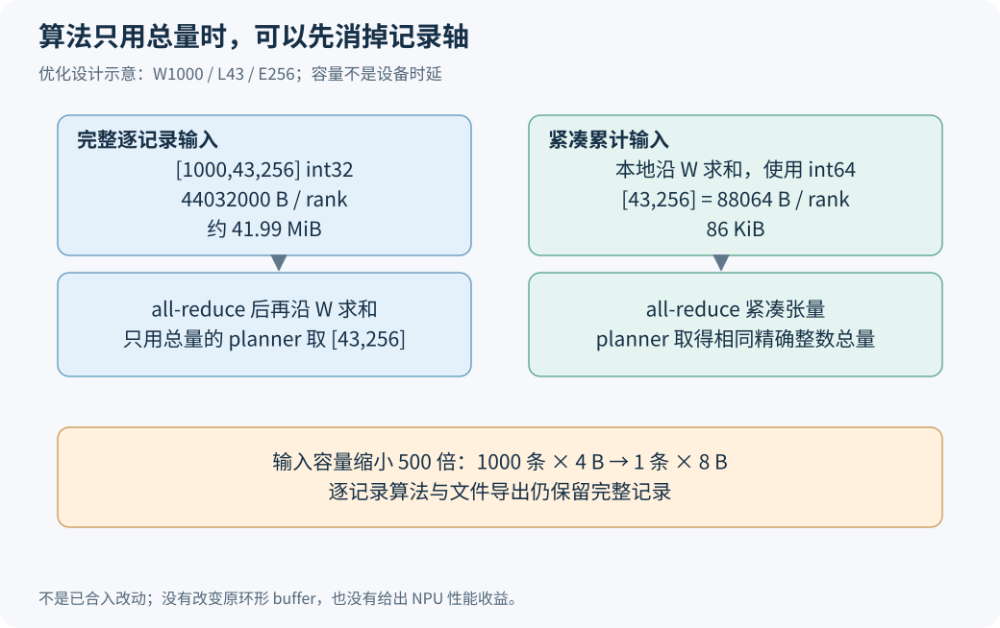

# 1000 条热度记录都要跨卡传吗？先看 EPLB 算法最后用了什么

一次 EPLB 更新可以读取最近 1000 条专家统计。假如算法最后只使用每位逻辑专家在这段时间里的总负载，那么把 1000 条全部做跨卡归约，再在本地求和，就包含了一项值得检查的工作：记录轴是否可以在通信前消掉？

答案由消费者决定。只用窗口总量的算法，可以先做本地累加，再归约小张量；需要逐记录负载的算法，不能丢掉记录轴。文件导出也需要保留原始数据，不能为了更新路径更省通信，把诊断信息一起压没。

本文分析固定 SGLang `2914be60` 的统计与算法接口，给出可运行的精确整数对照。这是一项基于现有链路的优化设计，不是已经合入的补丁，也没有给它填写设备时延或服务吞吐收益。

## 一、顺着调用链，找到那次大张量归约

统计窗口里的一个格子，可以理解成“某条记录、某层、某个物理槽位收到多少有效路由”。先别把它当成毫秒，也别把一条记录等同于一个请求。

`_StatAccumulator` 在设备上保存 `[W,L,P]` 的 int32 缓冲。W 是窗口容量，L 是层数，P 是全部物理专家槽位数。dump 时，代码先按物理到逻辑映射，把副本计数加回其逻辑专家，得到 `[W,L,E]`；E 是逻辑专家数。随后对这份张量调用 SUM all-reduce，再把结果交给 manager。见[统计 dump 分支](https://github.com/sgl-project/sglang/blob/2914be608009b65099c4c52ba118a597bf1b1421/python/sglang/srt/eplb/expert_distribution.py#L984-L1048)。

变量名里虽然有 `global_physical_count`，也不能据此认定它已在每个 rank 上完成相同的全局求和。物理槽位轴覆盖全局编号，与数值已经跨 rank 汇总，是两件事。这里应沿 gatherer 和 dump 的实际操作解释，不能看到名字就删掉 collective。

继续往下读，[算法选择入口](https://github.com/sgl-project/sglang/blob/2914be608009b65099c4c52ba118a597bf1b1421/python/sglang/srt/eplb/eplb_algorithms/__init__.py#L19-L72)把不同消费者分开了：`deepseek` 及其 hierarchical 变体对 `tokens_per_expert` 做 `sum(dim=0)`，把时间轴消成 `[L,E]`；`deepseek_vec` 及其变体则接收整份逐记录张量。

这才是压缩机会的依据。通信之后马上丢掉的那一维，有机会在通信之前就消掉；不能只凭“窗口很大”判断应该删维度。

## 二、先用两张卡、三条记录算一遍

设一层只有 A、B 两位逻辑专家。下面是教学计数，不是设备采样：

| rank | 记录 1：A/B | 记录 2：A/B | 记录 3：A/B | 本地总量 A/B |
|---|---|---|---|---|
| 0 | 3 / 1 | 4 / 0 | 0 / 2 | 7 / 3 |
| 1 | 1 / 2 | 0 / 3 | 2 / 1 | 3 / 6 |

现有顺序先跨 rank 汇总每条记录，得到 `[4,3]`、`[4,3]`、`[2,3]`；再沿记录求和，结果 `[10,9]`。

另一种顺序先在 rank 0 得到 `[7,3]`，在 rank 1 得到 `[3,6]`，再跨 rank 求和，仍是 `[10,9]`。改变的是加法的组织方式，最终交给总量算法的数据相同。

用下标写，目标是 `C[l,e]=Σr Σs X[r,s,l,e]`。先求 s 再求 r，或先求 r 再求 s，在整数不溢出的条件下相等。这一条不需要用性能结果证明；它是计算含义的等价性。

物理副本的归并也可以纳入这个关系。假如 A 有三个槽位，把它们加回 A 是一次 scatter-add。窗口内映射固定时，先沿记录累加物理槽位，再按映射归并，与每条先归并再累计相等。局部压缩可以减少逻辑张量的构造量，但映射必须属于同一个统计时期。

这不是允许把任何旧热度表拿当前映射重新解释。若窗口跨越布局变化，应按其所属映射转换，或在布局提交时按既有协议重置窗口。把物理槽位当作永久逻辑专家编号，会把另一个问题混进求和优化。

## 三、通信输入缩小 500 倍，数字从哪里来

取 W=1000、L=43、E=256 的教学配置。完整归约输入为 int32：

```text
1000 × 43 × 256 × 4 B = 44032000 B ≈ 41.99 MiB
```

本地累加时若使用 int64，紧凑输入为：

```text
43 × 256 × 8 B = 88064 B = 86 KiB
```

两者是 500 倍关系。之所以不是 1000，是因为新张量的元素宽度从四字节增加到八字节。若比较同 dtype，维度本身带来的缩减才是 W 倍。



这些数字是每个 rank 传给 collective 的输入容量，不是整套网络实际收发的总字节。all-reduce 的实现会影响链路流量，也可能包含分块、协议开销和中转，不能直接把输入大小当作某个 HCCL 通道的传输计数。

时延也不是线性按 500 倍缩放。新路径增加一次本地求和；通信还有启动延迟、同步等待、后端 dtype 支持和算法选择。若旧归约本来只占 update 的小部分，即使这一步明显缩短，完整更新和整服务的收益也会更小。该优化应先测统计 dump 的完成耗时，再测完整 update，最后看服务指标。

## 四、哪些信息不能被总和替代

`deepseek_vec` 保留记录轴有实际用途。固定源码中，它按记录计算副本候选的负载，而不只是把时间维求和后调用普通版。接口见[逐记录候选计算](https://github.com/sgl-project/sglang/blob/2914be608009b65099c4c52ba118a597bf1b1421/python/sglang/srt/eplb/eplb_algorithms/deepseek_vec.py#L98-L142)。

一个小例子就能说明丢失什么。场景一，两条记录是 `[100,0]` 与 `[0,100]`；场景二，两条都是 `[50,50]`。两种场景的累计负载都是 `[100,100]`，但每条记录的峰值分别是 100 和 50。先取 max 再累计，结果为 200 和 100，已经不同。

总和只能告诉算法“整个窗口里谁更热”，不能恢复“哪些专家同时更热”。任何逐记录峰值、分位数、相关性或加权新鲜度，都需要确认能否从所保留的数据计算。不能以普通 `deepseek` 的求和为依据，统一压缩所有算法。

文件导出的需要也不同。原始记录用于看 draft 零记录、热点切换、异常 forward 和窗口覆盖。即便当前在线 planner 只要 `[L,E]`，导出仍有理由保存 `[W,L,E]`。因此，压缩输出应是消费者明确请求的能力，不应悄悄改变公共 `dump_record()` 的默认形状。

均衡度报告同样有自己的统计定义。逐步利用率的平均值，不等于把全部计数相加后算一次利用率。压缩 planner 输入时，应保留它原有的独立统计与广播，避免把一个性能改动变成决策阈值的语义变化。

## 五、怎样设计接口，才不让 recorder 猜算法

一个便于维护的实现顺序，是由 manager 完成算法选择，然后根据消费者能力请求“逐记录”或“累计”结果。recorder 只负责按请求提供数据，不导入 planner 的具体实现，也不根据字符串到处判断算法名。

这项能力最好有明确默认值：既有调用仍收到原形状，文件模式保持原记录；只有已确认只消费总量的在线路径启用累计模式。如果算法入口仍约定三维，可以交付 `[1,L,E]` 并保留它现有的 `sum(dim=0)`，但必须明确这一维是合成的聚合记录，不能再用于逐记录分析。

全组请求还必须一致。某些 rank 走 `[W,L,E] int32`，另一些走 `[L,E] int64`，即使本地代码都能执行，也不构成合法 collective。模式、shape、dtype、参与组与调用次数需要由同一份运行配置决定，不能各 rank 根据自己的“本次是否有 token”临时选择。

类型选择要覆盖最坏计数。int32 单条记录不溢出，不代表 W 条再加所有 rank 后仍不溢出。教学例中，每条同一格有三百万，1000 条累计为三十亿，已经超过有符号 int32 上限。PyTorch 的整数 `sum` 会进行类型提升，文档也说明了 [int32 到 int64 的自动提升](https://docs.pytorch.org/docs/2.10/generated/torch.sum.html)。因此，不能把这个教学反例说成原算法现有的窗口求和 bug；它约束的是新实现不能为了保留小 dtype，另写会溢出的累计方式。应在累加前提升类型，窄类型结果溢出后再 `.to(int64)` 无法恢复原计数。

若还要让新旧窄类型路径逐位比较，应先限定原路径也不溢出的输入域。否则旧错误值和新正确值不同，不能被当成优化破坏等价性。目标后端对所选归约 dtype 的支持与成本，则应另行使用对应设备和版本验证。

## 六、CPU 对照如何覆盖等价与不等价

[算例包](https://raw.githubusercontent.com/AkiYangDev/llm-inference-notes/main/assets/eplb-count-reduction-lab/examples.zip)只需 Python 标准库。解压后执行：

```bash
python check_reduction.py
```

脚本覆盖 1/2/4 个 rank、1/2/7/50 条记录、1/3 层、2/5 位逻辑专家和三个随机种子，共 144 组。每组包含副本映射和零记录，分别走“逐记录归约后求和”“本地先求和再归约”，并与第三份逐格直接计算的参考结果比较。全部使用精确整数，不以浮点误差掩盖差异。

另外三组反例说明边界：同总量不同并发峰值；映射切换后拿错映射会把 `[20,0]` 解释成 `[10,10]`；int32 窗口累加会发生溢出。[完整输出](../../assets/eplb-count-reduction-lab/results.json)还保留了 44032000 与 88064 字节的计算。

这里验证的是代数关系、信息损失与输入容量。它没有执行 HCCL，也没有缩小现有环形记录 buffer。即便在线归约改为小张量，只要仍保留原记录用于后续导出，那份 buffer 就还占着原来的空间；要缩它需要另一个数据保留契约。

下一步设备实验因此很明确：固定已有计数快照和算法，确认 planner 实际输入、布局输出一致；比较本地求和加紧凑归约的完成时间，再把差值放回完整 update 和整服务。这样才能回答该方案值得合入多少代码，而不是让“500 倍”这个输入容量比例替代性能结果。

[返回 EPLB 专题](../distributed/eplb-study-guide.md)。
