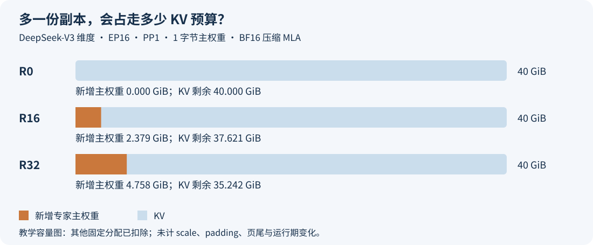

# 多放一份专家，还是多留一点 KV Cache？显存应该花在哪里

一个热点专家忙不过来，在另一张卡上多放一份，确实能让两边分担 token。但这份权重会常驻显存。假如服务原本把剩余空间都交给 KV Cache，多出来的专家就会挤掉一部分请求历史，能同时留下的长序列也会减少。

这让 EPLB 调优多了一层取舍：更新后的 forward 更快，并不保证整服务输出吞吐更高。单轮计算节省的时间，要和 batch 能否维持、请求是否排队、迁移本身花了多久一起看。

我会先把最低必要的 KV 容量留出来，再考虑用剩余预算复制热点专家。下面把这笔账展开：一份副本实际要花多少、它能换回多少 KV，以及怎样用两种对照区分布局收益和服务收益。

源码沿用 SGLang [`2914be60`](https://github.com/sgl-project/sglang/tree/2914be608009b65099c4c52ba118a597bf1b1421)。计算例子采用 DeepSeek-V3 的公开维度，显存与时间都明确列出设定；文末附可以直接复算的 CPU 脚本。DeepSeek-V4 的实测材料单独放在第五节，避免把不同模型的缓存结构混在一起。

## 一、多一份专家，买到的是分担热点的机会

先看一层 MoE。它有 256 个逻辑专家，部署在 16 个 EP rank 上。逻辑专家可以理解为 256 套不同的计算权重；物理槽位则是卡上真正存放它们的位置。

没有冗余槽位时，每个 rank 放 16 位专家。若每层整个 EP 组增加 16 个槽位，总数变成 272，每个 rank 放 17 位。增加的槽位保存某些逻辑专家的副本，由路由把访问这些专家的 token 分给不同副本。它们不会因此增加模型的逻辑专家数，也不会把每个 token 原本选中的专家数量加一。

这里有两个经常混淆的“16”：`R=16` 表示**每层、整个 EP 组多放 16 个物理槽位**。在 EP16 的均匀槽位布局下，每个 rank 每层只增加一个。若模型有 58 个 MoE 层，这一个槽位会在 58 层分别出现；各层有各自的权重，要逐层计算容量。

这与实际构造过程一致。[DeepSeek 的 MoE 初始化](https://github.com/sgl-project/sglang/blob/2914be608009b65099c4c52ba118a597bf1b1421/python/sglang/srt/models/deepseek_v2.py#L755-L765)把冗余数加进物理专家分配；[位置元数据](https://github.com/sgl-project/sglang/blob/2914be608009b65099c4c52ba118a597bf1b1421/python/sglang/srt/eplb/expert_location.py#L238-L275)也按逻辑专家数加冗余数建立槽位。副本如何挑选，可以接着看[16 个冗余专家怎么分](../distributed/eplb-redundant-expert-allocation.md)。

副本数和动态开关是两个配置维度。固定布局也能使用冗余槽位；动态 EPLB 则负责随负载调整布局。R0 时仍可以通过重新摆放不同专家来均衡各卡，只是没有额外槽位复制热点。做 OFF/ON 对照时，需要同时写出两边的 R，才能知道比较的是动态调整，还是连常驻容量一起改变了。

副本的价值来自原来的不均衡。假设某个热点专家占了一张卡上很大一部分工作，把它的一部分 token 分出去，有机会缩短最慢 rank 的执行时间。如果原本各卡已经接近均衡，或者计算主要受 Attention、通信和调度限制，再复制专家能改善的部分就很少。

副本也不是把原卡的全部工作平均分走。原卡还有其他专家，目标卡也可能忙；路由分流、核函数的 batch 形状和跨卡 dispatch 都会影响结果。判断要落到各 rank 的实际负载和 MoE 执行时间上，不能看到副本数翻倍就写耗时减半。

## 二、先算清一份副本究竟占多少

DeepSeek-V3 的[固定版配置](https://huggingface.co/deepseek-ai/DeepSeek-V3/blob/e815299b0bcbac849fa540c768ef21845365c9eb/config.json)给出 hidden size 为 7,168，MoE intermediate size 为 2,048，共 61 层，前 3 层使用 Dense，后 58 层使用 MoE。这里用它的矩阵维度做一个清楚的容量算例。

一个采用门控结构的专家主要有 gate、up、down 三个投影，权重元素总数是：

```text
gate: [intermediate, hidden]
up:   [intermediate, hidden]
down: [hidden, intermediate]

一层一位专家 = 3 × 7,168 × 2,048 = 44,040,192 个权重元素
```

假定这三份权重每个元素占 1 字节，且专家矩阵不再做 MoE TP 切分，那么一层一位专家的主权重就是 **42 MiB**。这个 1 字节是教学设定，不是在还原公开 FP8 权重包的全部存储，也不包含量化 scale、zero point、布局 padding 和分配器对齐。

于是，EP16 下从 R0 增加到 R16，每个 rank 每层多一位专家，58 层合计：

```text
每 rank 增加 = 58 × 42 MiB = 2,436 MiB ≈ 2.379 GiB
整个 EP16 组增加 = 16 × 2,436 MiB ≈ 38.063 GiB
```

第一行是单个 rank 的负担，第二行是跨 16 个 rank 的合计。后者没有堆在某一张卡上；也不能拿它去除以一份单卡 KV 的字节数，然后声称某张卡少了那么多 token。

实际工程里，要把公式中的 42 MiB 换成当前量化实现分给一个专家的完整物理字节数。融合的 w13 已经包含 gate 和 up，不能再把 gate、up 重复加一次。scale 和 bias 等辅助张量要一起计入；遇到 NZ 或 packed 权重，还要算物理 padding。多个导出视图共享同一份底层存储时，也不能把整块 storage 按视图数量重复求和。

这几项决定了为什么“磁盘上的模型大小 ÷ 专家数”通常算不准：文件里还包含 Attention、共享专家、Dense、embedding 等权重；部署后又可能重排、分片和补齐。本文的简单公式适合检查数量级，启动后的实际分配和张量布局用于完成最后核对。

量化也会改变这份交换。只看理想主权重，4 bit 相比 8 bit 可以把同样矩阵的字节数减半；实际还要加回量化参数和存储对齐。KV 的 dtype 则单独决定缓存成本。一个“W4”或“W8”标签，没有同时说明 KV 的 dtype，无法完成这笔预算比较。

另外，冗余槽位通常在模型构造、加载时就分配好。后续更新是把不同专家放进这些槽位，不能把每次 update 都算成又增加一整套常驻副本；把更新间隔拉长，也不会把这些槽位自动退还给 KV。

## 三、这 2.379 GiB，能换回多少 KV

KV 的单位应当是“当前 rank 为一个缓存 token 保存多少字节”。它取决于 Attention 结构、缓存 dtype、当前 stage 的层数，以及 head、序列和层在各 rank 上如何分片。EP16 本身不足以推出 KV 也缩小到十六分之一。

以普通、未量化的压缩 MLA 缓存为例，DeepSeek-V3 每层保存 512 维 latent，加上 64 维 RoPE key。采用 BF16、PP1、61 层都在本 rank，而且这些缓存行没有做序列切分时：

```text
一个本地缓存 token = 61 × (512 + 64) × 2 字节
                   = 70,272 字节 = 68.625 KiB
```

这里不再乘传统 MHA 的 K、V 两份完整 head 维度。压缩 MLA 把两者所需的信息保存在 latent 与 RoPE 部分，缓存布局已经不同。SGLang 的 [MLA pool](https://github.com/sgl-project/sglang/blob/2914be608009b65099c4c52ba118a597bf1b1421/python/sglang/srt/mem_cache/memory_pool.py#L4864-L4885)明确使用 `kv_lora_rank + qk_rope_head_dim` 作为这条普通路径的缓存维度。

两笔账现在才具备相除的条件：每 rank 增加 2,554,331,136 字节主权重，在这个缓存模型里，约相当于 **36,349 个本地 KV token**。一条 16K 输入、最多生成 1K 的独立序列，终点约为 17,408 个 token，因此这笔空间略多于两条完整序列的缓存。

但“约两条”还不是服务最大并发的下降量。服务可能有多个 Attention DP 副本，序列长度也不一致；共享前缀可以复用缓存块，页尾会留下碎片，投机解码还要预留候选位置。先在一个确定的本地 pool 内算容量，再结合请求归属和调度，才能讨论整服务并发。

下面把其他固定分配和运行余量先扣除，假定 R0 时本地 KV 可用预算是 40 GiB。只从这块预算里增加上述主权重，得到：

| 每层 EP 组冗余数 | 每 rank 新增主权重 | 剩余 KV 预算 | 理想本地 KV token | 完整 17K 序列 |
| --- | ---: | ---: | ---: | ---: |
| 0 | 0 | 40.000 GiB | 611,191 | 35 |
| 16 | 2.379 GiB | 37.621 GiB | 574,842 | 33 |
| 32 | 4.758 GiB | 35.242 GiB | 538,493 | 30 |

这张表忽略 scale、padding、页尾和运行期变化，用于复算容量交换。完整 17K 序列一列向下取整，表示所有序列都长到终点时能留下多少份；真实 continuous batching 不会让每条请求始终保持同一个长度。



图中每条都是同一份 40 GiB 增量预算。增加的专家主权重占走左边一段，KV 使用剩余部分；原有模型和其他运行资源已经在图外扣除。

这个 BF16 MLA 算式也不能直接套给 DeepSeek-V4。滑窗、压缩层、索引缓存和投机状态会改变每种 pool 的存储方式。有些成本随 token 增长，有些随请求槽位增长。应当用当前模型实际分配的各类缓存池逐项计算，并读取启动日志中的最终容量。

## 四、forward 快了，吞吐为什么还能不动

先只看普通 Decode：每条请求一轮输出一个 token，不开投机解码，不计更新停顿。一个持续满载的稳定 batch，其输出速度可以近似写成 `batch ÷ 单轮耗时`。

继续沿上面的容量例子，假设原来能维持 batch 35，每轮 35 ms，得到 1,000 token/s。再假定增加副本后，实际单轮为 33 ms，但长序列状态下只够维持 batch 33，仍然是 1,000 token/s。单轮少了 2 ms，TPOT 改善了，输出吞吐却相同。这里的时间是为了说明机制而给出的教学设定，不是 DeepSeek-V3 实测结果。

再换一个条件：用户只需要同时服务 32 条请求，两种配置都能放下，并且在这个相同 batch 上确实测到 forward 加速。那么额外 KV 暂时没有换来更多在跑请求，副本带来的计算收益就更容易保留。KV pool 变小，不一定触发性能损失；关键在于工作集是否撞到了容量边界。

靠近边界时，影响会先出现在接纳、排队和调度里。有请求不能及时进入计算，TTFT 会涨；若发生抢占、撤回或重算，还要记录对应次数和成本。不能仅凭 KV 剩余变少就断言已经重算，也不能只报参与计算的请求 TPOT，而把排队时间藏掉。

DSpark 下更不能直接沿用 `batch ÷ forward`。一轮 target verify 后，每条请求实际推进多少输出 token，与接受长度有关；draft、verify、候选 KV 和回滚也有各自的成本。此时应该比较同一窗口内真正交付的输出 token，同时保留原生接受长度、严格接受率及其计数分母。单看 target verify 快了多少，会漏掉完整解码过程。

PD 分离还会把取舍拆到两个服务。P 的冗余专家占用 P 的内存，D 的冗余专家占用 D 的内存；P 的省下空间不能自动搬给 D。P 需要关注接纳和 Prefill 合批，D 需要关注驻留序列、有效 batch 与持续输出。整服务的请求供给若受 P 限制，D 的单轮加速也不会按比例变成最终吞吐。

## 五、EPLB 的显存账，还要加上更新时的工作空间

常驻副本之外，还有统计记录、路由映射、通信资源和迁移 scratch。它们的增长方式不同，应该单列，才能判断哪一部分值得优化。

在本文固定源码的 `stat` 路径中，[记录 buffer 的形状](https://github.com/sgl-project/sglang/blob/2914be608009b65099c4c52ba118a597bf1b1421/python/sglang/srt/eplb/expert_distribution.py#L983-L997)包含记录条数、层数、物理专家数，并使用 int32。有限环形 buffer 按设定长度一次分配。这里还有个容易漏掉的区别：[DeepSeek 的位置元数据使用全部 61 层](https://github.com/sgl-project/sglang/blob/2914be608009b65099c4c52ba118a597bf1b1421/python/sglang/srt/models/deepseek_v2.py#L3560-L3566)，因此这块 buffer 按 61 层算，不能照搬主权重的 58 个 MoE 层。

设 buffer 长度为 1000，272 个槽位的这一块就是 `1000 × 61 × 272 × 4` 字节，约 63.29 MiB；R0 到 R16，仅槽位增加使它多约 3.72 MiB。完整 recorder 还可能有其他缓冲与历史。记录数改变时，这笔开销也会改变，需要与常驻副本分开列账。

迁移 scratch 也不能当成全部权重的永久复制。[当前 NPU adapter](https://github.com/sgl-project/sglang/blob/2914be608009b65099c4c52ba118a597bf1b1421/python/sglang/srt/hardware_backend/npu/eplb.py#L369-L401)直接暴露原权重的可写字节视图，独立申请 updater 所需的临时缓冲。执行时这些缓冲还会受布局、通信与异步生命周期影响。固定 KV 的对照，才容易看清它到底增加了多少水位。

我们此前在 Ascend 910C 上做过一次 DeepSeek-V4-Flash W8A8 的新旧搬运路径对照。两边都开动态 EPLB，冗余数相同，实际 KV 容量固定；移除 NZ↔ND 整层中转后，P 每芯片采样 HBM 差值的中位数下降 839.5 MiB，D 下降 1,641.5 MiB。完整配置、采样范围和逐芯片原始数据放在[存储路径重构文章](ascend-eplb-physical-storage-migration.md#kv)。

这个结果说明，降低迁移路径的内存成本，可以让系统保留同样的专家和 KV。它比较的是两种 ON 实现，没有比较 R0、R16、R32，也没有在这轮实验里把省下的空间重新分给 KV。因此不能把它写成“已经多跑了几条序列”。要兑现成容量收益，需要重新配置 pool 并验证实际分配。

还有一种容易错算的情况：两边设置相同 `mem_fraction_static`，更多权重挤掉了自动规划的 KV，最终设备总占用却差不多。总水位相同，不代表开关没有成本。SGLang 的 [KV 预算计算](https://github.com/sgl-project/sglang/blob/2914be608009b65099c4c52ba118a597bf1b1421/python/sglang/srt/mem_cache/kv_cache_configurator.py#L3027-L3097)使用加载后的可用内存，并扣除运行余量等项目；已经驻留的权重会通过剩余空间影响预算。

反过来，pool 分配完以后才第一次激活的通信缓冲、迁移峰值和图执行 workspace，也需要安全余量。只在启动后空闲时拍一张设备读数，既看不到完整高水位，也看不出 KV 被缩小了多少。

## 六、实验分两步，分别回答值不值

第一步先问：**相同 KV 能力下，增加副本有没有改善计算？** 固定模型、量化、卡数、并行布局、实际 KV 容量与负载，在合法的 R 档位之间对比。上面的 EP16 教学布局可以选 R0、R16、R32；实际后端的槽位数还要满足它自己的整除与对齐约束。实际 KV 容量选到最大 R 档也能安全放下的值，让所有组满足同一运行余量要求。

这一步需要看到更新前后热点是否减轻，以及同输入、同上下文、同实际 batch 的 forward 如何变化。更新前已经很均匀，意味着这份负载没有给副本多少发挥空间。可以检查不同真实业务切片，不能为得到漂亮结果临时构造热点，然后当作普通生产收益。

动态更新也要进入计时。记录每轮是否真的改变布局、update 的完整耗时，以及更新之间能运行多久。把一份副本始终放在正确位置的理想状态，与包含采集、迁移和热点变化的动态服务分开，才能判断收益能否抵过维护成本。

第二步再问：**同一台机器、同一份显存上限下，哪个配置能交付更多合格请求？** 允许各组按剩余空间分配 KV，记录最终 token 容量，再跑相同到达流量与长度分布。这轮把真实容量取舍纳入结果，适合决定上线配置。

两步的主表都要有平均与尾部 TTFT、TPOT、E2E、输出吞吐、失败数。另附实际 batch 分布、KV 使用峰值、接纳等待，以及发生过的抢占或重算；开启投机解码时再加原生接受指标。只报最大并发数，或者只截一段最高 token/s，都不足以说明用户体验。

显存也保留三个阶段：加载并完成预热后、第一次完整更新期间、稳定运行并排空后。把权重与辅助参数、KV 各 pool、统计与 scratch、allocator 的 allocated/reserved、设备总 HBM 分开记录。它们有包含关系，不应把所有读数相加。多个 rank 最后逐个对齐，避免用平均剩余量掩盖某一块卡已经放不下。

## 七、怎么决定下一笔显存花在哪

如果真实负载已经出现 KV 接纳等待，长上下文让驻留序列数明显下降，而各卡 MoE 负载相近，我会先保 KV，再减少占空间却没有改变慢端的副本。此时增加副本要拿出足够的单轮收益，才能补回少服务的那些请求。

如果 KV 仍有余量，实际 batch 由到达流量或请求数上限决定，而最慢 rank 长期被少数热点专家拖住，那么把一部分空间分给副本更有依据。先增加一个合法档位，核对热点、副本分流与稳态结果，再决定是否继续加。

还有一个更直接的检查：当前配置已经能达到目标吞吐和延迟，增加副本却只让空闲时的 forward 好看一点，就没有必要继续占用容量。副本、缓存和运行余量都应该对应当前服务要解决的问题。

为了方便核对本文数字，我把容量计算做成了[纯 Python 示例](../../examples/eplb-expert-kv-memory-budget/memory_budget.py)，在博客仓库根目录，或解压后的示例包根目录执行：

```bash
python examples/eplb-expert-kv-memory-budget/memory_budget.py --output results
```

脚本会生成 [capacity.csv](../../assets/eplb-expert-kv-memory-budget/data/capacity.csv) 和 [budget.json](../../assets/eplb-expert-kv-memory-budget/data/budget.json)，复算 42 MiB、2,436 MiB、三档 KV 容量及 35→33 的教学例子。[示例包直接下载](https://raw.githubusercontent.com/AkiYangDev/llm-inference-notes/main/assets/eplb-expert-kv-memory-budget/examples.zip)，参数和来源见[evidence.json](../../assets/eplb-expert-kv-memory-budget/evidence.json)。它计算字节和整数边界，不预测设备吞吐。

下一次看到“更新后 forward 快了几个百分点”，可以继续追问两个具体数：这个工作集还剩多少 KV 余量，稳定运行时实际 batch 保住了多少。把这两个数和更新成本放到一起，才知道那份专家副本有没有花对地方。

计数已经均匀、执行却仍有慢端时，可以接着看[专家收到的 token 一样多，为什么有的卡还是更慢？](moe-equal-token-counts-unequal-latency.md)。

[返回 EPLB 专题](../distributed/eplb-study-guide.md)。
