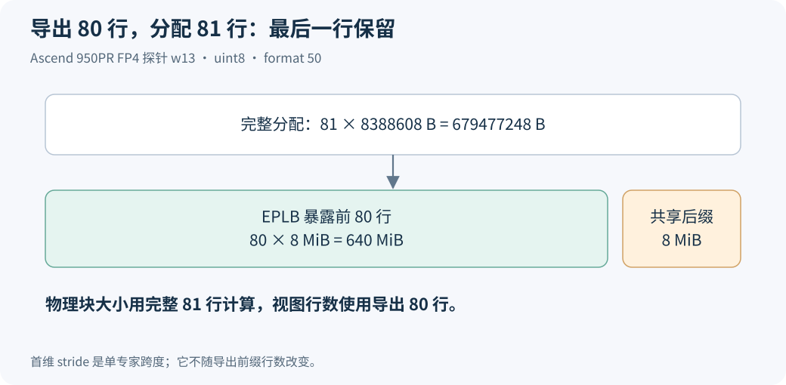

# FP4 第一次搬专家就报错：该补格式，还是放宽 stride 检查？

DeepSeek-V4-Flash 的 FP4 专家权重能完成加载和推理，动态 EPLB 第一次真正迁移时却报错：`NPU EPLB does not support storage format FRACTAL_NZ_C0_16`。

修复过程最容易走偏的地方，是把后面的检查一起放宽。已有 Ascend 950PR 探针给出的结论更直接：实际权重使用格式 50，旧允许列表只接受 0、2、29；原来的 NZ 专家块检查可以通过。补全格式支持就能解决这组输入的拒绝，不需要改变专家边界条件。

本文沿 PR #49701 的 [`e7fc1cdd`](https://github.com/sgl-project/sglang/commit/e7fc1cddf5dcb92b1b074301f2d748629293718f) 展开。真实尺寸来自该次设备探针，持续迁移结果来自原实验记录；随文脚本只复算元数据条件。三者各自回答的问题会放在对应位置。

## 一、为什么模型能跑，迁移才出错

模型前向把权重交给计算内核。EPLB 更新则需要枚举待迁移权重，确认它们可以划成独立专家块，再建立可写字节视图。二者经过的接口不同。

报错发生在 `_expert_storage_layout` 的格式检查，尚未进入这块权重的实际搬运。旧条件相当于：基础格式允许，NZ 只认 FRACTAL_NZ 的编号 29。探针实际返回 `FRACTAL_NZ_C0_16`，编号 50，于是入口直接拒绝。

所以，服务启动成功不能覆盖第一次迁移。即便计数、规划都正常，只有计划需要改动专家位置，权重验证路径才会暴露这个问题。验收动态 EPLB 时，应确认真实发生过迁移，并保留次数和异常情况；只看到 `--enable-eplb` 出现在命令里不够。

同样，也不能反过来推断“开 EPLB 的所有 FP4 模型都在启动时报错”。这里的触发点是格式检查遇到这类待迁移张量，报错位置和生命周期都能在调用链里说明白。

## 二、格式编号和专家形状，分别说明什么

格式编号描述 NPU 张量的存储安排。基础 ND 可以按常规连续多维数组理解；NZ 使用适合计算内核的分块安排。packed NZ 又有不同 C0 分块变体，格式 50 是其中之一。

EPLB 不根据模型名字来选择允许项，而是读取实际存储描述。因为同一个模型可以使用不同量化加载路径；请求 NZ，也不能把“最终一定返回 29”当作前提。补丁注释明确写出了 packed FP4 可能产生 C0 变体。

最终整理版把 29、50、51、52、53、54 写成具名常量，收在 `_SUPPORTED_NZ_FORMATS` 中。可直接读[该列表与注释](https://github.com/sgl-project/sglang/blob/2914be608009b65099c4c52ba118a597bf1b1421/python/sglang/srt/hardware_backend/npu/eplb.py#L32-L54)。这次真实模型探针命中的是 50，不能把一条列表写成六种格式都做过整模型性能测试。

另一个维度是 shape。探针中的 w13 导出为 `[80,2048,4096] uint8`，完整存储描述为 `[80,4096,2048] uint8`。后两维对调，表示专家内部使用转置视图；第一维仍是专家轴。

其中 4096 已经是 packed 后张量的维度。算迁移容量时，要从实际 `uint8` shape 和存储容量出发，不能看到 FP4 又把这份数据除以二。量化位宽怎样打包，是加载器和内核之间的约定；EPLB 这里搬的是已经打包好的字节。

## 三、沿真实尺寸，把三条检查逐项算出来

原 NZ 检查的核心条件可以读成三句话：导出权重与完整存储使用相同元素大小；跨一位专家的 stride 相同；完整张量的元素数恰好覆盖其全部专家行。对应函数见 [`_validate_nz_expert_blocks`](https://github.com/sgl-project/sglang/blob/2914be608009b65099c4c52ba118a597bf1b1421/python/sglang/srt/hardware_backend/npu/eplb.py#L314-L338)。

先算 w13。一位专家有 `2048×4096=8388608` 个 uint8 单元，所以 `stride(0)=8388608`，每位专家 8 MiB。完整描述虽然把内层写成 `[4096,2048]`，乘积仍一样，跨专家的 stride 没变。

| 探针输入 | 导出专家数 | 分配专家数 | 每专家物理字节 | 总存储字节 |
|---|---|---|---|---|
| w13 完整权重 | 80 | 80 | 8388608 | 671088640 |
| w13 带共享后缀 | 80 | 81 | 8388608 | 679477248 |
| w2 完整权重 | 80 | 80 | 4194304 | 335544320 |

第一行的元素大小是 `1=1`，首维 stride 是 `8388608=8388608`，完整元素数则是 `80×8388608=671088640`。三个不相等条件全部为假，因此不会报 `requires the original NZ expert blocks`。

w2 的计算完全可核对：`1024×4096=4194304`，每位专家 4 MiB，80 位共 320 MiB。w13 的完整 80 行是 640 MiB。表中这些探针恰好没有额外容量 padding；它们用来确认该次输入的边界，不能据此删除处理其他尺寸 padding 的代码。

第一维 80 的来源也要说清。该次配置有 256 位 routed experts，EP=4，且每个 rank 多留 16 个冗余槽位，于是每卡 `256/4+16=80`。这只是解释这份探针，代码没有把专家数写死为 80。

## 四、81 行只导出 80 行，为什么仍然合法

共享专家后缀那一行最容易让人怀疑 stride 校验：既然导出 80 行、底层 81 行，难道不就不相等了吗？

实际检查比较的是 `full.numel()` 与 `full.shape[0]×weight.stride(0)`。右边使用完整分配的 81，而不是导出的 80。两边分别为 `81×8388608` 和同一个数，仍然相等。

首维 stride 的含义是“从这一位专家走到下一位专家要跨多远”。导出前 80 位不会改变每位专家内部的大小，因此 stride 仍是 8388608。它不是整个 allocation 的总长度，也不是导出行数。用 stride 乘行数，才得到对应行范围占多少空间。

后续物理块大小使用 `storage_bytes/total_experts`，这里应除以完整分配的 81，得到 8 MiB。对迁移 updater 暴露的视图则只有 80 行。这样，80 位 routed / redundant 专家可以更新，第 81 行共享专家后缀保持在原位置。

如果错误地把整块分配除以导出的 80，每位专家就被算大了，后面的槽位起点会逐渐偏移。前缀与 allocation 各自的行数必须保留，这正是 layout 同时记录导出 shape 和 `total_experts` 的原因。

## 五、那次“还得放宽 stride”的判断，如何被更正

早期问题草稿曾把“放宽 stride”与“接受 packed NZ 格式”放在同一个补丁里。但第二处 stride 报错并没有真实发生。后来用未修改的严格条件核对三份探针，三份都通过；再把 stride 检查恢复原样，只保留格式允许项，完成了 124 次 rebalance：Prefill 12 次、Decode 112 次，零异常。

这组结果来自 Ascend 950PR 上的 DeepSeek-V4-Flash FP4 实验，环境记录为 CANN 9.1.0、torch 2.10.0 与 torch_npu 2.10.0.post6。它证明该配置下不必放宽原块条件。前一组包含更宽补丁的 272 次成功记录，不能拿来替代“只加格式项”的对照，所以这里以恢复严格检查后的 124 次为判断依据。

源码也能独立核对修复范围：`e7fc1cdd` 的父提交是 `08865d16`，该补丁只改格式常量列表与入口判断，没有改 `_validate_nz_expert_blocks`。[PR 的 FP4 验证说明](https://github.com/sgl-project/sglang/pull/49701)保留了这组 124 次结果；随文[来源与探针摘要](../../assets/eplb-storage-contract-lab/evidence.json)区分设备报告、代码对照和 CPU 复算。

持续更新零异常回答的是迁移路径能完成，不替代完整任务准确率。此前首 token 一致性也只有相应样本的证明范围。要验证模型仍在算对，继续沿[权重迁移正确性检查](eplb-weight-migration-correctness.md)核字节、量化辅助参数、映射、图回放和任务结果。

## 六、保留严格检查，给这条路径一个清楚的边界

补全格式之后，并不是遇到任意 NZ view 都直接拷贝。当前路径仍要求三维专家权重、稠密的专家内部布局、完整专家轴、合法容量以及可均分的物理块。格式允许项回答“认识这种存储格式吗”，块校验回答“这份张量能否按完整专家拆开”。两者缺一不可。

如果未来某个加载器改变专家轴，或导出的是专家内部子切片，应重新检查它的实际 storage descriptor。不能因为格式编号仍是 50，就绕过其他条件。相反，如果条件都满足，也不需要按模型名字再写一套搬运算法。

这次修复还澄清了 A3 / A5 的关系。EPLB 的物理字节方案保留底层格式，对 Ascend 910C 与 Ascend 950 使用同一条思路；格式 50 是这次 Ascend 950PR FP4 输入暴露的兼容性缺口。代码依据真实张量布局工作，不是见到某个卡型就无条件放行。

[CPU 算例包](https://raw.githubusercontent.com/AkiYangDev/llm-inference-notes/main/assets/eplb-storage-contract-lab/examples.zip)中的 `check_contracts.py` 已录入三组探针尺寸。它打印 80/80、80/81 与 w2 的容量和严格条件复算，结果见[输出文件](../../assets/eplb-storage-contract-lab/results.json)。读者可以改一个 stride 或行数，观察边界条件怎样失败；这个脚本不分配几百 MiB 权重，也不模拟设备 format cast。

留下来的补丁因此很小：补足实际格式，保留已经通过探针与迁移对照的专家块契约。问题定位到哪个判断，就用那个判断的输入与结果解释修复范围。

[返回 EPLB 专题](../distributed/eplb-study-guide.md)。
