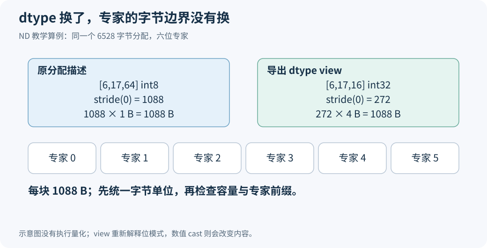

# 合法的 int32 权重，为什么被 EPLB 拒绝了？从元素个数到专家字节边界

一块量化权重先按 int8 分配，之后用 `view(torch.int32)` 交给计算内核。模型能正常使用它，EPLB 第一次搬专家时却把它判为非法：导出权重的元素大小，与底层存储描述不相等。

这个检查听起来合理，实际把两件事混在了一起。dtype 决定怎样解释字节；迁移需要确认的，是一位专家占哪一段字节。同一份存储换一种解释，专家边界可以原封不动。

PR #49701 的 [`83a22098`](https://github.com/sgl-project/sglang/commit/83a220985a1b4c1ca583c7b57a565a48c8315edb) 修正了这处契约。本文只展开其中的 ND 打包与 reshape 修复。源码以该修复及最终整理后的 `2914be60` 为准，算例使用 CPU 字节数组；它们验证边界和复制结果，不执行 NPU 算子。

## 一、先看一位专家到底有多大

用下面这组尺寸解释问题：底层按 `[6,17,64] int8` 分配。第一维是六位专家，每位专家有 `17×64=1088` 个 int8 元素，每个元素一字节。因此一位专家占 1088 字节，整块存储占 6528 字节。

量化加载器随后把它看成 `[6,17,16] int32`。最后一维从 64 变成 16，因为四个一字节单元合起来解释为一个四字节单元。每位专家现在有 `17×16=272` 个 int32 元素，占用仍是 `272×4=1088` 字节。

| 描述 | 专家形状 | 每元素大小 | 专家首维 stride | 每专家字节数 |
|---|---|---|---|---|
| 原分配 | `[6,17,64]` | 1 B | 1088 个 int8 | 1088 B |
| 导出 view | `[6,17,16]` | 4 B | 272 个 int32 | 1088 B |



这里的 stride 表示跨到下一位专家要跳过多少个**当前 dtype 的元素**。它不是字节单位，不能把两个张量的 stride 裸值直接比较。1088 和 272 看起来不同，换算后是同一个距离。

`view(dtype)` 也不同于 `.to(dtype)`。前者重新解释同一批数据，后者做数值转换。例如四个 int8 单元拼出的 int32 位模式，不等于把其中一个 int8 数值转换成 int32。量化内核约定了打包解释方式，迁移代码应保留这些位模式。PyTorch 对 dtype view 的定义与对齐条件，见 [2.10 的接口文档](https://docs.pytorch.org/docs/2.10/generated/torch.Tensor.view.html)。

## 二、模型加载器为什么会产生两种描述

这类输入有实际调用路径。[NPU 量化实现的 `_pack_to_int32`](https://github.com/sgl-project/sglang/blob/2914be608009b65099c4c52ba118a597bf1b1421/python/sglang/srt/hardware_backend/npu/quantization/moe_methods.py#L800-L806) 在检查最后一维可被四整除后，返回 `weight.view(torch.int32).contiguous()`。代码注释说明，它把四个 int8 单元所承载的八个 int4 值打包为 int32。

这不代表每次运行的底层描述符都必然保留 int8。关键在于，合法输入的契约必须允许它保留；不能要求加载器为了让迁移检查好看，再复制一份相同数据。

另一个来源是 GPTQ 的二维打包。加载器可以先把数据整理成二维矩阵，调用 `npu_convert_weight_to_int4pack`，再 reshape 回三维专家权重。对应路径可读 [GPTQ MoE 加载代码](https://github.com/sgl-project/sglang/blob/2914be608009b65099c4c52ba118a597bf1b1421/python/sglang/srt/hardware_backend/npu/quantization/gptq_kernels.py#L187-L200)。

假设底层分配是 `[102,16] int32`，导出为 `[6,17,16] int32`。两者有相同元素总数，导出后每位专家是连续的 272 个 int32。底层第一维的 102 表示二维矩阵行数，不是 102 位专家。

末尾写了 `.contiguous()`，也不能推断已经产生新分配。如果输入已经满足指定连续格式，PyTorch 的 [contiguous 定义](https://docs.pytorch.org/docs/2.10/generated/torch.Tensor.contiguous.html)允许直接返回原张量。连续 reshape 后的描述，和原分配描述继续不一样，完全符合接口约定。

这两种情况分别改变了 dtype 和维度。旧检查却要求它们都像“最初就是按三维专家张量分配的权重”，于是把合法输入挡在了迁移入口。

## 三、修复为什么要同时改计算单位

最直接的改法，是删掉 `element_size()` 必须相等的条件。但只删这一句，后续若继续用导出 dtype 去解释底层元素容量，仍会算错。

还是前面的例子：底层报告 6528 个 int8 元素。若乘上导出 int32 的四字节大小，会凭空得到 26112 字节，是原分配的四倍。根据这个数建立通信视图，错误已经从“拒绝合法输入”变成了“把地址外的空间也当作权重”。

修复后的代码把容量和边界各自转换为字节，再进行比较。下面保留了关键表达式，省略错误处理：

```python
storage_bytes = storage_elements * full_storage_tensor.element_size()
bytes_per_expert = weight.stride(0) * weight.element_size()
total_experts = storage_bytes // bytes_per_expert
```

第一行使用底层描述的元素单位；第二行使用导出张量的元素单位。两行结果都是字节，第三行才有资格相除。完整分支见 [`_expert_storage_layout`](https://github.com/sgl-project/sglang/blob/2914be608009b65099c4c52ba118a597bf1b1421/python/sglang/srt/hardware_backend/npu/eplb.py#L269-L300)。

ND 分支还检查容量能够被专家字节跨度整除，并确认导出的专家数不超过可容纳的完整块数。底层是二维还是三维，不再决定专家数量；导出张量提供专家轴，底层存储提供真实容量。

这里的 `storage_bytes` 比 `storage_elements` 更适合保存在 layout 对象里。后续建立字节别名时，不需要再猜这份元素数属于哪个 dtype。字段名本身就约束了使用方式。

## 四、允许 reshape，不等于允许任意切片

ND 按字节检查以后，仍然要求每位专家内部稠密、专家之间独立连续，并从存储起点导出完整专家前缀。

先看专家内部转置。一个 `[M,N]` 矩阵转置为 `[N,M]`，元素顺序的逻辑解释变了，但整位专家仍占连续的一块空间。实现按 stride 对内部维度排序，再逐项检查能否连续覆盖，这样就能接受完整的内部转置。

再看 `weight[:,:,::2]`。它只选择每隔一个元素的数据，专家内部出现空洞。若把它当成紧密字节行发送，带走的会是所选元素与被跳过元素的混合；若只发 `numel()` 对应的字节，又会截掉实际范围的后半部分。因此这种输入被稠密检查拒绝。

`weight[1:]` 则改变了起始 offset。当前接口支持的是从起点开始的完整专家前缀，不能拿同一套容量计算直接解释非零偏移的后缀。支持更广泛切片需要另外定义可用区间，不能靠删除 offset 检查得到。

共享专家后缀是另一个容易误判的例子。假设分配六位专家，只向 EPLB 导出前五位，底层容量仍是六块。代码应算出 `total_experts=6`，再建立五行可写视图。每行仍是 1088 字节，第六块必须保持原样。若用导出五行反过来均分整个分配，每位专家的边界就被破坏了。

这些检查分别约束内部覆盖、专家间跨度、起点和容量。它们保护的对象明确以后，代码既能接受合法打包，也能继续拒绝会造成错误读写的视图。

## 五、为什么 NZ 没有直接套用这套除法

ND 分支要求基础存储没有额外 padding。这样，导出专家的逻辑字节跨度就能用于完整划分分配。

NZ 还带物理分块与 padding。逻辑 shape 和 stride 描述了张量坐标，真实分配可能更大。此时仅凭导出的逻辑跨度，不能推出每位专家的完整物理范围。

因此，同一个修复将两种情况拆开：ND 从导出权重计算字节边界；NZ 保留完整分配的三维专家轴和原块约束，再用物理存储容量除以完整专家数。它没有因为 ND 支持 dtype view，就允许 NZ 任意改变底层元素解释或专家轴。

这也说明“能否删检查”必须回到分支契约。`element_size()` 相等对 ND 打包不是必要条件，在当前 NZ 实现里却是恢复原专家块的条件之一。把同一条判断放到所有输入前面会误拒绝；把它从所有输入里删除，又丢掉了另一条路径的依据。

## 六、用字节数组验证，能回答什么

[算例包](https://raw.githubusercontent.com/AkiYangDev/llm-inference-notes/main/assets/eplb-storage-contract-lab/examples.zip)只用 Python 标准库。解压后在文件所在目录执行：

```bash
python check_contracts.py
```

它先计算 int8 原分配、int32 view 和二维分配 reshape 三种描述，确认每专家都是 1088 字节、整块都是六位专家。然后生成 6528 字节的数组，先保存源块，再交换前五位专家，核对所有目标字节与第六块后缀。

脚本还检查四个拒绝用例：非零 offset、内部步进切片、导出超出容量、容量不能整除专家块。对应[运行输出](../../assets/eplb-storage-contract-lab/results.json)中，合法描述得到相同边界，四个非法输入全部被拒绝。字节数组对照不需要模型权重，也不会把 CPU 检查伪装成 NPU 设备回归。

这项契约也有设备验证。[PR 的验证记录](https://github.com/sgl-project/sglang/pull/49701)中，P、D 每端各通过 10 项真实设备存储检查，其中包含 packed int32 dtype view 与二维分配恢复为 ND 专家张量；该 adapter 在检查所用的 `e60cc1a99` 与完整服务所用的 `08865d168` 之间未变。随文 CPU 算例方便读者拆开复算每个边界，不替代那份设备记录。

这项修复的直接结果，是原本合法、边界不变的 ND 打包权重可以通过迁移检查。它没有为这两种输入新增整层格式转换，也没有要求加载器为了改变描述符再复制一次权重。

继续阅读：[FP4 格式补全为什么不需要放宽 NZ 块检查](eplb-fp4-nz-format-validation.md)，或回到[物理存储迁移的完整路径](ascend-eplb-physical-storage-migration.md)。

[返回 EPLB 专题](../distributed/eplb-study-guide.md)。
