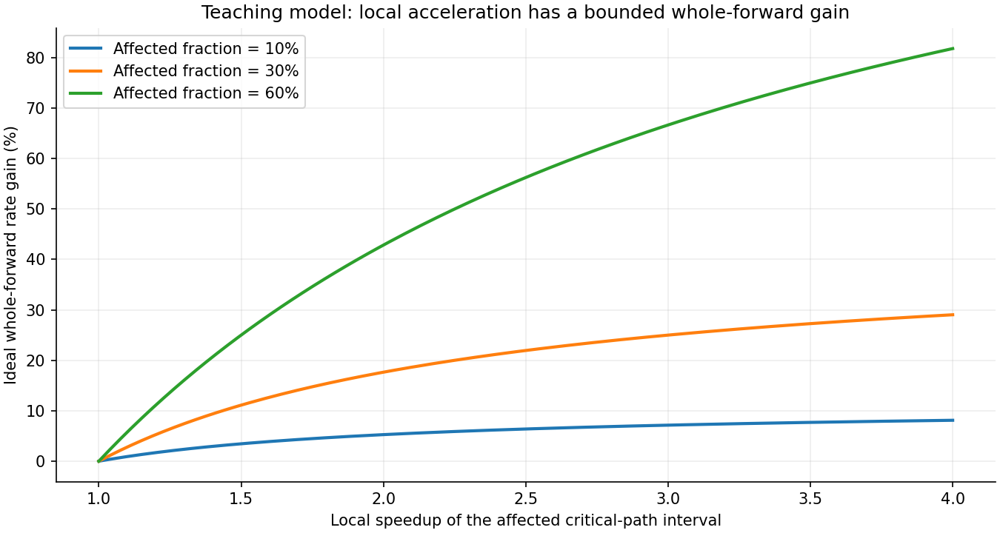

# EPLB 的收益上限在哪？先看 MoE 占了多少时间

有时专家负载已经明显均匀了，正常 forward 却只快了一点。继续增加冗余专家、缩短更新间隔，还会增加显存与迁移成本。这时先算一个收益上限，比继续扫参数更有帮助。

EPLB 改善的是专家负载的分配。一次 forward 里，还有 Attention、Dense 层、路由、通信、同步和调度等工作。即使某一段工作快很多，也只能节省它原本占用的那部分时间；进入完整 PD 服务以后，收益还要经过流水线瓶颈这一关。

下面用几组可以复算的教学数字，把“均衡度改善”“局部时间下降”“完整 forward 提速”和“整服务吞吐提高”连接起来。配套脚本会输出每一步算术结果，便于用自己的时间拆解替换参数。

## 一、先界定这次优化真正影响哪一段

假设一次固定状态的 forward 用时 100 ms，其中某段与专家倾斜有关的关键路径耗时为 30 ms，其余为 70 ms。如果新布局把这 30 ms 缩成 15 ms，完整 forward 就变为 85 ms。

这段局部计算快了一倍，但整轮时间只减少 15%，对应理想的重复执行速率提高约 17.65%。不能把局部的“两倍”直接写成完整服务“两倍”。

15% 和 17.65% 的分母不同。时间减少量是 `(100−85)/100`；若始终重复同样的执行，单位时间能完成的次数则变成原来的 `100/85`，所以速率增加约 17.65%。这一步先把“少等了多久”和“每秒多做多少”分开，后面读吞吐百分比就不会混淆。

估算之前，先要在时间线上找到这 30 ms。所谓关键路径，就是其中某一步没结束，后续工作便无法继续的依赖链。例如，其他 rank 已完成专家计算，却必须等最后一个 rank 才能进入下一步，这段等待就可能受负载均衡影响。16 个 rank 同时执行的 kernel 时间则不能相加充当一轮 forward 的耗时；整轮墙钟看的是从开始到完成经过了多久。

同样，如果专家计算与通信重叠，二者设备忙时间不能简单相加。减少一个完全藏在其他工作后面的 kernel，可能不改变整轮结束时刻。需要沿同一轮时间线找关键依赖，再定义可优化部分。

## 二、用一个式子算出局部改善的上限

设原 forward 时间为 F，可优化部分占比为 p，这部分获得 s 倍加速，其他部分保持不变。教学模型给出：

```text
新时间 / 旧时间 = (1 − p) + p / s
执行速率倍数    = 1 / ((1 − p) + p / s)
```

| 可优化部分占比 p | 这部分提速 s | 整轮时间减少 | 理想执行速率提高 |
|---|---:|---:|---:|
| 10% | 2 倍 | 5% | 5.26% |
| 30% | 2 倍 | 15% | 17.65% |
| 60% | 2 倍 | 30% | 42.86% |
| 30% | 完全消除该部分 | 30% | 42.86% |

最后一行是极限假设，不是现实实现：原本占 30% 的部分即使一瞬间完成，完整执行速率也只能达到约 1.43 倍。若有人根据同一轮时间拆解声称两倍整轮提速，就应该重新检查分母、统计区间或是否还有别的条件改变。

EPLB 一般不会把整个 MoE 消掉。所有 token 仍要执行相应专家，还需要 dispatch 与 combine。它主要减少分配不均带来的慢 rank 和等待，能够改变的时间通常只是 MoE 中的一部分。把整个 MoE 区间都当作可免费消除，会给出过于乐观的上限。

这个估算也有适用条件：同一输入、batch、上下文与执行路径，其他工作近似保持不变。如果新布局改变通信拓扑或分组效率，其他部分也可能变化，应把它们分别测出，重新建立时间账。



## 三、均衡度提高多少，不能直接换成加速多少

先用最理想的计数模型。四个 rank 的专家工作量为 `[160,80,80,80]`，均值 100、最大值 160。若时间严格正比于负载，且所有工作可自由分配，完美均衡以后最忙 rank 可以从 160 降到 100，这部分最多提速 1.6 倍。

原来的均值/最大值为 0.625，它描述的是负载分配。即使变成 1，也不能称为“forward 加速 60%”。如果受这部分影响的区间只占整轮 30%，代入上面的关系，新时间为旧时间的 88.75%，理想执行速率提高约 12.68%。

真实条件通常比这个模型更受约束。专家是离散函数与权重，副本预算有限，每张卡物理槽位固定；热点不能像水一样任意分到每个执行单元。一次 token 选择也不能为了均衡就改成另一位逻辑专家。

此外，相同路由数未必对应相同时间。Grouped GEMM 的专家分组、尾块、活跃专家数量与权重复用都影响效率；跨节点流量、源端晚到和同步也会拉长关键路径。因此计数模型适合估计“有没有倾斜空间”，实际收益仍应读取时间线。[路由均衡与耗时差异](moe-equal-token-counts-unequal-latency.md)给出了这些反例。

计数窗口也会隐藏时间上的不均衡。两张卡第一步为 `[100,0]`，第二步为 `[0,100]`，两步合计正好各 100，但每一步都有一张卡等另一张卡。只看累计负载会觉得已经平衡，逐轮时间线却能看到交替的慢端。若 planner 使用累计需求，应进一步确认这些热点是否能被当前副本布局同时承接。

相反，有些累计不均并不落在关键路径上：某张卡专家计算多一点，但另一张卡的 Attention 更晚，最后仍是 Attention 决定会合时刻。把前者均衡得更好，可能只是增加隐藏在等待中的余量。只有沿真实依赖对齐，p 的估计才不会把这部分余量误算成必得收益。

## 四、把更新成本放回去，才知道运行一段时间赚不赚

前面只比较更新前后的正常 forward。动态 EPLB 还要做统计整理、规划、迁移与位置提交，这些工作也会占用时间与资源。

设一个区间有 N 次同类 forward，原来每次花 f0，新布局每次花 f1，一次更新的额外阻塞成本为 U，其他差异累计为 C。简化后的净节省为：

```text
净节省 = N × (f0 − f1) − U − C
```

例如 f0−f1 为 0.2 ms，U 为 600 ms，暂把 C 设为 0，3000 次执行才刚好抵回更新成本；4000 次执行节省 800 ms，扣掉 U 后剩 200 ms。若原来 4000 次共花 140 秒，这 200 ms 的净变化只有约 0.14%。

局部确实优化了，但整段运行改善很小，这种结果完全可能出现。它提醒我们：既要测正常 forward 的差值，也要报告一次更新后的有效运行长度，不能只展示前者。

这里 U 指对关键路径的额外影响，不应机械等于某个设备通信 kernel 的累计忙时间。后台方案还涉及重叠与资源争用；分层 chunk 更新也可能把停顿分散到多次执行。测量应沿实际依赖，而不是把所有 rank 的 update 时间相加。

统计的固定开销同样值得单列。只比较“正常 forward 没有撞上 update”的请求，可以帮助排除直接停顿，却仍可能包含持续记录与不同 batch 的成本。[后台搬运与前台等待](async-eplb-foreground-wait.md)进一步讨论了这些关系。

## 五、到了 PD 服务，先看谁决定总产出

再设一个只为解释瓶颈的稳定供给模型：P 最多每秒提供 3 条请求，D 最多每秒完成 5 条。在请求形状与其他条件固定时，整条流水线最多由较慢的 P 提供约 3 条。把 D 从 5 提高到 6，不会自动把系统吞吐提到 6。

如果 EPLB 主要改善 P，使它能提供 4 条，D 也有足够余量，整服务就有机会达到约 4 条。与此同时 D 更忙，实际 batch 可能增长，单请求生成间隔也可能增加。这和“D 的局部 forward 有没有同状态提速”是不同层次的问题。

这份供给模型先帮助定位瓶颈在 P 还是 D。回到真实服务，还要把 KV 交接、突发组批、队列和长尾放进同一段时间里：它们会让两个阶段时忙时闲，也决定峰值能力能发挥多少。选定重点观察的一端后，再用完整服务对照核实。

已有一组公开 OFF/ON 测试就同时出现了吞吐提高、TTFT 下降与 TPOT 增加。那份数据支持的是完整服务变化，不能拿来填本篇教学表里的 p 或 s；完整条件见[吞吐提高而 TPOT 变差](tpot-worse-throughput-better.md)。

上下文与 batch 变化也会改变这个上限。更长历史可能增加 Attention 读取，更多有效 token 又会改变专家矩阵的分组和利用率。某个短上下文、大 batch 的布局收益，不能只按百分比搬到长上下文、小 batch 场景。至少需要分别确认相关关键路径占比与同状态时间差。

冗余还会改变实际可容纳的请求数。如果固定显存预算后，更多专家挤掉了 KV，正常 forward 虽然更快，服务能同时接住的长序列却可能更少。收益上限模型假定其他条件不变，这种容量变化必须另列，不能继续把原 p、s 当作完整上线预测。

## 六、用收益上限决定下一步测什么

如果专家倾斜严重、MoE 的相关关键路径又占很大比例，值得先验证一次布局更新。优先固定真实计算状态，确认新布局能缩短哪个区间，随后再评估周期更新与服务吞吐。

如果路由已经接近均匀，或者可优化区间占比很小，继续增加冗余往往更容易增加常驻权重和压缩 KV。此时应查 Attention、通信、Prefill 队列或图桶，而不是期待一个更激进的 EPLB 参数突然释放大收益。

如果 normal forward 有收益、净收益却很小，重点看更新间隔、布局持续时间、无效迁移和一次 update 成本。把 I 拉长的作用是减少重复支付成本，它不能让过期热点继续有效；W 与业务时间尺度仍要匹配。

如果局部变快而整服务不变，先看瓶颈是否在另一端，并核对实际 batch、缓存、接受率与请求构成。相同客户端并发不等于相同设备工作量，不能把所有差异都塞回某个算子解释。

实际使用时，先从 trace 估出可影响的区间，再用同状态前后对照测一个时间差。若这个差值即使持续整个更新周期，也抵不过迁移成本，就先处理更新开销或其他瓶颈；若它有足够余量，再测试窗口、间隔和完整服务。一个上限算例就能帮助缩小参数范围。

表格与净收益例子可通过[标准库算例](../../examples/eplb-study-lab/eplb_models.py)复算，[完整结果](../../assets/eplb-study-lab/models.json)标明了教学假设。[返回 EPLB 专题](../distributed/eplb-study-guide.md)。
