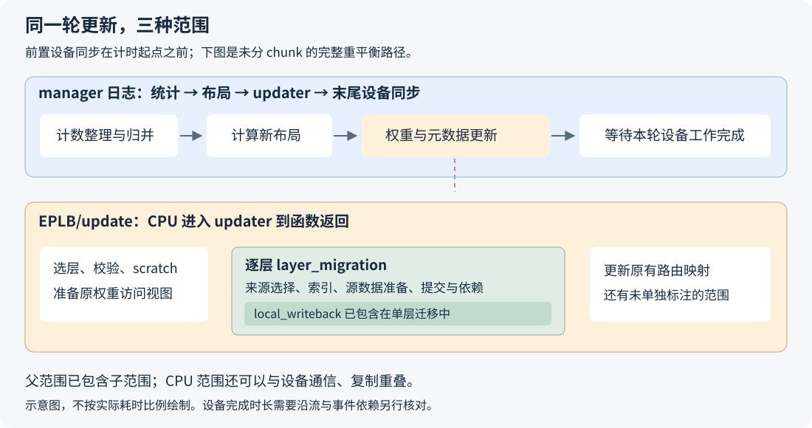

# 一轮 EPLB 更新的时间，究竟花在哪里？

动态 EPLB 调整了专家布局，下一轮推理会用到新的专家位置。但在它生效之前，服务先要付出一次更新成本：整理专家热度、计算新布局、准备搬运、交换权重，再切换路由映射。

我们在 DeepSeek-V4-Flash 的 Ascend 910C 服务里采过这段过程。一次 profiling 中，P 端 rank 0 的 updater 标注持续了 **665.44 ms**，D 端为 **515.90 ms**。把时间线展开，会看到几十层迁移、几千次收发调用，以及末尾一段很长的复制接口。

这里的 665.44 ms，量的是 CPU 主线程从进入 updater 到返回的时间。它没有包含前面的统计导出和布局计算，里面也不全是设备通信。先把这条边界画清楚，再看内部的收发与复制，才能判断哪项工作值得优化。

下面先走完一次更新，再把真实计时放回各自的位置。本文 P 指 prefill 端，D 指 decode 端；毫秒数均注明测量范围。源码主线按 [SGLang `2914be608`](https://github.com/sgl-project/sglang/blob/2914be608009b65099c4c52ba118a597bf1b1421/python/sglang/srt/eplb/eplb_manager.py) 解读，profiling 使用较早的 `e60cc1a994`，两份材料分开使用。

## 一、到达更新间隔以后，系统先做什么

先假设模型有四个逻辑专家 A、B、C、D，分布在两张卡上。近期 A 比较忙，EPLB 决定调整副本分配和摆放位置。这里至少有两个问题要分别回答：新布局应该是什么，以及怎样把现有权重安全地搬成这个布局。

第一个问题由负载统计和布局算法处理，第二个问题交给权重 updater。manager 的整轮日志会包含这两部分，`EPLB/update` 标注只包住后面的 updater。



在 [`EPLBManager.rebalance()`](https://github.com/sgl-project/sglang/blob/2914be608009b65099c4c52ba118a597bf1b1421/python/sglang/srt/eplb/eplb_manager.py) 中，主要顺序是：

```text
到达重平衡间隔
    ↓
dump_record：取出窗口内的统计，整理为布局算法使用的计数
    ↓
检查是否需要重平衡
    ↓
计算新专家布局
    ↓
选择需要更新的层，调用 updater
    ↓
权重迁移完成后，更新位置元数据
    ↓
后续 forward 使用新布局
```

“到达间隔”只表示轮到这次判断。均衡度阈值可以跳过重平衡；计算出的布局也可能与原布局相同。这时不会发生一轮完整的权重搬家。看实验日志时，要把周期触发次数、真正改变布局的次数和实际通信量区分开。

统计导出本身也有计算与通信。在本文源码的 [`_StatAccumulator.dump()`](https://github.com/sgl-project/sglang/blob/2914be608009b65099c4c52ba118a597bf1b1421/python/sglang/srt/eplb/expert_distribution.py#L1017-L1046) 中，系统先把物理槽位计数换成逻辑专家计数，再执行 `all_reduce(SUM)`，把各 rank 的计数合在一起。这个通信汇总的是热度数据，后面的 P2P 搬运才传专家权重，两者用途不同。

统计还有一部分成本发生在普通 forward 中：每轮路由时记录专家计数。到更新时才做的统计导出，与每步持续记录的成本，属于两个时间范围。只测一次 updater，得不到开启动态 EPLB 的全部运行成本。

### 日志里的 rebalance time 包住哪一段

在不按层分 chunk 的同步计时分支里，manager 先同步设备，再记开始时间；完成统计导出、布局计算和更新后，再同步并记结束时间。把已执行重平衡的路径缩成示意代码，就是：

```python
device.synchronize()
start = time.time()

records = recorder.dump_record(output_mode="object")
new_layout = compute_layout(records)
updater.update(...)

device.synchronize()
elapsed = time.time() - start
```

实际代码还有跳过判断、恢复流程和日志，这里只保留计时边界。按层分 chunk 时，manager 可以在 chunk 之间让出执行，不能继续套用这段整轮同步计时。

前面的同步用于排空此前工作，位于计时起点之前；末尾同步位于计时范围之内。这样得到的日志时长，比只围住一个 Python 函数调用更接近“本轮工作做完需要多久”。它仍然只是这一段重平衡的耗时，不包含此前每轮 forward 的计数成本。

## 二、进入 updater 后，才开始处理怎样搬

新布局已经算出来，updater 接下来处理的是具体存储和通信。NPU 路径的调用关系可以概括为：

```text
ExpertLocationUpdater.update
  ├─ 对比旧、新布局，选择变化的层与本 rank 参与的任务
  ├─ 检查权重布局，创建专家权重访问视图和临时缓冲
  ├─ 逐层调用 update_expert_weights_single_layer
  │    ├─ 确认每个目标槽位的数据来源
  │    ├─ 保存后面仍需读取的源数据
  │    ├─ 构造、分批提交 send / recv，建立完成依赖
  │    └─ 将暂存的专家块写到目标槽位
  └─ 更新原有位置元数据
```

具体实现见 [NPU `migrate_expert_weights()`](https://github.com/sgl-project/sglang/blob/2914be608009b65099c4c52ba118a597bf1b1421/python/sglang/srt/hardware_backend/npu/eplb.py) 和[单层更新函数](https://github.com/sgl-project/sglang/blob/2914be608009b65099c4c52ba118a597bf1b1421/python/sglang/srt/eplb/expert_location_updater.py)。

这里有几项工作即使没有跨卡发送，也可能发生。例如两个专家只在本卡交换位置，直接先把 B 覆盖到 A 的槽位，就会丢失后面还需要的 A。因此要先保存仍需读取的源数据，再覆盖目标。scratch 是为这类依赖准备的临时空间。

临时缓冲、发送源和原模型权重的关系，会影响能否安全原位修改。它们不能只按“多了一次 copy”就直接删掉；先要确认源数据之后是否仍被某个目标或发送操作使用。原位更新与图地址的关系，见[图捕获与权重地址](graph-capture-tensor-storage.md)。

### prepare 不一定在搬权重，writeback 也有两种含义

旧 Ascend 路径先把 NZ 权重转换成连续 ND 中转张量，在中转张量上迁移，最后转回原格式并复制到模型权重。这里的准备和写回包含整层权重转换、复制。

新的物理存储路径为原权重创建可写的字节视图。创建视图主要准备张量描述和生命周期关系，并不复制整层权重。后续仍有 scratch 与目标槽位之间的专家块复制，但不再需要把整层 ND 结果转换、写回。

因此，时间线上出现 `prepare_weights`，不表示又做了一遍 NZ→ND；出现 `local_writeback`，也不表示旧的整层写回回来了。标注覆盖哪个函数，比名字本身更重要。[上一篇存储路径文章](ascend-eplb-physical-storage-migration.md)展开了这部分实现。

## 三、把一份真实 trace 的主线程时间账算清楚

这份采集使用 DeepSeek-V4-Flash-0731 W8A8、Ascend 910C，每端 TP16/EP16、attention DP16，CP1、PP1；开启 DSpark，gamma 为 5、verify width 为 6，每个 EP 组配置 16 个冗余专家槽位。P 的更新间隔/统计窗口为 50/50，D 为 4000/1000。

采集代码固定为 [`e60cc1a994`](https://github.com/sgl-project/sglang/blob/e60cc1a994492a36ef07f54c3640d5d6b64b1756/python/sglang/srt/hardware_backend/npu/eplb.py)。P 端采了 53 个 target forward 步，D 端采了 240 个 target graph forward 步，两边各覆盖一次真实更新；D 采集负载为滚动 C64。下面只看各端 rank 0，不把它当成 16 个 rank 的完整通信关键路径。

实验脚本在采集期间给几个函数加了 CPU 标注，结束后恢复。它们的对应关系是：

| 搜索名称 | 包住的代码范围 |
| --- | --- |
| `EPLB/update` | `ExpertLocationUpdater.update`，包含权重与位置元数据更新 |
| `EPLB/prepare_weights` | `make_weight_views`，准备原权重的访问视图 |
| `EPLB/scratch` | `create_temp_buffers`，分配临时缓冲 |
| `EPLB/layer_migration` | 一层的迁移函数 |
| `EPLB/local_writeback` | 该次实验中的专家块复制 helper，位于单层迁移内部 |

这些是实验标注，并非要求上游代码长期保留的接口。profiler 和标注会增加观测开销，下面的数字用于解释这次采集中的调用范围。

### 最容易重复计算的一笔：父范围里已经有子范围

P 端 43 个 `layer_migration` 的 CPU 时长合计为 **430.865 ms**，其中已经包含 **13.759 ms** 的 `local_writeback`。把两者相加，会把这 13.759 ms 算两遍。

这次重新解析原始 trace 时，先按 updater 所在的同一进程、同一线程筛选，再检查子区间的包含与重叠关系。扣掉嵌套项后，可以得到下面这张不重复计数的主线程范围表：

| CPU 范围，单位 ms | P，rank 0 | D，rank 0 |
| --- | ---: | ---: |
| 分配 scratch 的调用范围 | 0.194 | 0.201 |
| 43 层准备权重视图 | 8.434 | 8.385 |
| 单层迁移中的本地专家块复制 | 13.759 | 18.487 |
| 单层迁移的其余范围，已扣除上一项 | 417.106 | 367.963 |
| updater 中其余未被上述子标注覆盖的范围 | 225.949 | 120.864 |
| **updater CPU 总范围** | **665.442** | **515.899** |

表格按原始微秒值计算后显示为三位小数，末位可能有四舍五入差异。原始 trace 分别扫描了 2,442,301 和 5,050,714 个事件；[配套统计](../../assets/eplb-update-time-breakdown/data/profile_cpu_ranges.csv)保留计算结果，[证据说明](../../assets/eplb-update-time-breakdown/evidence.json)记录源码与 trace 的校验值。

这张表回答的是：主线程从进入 updater 到返回，时间落在了哪些代码范围。范围中可以包含排队和等待，因此不能把它改名为“CPU 纯计算耗时”，也不能把 417.106 ms 直接命名为 P2P。

单层迁移的其余范围还包括来源选择、索引、临时数据准备、通信对象构造、接口提交和完成依赖。updater 外层余下的范围，则还包含选层、校验和位置元数据更新等工作。要继续拆分，就应在这些具体边界补观测，而不是给差额统一贴上“通信”的标签。

## 四、P2P 要分成提交、设备执行和完成依赖看

跨卡搬运时，公共迁移函数会构造 P2P 操作，按专家 ID 区间分批提交：

```python
reqs = torch.distributed.batch_isend_irecv(batch_ops)
for req in reqs:
    req.wait()
```

这两行代码背后至少有三段工作。主线程先构造和提交任务；后端将通信安排到设备侧；之后读取或覆盖相关存储的操作，需要正确等待这次通信。

三段可以交错。CPU 还在提交后一批，设备已经执行前一批；后续复制也可能通过流依赖等待通信。把所有 API 时长、所有通信 task 时长和所有等待时长直接相加，会重复计算重叠部分。

这里的 stream 可以先理解为设备任务队列。让当前流等待通信事件，是把“后面的操作要等这次通信完成”登记到执行依赖里；它与“CPU 线程停在这里，直到通信完成才返回”是两种不同的等待。

用一个教学例子说明：CPU 在第 0～2 ms 提交工作，设备在第 1～5 ms 执行，CPU 在第 2～5 ms 等待。这段从开始到完成是 5 ms，不能把提交 2 ms、设备执行 4 ms、等待 3 ms 加成 9 ms。

### trace 里有八千多次收发调用，说明了什么

在这次 updater 的主线程范围内，P 端 `c10d::send` 与 `c10d::recv_` 共 **8,286 次**，这些 CPU 事件的范围时长合计 **217.055 ms**；D 端为 **8,298 次、181.319 ms**。它们是 43 层累积的数字。

这说明提交路径由大量小操作构成，值得检查构造、索引与提交成本。它不表示 217.055 ms 之后所有权重才刚好传完，也不能再加到前面的单层迁移范围上。这些调用本来就发生在那段迁移中。

trace 的底层事件名称显示为 `send`、`recv_`，也不意味着 Python 写的是同步 `dist.send()`；这里调用的仍是批量异步收发接口。

### wait 返回，究竟保证了什么

这一点要看实际后端。本文核对的 [torch_npu `WorkHCCL::wait()`](https://github.com/Ascend/pytorch/blob/e945b7088a865036fbd06bc02c3097005526469a/torch_npu/csrc/distributed/ProcessGroupHCCL.cpp#L1232-L1242)会进入 `synchronizeInternal()`：先让当前流等待 HCCL 完成事件；在配置 blocking wait 或 barrier 等条件下，还会发生相应的主机等待或设备同步。[对应实现](https://github.com/Ascend/pytorch/blob/e945b7088a865036fbd06bc02c3097005526469a/torch_npu/csrc/distributed/ProcessGroupHCCL.cpp#L1125-L1217)把这些分支写得很明确。

因此，要量完整通信完成时间，不能只在 Python 的 `req.wait()` 两侧放墙钟，就把差值解释为传输时长。需要看通信任务的实际区间、完成事件，以及后续依赖操作何时能够继续。

## 五、迁移结束后的复制接口，为什么会显示两百毫秒

在 P 端这次更新中，最后一个单层迁移范围结束后，出现了一个 **209.953 ms** 的 `aten::_to_copy` CPU 事件。D 端对应位置有一个 **99.591 ms** 的事件。各端共四次 `_to_copy`，都在最后一层迁移标注之后。

如果只按 CPU duration 排序，很容易把它列成头号拷贝优化对象。但这里的 duration 量的是 Host 接口进入到返回的范围，单凭这一列，分不出设备真正复制数据用了多久，以及接口返回前承担了哪些准备或等待。

位置元数据更新确实在权重迁移之后。[`ExpertLocationMetadata.update()`](https://github.com/sgl-project/sglang/blob/e60cc1a994492a36ef07f54c3640d5d6b64b1756/python/sglang/srt/eplb/expert_location.py)会准备更新 mask，把它放到对应设备，并更新原来的映射张量。源码给出了这段尾部工作，trace 给出了长接口的所在位置；继续归因时，还要沿关联事件检查这个接口内的设备复制、排队和同步。

一个常见的归账现象是：前面提交的是异步工作，后面遇到需要确认完成的操作，等待就显示在后面的调用里。此时，删掉后面的调用并不会自动消除前面尚未完成的工作；等待可能转移到另一个位置。

所以这里应提出的具体问题是：“209.953 ms 里，实际复制区间在哪，接口前后等待的是哪些任务？”在回答它之前，把它写成“映射数据传输需要 210 ms”，就把调用位置误当成了成本来源。

这与末尾 `synchronize()` 的道理相同：它让此前排队的工作完成。把同步删掉，函数返回可能更早，但只要下一次 forward 仍要等待这些权重，服务的停顿就没有凭空消失。

## 六、真正减少 update 成本，要减少哪些工作

有一组不带 profiler 的旧、新存储路径对照，可以先说明已经兑现的变化。两边都开启动态 EPLB，固定实际 KV 容量：P 为 911,104 token，D 为 514,304 token；每端 TP16/EP16，PP1，冗余专家均为 16，P 使用 50/50，D 使用 4000/1000。

旧版提交为 `ddc2a3abab`，新版为 `4eb587cad`。下面每轮都取该端 16 个 rank 日志耗时的最大值，再对 P 的三轮取中位数：

| 完整 manager 重平衡日志，单位 ms | 旧路径 | 新路径 |
| --- | ---: | ---: |
| P，第 1 轮最慢 rank | 696 | 576 |
| P，第 2 轮最慢 rank | 711 | 621 |
| P，第 3 轮最慢 rank | 689 | 611 |
| P，三轮中位数 | 696 | 611 |
| D，一轮最慢 rank | 730 | 658 |

P 的这个代表值减少 **12.21%**，D 的一次观测减少 **9.86%**。原始数据见[逐轮 CSV](../../assets/eplb-update-time-breakdown/data/update_per_round.csv)与[公开实验附件](https://github.com/AkiYangDev/sglang/releases/tag/eplb-pr49701-update-memory-20261111)。两版各自根据运行统计生成布局，并没有强制搬运完全相同的专家，所以这是一组完整服务中的存储路径对照，不是相同字节数的纯链路带宽测试。

它也不是上一节 `e60cc1a994` 的 profiler 采集。不能用这里的新版本 611 ms 减去另一轮 profiler 的 665 ms，试图推算统计或布局成本。

比较时还要区分首次执行和热态。统计 accumulator 的首次 dump、updater 的首次执行都有清理缓存的代码，通信预热和缓冲分配状态也要记录。只拿旧版第一轮与新版预热后的某一轮比较，会把初始化状态混进存储路径收益。本文保留逐轮数值，P 用三轮中位数，D 按一次观测报告。

### 省掉整层转换，比只缩短接口返回更直接

新路径减少的工作很具体：整层 NZ→ND、整层 ND→NZ，以及将中转结果额外写回原权重。这些操作不再需要，临时大张量的驻留也随之减少。在前面的 `e60` 采集中，updater 范围内没有出现 `format_cast` 事件；`prepare_weights` 包住的是原存储视图的准备。

本地专家块复制与 P2P 则继续存在，因为专家的数据仍然必须到达正确槽位。换一种访问视图可以省去转换，但不能省去真实的数据依赖。

进一步优化时，我会先看三个量：本次布局有多少槽位真正变化、跨卡需要搬多少字节、为这些字节构造并提交多少个操作。它们分别指向不同的办法：

- 减少无意义的布局变化，可以少搬专家，但必须确认没有损失均衡收益。
- 保留本卡已有副本、选择合适来源，可以减少真实跨卡流量；还要核对发送方负载和目的端依赖。
- 对大量小操作减少重复索引、构造或提交，可以降低主机成本；合并时必须保持各 rank 的匹配、批边界和覆盖安全。

公共迁移器已经会跳过内容不变的目标槽位，并优先寻找本卡已有来源。进一步优化要先找出它仍在重复处理的工作，再用相同迁移计划做对照。仅仅把多个 `record_function` 合成一段，或者把等待挪到下一层，改变的是时间显示的位置，不能作为优化结果。

## 七、一次更新快了，多久能在推理里赚回来

update 发生得少，平均成本可以不高，但触发当下仍会形成一次集中停顿。这两种影响应分别报告。

假设一次更新为 600 ms，每 4,000 次 forward 触发一次，正常每步为 35 ms。这是教学算例：

```text
正常 forward 总时间：4,000 × 35 ms = 140,000 ms
更新相对 forward 的摊销比例：600 / 140,000 ≈ 0.429%
平均摊到每步：600 / 4,000 = 0.15 ms
```

“平均每步多 0.15 ms”并不表示发生更新的请求只多等 0.15 ms。同步更新期间，已经进入服务的请求可以共同受到这次集中停顿影响。

反过来，若新布局让后面的每步从 35 ms 降到 34 ms，每步省 1 ms，持续约 600 步就能抵掉这次 600 ms 的更新。如果每步只省 0.2 ms，就要约 3,000 步。这里还没有加入持续记录统计的额外成本；比较完整开销时，这笔每步成本也要一起计算。

这也是为什么更新间隔 I 与统计窗口 W 要配合：I 决定多久做一次判断，W 决定用多长历史作判断。间隔拉长能降低摊销成本，但旧布局在负载变化后也可能使用得更久；窗口拉长能看更多样本，也可能混入过时的热度。选择参数前，先确认更新后的布局在同 batch、同上下文和同输入条件下，普通 forward 是否真的更快，以及收益能够持续多久。

在 DSpark 场景还要明确“步”的含义：target verify 一步可以产生多个 token，manager 的触发步数要沿实际 forward 回调确认，不能把 I=4,000 写成每 4,000 个请求或每 4,000 个输出 token 更新。

### 在 MindStudio Insight 里，按这个顺序找

先搜索 `EPLB/update`，确认它来自这份采集的实验标注；再展开 `layer_migration`、`prepare_weights` 和 `local_writeback`，看清父子关系。沿 Host 到设备的关联事件找到通信任务和复制任务，观察它们何时提交、何时执行、下一次 forward 何时能够继续。

看多 rank 时，先在每个 rank 自己的时间线上解释更新，再核对慢 rank 与通信对端。不要把 16 个 rank 的耗时加起来，当成一次服务停顿，也不要把 16 份通信时长除以一份 forward 时长。

最后保留两份各有用途的结果：短 profiling 窗口解释更新的组成和依赖，不带 profiler 的同负载测试回答服务实际多快。一次成功的优化，应当能说清楚少做了哪项工作，并在相同测量范围里看到它的成本下降。

关于统计窗口和检查间隔怎样影响热点响应，见[动态负载均衡会不会追着旧热点跑？](dynamic-eplb-stale-hotspots.md)。

[返回 EPLB 专题](../distributed/eplb-study-guide.md)。
