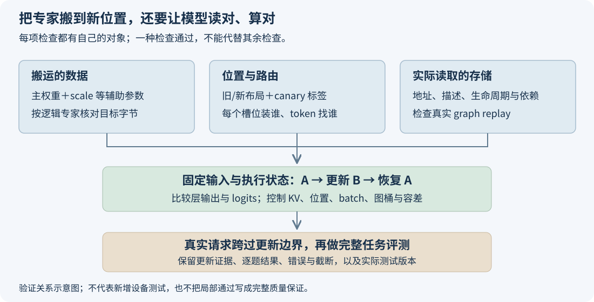

# 权重搬完没报错，怎样证明模型还在算对的东西？

一次 EPLB 更新顺利返回，后面的请求也能生成文字，这说明迁移没有立即破坏执行流程。接下来还要确认：token 找到的槽位里，是否放着它原本要用的专家；主权重和量化参数是否一起到位；图回放是否读到了刚写好的数据。

这些错误不一定产生 NaN。把专家 A 错换成专家 B，矩阵的 shape、dtype 都可能合法，结果也完全有限。服务照常输出，答案却已经变了。

我会把验证沿实际调用顺序展开：先确认搬过去的对象，再检查存储和映射，随后用固定状态的前向对照查数值，最后跑完整请求与任务评测。下面以 DeepSeek 的专家迁移为例，源码固定在 SGLang [`2914be60`](https://github.com/sgl-project/sglang/tree/2914be608009b65099c4c52ba118a597bf1b1421)。文末的 CPU 示例会实际注入几种错误，已有 Ascend 910C 设备验证和 GSM8K 材料则分别列出对应版本。

## 一、先约定迁移之后，什么东西应该相同

EPLB 改变的是逻辑专家的放置位置。专家 A 可以从 rank 0 的槽位搬到 rank 1，或者在另一处多放一个副本，但 A 的逻辑函数没有因此重新训练。token 仍然应该执行 A，只是到另一个物理位置读取它。

假设某层三个槽位原本是 `[A,B,C]`，更新后变成 `[B,C,A]`。验证目标很具体：新槽位 0 的完整专家数据对应旧 B，新槽位 1 对应旧 C，新槽位 2 对应旧 A；路由也要改为按这个新位置寻找逻辑专家。

检查时要沿“逻辑专家”追数据。更新前，A 在槽位 0；更新后，A 在槽位 2，所以应当比较旧槽位 0 与新槽位 2。若始终比较同一槽位下标，看到的本来就是两个不同专家，正常搬运也会被误判为权重变化。给快照同时记下逻辑 ID 和物理槽位，可以避免这类混淆。

这里的“完整专家数据”需要从模型当前量化实现确认。除了 gate/up/down 主权重，还可能有 scale、zero point、bias 或其他辅助张量。同一组量化整数配上不同 scale，会表示不同的实数权重；只对主矩阵做拷贝校验，会漏掉这种错配。

把专家缩成两个整数更直观：B 的量化权重是 `[6,8]`，scale 为 2，输入为 `[1,2]`，结果是 `(6 × 1 + 8 × 2) × 2 = 44`。若只把 `[6,8]` 搬到旧 A 的位置，却留下 scale=1，结果就变成 22。主权重逐字节完全正确，计算照样已经错了。

固定源码的 [DeepSeek 权重导出](https://github.com/sgl-project/sglang/blob/2914be608009b65099c4c52ba118a597bf1b1421/python/sglang/srt/models/deepseek_v2.py#L1033-L1048)按参数过滤规则收集路由专家张量，并裁掉融合共享专家的后缀。验证时应该核对这份实际清单，而不是自行假定只有 `w13_weight` 和 `w2_weight` 两项。共享专家不参与这次路由专家重排，它的存储也要保持正确。

循环重排还会暴露覆盖顺序的问题。如果先把 B 写进槽位 0，再搬 C，最后从“旧槽位 0”读 A，那里已经是 B，A 就丢了。临时缓冲要保护尚未消费的源数据，发送与本地复制都要遵守这条依赖。当前 updater 的[处理顺序](https://github.com/sgl-project/sglang/blob/2914be608009b65099c4c52ba118a597bf1b1421/python/sglang/srt/eplb/expert_location_updater.py#L290-L303)把接收准备、发送、通信与缓冲写回组织在同一条更新流程中。

## 二、字节、标签和映射，各自能查出什么

最直接的数据检查，是在覆盖前按逻辑专家保存参考，然后按新布局检查每个目标槽位。普通重排应保持主权重与辅助张量的有效载荷逐字节一致；对不发生数值转换的字节搬运，不应先放宽浮点容差来掩盖数据差异。

参考也要独立保存。若“旧权重快照”只是指向原存储的另一个 view，更新会连它一起改掉，最后比较两份被同时覆盖的数据，错误就看不见了。诊断用的 clone、CPU 导出或散列应在相应设备工作完成后取得，并明确关联层号、逻辑专家 ID、张量名和源版本。

只看总和不够。例如两个权重字节 `[2,4]` 与 `[4,2]`，总和都是 6；输入 `[1,2]` 做点积时，结果分别为 10 和 8。对整组 rank 求一个总 checksum，还会把“专家去了错误的卡”隐藏起来。需要保留每个专家、每项张量的目标关系；逐字节比较直接，散列便于压缩留证。

NZ 和 packed 权重还要先界定比较区域：专家的有效字节、物理 padding、共享专家后缀与整个 allocation 是不同范围。比较同一来源专家的迁移前后物理块时，要有明确的块边界和一致的采样时刻；两个独立初始化的 padding 区域不必天然相同，也不应该把它们当作模型精度误差。具体存储表示见[NZ 权重的物理迁移路径](ascend-eplb-physical-storage-migration.md)。

社区 updater 还有一个现成的诊断办法：[`SGLANG_EXPERT_LOCATION_UPDATER_CANARY`](https://github.com/sgl-project/sglang/blob/2914be608009b65099c4c52ba118a597bf1b1421/python/sglang/srt/eplb/expert_location_updater.py#L86-L151)。开启后，它把旧布局中的逻辑专家 ID 当作额外的 canary 张量，一起交给迁移器，搬完再与新布局的预期 ID 比较。

这个标签能发现来源、目的位置或某些重排顺序错误，尤其适合确认“这个槽位应该装的是 B”。但标签正确，不会替每一份主权重和 scale 验证内容。某一路张量漏搬、字节损坏或存储视图构造错误，仍可能只影响数据而不影响标签。canary 也增加了诊断工作，性能测量要单独记录它是否开启。

路由映射则要再查一次。当前[外层 updater](https://github.com/sgl-project/sglang/blob/2914be608009b65099c4c52ba118a597bf1b1421/python/sglang/srt/eplb/expert_location_updater.py#L66-L83)先调用权重更新，再提交相关层的位置元数据。验证目标是新映射指定的每一个物理位置都有对应专家，副本集合完整，读取该表的后端状态也已经切换。只证明“新 B 的字节在槽位 0”，还没有证明 token 会按新表来找它。

## 三、同一地址，也要等写完；换了地址，要查图实际读谁

图回放让验证又多了一层。Python 属性指向一份新张量，eager forward 可以读到它；已经捕获的图却不一定随这个名字改变，仍可能使用原先登记的存储。

当前 NPU adapter 创建的是[原权重的可写字节别名](https://github.com/sgl-project/sglang/blob/2914be608009b65099c4c52ba118a597bf1b1421/python/sglang/srt/hardware_backend/npu/eplb.py#L334-L401)，写入会改变模型本来使用的那份存储。它还保活原 weight，并记录当前 stream 的使用关系。这些行为既保护地址，也保护存储的异步生命周期。

不过，`data_ptr()` 在两个测点相同，只核对了起点地址。还要检查 shape、stride、dtype、格式与有效容量，并确认最后一次旧读、迁移写入、下一次 forward 之间存在正确的设备执行依赖。Python 调用已经返回，不表示所有设备写入都完成。

在专门的正确性小实验里，可以等写入完成后再读取字节和做前向；这让检查时刻清楚。正式路径是否需要等待、依靠哪个 stream 或 event，则要沿实际调用关系核对，不能靠给每一步插全局同步来推断原设计已经安全。

图回放也必须实际测。固定 NPU 后端的[普通 replay 分支](https://github.com/sgl-project/sglang/blob/2914be608009b65099c4c52ba118a597bf1b1421/python/sglang/srt/hardware_backend/npu/graph_runner/npu_cudagraph_backend.py#L543-L544)重放图后返回已有输出对象。保存多轮对照时，要在本轮结果有效期间复制快照；只往列表里存同一个输出对象，下一次回放可能把前一份“结果”一起覆盖。

可以让同一份固定输入分别走 eager 和实际 replay：eager 检查当前模型对象能否正确计算，replay 检查捕获后的执行是否仍读到正确数据。保存两边结果时都复制独立快照，并记录读写完成时刻。若只在 replay 出错，地址引用和设备依赖就是需要继续追的方向，细节可以结合[图捕获与张量存储](graph-capture-tensor-storage.md)阅读。

## 四、固定状态，看模型哪一步开始偏了

存储检查通过后，再做数值对照。我更愿意先取同一份输入和执行状态，在布局 A 上跑正常 forward，执行一次真实更新得到布局 B，再恢复相同状态跑 B；条件允许时再恢复 A，确认基线还能复现。

这里要固定的比输入文字多。token ID、position、有效长度、attention mask、batch 排列、KV 内容及其位置、图桶和相关元数据都属于这次计算的输入。Decode 会推进 KV 和位置，直接把相邻两步的输出拿来比，实际上已经换了上下文。投机解码还要对齐候选 token 和验证状态。

先确认这次更新确实搬动了权重：保存至少一层的旧、新映射，数出变化槽位，再核对更新完成回执。若 planner 返回原布局，这轮可以用于检查跳过路径；要验证搬运后的前向，则继续选取实际有位置变化的更新。

对照可以先从目标 MoE 层输出开始，再到完整模型 logits。logits 是模型给词表各 token 的分数，最终采样或取最大值只是它的后续处理。如果最早一层就出现大误差，定位比等最终回答变错容易得多。

首 token 相同会漏掉很多差异。教学向量 `[10,9,0]` 与 `[10,1,-50]` 的最大项都在位置 0，但其余分数已经大幅改变。连续生成时，一旦某步选择不同，后面的输入也分叉，再比较后续 logits 就混入了上下文差异。要定位数值，应该喂同一条固定 token 轨迹逐步比较，而不是让两边自由生成后再硬对齐。

浮点前向需要合理容差。先重复运行未更新的基线，观察同版本、同后端、同 shape 的数值波动，再按 dtype 和验收目标提前确定标准；不能发现 B 超标后，才不断放宽阈值。PyTorch 2.10 的[数值说明](https://docs.pytorch.org/docs/2.10/notes/numerical_accuracy.html)解释了运算顺序与批次实现为何会影响舍入；temperature=0 和固定 seed 也不能代替对底层计算路径的控制。

记录时至少保留非有限值、最大绝对误差、容差失败数量和具体位置，同时看关键 token 排名。`torch.testing.assert_close` 使用 `atol + rtol × abs(expected)` 判断有限值是否接近，且[默认不检查 stride](https://docs.pytorch.org/docs/2.10/testing.html#torch.testing.assert_close)。数值接近与存储描述正确，应当分别验证。单独一个余弦相似度接近 1，也可能掩盖少量关键位置的错误。

## 五、完整服务要覆盖真正发生迁移的那段时间

固定状态的小实验便于定位，服务验证还要让真实请求跨过更新边界。Prefill、普通 Decode、实际采用的投机解码与图路径，分别确认哪些已经被这次用例执行到。请求成功只说明服务完成了响应，输出校验还要继续看内容。

先覆盖能揭示重排错误的情况：跨 rank 发送接收、本卡循环换位、新增副本、只发送而本地不变，以及不参与本层搬运的 rank。共享专家或导出前缀与后缀共用存储时，还要检查没有改动后缀。多次更新和恢复可检查源数据是否在前一轮就被悄悄损坏。

每轮记录计划、涉及层、参与组、完成状态和请求区间。多 rank 结果要按拓扑与全局身份对应，不能把某一个 rank 的“完成”当作整个组的完成。没有活跃请求的 rank，也可能持有其他 rank 需要发送的专家。

任务评测放在这之后。它检验整模型在一组真实题目上的表现，能覆盖单层数值检查不容易表达的最终行为。对比时固定数据集切分、提示模板、few-shot 来源、thinking 设置、采样参数和答案提取规则；错误、截断、空输出要按事先约定计入，不能只报告成功返回的题目。

保留逐题结果也很重要。两次总分相同，仍可能有一些题从对变错，另一些从错变对。逐题变化能帮助区分格式提取、数值波动和稳定回归；只有一个 ON 版本的得分，则应作为该版本的任务验证记录，不能直接写成相对 OFF 无损。

## 六、已有材料分别验证到了哪里

这条 NPU 物理迁移路径，已有两类公开材料，适合放在一起看，但各自对应的提交和覆盖范围要留下来。

Ascend 910C 的 P、D 两端各有十项设备小实验：ND、int8→int32 打包 view、平面分配后 reshape、带 padding 的 format 29、内部转置 NZ，每类都检查完整 `parameter.data` 和专家前缀。记录核对字节重排与恢复，以及原权重地址、shape、stride、格式。逐项结果可下载 [P 端](../../assets/ascend-eplb-physical-storage-migration/storage-smoke-P.jsonl)和 [D 端](../../assets/ascend-eplb-physical-storage-migration/storage-smoke-D.jsonl)原始输出。

同一 PR 较早的 `08865d168` 提交还跑过全量 GSM8K。本文重新读取了已公开附件中的 summary 与 1,319 条预测记录：答对 1,283 题，准确率约 97.2707%，请求错误和截断均为 0。配置为 DeepSeek-V4-Flash W8A8、动态 EPLB ON、`sgl_eval 0.1.3`、thinking 关闭、temperature=0、seed=0、最大输出 4,096 token、并发 16。

| 证据 | 它直接回答的问题 |
| --- | --- |
| 设备存储小实验，P/D 各十项通过 | 这些已测布局能否正确重排、恢复并保留张量描述 |
| 该提交的 GSM8K，1,283/1,319 | 该版本与该评测配置下，完整模型的实际答题结果 |

GSM8K 的[完整公开附件](https://github.com/AkiYangDev/sglang/releases/download/eplb-pr49701-validation-20261111/gsm8k-final-evidence.zip)包含原生逐题预测、summary 和原始截图。读这些材料时，可以先用设备小实验确认存储重排，再查看对应提交的任务答题结果。两组材料分别保留版本号，后续代码变化也就有了明确的回归起点。

## 七、把能漏掉错误的检查，放进一个可运行例子

为便于看清各项检查的作用，我把专家缩成两个权重字节和一个独立 scale，使用固定逻辑路由做线性计算。正确更新执行 `[A,B,C] → [B,C,A]`，再恢复 A；错误版本分别漏搬 scale、保留旧映射、损坏主权重、替换底层对象，或按错误顺序覆盖循环重排的源。

示例把标签支路保持正确，同时向数据或状态支路注入错误，用来观察“canary 已通过”以后还会漏掉什么。实际 canary 仍随迁移器执行，前面第二节说明了它能检查的重排问题。这样能直接看到：标签通过，主权重或辅助参数仍可能失败；替换存储的版本甚至可以让 eager 输出通过，而保存旧存储引用的“捕获读取”失败。这里的捕获读取只是 CPU 对象引用模型，真机图仍需前面第三节的设备验证。



从[下载包](https://raw.githubusercontent.com/AkiYangDev/llm-inference-notes/main/assets/eplb-weight-migration-correctness/examples.zip)解压，或在博客仓库根目录执行：

```bash
python examples/eplb-weight-migration-correctness/migration_checks.py --output results
```

[fault_checks.csv](../../assets/eplb-weight-migration-correctness/data/fault_checks.csv)逐项列出六种版本的检查结果，[checks.json](../../assets/eplb-weight-migration-correctness/data/checks.json)保留恢复、总和碰撞和首 token 反例。程序使用整数与有理数运算，可以直接运行，输出每种注入错误触发了哪些检查。源码与原始设备、任务证据的对应关系放在[evidence.json](../../assets/eplb-weight-migration-correctness/evidence.json)。

把这些检查按一次更新串起来，最后应能回答：A 从哪个旧槽位到了哪个新槽位，主权重和 scale 是否都对上，路由是否找到了它，真实 replay 是否使用了它，以及固定输入和任务结果是否达标。数据错就查来源和字节边界；数据对、路由错就查映射；两者都对但 replay 错，再查存储引用和执行依赖。定位可以沿着这条顺序逐步缩小。

固定输入以后，batch 和计算路径仍可能影响数值。怎样区分舍入、路由变化和真正的实现错误，见[同样的输入，换个 batch，为什么答案会变？](same-prompt-different-batch-numerics.md)。

[返回 EPLB 专题](../distributed/eplb-study-guide.md)。
