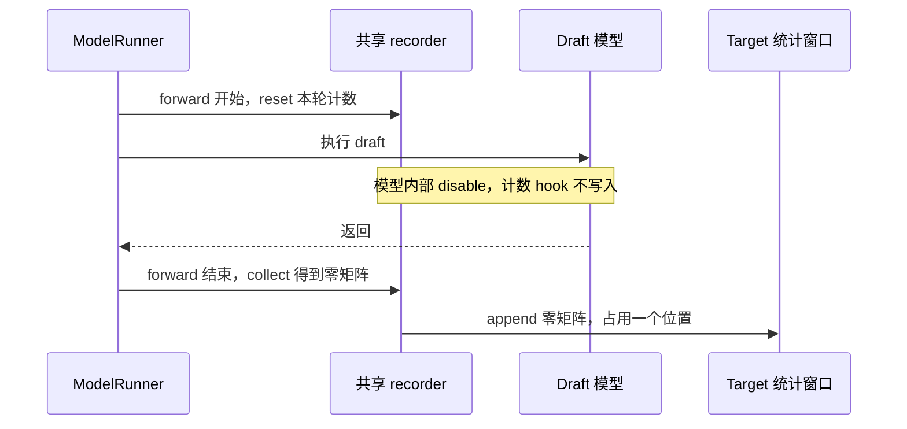

# 给统计窗口加一个零，为什么会改变负载均衡？

动态 EPLB 收集专家负载，再决定哪些专家需要更多副本、应该放到哪张卡。排查这条链路时，我们碰到一种看起来无害的记录：draft 没有往主模型计数器里写任何数据，结束时却把一整张零矩阵追加进了主模型的统计窗口。

第一反应很容易是：加零不改变求和，应该没有影响。

如果原来的数据都还在，这句话成立。但固定长度的窗口每追加一条记录，就会占用一个位置；写满以后，还要覆盖旧记录。零在数值上没有贡献，在窗口里却有位置。它占掉的位置，原本可以保存一次 target forward 的真实负载。

我们用两组真实服务记录确认了这件事。连续导出 200 次实际入窗：有保护的一组留下 200 条 target，无保护的一组留下 100 条 target 和 100 条全零 draft。另一次完整服务实验中，同一时刻的实际窗口只剩 500 条 target 历史；用额外保存的完整 1000 条 target 记录复算，七次更新的专家副本分配都发生了变化。

这篇沿着记录的生命周期，讲清零从哪来、挤掉了什么，以及怎样修复而不误删合法的零负载记录。

## 一、模型没写计数，外层还是完成了一次记录

target 是负责验证、生成最终输出的主模型，draft 是投机解码里提出候选的模型。它们可以共享同一个专家分布 recorder，但 EPLB 要调整的是 target 专家的布局，统计窗口也应该描述 target 的负载。

旧路径的问题出在 recorder 的内外两层。`ModelRunner.forward` 进入记录上下文，先清空本轮计数，再执行模型，最后收集计数并追加到窗口。简化后是这样的关系：

```python
# 生命周期示意，省略记录模式及状态管理。
reset_current_counts()
try:
    run_model()
finally:
    window.append(collect_current_counts())
```

这里的 `reset` 清的是本轮计数器，历史窗口仍然保留。模型通常在中间通过 TopK 或 dispatch 的 hook 累加各层专家负载，结束时得到一条完整记录。

DSpark 的 draft 模型内部已经使用 `disable_this_region()` 禁止统计写入。它解决了“不要把 draft 的专家负载混到 target 计数里”，但没有包住外层生命周期：draft 执行前，外层已经 reset；模型内部不写入；退出模型后，外层又 collect 和 append。于是收集到的零矩阵仍然入窗。



记录的单位也要看准。一次被 recorder 选中的 forward 结束后，通常追加一条聚合记录，不是 batch 里有几个请求就追加几条。一个请求会经历很多次 forward；一次 forward 也可能包含多个请求或多个候选 token。DSpark 的 gamma=5，不能直接换算成每轮追加五条 draft 记录，要看真实的调用和 append 次数。

每个 rank 保存自己的窗口，后续再做全局汇总。TP16 也不意味着某个 rank 的窗口会因为另外 15 个 rank 同时执行，就额外推进 15 次。

## 二、连续 200 次入窗，里面装了谁

为了把来源看清楚，我们跑了两组一体化 DeepSeek-V4-Flash-0731 W8A8 服务。设备为 Ascend 910C，共 16 个逻辑设备，TP16、EP16、attention DP16；开启 DSpark gamma5/verify6 和图回放，两组都配置 16 个冗余专家。

A 保留 draft 隔离，B 撤掉新增的隔离，直接继承固定社区版本的 recorder 生命周期。B 没有替代实现，也没有由诊断脚本人为插入零。启动前核对了方法身份，并检查 `with_forward_pass`、开始、结束、hook 四个方法的 AST 与社区源码一致。

两组都在原来的 append 执行后读取实际写入的环形槽位，校验原张量，连续保存 200 条记录。统计窗口配置仍为 W=1000；200 是导出切片的长度。

| 每个 rank 的 200 条记录 | A：隔离 draft | B：社区生命周期 |
| --- | ---: | ---: |
| target 记录 | 200 | 100 |
| draft 记录 | 0 | 100 |
| 全零 draft 记录 | 0 | 100 |
| 全零 target 记录 | 0 | 0 |
| 16 rank 汇总的路由计数 | 4,953,600 | 2,476,800 |

16 个 rank 的记录组成一致，实际槽位写入均通过校验。A 的切片期间还执行了 199 次 draft 图回放，它们没有入窗；B 的 100 次 target 与 100 次 draft 则交替入窗。B 的每条 draft 记录是完整的 `[43 层, 272 个物理专家]` 矩阵，所有元素都为零。

两组每条 target 记录的全局计数都是 24,768。表格中的总量相差一半，来自同样 200 个位置覆盖的 target 次数不同，不能读成“每次 target 少算了一半路由”。

本次两组各有 16 个正式请求，并发 16，输入为同一批提示，实际 511～526 token，输出 2048 token。attention DP16 下，观察到的每 rank target batch 为 1；客户端并发和每 rank batch 是两个量。采样期间布局保持相同，两组请求均全部成功。

这份证据回答了零是否真实出现、是谁追加的。要解释它怎样改变 planner，还得继续看窗口的覆盖规则。

## 三、加零没有改错加法，它换掉了加法的输入

环形窗口的实现很短：

```python
def append(self, value):
    self._buffer[self._curr_index] = value
    self._curr_index = (self._curr_index + 1) % len(self._buffer)
```

无论 `value` 是真实负载还是零，都会写入当前位置，再把下标向前移动。模运算只负责循环使用存储，问题在于哪些执行被允许调用 append。

用四个位置看一次覆盖。target 记录记为 T，draft 零记录记为 Z。执行 `T1 → Z → T2 → Z` 后，窗口已经写满；再写 T3，覆盖掉的是 T1。等 T4 和它后面的 Z 写完，窗口里只剩 T3、T4 和两个零。

再给四次 target 一个具体负载，以下是教学算例，两个数表示两个专家的路由计数：

```text
T1 = [90, 10]    T2 = [90, 10]
T3 = [10, 90]    T4 = [10, 90]
```

| 窗口与入窗规则 | 保留的 target | 专家累计计数 | 两专家占比 |
| --- | --- | --- | --- |
| W=4，draft 不入窗 | T1、T2、T3、T4 | 200 / 200 | 50% / 50% |
| W=4，每次 target 后追加零 | T3、T4 | 20 / 180 | 10% / 90% |
| W=8，每次 target 后追加零 | T1、T2、T3、T4 | 200 / 200 | 50% / 50% |

第三行保留了全部真实数据，所以加零确实没有改变求和。第二行已经覆盖了前半段历史，零无法补回被删除的 T1、T2。planner 看到的是更短的一段近期负载。

反例也很有用。如果四次 target 都是 `[90,10]`，完整窗口累计 `[360,40]`，掺零后的窗口累计 `[180,20]`，归一化后都是 90%/10%。对于这里按时间求和、再分配副本的 DeepSeek 策略，同比缩放本身不会改变专家之间的比较关系。

因此，确定发生的是有效历史缩短；当负载随时间变化，较短历史会改变专家占比。不能把它简单说成“零会把所有负载比例都稀释”，也不能因为恒定负载的布局没变，就认为窗口组成无关紧要。

## 四、同一时刻，两份历史分出了不同的专家副本

另一轮 PD 分离服务实验，把这个推演接到了真实的更新数据上。P、D 各 16 个 Ascend 910C 逻辑设备，模型同为 DeepSeek-V4-Flash W8A8，开启 DSpark gamma5/verify6，各 16 个冗余专家。负载为 512 请求、并发 128，输入 16,388 token、输出 8,192 token；P 使用 I50/W50，D 使用 I1000/W1000。

无保护的 D 服务除了保留实际窗口，还由观察器额外复制最近 1000 条 target 记录。额外窗口只用于分析，不驱动在线更新。每次重平衡时，取同一次运行、同一时刻的两份计数，交给同一套 DeepSeek 分配算法离线复算。

| D 端更新轮次 | 实际窗口中的 target 条数 | 额外 target 窗口条数 | 副本数量不同的层 / 共 43 层 |
| ---: | ---: | ---: | ---: |
| 1 | 500 | 1000 | 18 |
| 2 | 500 | 1000 | 43 |
| 3 | 500 | 1000 | 34 |
| 4 | 500 | 1000 | 42 |
| 5 | 500 | 1000 | 43 |
| 6 | 500 | 1000 | 22 |
| 7 | 500 | 1000 | 43 |

七轮中，实际窗口都只保留了一半 target 历史。两份计数归一化后仍然不同，同一算法也确实给出了不同的副本数量。这一对照没有跨两次独立服务去比较热点，而是在同一次运行里对齐了决策时刻。

看第二轮、层下标 32 的两个专家，副本数包含原有副本：

| 专家 | 500 条 target 历史：占比 / 副本 | 1000 条 target 历史：占比 / 副本 |
| --- | ---: | ---: |
| 107 | 7.06% / 4 | 5.11% / 3 |
| 117 | 3.55% / 2 | 5.46% / 3 |

DeepSeek 的副本分配循环会比较各专家的“负载 ÷ 当前副本数”，给负载最大的专家继续分配副本。专家 107 在较短窗口里更热，获得四个副本；专家 117 在较长历史里占比更高，对应三个副本。变化已经走到了布局决策，不只停在统计显示上。

同一轮实验里，P 没有执行 draft。它的三次更新中，实际窗口与额外窗口都保留 50 条 target，计数和复算布局全部一致。这也核对了额外复制、映射和比较的方法。

在线服务实际执行的是实际窗口方案，完整 target 窗口的布局来自离线复算。这里证明的是统计历史改变了分配决策；下一段请求是否更快，需要按相同负载单独测量。缩短窗口既可能更快追踪持续热点，也可能更容易追随短时波动，布局不同本身不等于吞吐变差。

## 五、零记录还可能让“均衡度”看起来更高

除了 planner 使用的路由历史，代码还可以维护逐步均衡度的历史。两份历史的用途不同，不能把它们混成一个窗口。

该版本的逐层均衡度公式是：

```python
balancedness = (mean_rank_load + 1e-5) / (max_rank_load + 1e-5)
```

两卡负载 `[90,10]` 时，平均值为 50，最大值为 90，均衡度约 0.5556。全局负载都是零时，分子、分母却都等于 `1e-5`，结果为 1。

如果每个真实步骤后面都追加一个全局零，先算每步均衡度、再对历史取平均，会得到 `(0.5556 + 1) / 2 ≈ 0.7778`。真实步骤并没有变均衡，多出来的零步骤把历史平均值抬高了。

启用均衡度历史和相应重平衡阈值时，这会影响是否跳过更新。例如阈值为 0.75，原来的 0.5556 允许继续重平衡，混入零后的 0.7778 超过阈值，就会跳过。这个数值例子按源码公式与判断条件计算，讲的是另一条影响路径。

前面的七轮真实服务使用 report=off、threshold=1.0，没有通过这项历史均衡度跳过更新。它们的副本差异来自路由窗口缩短。这两个证据分别支撑窗口内容和阈值判断，不能互相替代。这里的均衡度也是路由负载指标，不是 `npu-smi` 的设备利用率。

## 六、按执行身份跳过生命周期，保留合法的零

修复应当发生在记录入口。在执行模型之前，runner 已经知道自己是不是 draft，就应该把这个身份交给 recorder。draft 整次跳过 reset、collect 和 append；target 按原来的规则继续记录。

```python
# 摘录修复后的上下文入口。
if self._disable_all or is_draft:
    with self.disable_this_region():
        yield {}
    return

# target 继续执行原来的 start → model → end 生命周期。
```

这比在模型内部只关掉 hook 覆盖得完整。传入的身份来自 `is_draft_worker`，不能只用 forward mode 判断：实验中的 target 记录是 `TARGET_VERIFY`，draft 的执行也可以使用这个 mode。计算模式描述这轮怎么执行，runner 身份说明是哪一个模型在执行。

也不能把修复写成“计数全零就不 append”。合法的 target IDLE 或空负载步骤也可能为零，它仍然属于 target 的时间序列。窗口尚未写入的位置初始化为零，同样不会额外推进下标。要排除的是 draft 对 target 窗口的参与，而不是所有值等于零的记录。

图捕获还要看入口。共享的 prefill、decode capture 回调可以直接执行模型，绕过普通 `ModelRunner.forward`；对模型内部没有保护的 draft，实现还需在 capture 入口禁止捕获计数写操作。DSpark 已经在模型内部保护了它的 stages，修复其空记录问题的关键是外层生命周期。不能把所有模型的图捕获问题都归到 DSpark 身上。

实现后来收拢到公共 recorder 上下文和 runner/capture 入口，相关代码固定见 [`0c947c99`](https://github.com/AkiYangDev/sglang/blob/0c947c997d747b1fb1805fccdcdc093100dfde8d/python/sglang/srt/eplb/expert_distribution.py)。新增的角色参数让窗口按 target 执行推进，合法 target 零记录、嵌套禁用和异常恢复都保留原有语义。

这也让 I 和 W 的讨论回到可理解的单位。I 决定 manager 多久检查一次更新，W 决定统计保留多少条记录。把 draft 零记录插进窗口，会改变 W 对应的 target 历史，不能据此推导 I 会自动翻倍或更新次数增加。DSpark 候选数、客户端请求数、target forward 次数、实际 append 次数，都应当分别读取。

如果本来就想用更短历史追踪近期热点，直接调整 W，并比较相同条件下的布局与性能。让 draft 的执行节奏悄悄改变有效窗口，会把一个明确参数变成随路径变化的隐含参数。

## 源码与实验数据

200 条真实记录实验执行于 2026-10-31，基于 `59565b93d17a6e5f176b64335b1978993a223e5f`，无保护组的生命周期与社区 `de7055f59645ebe03784b0980e1f222789f468a3` 一致。完整 PD 服务的同次运行对照来自 2026-10-30 的 `bf8fa56315f86388f1941ff2358ea0fccec65741`。两次实验分别验证入窗组成和完整更新时的决策差异。

[实验说明与校验值](../../assets/eplb-zero-record-rolling-window/evidence.json)记录配置、来源和测量口径；[400 条入窗记录 CSV](../../assets/eplb-zero-record-rolling-window/append-records.csv)保留两组来源、forward ID、槽位和全局计数；[七轮副本分配对照](../../assets/eplb-zero-record-rolling-window/replica-comparison.json)保留各层额外副本数量，可重新计算表内差异。教学算例及其对照见[窗口计算结果](../../assets/eplb-zero-record-rolling-window/window-examples.json)。旧生命周期、环形窗口和均衡度公式均可在[固定社区源码](https://github.com/AkiYangDev/sglang/blob/de7055f59645ebe03784b0980e1f222789f468a3/python/sglang/srt/eplb/expert_distribution.py)中对应查看。
