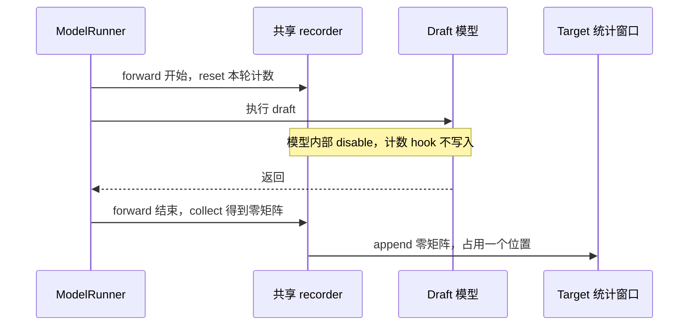

# 给统计窗口加一个零，为什么会改变负载均衡？

排查动态 EPLB 时，我们在主模型的负载窗口里找到了 draft 留下的整张零矩阵。draft 已经禁止内部计数写入，外层流程却照常收集、追加，EPLB 之后会拿这些历史来分配专家副本和位置。

零没有增加求和结果，却在固定长度窗口中占了一格。

每追加一条，就占一个位置；写满后，下一条覆盖最旧记录。draft 的零矩阵不增加负载，却挤掉了一条原本还能留着的 target 历史。

真实服务记录能看到这一步。连续导出 200 次入窗，带保护的一组全是 target，未保护的一组只有 100 条 target，另 100 条是全零 draft。另一轮完整服务里，实际窗口在更新时只剩 500 条 target；用额外保存的完整 1000 条 target 复算，七次更新都分出了不同的专家副本。

要修它，得找出哪一次执行应该推进窗口。直接丢弃全零矩阵会连合法的 target 零负载一起删掉。

## 一、模型没写计数，外层还是完成了一次记录

投机解码由 draft 提候选、target 验证并生成最终输出。两者可以共用进程里的专家分布 recorder，但 EPLB 迁移的是 target 权重，窗口需要记录 target 负载。

旧实现的缺口在 recorder 的内外两层。`ModelRunner.forward` 先进入记录上下文，清空本轮计数，再跑模型，退出时收集并追加：

```python
# 生命周期示意，省略记录模式及状态管理。
reset_current_counts()
try:
    run_model()
finally:
    window.append(collect_current_counts())
```

`reset` 清的是当前轮，已有历史仍在窗口中。正常执行时，TopK 或 dispatch hook 逐层累加，结束时再收成一条聚合记录。

DSpark draft 内部已有 `disable_this_region()`，hook 因此没有写入。但模型外的 reset 早已发生，退出后 collect、append 也照常执行。收集到的零矩阵就这样进入了 target 窗口。



一次记录通常对应一次被选中的 forward，并不对应一个请求或一个候选。一次 forward 可处理多个请求、多个候选，一个请求也会经历多次 forward。gamma=5 因而不意味着每轮一定有五条 draft 记录，具体要数调用和 append。

各 rank 先维护自己的窗口，之后才全局汇总。TP16 中其他 15 个 rank 同时执行，也不会额外推进本 rank 的下标。

## 二、连续 200 次入窗，里面装了谁

第一轮使用两组一体化 DeepSeek-V4-Flash-0731 W8A8 服务：Ascend 910C、16 个逻辑设备，TP16、EP16、attention DP16，DSpark gamma5/verify6，开启图回放，配置 16 个冗余专家。

A 保留新增的 draft 隔离，B 撤去它，使用固定社区版的 recorder 生命周期。诊断没有替换 B 的实现或人为插零；启动前核对了方法身份，`with_forward_pass`、开始、结束、hook 四个方法的 AST 都与社区源码相同。

观察器等原 append 完成后，再读刚写入的槽位，核对原张量，连续保存 200 条。两边窗口一直是 W=1000，200 只是这次导出的切片长度。

| 每个 rank 的 200 条记录 | A：隔离 draft | B：社区生命周期 |
| --- | ---: | ---: |
| target 记录 | 200 | 100 |
| draft 记录 | 0 | 100 |
| 全零 draft 记录 | 0 | 100 |
| 全零 target 记录 | 0 | 0 |
| 16 rank 汇总的路由计数 | 4,953,600 | 2,476,800 |

16 个 rank 的记录组成一致，实际槽位写入也全部核对通过。A 导出期间还有 199 次 draft 图回放，但都没入窗；B 则交替写入 100 次 target 和 100 次 draft。每条 draft 都是完整的 `[43 层, 272 个物理专家]` 矩阵，元素全零。

两组每条 target 的全局计数都是 24,768。表中总量差一半，原因是同样 200 个位置装进了不同数量的 target，每次 target 本身的路由计数没有减半。

每组各发 16 条正式请求，并发 16，提示相同，实际输入 511～526 token，输出 2048 token。attention DP16 下观察到每 rank 的 target batch 为 1，因此客户端并发也不能直接充当本地 batch。采样时布局相同，两组请求全部成功。

这组结果确认了零记录确实入窗，也找到了 draft 外层 append 这个来源。下一步要看它挤掉了什么。

## 三、加零没有改错加法，它换掉了加法的输入

环形窗口的写入逻辑如下：

```python
def append(self, value):
    self._buffer[self._curr_index] = value
    self._curr_index = (self._curr_index + 1) % len(self._buffer)
```

`value` 即使全零，也会占据当前槽位，下标照常推进。取模只负责循环复用存储，窗口保存哪些历史，由谁调用 append 决定。

把窗口缩成四格，T 表示 target，Z 表示 draft 零记录。`T1 → Z → T2 → Z` 已经写满；T3 开始覆盖 T1，等 T4 及后续 Z 写完，就只剩 T3、T4 和两个零。

再给四次 target 指定两位专家的教学负载：

```text
T1 = [90, 10]    T2 = [90, 10]
T3 = [10, 90]    T4 = [10, 90]
```

| 窗口与入窗规则 | 保留的 target | 专家累计计数 | 两专家占比 |
| --- | --- | --- | --- |
| W=4，draft 不入窗 | T1、T2、T3、T4 | 200 / 200 | 50% / 50% |
| W=4，每次 target 后追加零 | T3、T4 | 20 / 180 | 10% / 90% |
| W=8，每次 target 后追加零 | T1、T2、T3、T4 | 200 / 200 | 50% / 50% |

第三行扩大窗口后保住了所有 target，求和与不混零时相同。第二行却丢了 T1、T2，planner 只能看到最近两次 target，填零补不回被覆盖的旧负载。

若四次负载都恰好为 `[90,10]`，完整累计 `[360,40]`，混零后累计 `[180,20]`，归一化仍是 90%/10%。这里的 DeepSeek 策略先沿时间求和再分配副本，同比缩放不改变专家间的比较。

因此，target 历史变短是确定的；副本决策是否跟着变，则取决于被删掉的历史与留下的历史是否同分布。恒定负载可以得到同一布局，变化负载未必。

## 四、同一时刻，两份历史分出了不同的专家副本

另一轮 PD 实验把每次实际更新的数据保留了下来。P、D 各 16 个 Ascend 910C 逻辑设备，DeepSeek-V4-Flash W8A8、DSpark gamma5/verify6，各配置 16 个冗余专家。512 请求、并发 128，输入 16,388 token、输出 8,192 token；P 为 I50/W50，D 为 I1000/W1000。

D 没有隔离 draft，继续用实际窗口在线更新。观察器另外复制最近 1000 条 target，每到重平衡时刻，把两份计数交给同一 DeepSeek 算法复算。额外窗口只用于分析，没有参与在线决策或改动实际布局。

| D 端更新轮次 | 实际窗口中的 target 条数 | 额外 target 窗口条数 | 副本数量不同的层 / 共 43 层 |
| ---: | ---: | ---: | ---: |
| 1 | 500 | 1000 | 18 |
| 2 | 500 | 1000 | 43 |
| 3 | 500 | 1000 | 34 |
| 4 | 500 | 1000 | 42 |
| 5 | 500 | 1000 | 43 |
| 6 | 500 | 1000 | 22 |
| 7 | 500 | 1000 | 43 |

七轮更新中，实际窗口都只留下完整 target 历史的一半。两份负载归一化后仍不相同，同一算法于是分出了不同副本。比较发生在同一次运行、同一决策时刻，也就避开了两次运行热点变化的干扰。

第二轮的层下标 32 给出了具体例子，表中副本数包含原有副本：

| 专家 | 500 条 target 历史：占比 / 副本 | 1000 条 target 历史：占比 / 副本 |
| --- | ---: | ---: |
| 107 | 7.06% / 4 | 5.11% / 3 |
| 117 | 3.55% / 2 | 5.46% / 3 |

DeepSeek 分配循环反复比较“负载 ÷ 当前副本数”，给当前最忙的专家再加副本。短窗口里专家 107 更热，拿到四个副本；完整历史里专家 117 占比更高，得到三个。历史组成的差别已经传到实际分配方案中。

P 不执行 draft，可以用来交叉检查。三次更新里，实际窗口与额外窗口都保留 50 条 target，计数和复算布局完全相同，额外复制、映射和比较过程也因此有了核对。

在线执行的仍只有实际窗口方案，完整历史的布局来自离线复算，所以这组数据没有比较两套布局的后续速度。短窗口可能更快跟上持续热点，也可能更容易跟随瞬时波动；当前能够确认的是历史组成改变了决策。

## 五、零记录还可能让“均衡度”看起来更高

此外，逐步均衡度也可以保存成历史，用来决定是否跳过重平衡。这与 planner 求和的路由历史是另一种计算。

该版逐层均衡度采用这个公式：

```python
balancedness = (mean_rank_load + 1e-5) / (max_rank_load + 1e-5)
```

两个 rank 负载 `[90,10]` 时，均值 50、最大值 90，均衡度约 0.5556。若全局全零，分子、分母都只剩 `1e-5`，结果就成了 1。

如果每个真实步骤后插一条全局零记录，先逐步算均衡度、再对历史平均，就得到 `(0.5556 + 1) / 2 ≈ 0.7778`。真实步骤没有变得更均匀，多出来的零步骤却抬高了平均值。

启用历史均衡度和阈值后，这个变化可能阻止更新。例如阈值 0.75，原值 0.5556 可以更新，混零后的 0.7778 则触发跳过。这是按源码公式、条件计算的例子。

前面的七轮服务设为 report=off、threshold=1.0，并未因历史均衡度跳过更新，副本差异来自路由窗口缩短。两种影响不能混作同一个实测原因。这些均衡度都是路由指标，也不是 `npu-smi` 的设备利用率。

## 六、按执行身份跳过生命周期，保留合法的零

runner 在执行前知道自己是不是 draft，可以把身份传入 recorder。修复让 draft 跳过整次 reset、collect、append，target 继续按原规则推进窗口。

```python
# 摘录修复后的上下文入口。
if self._disable_all or is_draft:
    with self.disable_this_region():
        yield {}
    return

# target 继续执行原来的 start → model → end 生命周期。
```

这样才能覆盖模型内部关 hook 漏掉的外层流程。身份取自 `is_draft_worker`，forward mode 不够：实验里 target 用 `TARGET_VERIFY`，draft 也能用这个 mode。mode 表示怎样计算，runner 身份才表示哪个模型。

按零值过滤则会错删合法历史。target 的 IDLE 或空负载也可能全零，仍应留在 target 时间序列。未写入槽位初始也是零，但没有推进下标，和这次问题不同。修复排除的是 draft 参与，而非零这个数。

图捕获还有绕行入口。共享 prefill、decode capture 回调可能直接调用模型，跳过普通 `ModelRunner.forward`；内部没有保护的 draft，需要在 capture 入口禁掉计数写操作。DSpark 已在模型内部保护 stages，它这次主要漏了外层生命周期。通用 capture 保护和 DSpark 修复各覆盖不同路径。

后续实现将角色判断放入公共 recorder 上下文，以及 runner/capture 入口，固定代码见 [`0c947c99`](https://github.com/AkiYangDev/sglang/blob/0c947c997d747b1fb1805fccdcdc093100dfde8d/python/sglang/srt/eplb/expert_distribution.py)。窗口由 target 推进，合法 target 零记录、嵌套禁用和异常恢复仍遵守原语义。

回到配置，I 管 manager 多久检查一次，W 管保存多少条记录。draft 零记录缩短的是 W 里的 target 历史，不能由此推导 I 自动翻倍或更新次数增加。候选数、请求数、target forward 数和 append 数仍需分别读取。

确实需要追踪近期热点时，可以明确调小 W，再比较布局和性能。这样改变了多少历史是可控的，不再由 draft 的执行节奏悄悄决定。

## 源码与实验数据

200 条入窗实验执行于 2026-10-31，基于 `59565b93d17a6e5f176b64335b1978993a223e5f`，无保护组生命周期与社区 `de7055f59645ebe03784b0980e1f222789f468a3` 相同。完整 PD 同次运行对照来自 2026-10-30 的 `bf8fa56315f86388f1941ff2358ea0fccec65741`。前者检查入窗组成，后者检查更新时的决策差异。

[实验说明与校验值](../../assets/eplb-zero-record-rolling-window/evidence.json)给出配置和测量来源，[400 条入窗记录 CSV](../../assets/eplb-zero-record-rolling-window/append-records.csv)保留两组来源、forward ID、槽位与全局计数，[七轮副本分配对照](../../assets/eplb-zero-record-rolling-window/replica-comparison.json)可重算逐层额外副本差异。教学例子的对照在[窗口计算结果](../../assets/eplb-zero-record-rolling-window/window-examples.json)中，旧生命周期、环形窗口、均衡度公式可对应[固定社区源码](https://github.com/AkiYangDev/sglang/blob/de7055f59645ebe03784b0980e1f222789f468a3/python/sglang/srt/eplb/expert_distribution.py)查看。
