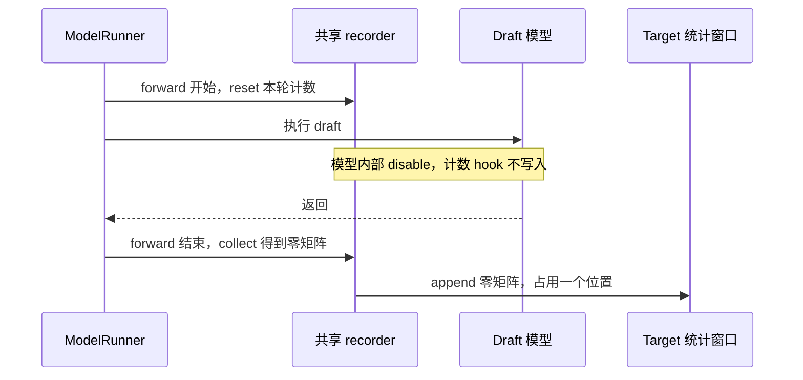

# 给统计窗口加一个零，为什么会改变负载均衡？

排查动态 EPLB 的负载统计时，我们发现 draft 会向主模型窗口追加一整张零矩阵。draft 执行期间没有写入主模型计数器，但外层记录流程仍在结束时收集计数，并将这份全零结果入窗。EPLB 随后就会使用包含这些记录的历史，决定专家副本数量和放置位置。

零参与求和，数值确实不会增加。但这里还存在窗口覆盖。

固定长度的窗口每追加一条记录，就占掉一个位置；写满后，新记录会覆盖旧记录。一条零记录占据的位置，本来可以留给一次 target forward 的真实负载。所以要检查的是还剩哪些历史，再看这些历史的求和结果。

两组真实服务记录验证了这一过程。我们连续导出 200 次实际入窗：有保护的一组保留 200 条 target，无保护的一组则有 100 条 target 和 100 条全零 draft。另一轮完整服务实验中，实际窗口在同一时刻只保留 500 条 target 历史；用额外保存的完整 1000 条 target 记录复算，七次更新都得到了不同的专家副本分配。

下面先查零记录在哪一步产生，再看它怎样影响规划。修复还要保留合法的零负载记录，因此不能直接过滤所有全零矩阵。

## 一、模型没写计数，外层还是完成了一次记录

投机解码中，draft 提出候选，target 主模型负责验证并生成最终输出。两者可以共用专家分布 recorder；但 EPLB 调整的是 target 专家的布局，需要记录的也是 target 负载。

旧路径在 recorder 的内外层之间留下了一个缺口。`ModelRunner.forward` 先进入记录上下文、清空本轮计数，再执行模型，退出时收集并追加记录。简化后的调用顺序是：

```python
# 生命周期示意，省略记录模式及状态管理。
reset_current_counts()
try:
    run_model()
finally:
    window.append(collect_current_counts())
```

`reset` 只清空当前轮的计数器，已有历史仍留在窗口中。执行模型时，TopK 或 dispatch 的 hook 通常会逐层累加专家负载，最后收集成一条记录。

DSpark draft 模型内部已有 `disable_this_region()`，能够禁止 hook 写入 draft 负载。然而，进入模型前外层已经 reset，离开模型后外层仍会 collect 和 append。内部没有写入数据，外层收集到的便是零矩阵，随后照常追加到窗口。



还需要查清一条记录对应什么。recorder 通常在一次被选中的 forward 结束后追加聚合记录，条数不随 batch 中的请求数直接增加。一个请求会经过多次 forward，一次 forward 又可能处理多个请求或候选 token。因此 DSpark 的 gamma=5 并不表示每轮一定追加五条 draft 记录，仍应以调用和 append 次数为准。

窗口由每个 rank 分别维护，之后才做全局汇总。在 TP16 下，另外 15 个 rank 同时执行，不会让本 rank 的窗口额外推进 15 次。

## 二、连续 200 次入窗，里面装了谁

我们用两组一体化 DeepSeek-V4-Flash-0731 W8A8 服务追踪记录来源。两组均使用 Ascend 910C 的 16 个逻辑设备，配置为 TP16、EP16、attention DP16，开启 DSpark gamma5/verify6 和图回放，并配置 16 个冗余专家。

A 保留 draft 隔离，B 撤去新增隔离，使用固定社区版本原有的 recorder 生命周期。B 没有替换实现，诊断脚本也没有插入零。启动前核对了方法身份，`with_forward_pass`、开始、结束和 hook 四个方法的 AST 均与社区源码一致。

观察器在原 append 完成后，读取刚写入的环形槽位，核对原张量并连续保存 200 条记录。两组统计窗口始终设为 W=1000；这里的 200 只是导出切片长度。

| 每个 rank 的 200 条记录 | A：隔离 draft | B：社区生命周期 |
| --- | ---: | ---: |
| target 记录 | 200 | 100 |
| draft 记录 | 0 | 100 |
| 全零 draft 记录 | 0 | 100 |
| 全零 target 记录 | 0 | 0 |
| 16 rank 汇总的路由计数 | 4,953,600 | 2,476,800 |

16 个 rank 上的记录组成相同，实际槽位写入全部通过校验。A 导出期间另有 199 次 draft 图回放，均未入窗；B 则交替写入 100 次 target 和 100 次 draft。B 的每条 draft 记录都具有完整的 `[43 层, 272 个物理专家]` 形状，且元素全零。

每条 target 记录的全局计数在两组中都是 24,768。表中总量相差一半，是因为相同的 200 个窗口位置保留了不同次数的 target；target 每次执行的路由计数并未减半。

两组各发出 16 个正式请求，并发为 16，使用相同的一批提示，实际输入长度为 511～526 token，输出 2048 token。在 attention DP16 下，观察到每个 rank 的 target batch 为 1。这里的客户端并发不能直接当作每 rank batch。采样期间，两组保持相同布局，请求均全部成功。

由此可以确认，零记录出现在实际窗口中，来源是 draft 外层的 append。要判断规划为何改变，还需看它覆盖了哪些历史。

## 三、加零没有改错加法，它换掉了加法的输入

环形窗口按下面的方式写入：

```python
def append(self, value):
    self._buffer[self._curr_index] = value
    self._curr_index = (self._curr_index + 1) % len(self._buffer)
```

传入的 `value` 无论是否全零，都会写入当前槽位，然后推进下标。模运算让存储循环复用；决定历史组成的，是哪些执行会调用 append。

假设窗口只有四个位置，用 T 表示 target 记录、Z 表示 draft 零记录。写入 `T1 → Z → T2 → Z` 后，窗口已满。下一条 T3 会覆盖 T1；等 T4 及其后的 Z 写完，窗口只保留 T3、T4 和两个零。

给这四次 target 指定一组教学负载，每对数字分别表示两个专家的路由计数：

```text
T1 = [90, 10]    T2 = [90, 10]
T3 = [10, 90]    T4 = [10, 90]
```

| 窗口与入窗规则 | 保留的 target | 专家累计计数 | 两专家占比 |
| --- | --- | --- | --- |
| W=4，draft 不入窗 | T1、T2、T3、T4 | 200 / 200 | 50% / 50% |
| W=4，每次 target 后追加零 | T3、T4 | 20 / 180 | 10% / 90% |
| W=8，每次 target 后追加零 | T1、T2、T3、T4 | 200 / 200 | 50% / 50% |

第三行扩大窗口，保留了全部 target，因此求和结果与没有零记录时一致。第二行却已失去 T1、T2，planner 只能根据最近的两条 target 规划。零记录本身不会恢复被覆盖的负载。

负载恒定时，结果又会不同。如果四次 target 都是 `[90,10]`，完整窗口累计为 `[360,40]`，混入零后的窗口累计为 `[180,20]`，两者归一化都得到 90%/10%。这里的 DeepSeek 策略先按时间求和，再分配副本；同比缩放不会改变专家间的比较关系。

所以，窗口有效历史缩短是确定发生的变化；它是否改变专家占比，取决于这段时间的负载是否变化。恒定负载可以得到相同布局，变化的负载则可能给出不同决策，不能仅靠某一种情况判断零记录是否有影响。

## 四、同一时刻，两份历史分出了不同的专家副本

另一轮 PD 分离实验保留了实际更新时的数据。P、D 各使用 16 个 Ascend 910C 逻辑设备，运行 DeepSeek-V4-Flash W8A8，启用 DSpark gamma5/verify6，各配置 16 个冗余专家。负载为 512 请求、并发 128，输入 16,388 token、输出 8,192 token；P 使用 I50/W50，D 使用 I1000/W1000。

未隔离 draft 的 D 服务继续使用实际窗口做在线更新。同时，观察器额外复制最近 1000 条 target，供离线分析。每到重平衡时刻，就将当时的两份计数交给同一套 DeepSeek 分配算法复算。额外窗口不参与在线决策，也没有改变服务实际使用的布局。

| D 端更新轮次 | 实际窗口中的 target 条数 | 额外 target 窗口条数 | 副本数量不同的层 / 共 43 层 |
| ---: | ---: | ---: | ---: |
| 1 | 500 | 1000 | 18 |
| 2 | 500 | 1000 | 43 |
| 3 | 500 | 1000 | 34 |
| 4 | 500 | 1000 | 42 |
| 5 | 500 | 1000 | 43 |
| 6 | 500 | 1000 | 22 |
| 7 | 500 | 1000 | 43 |

七轮更新中，实际窗口均只保留了完整 target 历史的一半。两份计数归一化后仍有差异，同一算法据此分配出不同的副本数量。由于比较的是同一次运行的同一决策时刻，这里没有混入两次独立运行之间的热点差别。

第二轮的层下标 32 可以看到具体变化。下表副本数已包含原有副本：

| 专家 | 500 条 target 历史：占比 / 副本 | 1000 条 target 历史：占比 / 副本 |
| --- | ---: | ---: |
| 107 | 7.06% / 4 | 5.11% / 3 |
| 117 | 3.55% / 2 | 5.46% / 3 |

DeepSeek 的分配循环会反复比较“负载 ÷ 当前副本数”，继续给负载最大的专家分配副本。较短窗口中，专家 107 更热，得到四个副本；完整历史中，专家 117 占比更高，对应三个副本。两份统计因此产生了不同的实际分配方案。

同一实验的 P 端没有执行 draft，可作为检查。它进行了三次更新，实际窗口与额外窗口均保留 50 条 target；两份计数和复算布局全部一致。这也核对了额外复制、映射及比较过程。

需要分清的是，在线服务只执行了实际窗口方案，完整 target 窗口对应的布局来自离线复算。这些记录能证明历史组成影响分配决策，尚未比较两种布局下的后续性能。较短窗口可能更快跟踪持续热点，也可能更容易追随短时波动；要判断哪种更快，仍需在相同负载下测量。

## 五、零记录还可能让“均衡度”看起来更高

代码还可以保存逐步均衡度历史，用来决定是否重平衡。它与 planner 使用的路由历史承担不同用途，需要分开看。

该版本按以下公式计算逐层均衡度：

```python
balancedness = (mean_rank_load + 1e-5) / (max_rank_load + 1e-5)
```

以两个 Rank 的负载 `[90,10]` 为例，均值为 50、最大值为 90，结果约为 0.5556。如果全局负载全零，分子和分母则都变成 `1e-5`，计算结果为 1。

若每个真实步骤后面都追加全局零记录，再先逐步计算均衡度、后对历史取平均，结果会变成 `(0.5556 + 1) / 2 ≈ 0.7778`。真实步骤的负载没有改变，平均值上升来自额外的零步骤。

启用这份均衡度历史和相应阈值后，升高的平均值可能让重平衡被跳过。例如阈值为 0.75 时，原来的 0.5556 允许更新，混入零后的 0.7778 则超过阈值。这个例子按源码公式和判断条件计算，展示了零记录的另一种影响。

前述七轮服务使用 report=off、threshold=1.0，没有因历史均衡度跳过更新，其副本差异来自路由窗口缩短。阈值算例不能替代那组实测的解释。另外，本文均衡度衡量的是路由负载，与 `npu-smi` 中的设备利用率不同。

## 六、按执行身份跳过生命周期，保留合法的零

runner 在执行模型前就知道自身是否为 draft，可以将身份传给 recorder。修复时，让 draft 跳过整次 reset、collect 和 append，target 继续按原规则记录，从入口上避免空记录入窗。

```python
# 摘录修复后的上下文入口。
if self._disable_all or is_draft:
    with self.disable_this_region():
        yield {}
    return

# target 继续执行原来的 start → model → end 生命周期。
```

这样才能覆盖模型内部关闭 hook 遗漏的外层生命周期。身份参数来自 `is_draft_worker`，不能只根据 forward mode 判断：实验里 target 使用 `TARGET_VERIFY`，draft 同样可以使用该 mode。mode 说明本轮怎样计算，runner 身份才说明执行的是哪个模型。

按数值过滤全零记录会误删合法历史。target 的 IDLE 或空负载步骤也可能全零，但仍属于 target 时间序列，应当保留。窗口中尚未写入的位置虽然初始化为零，却没有推进下标，更不属于这次缺陷。需要排除的是 draft 的参与，而非零这个数值。

图捕获入口要另外检查。共享 prefill、decode capture 回调可以直接调用模型，绕开普通 `ModelRunner.forward`；对于模型内部没有保护的 draft，还需在 capture 入口禁止捕获计数写操作。DSpark 已经在模型内部保护 stages，它的空记录问题主要由外层生命周期造成。通用图捕获保护与 DSpark 生命周期修复有各自的适用范围。

后续实现把角色判断放到公共 recorder 上下文和 runner/capture 入口，代码固定见 [`0c947c99`](https://github.com/AkiYangDev/sglang/blob/0c947c997d747b1fb1805fccdcdc093100dfde8d/python/sglang/srt/eplb/expert_distribution.py)。窗口由 target 执行推进，同时保留合法 target 零记录、嵌套禁用与异常恢复的原有语义。

修好记录来源后，才能准确理解 I 和 W。I 控制 manager 多久检查一次更新，W 控制保存多少条统计记录。draft 零记录改变的是 W 覆盖的 target 历史，不能据此推出 I 自动翻倍或更新次数增加。DSpark 候选数、客户端请求数、target forward 次数和实际 append 次数需要分别读取。

如果希望缩短历史、跟踪近期热点，可以直接调整 W，在相同条件下比较布局和性能。这样窗口长度是一个明确的策略选择，不会随 draft 的执行节奏悄悄变化。

## 源码与实验数据

200 条真实记录实验执行于 2026-10-31，基于 `59565b93d17a6e5f176b64335b1978993a223e5f`，无保护组的生命周期与社区 `de7055f59645ebe03784b0980e1f222789f468a3` 一致。完整 PD 服务的同次运行对照来自 2026-10-30 的 `bf8fa56315f86388f1941ff2358ea0fccec65741`。两次实验分别验证入窗组成和完整更新时的决策差异。

[实验说明与校验值](../../assets/eplb-zero-record-rolling-window/evidence.json)记录配置、来源和测量口径；[400 条入窗记录 CSV](../../assets/eplb-zero-record-rolling-window/append-records.csv)保留两组来源、forward ID、槽位和全局计数；[七轮副本分配对照](../../assets/eplb-zero-record-rolling-window/replica-comparison.json)保留各层额外副本数量，可重新计算表内差异。教学算例及其对照见[窗口计算结果](../../assets/eplb-zero-record-rolling-window/window-examples.json)。旧生命周期、环形窗口和均衡度公式均可在[固定社区源码](https://github.com/AkiYangDev/sglang/blob/de7055f59645ebe03784b0980e1f222789f468a3/python/sglang/srt/eplb/expert_distribution.py)中对应查看。
