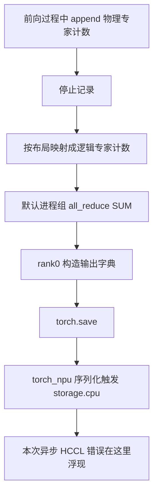

# 专家计数都采到了，为什么导出还会失败？

这次故障发生得很晚：160 条请求已经全部生成成功，压测工具 AISBench 也正常退出了。接着，我们让服务把记录到的专家访问次数保存成 `.pt` 文件，Decode 端的调度进程却在这一步退出，健康检查返回 503。磁盘上虽然多了一个文件，却只有 1949 字节，无法当成有效计数使用。

报错栈看起来像保存失败：`torch.save()` 在把设备存储搬到 CPU，也就是执行 `storage.cpu()` 时抛出了异常。但同一段日志明确指出，失败的操作是 HcclAllreduce，它申请 2,517,630,976 字节 NPU 内存时没有成功。于是排查重点从“文件为什么没写好”，移到了“保存之前，统计导出做了哪次设备通信”。

最后采用的修复是：各 rank 先按原来的映射，把副本计数合成逻辑专家计数；然后各自复制到 CPU，通过已有的 Gloo 通信组把整数计数相加，最后由 rank0 写文件。Gloo 在这里承担 CPU 张量通信，HCCL 承担的则是原来的 NPU 张量通信。模型前向的计算路径保持原样。

修复后重新开启了一个采集窗口，得到完整的 `[512, 43, 256]` 计数张量，总计 45,597,888 次专家分配。下面沿着导出顺序，说明原路径为什么会碰到 HCCL，以及改成 CPU 求和后怎样核对结果。

实验发生在 2026 年 10 月 21 日，使用 DeepSeek-V4-Flash 和 Ascend 910C 的 PD 分离服务，P、D 各 8 张物理卡。每条请求的正文为 16K token，加上 Chat 模板后是 16388，输出 1024，前缀缓存命中率为 0。共发送 160 条请求，并发上限 128，每秒发送 6 条；D 使用 5 个草稿 token、6 个位置的验证配置。

本轮手动开启 stat 记录，关闭在线 EPLB 和均衡度报告，因此导出的是用于后续静态布局拟合的数据。对应实现已按 SHA 冻结，见[数值证据](../../assets/expert-count-export-hccl-gloo/evidence.json)、[前后源码片段](../../assets/expert-count-export-hccl-gloo/export-fragments.py.txt)。

## 一、生成完成时，统计工作还没有结束

计数用于拟合 D 静态布局。一个逻辑专家可有多个物理副本，实际分配在副本之间如何分布，会影响 EP Rank 负担。

记录器每次执行 append，就把这一轮各物理专家槽收到的分配数写入缓冲区。导出方法 dump 再查询 `physical_to_logical_map`，把属于同一个逻辑专家的副本合起来。例如，专家 E0 有两份副本，分别收到 2 次和 3 次分配，那么导出的 E0 逻辑计数就是 5。代码里的 `scatter_add_` 完成的就是这种“找到对应专家，再把次数加上去”的操作。

合并副本后，当前张量仍只包含这个 rank 记录到的分配。要得到完整热度表，还需要把所有参与 rank 的结果相加。原来的 `_StatAccumulator.dump()` 直接对 NPU 张量调用默认通信组的 `all_reduce(SUM)`，完成全局求和，再交给 rank0 保存：



原 AISBench 的 160 成功、0 失败、独立退出，确认生成完成。计数还要经过归约、设备转移、序列化。

这里有三个独立动作。`start_record()` 清空旧数据并开始记录；stop 关闭记录开关；dump 才执行映射、全局求和和保存，正常返回后再清空本轮数据。前两个接口都返回 HTTP 200，只能说明开始、停止成功。要确认采集完成，还得等第三个动作返回，并真正读回保存的文件。

## 二、二十多 MB 的计数，为什么报了约 2.52 GB 的申请

成功张量 512 槽、43 层、256 专家，int32 大小为：

```text
512 × 43 × 256 × 4 = 22,544,384 bytes = 21.5 MiB
```

最终完整的 `.pt` 文件是 22,546,433 字节，比张量本体略大，多出的是序列化信息。日志中失败的 2,517,630,976 字节申请则来自 HCCL。两者属于不同层次：前者是要保存的数据，后者是通信执行过程中申请的设备内存。不能拿文件有多大，直接推算通信后端只会用多少显存。

执行顺序解释了为什么异常出现在保存函数里。逻辑计数还放在 NPU 上，`all_reduce` 又没有指定其他通信组，于是走到了默认设备通信路径。设备操作通常先提交、后执行，Python 可以继续往下走。等 rank0 调用 `torch.save()`，序列化必须把设备数据取回 CPU，这时才需要等待前面的设备操作，先前的通信错误也就在这里暴露了。

原日志为：

```text
torch.save
  -> torch_npu serialization
  -> storage.cpu()

current working operator name is HcclAllreduce
Failed to allocate memory requested by HCCL module.
Failed to allocate 2517630976 bytes of NPU memory.
```

日志也提示异步 Python 栈可能偏移。看到`storage.cpu()`，应继续核此前依赖的设备操作。

这段日志足以把本次失败定位到 dump 中的 HCCL 路径。至于这笔大申请在 HCCL 内部具体用作什么，日志没有给出分配明细。本轮的处理直接针对已确认的调用：这份计数接下来本来就要保存到 CPU 文件，因此先把离线求和也放到 CPU，避开导出时的这次设备归约。

候选同时去掉首次 dump 的`empty_cache()`，首次标记仍消耗。它是组合导出调整，没有独立消融。

## 三、把 SUM 搬到 CPU，先保持参加计算的人不变

受控窗口结束后的整数计数可以走 CPU，前提是映射、组成员、SUM 语义不变。

例如，原来需要汇总 16 个 rank 的计数，换后端时也必须让这 16 个 rank 全部参加。若只选其中一个 TP 子组，得到的只是部分总和。另一个容易出错的方向是重复求和：`all_reduce` 结束后，每个成员手里都有同一份全局结果；分析脚本再把这些副本加起来，就会把次数放大。

`get_world_group().cpu_group`已在初始化按相同 Rank 列表创建，冻结`parallel_state.py`与现场 SHA 一致，dump 没有新建 group。

辅助函数顺序为：

```python
# 说明性节选：省略异常信息与完整成员检查。
# logical_count 已经经过原来的 physical-to-logical 转换。
cpu_count = logical_count.detach().cpu().contiguous()
torch.distributed.all_reduce(
    cpu_count,
    op=torch.distributed.ReduceOp.SUM,
    group=world_group.cpu_group,
)
return cpu_count
```

先检查CPU组存在、backend Gloo、成员及顺序等于默认WORLD，只收int32/int64。[PyTorch all_reduce](https://docs.pytorch.org/docs/2.14/distributed.html#torch.distributed.all_reduce)给出指定组原地SUM、各成员得结果的语义；现场仍以冻结实现为准。

原映射转换保留，之后 D2H、CPU 整数 SUM。rank0 字典已是 CPU Tensor，保存时无需隐式搬这份 NPU storage。全部成员参加归约，只有 rank0 写盘。

这条路径的成本也很明确：每个 rank 都要把本地计数从设备复制到主机，也就是 D2H；主机需要容纳这些张量，Gloo 再通过主机通信完成求和。这些工作集中在手动采集结束后的导出阶段，没有插进每一步 Decode。本轮记录了整个 dump 接口的时间，但没有分别测量复制、求和和写盘，所以后面的接口耗时应按整体导出来读。

本次修改接在手动 stat 的文件导出流程中，服务设置为 `enable_eplb=false`、balancedness 关闭。在线均衡度的 reduce/broadcast 与逐步模型通信仍走各自的原路径。若把 CPU 归约用于在线更新，需要另外测量每次 D2H、主机通信和等待对前向节奏的影响。

## 四、两 rank 算对了，还要走完真实 16 worker 的导出

接实机前，先提取真实 dump、转换、SUM 方法，用两进程 CPU/Gloo 和非恒等映射逐元素核整数结果。

CPU 对照覆盖了两条输出分支：int32 计数通过 object 分支返回结果，int64 计数通过 file 分支保存文件。两种情况都从首次 dump 状态开始，并检查结果是否逐元素一致、结果是否留在 CPU、是否只有 rank0 保存。另有错误输入检查，确认浮点计数和成员不匹配的通信组会被拒绝。这些检查由两个 CPU/Gloo 进程实际执行，不需要初始化 NPU。

CPU 覆盖转换、归约、输出分支，NPU 复制、已有组、多 worker 协议继续在服务验证。

有效新窗口复用已加载热服务，start/reset 一次、同场景 N160、原负载独立退出后 stop/dump。新增启动、MF、路由预热均 0：

| 项目 | 真实运行结果 |
| --- | --- |
| 正式请求 | 160 成功，0 失败，实际输出均为 1024 |
| start / stop / dump | 各一次完成，均返回 200 |
| dump API 墙时 | 约 0.0715 秒 |
| worker 身份 | 前后相同的 16 个 PID 与启动标识 |
| 保存位置与类型 | rank0，CPU int32 张量 |
| 逻辑计数形状 | `[512, 43, 256]` |
| 计数总和 | 45,597,888 |
| 文件验证 | 22,546,433 字节，CPU 完整加载与 SHA256 留存 |

服务的 FanOut 调用会把命令发给 DP16 的 worker 并等待回复。本轮接口完成，前后记录的 16 个 worker 身份也相同，说明是在原热服务中走完了导出。整个 dump API 约用 0.0715 秒，这是一次导出的实际等待时间；本轮没有做 HCCL/Gloo 的同条件时延对照，也没有产出原生稳态性能结果，因此它用于确认计数采集链路可用。

1949 字节的坏文件仍保留在故障证据中。有效计数来自修复后的新窗口，原来失败窗口里的计数没有被恢复。

## 五、文件能加载之后，还要弄清 512 代表什么

文件第一维的 512，表示记录缓冲区有 512 个位置。每次 `_CircularBuffer.append()` 把一份统计写入当前槽，再把写指针向后移动；写满后回到开头，覆盖最旧的位置。

因此，数组下标和时间先后不是一回事。例如，写指针绕回开头后，槽 0 里可能比槽 511 更新。`get_all()` 返回的是数组当前的排列，没有替调用者按时间排序。想追踪热点怎样变化，就要连写指针或记录序号一起保存。

160 请求经过多次 Forward、调度，形状无法还原各请求完整轨迹，也不说明首槽就是首步。45,597,888 数专家分配。

后续槽位分 256/256 拟合、检查，可看另一部分计数上的表现；未存时序，不能叫早期训练、晚期验证。研究时间变化还需时间索引、append 顺序。

rank0 数已全局归约，拟合只读一份，不乘 DP16、不再汇总其他 Rank 的同份结果。

文件让拟合继续，性能再由匹配服务比较，放置背景见[P 端场景静态 EPLB](ascend-910c-prefill-scenario-static-eplb.md)。

## 六、下次怎样少花一轮昂贵采集

这次最值得提前做的检查，就是用一个小窗口完整走一遍首次 dump。仅仅能生成 token、能开启和停止记录，还没有执行到首次归约和保存。让小窗口先触发这些分支，可以在正式采集之前发现问题。CPU 对照负责检查计数有没有算错，真实服务则负责检查设备复制、现有通信组和多 worker 调用是否接得起来。

CPU 完整加载，再核 shape、dtype、非负、有效计数、窗口、哈希。本次用成功 API、同 worker、新文件完整内容一起确认。

临时文件验证后原子改名，可避免半文件被消费；这是后续方案，本次仍用原`torch.save`分支。

本轮 scheduler 已退、health 返回 503，确认原请求结束后需要恢复服务。若只是客户端处理坏了、远端还健康，则先修原数据，恢复位置由实际状态决定。

映射、成员、整数 SUM 保持原意，归约输出移到既有 CPU 通道，计数才进入静态拟合。一次采集是否结束，要一直核到最后的通信、转移、序列化。

[返回 EPLB 专题](../distributed/eplb-study-guide.md)。
