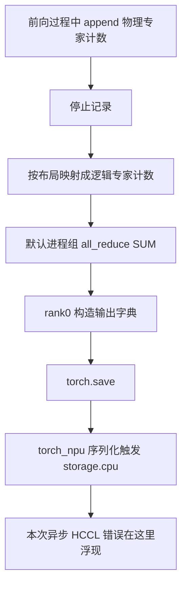

# 专家计数都采到了，为什么导出还会失败？

160 条生成已结束，AISBench 退出 0，故障却发生在导出专家计数。D 的 scheduler 随后退出，health 返回 503，新`.pt`只有 1949 字节。

Python 栈停在`torch.save()`的`storage.cpu()`，同段日志报 HcclAllreduce 申请 2,517,630,976 字节 NPU 内存失败。文件写入只是错误浮现的位置，还得向前查 dump 中的设备通信。

修复保留物理→逻辑专家转换，转换后复制 CPU，用已有同成员 Gloo 做整数 SUM，再由 rank0 保存。没有改模型前向。

新窗口文件完整加载为`[512, 43, 256]`、总计 45,597,888。下面先追原导出怎样调用 HCCL，再核 CPU 归约是否保住了统计含义。

数据为2026年10月21日Flash/Ascend 910C真实PD，P8+D8物理16卡，复制集16K正文、Chat16388、输出1024、N160/C128/r6、cache0，D G5/Verify6。手动stat、在线EPLB与balancedness关，冻结SHA绑定实现，见[数值证据](../../assets/expert-count-export-hccl-gloo/evidence.json)、[前后源码片段](../../assets/expert-count-export-hccl-gloo/export-fragments.py.txt)。

## 一、生成完成时，统计工作还没有结束

计数用于拟合 D 静态布局。一个逻辑专家可有多个物理副本，实际分配在副本之间如何分布，会影响 EP Rank 负担。

recorder append 保存物理数，dump 按当前`physical_to_logical_map`合逻辑数。例如副本 2、3 次，逻辑总 5，对应`scatter_add_`的专家分配加和。

转换后仍为本进程统计。原`_StatAccumulator.dump()`用默认组`all_reduce(SUM)`取全局，再 rank0 保存：



原 AISBench 的 160 成功、0 失败、独立退出，确认生成完成。计数还要经过归约、设备转移、序列化。

`start_record()`先 reset 再开，stop 只关开关，dump 返回后才 reset。start、stop 各 200，并没确认后续 dump 完成。

## 二、二十多 MB 的计数，为什么报了约 2.52 GB 的申请

成功张量 512 槽、43 层、256 专家，int32 大小为：

```text
512 × 43 × 256 × 4 = 22,544,384 bytes = 21.5 MiB
```

完整`.pt`22,546,433 字节，另含序列化信息。2,517,630,976 申请来自 HCCL，与计数文件规模不同。

逻辑转换后仍为设备 Tensor，`all_reduce`未设 group，报 HcclAllreduce。rank0 再把设备字典交给`torch.save`，torch_npu 序列化搬 storage 到 CPU 时，先前异步错误才暴露。

原日志为：

```text
torch.save
  -> torch_npu serialization
  -> storage.cpu()

current working operator name is HcclAllreduce
Failed to allocate memory requested by HCCL module.
Failed to allocate 2517630976 bytes of NPU memory.
```

日志也提示异步 Python 栈可能偏移。看到`storage.cpu()`，应继续核此前依赖的设备操作。

记录定位到 dump 的 HCCL 路径，还没解释内部大申请的用途、分配时机。因此先移开离线归约，没有猜某类 buffer 再调容量。

候选同时去掉首次 dump 的`empty_cache()`，首次标记仍消耗。它是组合导出调整，没有独立消融。

## 三、把 SUM 搬到 CPU，先保持参加计算的人不变

受控窗口结束后的整数计数可以走 CPU，前提是映射、组成员、SUM 语义不变。

原需 16 Rank 求和，若只换成一部分 TP 成员，API 成功也会漏数；归约后每人都有全局结果，再把 16 份相加又会重复。

`get_world_group().cpu_group`已在初始化按相同 Rank 列表创建，冻结`parallel_state.py`与现场 SHA 一致，dump 没有新建 group。

辅助函数顺序为：

```python
# 说明性节选：省略异常信息与完整成员检查。
# logical_count 已经经过原来的 physical-to-logical 转换。
cpu_count = logical_count.detach().cpu().contiguous()
torch.distributed.all_reduce(
    cpu_count,
    op=torch.distributed.ReduceOp.SUM,
    group=world_group.cpu_group,
)
return cpu_count
```

先检查CPU组存在、backend Gloo、成员及顺序等于默认WORLD，只收int32/int64。[PyTorch all_reduce](https://docs.pytorch.org/docs/2.14/distributed.html#torch.distributed.all_reduce)给出指定组原地SUM、各成员得结果的语义；现场仍以冻结实现为准。

原映射转换保留，之后 D2H、CPU 整数 SUM。rank0 字典已是 CPU Tensor，保存时无需隐式搬这份 NPU storage。全部成员参加归约，只有 rank0 写盘。

每 Rank 都付 D2H、CPU 内存、Gloo 成本，仅在采集结束后执行，没有加入逐步 Decode。复制、归约、写盘未分别计时，更大规模仍需估主机与网络代价。

范围只限手动 stat，`enable_eplb=false`、balancedness 关。utilization 设备 reduce/broadcast、模型、量化、推理通信都未替换，不能直接当在线 EPLB 通用替代。

## 四、两 rank 算对了，还要走完真实 16 worker 的导出

接实机前，先提取真实 dump、转换、SUM 方法，用两进程 CPU/Gloo 和非恒等映射逐元素核整数结果。

int32 走 object、int64 走 file，均从`_first_dump=True`开始，核仅 rank0 保存、CPU 结果、浮点与错成员拒绝。两进程通过，未初始化 NPU。

CPU 覆盖转换、归约、输出分支，NPU 复制、已有组、多 worker 协议继续在服务验证。

有效新窗口复用已加载热服务，start/reset 一次、同场景 N160、原负载独立退出后 stop/dump。新增启动、MF、路由预热均 0：

| 项目 | 真实运行结果 |
| --- | --- |
| 正式请求 | 160 成功，0 失败，实际输出均为 1024 |
| start / stop / dump | 各一次完成，均返回 200 |
| dump API 墙时 | 约 0.0715 秒 |
| worker 身份 | 前后相同的 16 个 PID 与启动标识 |
| 保存位置与类型 | rank0，CPU int32 张量 |
| 逻辑计数形状 | `[512, 43, 256]` |
| 计数总和 | 45,597,888 |
| 文件验证 | 22,546,433 字节，CPU 完整加载与 SHA256 留存 |

当时 FanOut 等 DP16 回复，前后 worker 身份一致，提供协议级结束证据，缺逐 Rank 时间 trace。

0.0715 秒仅是单次 dump API 墙时，未比较两 backend 性能。该轮开着采集、没有 native，归布局诊断。

1949 字节坏文件继续保留。成功来自新窗口，原失败计数没有恢复。

## 五、文件能加载之后，还要弄清 512 代表什么

第一维 512 是环形槽，未对应请求数、输出数。

`_CircularBuffer.append()`写当前槽、取模前进，满后覆盖；`get_all()`原样返回 buffer，不按时间重排。

160 请求经过多次 Forward、调度，形状无法还原各请求完整轨迹，也不说明首槽就是首步。45,597,888 数专家分配。

后续槽位分 256/256 拟合、检查，可看另一部分计数上的表现；未存时序，不能叫早期训练、晚期验证。研究时间变化还需时间索引、append 顺序。

rank0 数已全局归约，拟合只读一份，不乘 DP16、不再汇总其他 Rank 的同份结果。

文件让拟合继续，性能再由匹配服务比较，放置背景见[P 端场景静态 EPLB](ascend-910c-prefill-scenario-static-eplb.md)。

## 六、下次怎样少花一轮昂贵采集

下次首次 dump 也放入提前检查。仅确认 Forward、start、stop，会把首次失败分支留到昂贵负载之后。CPU 与真实服务各验证不同边界。

CPU 完整加载，再核 shape、dtype、非负、有效计数、窗口、哈希。本次用成功 API、同 worker、新文件完整内容一起确认。

临时文件验证后原子改名，可避免半文件被消费；这是后续方案，本次仍用原`torch.save`分支。

本轮 scheduler 已退、health 返回 503，确认原请求结束后需要恢复服务。若只是客户端处理坏了、远端还健康，则先修原数据，恢复位置由实际状态决定。

映射、成员、整数 SUM 保持原意，归约输出移到既有 CPU 通道，计数才进入静态拟合。一次采集是否结束，要一直核到最后的通信、转移、序列化。

[返回 EPLB 专题](../distributed/eplb-study-guide.md)。
