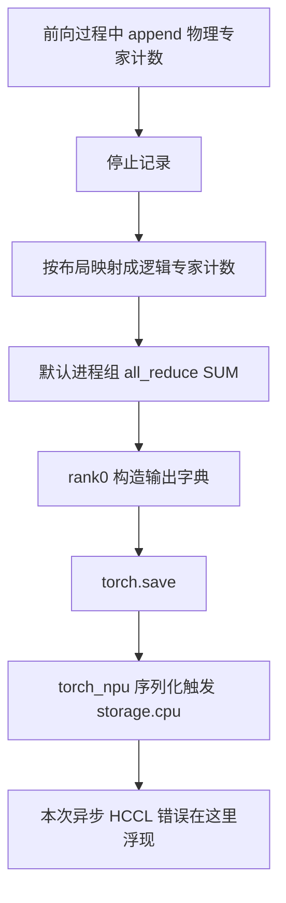

# 专家计数都采到了，为什么导出还会失败？

160 条请求已经生成完，AISBench 退出码为 0。接下来只剩下停止专家计数、导出文件，再拿计数拟合静态布局。

问题就出在最后一步。dump 请求超时，D 端 scheduler 崩溃，健康检查变成 503。目录里确实多了一个 `.pt`，但只有 1949 字节。错误栈落在 `torch.save()` 内部的 `storage.cpu()`，继续往下看，却是 `HcclAllreduce` 申请 2,517,630,976 字节 NPU 内存失败。

这次修复最终没有动模型前向，而是把专家统计的导出路径改成了：保持原有物理专家到逻辑专家的转换，先复制到 CPU，再用已有的同成员 Gloo 进程组做整数 SUM，最后由 rank0 保存 CPU 张量。

成功那轮的文件能完整加载，形状为 `[512, 43, 256]`，计数总和 45,597,888。本文沿这段过程解释：一次看起来只是“存文件”的操作，为什么还会走设备通信；换通信后端时，又有哪些统计含义需要保住。

实验发生在 2026 年 10 月 21 日，模型为 DeepSeek-V4-Flash，设备为 Ascend 910C，真实 PD、P8+D8 共 16 张物理卡。负载是 16K 正文、实际 Chat 输入 16388、输出 1024 的有利复制任务，N160/C128、6 req/s、零前缀缓存，D 使用 G5/verify6。这是手动 `stat` 采集，在线 EPLB 和 balancedness 报告均关闭。[脱敏数值记录](../../assets/expert-count-export-hccl-gloo/evidence.json)与[修改前后源码片段](../../assets/expert-count-export-hccl-gloo/export-fragments.py.txt)随文保留；源码身份按当时冻结文件的 SHA256 记录，不套用后来版本的实现。

## 一、生成完成时，统计工作还没有结束

我们需要专家计数，是为了按当前负载重新准备 D 端静态布局。MoE 的逻辑专家可能有多个物理副本，实际 token 分到哪些副本、各副本承接多少工作，会影响不同 EP rank 的负载。

这轮 recorder 先保存每次 append 的物理专家计数。导出时，再根据当前布局的 `physical_to_logical_map`，把同一逻辑专家的不同副本加到一起。例如一个逻辑专家有两个物理副本，分别记录 2 次和 3 次分配，逻辑计数就应得到 5。这个教学例子对应源码里的 `scatter_add_`，它保留的是分配次数。

到这里，拿到的仍然是各进程参与统计的数据。原 `_StatAccumulator.dump()` 后面还要经过默认进程组的 `all_reduce(SUM)`，才把结果交给 rank0 的文件保存分支。完整路径大致如下：



所以，“请求生成完了”和“统计文件已经可用”是两个状态。前者有原 AISBench 的 160 成功、0 失败和独立退出记录；后者还需要跨 rank 汇总、设备数据转移与文件写入都完成。

原 recorder 的生命周期也影响判断：`start_record()` 会 reset 后开启记录；`stop_record()` 关闭记录开关；`dump_record()` 则先调用 accumulator 的 dump，返回后才 reset。stop 返回成功，并不包含后面 dump 的成功保证。这次 start、stop 都返回了 200，错误依然发生在导出阶段。

## 二、二十多 MB 的计数，为什么报了约 2.52 GB 的申请

先把几个大小分开看。成功文件中的逻辑计数有 512 个槽位、43 层、每层 256 个逻辑专家，dtype 为 int32，纯张量大小为：

```text
512 × 43 × 256 × 4 = 22,544,384 bytes = 21.5 MiB
```

实际成功 `.pt` 为 22,546,433 字节，还包含序列化元数据。失败日志里的 2,517,630,976 字节则明确属于 HCCL 模块申请。它与计数张量的大小相差很远，不能按“文件需要这么大内存”解释。

原 dump 中，物理计数转成逻辑计数后，张量仍在设备上。接着执行未指定 `group` 的 `all_reduce`；这次运行的错误信息把工作算子标为 `HcclAllreduce`。最后，rank0 把包含该设备张量的字典交给 `torch.save`，`torch_npu` 的序列化路径需要把 storage 搬到 CPU，错误就在这次访问中浮现。

原日志保留下来的关键内容是：

```text
torch.save
  -> torch_npu serialization
  -> storage.cpu()

current working operator name is HcclAllreduce
Failed to allocate memory requested by HCCL module.
Failed to allocate 2517630976 bytes of NPU memory.
```

同一段日志还提示，算子异步调用可能让 Python 栈的位置不准确。读到 `storage.cpu()`，应继续沿它依赖的设备操作往前查；仅看栈顶，会把通信申请失败误归到文件保存或 CPU 内存。

这组证据说明了本次失败涉及 dump 内的 HCCL 路径，但没有给出这块申请的完整内部拆分。它究竟对应哪一类工作区、何时建立、为何恰好是这个大小，现有记录没有展开。修复时，我们选择让这份离线统计不再依赖这段设备归约，而不是先把它推定成一个特定 HCCL 缓冲区，再盲调容量。

原代码首次 dump 前还有一次 `empty_cache()`。后来的 CPU/Gloo 候选同时移除了它，首次标记仍被消耗。因此，修复是一组导出路径调整；我们没有做逐项消融，也没有把成功单独归功于删掉这一行。

## 三、把 SUM 搬到 CPU，先保持参加计算的人不变

这次需要保存的是整数统计，导出发生在受控采集窗口结束后。它适合走 CPU 通信，但前提是归约含义保持一致。

假设原来要求 16 个 rank 的对应计数相加，换成一个只含部分成员的 TP 子组，即使每个 API 都执行成功，保存的数也已经变了。另一个容易出错的做法，是把 16 个 rank 各自拿到的 all-reduced 结果再次相加：每份本来就已经包含全组 SUM，这样会重复计算。

候选使用 `get_world_group().cpu_group`。当时冻结的 `parallel_state.py` 已经在初始化阶段为相同 rank 列表建立 Gloo CPU 组，源码 SHA 与现场绑定一致。dump 里复用这个组，没有临时调用 `new_group()`。

关键辅助函数按下面的顺序工作，完整片段见随文文件：

```python
# 说明性节选：省略异常信息与完整成员检查。
# logical_count 已经经过原来的 physical-to-logical 转换。
cpu_count = logical_count.detach().cpu().contiguous()
torch.distributed.all_reduce(
    cpu_count,
    op=torch.distributed.ReduceOp.SUM,
    group=world_group.cpu_group,
)
return cpu_count
```

实际代码在复制之前检查 CPU 组存在、后端为 Gloo，`world_group.ranks` 和 CPU 组成员顺序都与默认 WORLD 一致；计数只接受 int32、int64。PyTorch 的 [`all_reduce` 接口](https://docs.pytorch.org/docs/2.14/distributed.html#torch.distributed.all_reduce)按指定组原地归约，所有组成员得到结果；未传 `group` 时才使用默认组。这里引用接口语义，实际运行行为仍以本次冻结源码与执行记录为准。

物理到逻辑的转换继续留在原位置、使用原映射。其结果复制到 CPU 后再做整数 SUM，rank0 的输出字典里就已经是 CPU 张量，序列化无需再为这份计数隐式执行 NPU storage 转移。所有成员依然参加 collective，只有写文件由 rank0 执行。

代价是每个成员都要完成设备到主机的复制，并为 CPU 张量和 Gloo 通信准备主机资源。这轮导出放在受控窗口结束之后，没有把这段路径放进每一步 Decode；我们也没有测出复制、归约、写盘各自的阶段耗时。选择 CPU 通道解决的是这次离线导出的设备依赖问题，后续扩大统计量或跨节点使用时，主机内存与网络成本仍要重新核算。

范围也收得很小：这个候选用于手动 stat，`enable_eplb=false`、balancedness 报告关闭。原 utilization 路径还可能执行设备 reduce 或 broadcast，候选没有把它一起改掉。模型前向、权重、量化和推理通信算法保持原样；这段修改也没有直接成为在线动态 EPLB 的通用替代实现。

## 四、两 rank 算对了，还要走完真实 16 worker 的导出

在实际服务上用它之前，我们先运行了真实的两进程 CPU/Gloo 检查。测试提取候选的 dump 方法、物理到逻辑转换和 SUM 辅助函数，用非恒等映射构造计数，核对逐元素整数结果。

int32 走 object 返回分支，int64 走 file 分支；每次都从 `_first_dump=True` 开始。还检查了 rank0 才保存、输出位于 CPU，以及浮点计数和错误成员列表会被拒绝。两进程均通过，全程没有初始化 NPU。

这一步回答的是转换、归约和输出分支能否按预期执行。实际服务中，NPU 到 CPU 的复制、已有进程组和多 worker 控制协议，还需要真实路径来回答。

后面取得有效计数的窗口复用了已经加载候选的热服务：一次 start/reset，发送同场景 N160，原负载独立结束后执行 stop、dump。该窗口新增模型启动、MF 和路由预热均为零。导出结果如下：

| 项目 | 真实运行结果 |
| --- | --- |
| 正式请求 | 160 成功，0 失败，实际输出均为 1024 |
| start / stop / dump | 各一次完成，均返回 200 |
| dump API 墙时 | 约 0.0715 秒 |
| worker 身份 | 前后相同的 16 个 PID 与启动标识 |
| 保存位置与类型 | rank0，CPU int32 张量 |
| 逻辑计数形状 | `[512, 43, 256]` |
| 计数总和 | 45,597,888 |
| 文件验证 | 22,546,433 字节，CPU 完整加载与 SHA256 留存 |

HTTP 返回的依据，是当时绑定的 FanOut 控制协议等待 DP16 回复完成，再结合前后 worker 身份核对。这里记录的是协议级完成；我们没有给每个 rank 各采一条独立的时间 trace。

0.0715 秒也只属于这一次 dump API 墙时。它说明导出已经能完成，并不是 Gloo 比 HCCL 快多少的对照。该轮开启了专家记录，没有采 native 性能窗口，报告将其标为布局诊断，后面的普通压测另行比较。

原先 1949 字节的坏文件依旧保留为失败产物。成功文件来自后来的新采集窗口，没有把它包装成对原失败计数的恢复。

## 五、文件能加载之后，还要弄清 512 代表什么

这份计数终于可以用于 CPU 拟合，但第一维 512 很容易被误读。它是 recorder 的循环缓冲槽位数，既不是请求数，也不是输出 token 数。

当时 `_CircularBuffer.append()` 把一份计数写入当前位置，然后按容量取模推进下标；`get_all()` 直接返回底层 buffer。写满后新值会覆盖旧值，返回时也没有按时间顺序重新排好。于是，一个完整的 `[512, 43, 256]` 张量，只能说明这组槽位成功保存了下来。

160 条长输出请求会经历许多前向和调度过程。单凭文件形状，无法把这些槽位逐一还原成 160 条请求的完整轨迹，更无法认定第一个槽位就是采集开始的第一步。总和 45,597,888 也是专家分配计数，不是模型输出 token 总数。

这会影响拟合结果的解释。后续 CPU 工具把保留槽位分成 256/256 两部分用于拟合和检查，这种切分可以观察候选对另一部分计数的适应情况；循环槽没有建立时间顺序，所以它不是一组天然的“早期训练、晚期验证”样本。若要研究流量随时间变化，采集协议还得保留时间索引或原始追加顺序。

归约状态也跟着文件一起保存：这份 rank0 逻辑计数已经 all-reduced。拟合入口按这一份读取，不再乘 DP16，也不把各 rank 的同份全局结果重新 SUM。这样后面的布局比较，才仍然使用原来那组分配权重。

有效计数让静态布局拟合得以继续。它本身还不是吞吐收益；布局放进真实服务后，仍需在同一负载上测。相关放置机制在[P 端场景静态 EPLB](ascend-910c-prefill-scenario-static-eplb.md)中另有展开。

## 六、下次怎样少花一轮昂贵采集

这次最值得提前验证的，是第一次 dump。只测前向、只调用 start/stop，都会把导出中的首次分支留到长负载结束之后。两 rank CPU 检查有价值，真实服务首次导出也有自己的作用；两者分别覆盖哪段路径，事先分清，才能把短检查用在会失败的位置。

导出完成后的验收同样要落实到内容。新文件名和非零字节数只是起点，接下来应在 CPU 完整加载，检查形状、dtype、非负性、有效计数和对应窗口，再记录哈希。坏文件不能因为扩展名正确，就进入布局拟合。我们最后以新文件、成功 API、未更换的 worker 身份和完整加载共同确认这次导出。

以后若把这段能力做成长期维护的组件，还可以增加临时文件写入、验证后原子改名，避免消费者把写了一半的文件当成成品。这是后续设计建议，本次候选仍使用原来的 `torch.save` 文件分支。

故障后的动作则取决于服务是否还活着。这一次 scheduler 已经退出、health 为 503，确认原请求结束后需要恢复服务；如果只是客户端收集或解析失败，远端仍健康，就应先处理已有产物。把两种情况都归到“实验失败，重新跑一遍”，会浪费已经完成的推理和预热。

我们最终保留下来的修复范围很明确：同一份物理到逻辑映射、同一组参与者、同一种整数 SUM，归约与文件输出换到已有 CPU 通道上执行。它让这份统计能可靠地走到布局拟合，同时也提醒我们，观测功能加入的 collective、同步和序列化，都需要按真实执行路径算进一次采集的生命周期。
