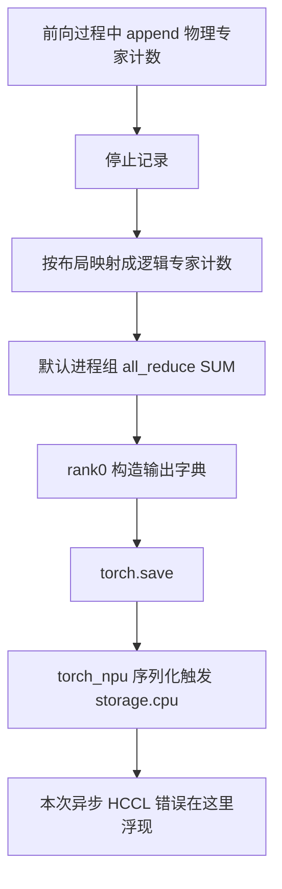

# 专家计数都采到了，为什么导出还会失败？

160 条模型请求已完成，AISBench 退出码为 0。采集还剩停止计数、导出文件和静态布局拟合，故障却发生在导出阶段。

dump 超时后，D 端 scheduler 崩溃，health 返回 503。新出现的 `.pt` 只有 1949 字节。栈顶位于 `torch.save()` 的 `storage.cpu()`，日志同时报 `HcclAllreduce` 申请 2,517,630,976 字节 NPU 内存失败。

修复保留了物理专家到逻辑专家的转换，将转换结果复制到 CPU，再用已有、同成员的 Gloo 组执行整数 SUM，最后由 rank0 保存 CPU 张量。模型前向没有改动。

新窗口导出的张量可完整加载，形状为 `[512, 43, 256]`，总计 45,597,888。要解释修复为何有效，需要先看 dump 中隐藏的设备通信，再核对换后端后是否保留原计数含义。

实验为 2026 年 10 月 21 日的 DeepSeek-V4-Flash、Ascend 910C 真实 PD，P8+D8 共 16 张物理卡。负载采用有利复制任务，16K 正文、Chat 输入 16388、输出 1024，N160/C128、6 req/s、零前缀缓存，D 使用 G5/verify6。采集为手动 `stat`，关闭在线 EPLB 与 balancedness 报告。记录见[数值证据](../../assets/expert-count-export-hccl-gloo/evidence.json)和[前后源码片段](../../assets/expert-count-export-hccl-gloo/export-fragments.py.txt)，实现按当时冻结文件 SHA256 绑定。

## 一、生成完成时，统计工作还没有结束

采集用于按实际负载拟合 D 端静态布局。逻辑专家可能分布为多个物理副本，token 分配到各副本的数量不同，会改变 EP rank 间负载。

recorder 先按 append 保存物理专家计数，dump 再用当前 `physical_to_logical_map` 合并同一逻辑专家的副本。例如两个副本记录 2、3 次分配，逻辑专家应得到 5。这个教学例子对应 `scatter_add_`，累加的是专家分配次数。

转换后仍只有各进程本地统计。原 `_StatAccumulator.dump()` 接着通过默认组 `all_reduce(SUM)` 全局归约，再让 rank0 保存。路径如下：



原 AISBench 的 160 成功、0 失败与独立退出记录，能够证明生成结束。要得到可用统计文件，还需完成全局归约、设备转移及序列化，后面这些步骤尚有失败可能。

原生命周期中，`start_record()` 先 reset 再开启记录，`stop_record()` 只关闭开关，`dump_record()` 等 accumulator dump 返回后才 reset。此次 start、stop 均返回 200，未覆盖随后导出的完成状态。

## 二、二十多 MB 的计数，为什么报了约 2.52 GB 的申请

成功计数具有 512 个槽位、43 层、每层 256 个逻辑专家，int32 纯张量大小为：

```text
512 × 43 × 256 × 4 = 22,544,384 bytes = 21.5 MiB
```

成功 `.pt` 共 22,546,433 字节，除张量外还含序列化信息。失败的 2,517,630,976 字节申请明确来自 HCCL 模块，规模与统计文件不同，不能解释成文件本身需要同样大的存储。

原实现转成逻辑计数后，张量仍驻留设备，再通过未指定 `group` 的 `all_reduce` 归约，报错算子为 `HcclAllreduce`。rank0 随后将设备张量字典交给 `torch.save`，torch_npu 序列化需要把 storage 搬到 CPU，异步错误在这次访问时浮现。

日志保留了以下信息：

```text
torch.save
  -> torch_npu serialization
  -> storage.cpu()

current working operator name is HcclAllreduce
Failed to allocate memory requested by HCCL module.
Failed to allocate 2517630976 bytes of NPU memory.
```

同段日志提示异步调用可能使 Python 栈定位不准。因此看到 `storage.cpu()`，还应检查它之前依赖的设备工作，仅按栈顶归因会误判为文件或主机内存错误。

现有记录把失败定位到 dump 的 HCCL 路径，还没有说明这块申请在内部用于什么、何时分配。因此修复先将这段离线归约移到 CPU，没有猜定它属于某一种 HCCL buffer，再据此调整容量。

候选还移除了首次 dump 前的 `empty_cache()`，首次标记仍会被消耗。因此这是组合导出调整，没有逐项消融，不能把成功全部归给删除这一行。

## 三、把 SUM 搬到 CPU，先保持参加计算的人不变

受控采集窗口结束后的整数统计适合使用 CPU 通信，但组成员、映射和归约操作必须保持原意。

原本需要 16 个 rank 求和，若换成只覆盖部分成员的 TP 子组，即使 API 成功，统计也已不完整。归约后的各 rank 又都持有全组结果，若再将 16 份相加，会重复计算同一组负载。

候选复用 `get_world_group().cpu_group`。冻结的 `parallel_state.py` 已在初始化时按相同 rank 列表创建 Gloo CPU 组，源码 SHA 与现场一致；dump 中没有另行 `new_group()`。

辅助函数按以下顺序执行，完整代码保存在随文片段：

```python
# 说明性节选：省略异常信息与完整成员检查。
# logical_count 已经经过原来的 physical-to-logical 转换。
cpu_count = logical_count.detach().cpu().contiguous()
torch.distributed.all_reduce(
    cpu_count,
    op=torch.distributed.ReduceOp.SUM,
    group=world_group.cpu_group,
)
return cpu_count
```

复制前检查 CPU 组存在、后端为 Gloo，且 `world_group.ranks` 与 CPU 成员顺序均匹配默认 WORLD；计数仅接受 int32、int64。[PyTorch all_reduce](https://docs.pytorch.org/docs/2.14/distributed.html#torch.distributed.all_reduce) 在指定组中原地归约，并让所有成员获得结果；省略 `group` 才选默认组。这里引用接口语义，现场行为仍按冻结实现与记录判断。

物理到逻辑转换保留原位置和映射。将结果复制到 CPU 后再做整数 SUM，rank0 待保存字典就已包含 CPU 张量，无须在序列化时隐式转移这份 NPU storage。collective 仍由全部成员参与，只有文件写入限定 rank0。

代价是每 rank 都需设备到主机复制，并为 CPU 张量、Gloo 通信占用主机资源。该路径只在采集结束后执行，未加入逐步 Decode。我们未分别测量复制、归约和写盘时间，扩大规模或跨节点时，仍需重新评估主机内存与网络成本。

修改限于手动 stat，条件为 `enable_eplb=false`、balancedness 报告关闭。utilization 的设备 reduce、broadcast 没有一起替换，模型前向、权重、量化及推理通信也保持原样。因此该候选不能直接用作在线动态 EPLB 的通用替代。

## 四、两 rank 算对了，还要走完真实 16 worker 的导出

实机接入前，先用真实两进程 CPU/Gloo 检查提取出的 dump、映射转换和 SUM 方法，以非恒等映射构造计数，逐元素核对整数结果。

int32 覆盖 object 返回分支，int64 覆盖 file 分支，每次均从 `_first_dump=True` 开始。检查了仅 rank0 保存、结果在 CPU，以及拒绝浮点计数和错误成员。两进程均通过，未初始化 NPU。

这组检查覆盖逻辑转换、归约与输出分支。NPU→CPU 复制、已有组及多 worker 控制协议，还需放进实际服务确认。

取得有效计数的一轮使用已加载候选的热服务：执行一次 start/reset，发同场景 N160，原负载独立退出后再 stop、dump。这个采集窗口没有新增模型启动、MF 或路由预热，结果如下：

| 项目 | 真实运行结果 |
| --- | --- |
| 正式请求 | 160 成功，0 失败，实际输出均为 1024 |
| start / stop / dump | 各一次完成，均返回 200 |
| dump API 墙时 | 约 0.0715 秒 |
| worker 身份 | 前后相同的 16 个 PID 与启动标识 |
| 保存位置与类型 | rank0，CPU int32 张量 |
| 逻辑计数形状 | `[512, 43, 256]` |
| 计数总和 | 45,597,888 |
| 文件验证 | 22,546,433 字节，CPU 完整加载与 SHA256 留存 |

HTTP 完成依赖当时绑定的 FanOut 协议等待 DP16 回复，并核对前后 worker 身份。这是协议级结束证据，没有逐 rank 独立时间 trace。

0.0715 秒只表示这一次 dump API 墙时，不能据此比较 Gloo 与 HCCL 性能。该轮开启专家采集，未采 native，报告将其标为布局诊断；普通性能需在后续另测。

1949 字节坏文件保留为失败产物。成功文件来自新采集窗口，并未恢复原先失败的那份计数。

## 五、文件能加载之后，还要弄清 512 代表什么

文件可加载后，还需解释各维度。第一维 512 是 recorder 环形槽位数，与请求量和输出 token 数都不同。

当时 `_CircularBuffer.append()` 写入当前槽位并取模推进，写满会覆盖旧值；`get_all()` 直接返回底层 buffer，不重排时间顺序。因此 `[512, 43, 256]` 说明槽位成功保存，不能直接还原采集时间线。

160 条长输出经历多次 forward 和调度，文件形状无法对应每条请求的完整轨迹，也不能确认首槽就是首步。45,597,888 是专家分配计数，不是输出 token 总量。

后续 CPU 工具将槽位分成 256/256 做拟合与检查，可观察候选对另一部分计数的适应情况。但环形槽未保留时序，不能将这个划分称作早期训练、晚期验证；研究负载随时间变化时，还需时间索引或原始 append 顺序。

文件同时记录归约状态。rank0 逻辑计数已 all-reduced，拟合读取一份即可，不乘 DP16，也不再 SUM 各 rank 的相同全局结果，避免改变负载权重。

可用计数让静态拟合继续，但布局是否提高吞吐，仍需放到同负载服务比较。放置背景见[P 端场景静态 EPLB](ascend-910c-prefill-scenario-static-eplb.md)。

## 六、下次怎样少花一轮昂贵采集

下次应将首次 dump 放进提前检查，而不只检查 forward、start 和 stop。否则首次分支仍要等长负载结束才执行。CPU 两 rank 与真实服务首次导出各覆盖不同路径，短检查应针对实际可能失败的位置。

文件验收也需检查内容：在 CPU 完整加载后，核对形状、dtype、非负性、有效计数及窗口，再保留哈希。新文件名或非零大小都不充分。这次最终依据新文件、成功 API、相同 worker 身份和完整加载，确认导出完成。

长期维护时，还可考虑先写临时文件、验证后原子改名，避免下游读到半文件。这是后续建议，本次仍使用原 `torch.save` 文件分支。

故障恢复要看服务状态。本次 scheduler 已退出、health 为 503，确认原请求结束后需要恢复服务；若只有客户端采集或解析失败，而远端仍健康，应先修复原产物。两种情形采取相同的重跑动作，会浪费已完成的推理与预热。

修复最终保持同一份物理到逻辑映射、同一组成员和整数 SUM，只把归约、输出迁到已有 CPU 通道。专家计数得以进入布局拟合，而这次故障也表明，采集结束仍需经过 collective、数据转移与序列化，不能以模型请求结束替代整次采集完成。
