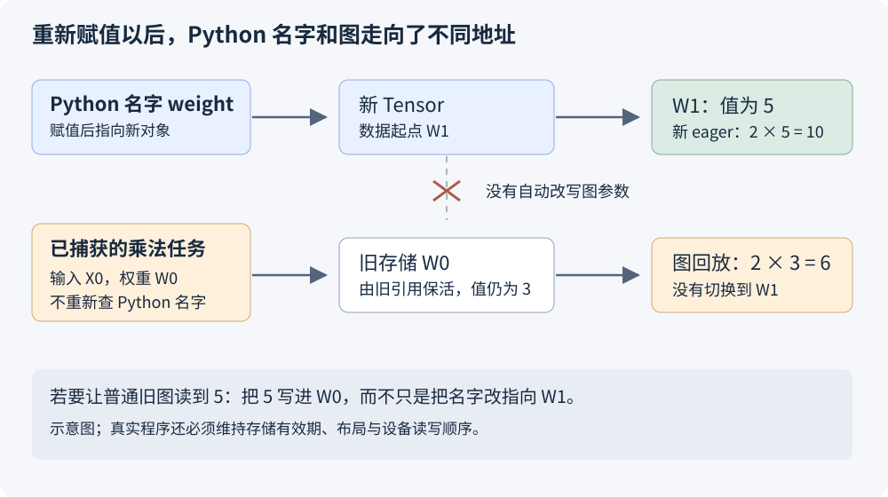

# 图捕获以后，为什么还能改权重，却不能随便换张量？

在 SGLang 的动态 EPLB 里，系统根据专家的忙闲程度重新安排副本，专家权重也会跟着换位置。此时模型已经捕获了图，迁移结束后却不必为每次专家重排重新捕获：后续回放继续访问原来的权重地址，读到的是更新后的内容。

这很容易让人困惑。既然图是“固定”的，为什么权重还能变？反过来，如果新权重已经准备好，直接写一句 `weight = new_weight`，为什么又不行？

先看一项乘法：输入 `x=2`，权重 `weight=3`，捕获的工作是计算 `x * weight`。之后把原权重里的 3 改成 5，回放应得到 10；把 Python 变量 `weight` 改为指向另一张值为 5 的张量，普通回放仍然使用捕获时的旧地址。

沿着这次乘法，依次看三个位置就够了：Python 的 `weight` 名字、它指向的 Tensor 对象、图中乘法记录的设备地址。普通 Python 计算每次重新查名字；图回放直接用已经记录的地址。这条差别贯穿后面的赋值、复制和存储替换。先讲普通回放，再看 SGLang 怎样准备输入，以及 NPU 怎样显式更新受支持的图参数。

这里的图指 `torch.cuda.CUDAGraph` 和 `torch.npu.NPUGraph` 这类设备执行图。源码固定为 PyTorch 2.10、Ascend/pytorch 的 [`e945b708`](https://github.com/Ascend/pytorch/blob/e945b7088a865036fbd06bc02c3097005526469a/torch_npu/npu/graphs.py)，以及 SGLang 的 [`2914be608`](https://github.com/sgl-project/sglang/blob/2914be608009b65099c4c52ba118a597bf1b1421/python/sglang/srt/hardware_backend/npu/graph_runner/npu_cudagraph_backend.py)。下文的 2、3、5 是教学用值，设备示例的预期结果集中列在文末。

## 一、捕获时走过 Python，回放时直接执行设备任务

普通 eager 执行一次 `output = x * weight`，Python 先找到当前的 `x`、`weight`，PyTorch 根据张量的 dtype、shape、设备等信息，安排相应的执行工作。下一次重新执行这行 Python，就会重新读取这些名字。

图捕获是在一段工作提交过程中，把设备任务及其依赖记录下来，供以后重复发起。对于这个乘法，读者可以先把记录理解为：

```text
读取地址 X0 上的输入
读取地址 W0 上的权重
执行乘法
把结果写入地址 Y0
```

上面的任务描述用来说明地址关系。后端真正保存的图还包含内核、工作空间、参数和执行依赖。重放时，它按已建立的关系访问输入与权重；Python 名字 `weight` 后来绑定到哪个对象，属于另一层状态，重新赋值不会自动改写这些任务参数。

模型的一轮 forward 往往要提交很多设备任务。把这些工作捕获成图以后，CPU 可以通过图回放发起这轮计算，减少反复执行 Python、调度和逐项提交的开销。设备仍然要读取输入和权重，完成这轮实际计算，因此原地址中的新数值能够影响结果。

PyTorch 2.10 的 [CUDA Graph 说明](https://github.com/pytorch/pytorch/blob/v2.10.0/docs/source/notes/cuda.rst#L1297-L1309)明确区分了同一组任务参数与地址中不断变化的数据。Ascend 的实现则可以直接沿 [NPUGraph.replay()](https://github.com/Ascend/pytorch/blob/e945b7088a865036fbd06bc02c3097005526469a/torch_npu/npu/graphs.py#L638-L641) 追到 [C++ 的执行入口](https://github.com/Ascend/pytorch/blob/e945b7088a865036fbd06bc02c3097005526469a/torch_npu/csrc/core/npu/NPUGraph.cpp#L265-L283)：它提交已捕获的图到当前 NPU stream，没有重新调用原来的 Python forward。

因此，图固定的是普通回放采用的执行安排，不是把权重数值冻结成了一张照片。地址 W0 里原来是 3，后来写成 5，只要新的写入先完成，读取 W0 的乘法就会用到 5。

这里的地址是进程使用的设备虚拟地址。图回放要求这个地址仍然有效，指向满足算子要求的数据；它不要求我们追踪某个物理 HBM 位置是否永远不变。

## 二、三种“改权重”，实际上改了不同的东西

先给出关系：Python 变量是一个名字；Tensor 对象保存 shape、stride、dtype、设备、存储偏移等信息；Storage 承载底层分配。`id(weight)` 看 Python 对象身份，`weight.data_ptr()` 看张量数据起点。两者不能互相替代。

下面三个例子都使用普通 ND 小张量，并从独立的初始状态开始：`x=2`，`weight=3`，图已经捕获，第一次回放得到 6。它们没有调用图参数更新接口。NZ 权重的格式约束放到最后的 EPLB 场景再讲。

### 原地 copy：地址没变，内容变了

```python
with torch.no_grad():
    weight.copy_(new_weight)  # new_weight 的值是 5

graph.replay()
```

`copy_` 把源张量的数据写进目标张量，目标仍然是原来那块存储。图中的 W0 没变，W0 的内容从 3 变成 5，乘法得到 10。

这里要求目标张量仍然符合图捕获时的布局，并保证写入和后续读取有正确顺序。示例中的 `no_grad()` 让权重更新不参与自动微分记录，它不负责设备同步，也不会修复错误的 stream 依赖。[copy_ 的接口定义](https://docs.pytorch.org/docs/2.10/generated/torch.Tensor.copy_.html)说明它把源元素复制到目标张量；源还可以具有可广播的形状或不同 dtype，不能只凭“调用成功”就认定权重更新的业务含义正确。

### 重新赋值：Python 名字换了指向

```python
weight = new_weight
graph.replay()
```

这句赋值让 `weight` 指向新对象，新对象的数据位于 W1。它没有把 W1 写入原图的乘法参数，也没有把 5 复制到 W0。

现在同一段程序里会有两种结果：重新执行 eager 的 `x * weight`，会找到 W1 并得到 10；回放旧图，仍然读取 W0 并得到 6。



为让这个对照有确定的含义，示例必须一直保留 W0 的有效存储。若旧存储被释放或被分配器复用，问题就变成了失效地址或错误生命周期，不能再期待图稳定地给出旧值 6。

### 替换 storage：对象可以没换，地址仍然会换

```python
old_storage_owner = weight.detach()  # 保留旧存储，供这次演示使用
weight.set_(new_weight)
graph.replay()
```

`set_` 会设置张量的底层 storage、size 和 stride；当源是另一张 Tensor 时，目标改为与它共享存储。[官方接口说明](https://docs.pytorch.org/docs/2.10/generated/torch.Tensor.set_.html)给出了这个行为。

这次 `id(weight)` 可以不变，`weight.data_ptr()` 却已经从 W0 变成 W1。普通回放没有重新读取这个 Tensor 对象来生成参数，仍然访问 W0。因为演示显式保留了旧存储，所以图得到 6；新的 eager 计算使用已改指向的张量，得到 10。

读这两个带下划线的方法时，要继续追它们修改的对象：`copy_` 修改原分配里的内容；`set_` 修改 Tensor 指向哪份存储。图关心的是乘法读取的地址，所以两种操作对旧图的效果不同。

| 操作 | Python 对象 | 数据起点 | 普通旧图读取 |
| --- | --- | --- | --- |
| `weight.copy_(new_weight)` | 保留 | W0 | W0 的新内容 |
| `weight = new_weight` | 名字指向新对象 | W1 | W0，前提是旧存储仍有效 |
| `weight.set_(new_weight)` | 可以保留 | W1 | W0，前提同上 |

实际模型中，直接执行 `module.weight = tensor` 还受到 `nn.Module` 参数注册规则约束，未必能这样赋值。即使换成合法的新 `Parameter`，也不意味着旧设备图会自动更新权重地址。上面的普通 Tensor 例子把 Python 赋值与参数注册先分开，便于观察地址问题。

本节示例都从偏移为 0 的单元素张量开始。一般视图还要看 `storage_offset()`：两张视图可以共享 Storage，却从不同位置开始，因而 `data_ptr()` 不同。它们是否共享存储、图究竟读取哪一个起点，需要分别确认。

## 三、输入每轮都变，为什么仍然可以复用同一张图

推理服务每轮接收不同的 token。如果图要求每次数据都相同，它就几乎没法用。常见做法是提前准备固定的输入缓冲，每次把本轮数据写进去，再回放。

```python
# 示意代码：static_input 已用于捕获，live_input 是本轮数据。
static_input.copy_(live_input)
graph.replay()
```

新请求的张量可以是新对象；它先作为复制来源，把内容送进图使用的老地址。需要稳定的是图的输入缓冲，而不是服务里出现的每一张张量。

这层复制也有明确作用：将动态的请求数据接到固定的图输入。它会产生数据搬运成本，但不能因为“多一次 copy 看起来不优雅”，就直接把静态缓冲的变量换成新请求张量。要省掉这次复制，需要确认生产者已经把数据写进图所使用的缓冲，或者使用后端支持的显式更新机制。

输出也有类似的固定地址。一次捕获得到 `static_output`，后续回放继续写它。把引用放进列表，不会自动保存每轮结果：

```python
# 第一轮回放完成后，static_output 的内容是 6。
first_reference = static_output
first_snapshot = static_output.clone()

# 把下一轮输入写进静态缓冲，再回放，输出变为 12。
# first_reference 也会看到 12；first_snapshot 仍保存第一轮的 6。
```

如果每轮都执行 `results.append(static_output)`，列表里保存的也只是同一份输出的多个引用。第二轮把输出改成 12 后，查看第一项也会看到 12。若要保存第一轮的 6，必须在第二轮覆盖前复制，并保证这次复制读到已完成的结果。

在同一 stream 上按顺序提交，前一次回放、输出复制、下一次回放可以由流顺序组织；跨 stream 时则需要相应依赖。给 Python 变量起名为 `last_output` 或把它塞进字典，不会增加任何设备端的完成保证。

这里的 stream 可以先理解为设备任务队列：Python 把任务提交进去，不必等设备做完就能继续往下走。同一条队列中的执行顺序，与两条队列之间如何等待，是两件事。这也是为什么“Python 已经执行到下一行”不等于“上一行安排的设备复制已经完成”。

## 四、SGLang 怎样把这些规则落到实际推理中

SGLang 的图 runner 会为选中的执行规格准备捕获输入，把模型调用封装为回调，再交给后端捕获。在本文固定版本里，共享 decode runner 的 [capture_one_shape()](https://github.com/sgl-project/sglang/blob/2914be608009b65099c4c52ba118a597bf1b1421/python/sglang/srt/model_executor/runner/decode_cuda_graph_runner.py#L1417-L1556)组织这段工作。

进入 NPU 后端，[_capture_one()](https://github.com/sgl-project/sglang/blob/2914be608009b65099c4c52ba118a597bf1b1421/python/sglang/srt/hardware_backend/npu/graph_runner/npu_cudagraph_backend.py#L417-L466)先做两次预热，再创建图并执行捕获回调。关键代码可以缩成：

```python
# 摘录 NPU 后端，省略预热及外围上下文。
graph = torch.npu.NPUGraph()
with torch.npu.graph(
    graph,
    pool=self._pool,
    stream=self._capture_stream,
    auto_dispatch_capture=True,
):
    out = forward_fn()

self._graphs[shape_key] = graph
self._outputs[shape_key] = out
```

后端保存了两样东西：用于重放的图，以及用于读取结果的输出对象。普通重放分支执行：

```python
self._graphs[shape_key].replay()
return self._outputs[shape_key]
```

返回值是捕获时登记的输出对象，其底层数据由本次图执行更新。调用者若需要跨多轮保存结果，就要遵守上一节的输出生命周期，而不能把它当作每轮新分配的独立结果。

这也解释了服务代码里为什么会同时出现“固定输出对象”和“本轮请求结果”。前者是设备反复写入的工作区，后者需要在适当时机取出本轮有效部分。把工作区的引用直接交给一个还会长期持有它的消费者，下一轮覆盖时，消费者看到的数据也会跟着变。

本轮输入也不是靠重新绑定 `forward_batch` 就自动进入图。NPU 后端的 [prepare_replay()](https://github.com/sgl-project/sglang/blob/2914be608009b65099c4c52ba118a597bf1b1421/python/sglang/srt/hardware_backend/npu/graph_runner/npu_cudagraph_backend.py#L207-L219)有将 token 与位置写入捕获缓冲的分支：

```python
runner.buffers.input_ids[: runner.raw_num_token].copy_(
    forward_batch.input_ids
)
runner.buffers.positions[: runner.raw_num_token].copy_(
    forward_batch.positions
)
```

这里的 `raw_num_token` 让本轮有效数据进入缓冲的相应范围。padding 和其余元数据还有各自的准备逻辑，不能只看这两次复制就认定整批输入已经齐全。

共享 runner 中还存在[已经预先写入时跳过重复复制的路径](https://github.com/sgl-project/sglang/blob/2914be608009b65099c4c52ba118a597bf1b1421/python/sglang/srt/model_executor/runner/decode_cuda_graph_runner.py#L2021-L2036)。这个优化成立，是因为前面的生产步骤已经填好了目标缓冲。它没有放弃地址约束，而是改变了谁负责在回放前准备数据。

### 不同 batch 复用的是选定规格，不是任意改变同一张图

代码里的 `shape_key` 用于选择已经捕获的执行规格。同一批静态缓冲可以被不同的图、不同切片使用；“同一个缓冲池”也不等于“只有一张图”。

举一个纯教学例子：如果图按容量 8 捕获，本轮只有 5 条请求，系统可以把 5 条有效请求写进去，其余位置使用符合后端契约的 padding，并通过有效长度或 mask 控制计算。图仍然按捕获的规格运行，运行时并没有凭空把它改成一张容量 5 的图。

因此，配置并发、实际 batch、图档位是三种数量。图输出有 8 行，也不能未经有效行处理就全部当作 8 条真实请求的结果。具体采用 padding、其他档位或 eager 回退，要看对应 runner 的选择逻辑。

## 五、哪些变化能放在数据里，哪些需要更新图

“shape 固定”经常被理解成序列长度不能变化。但存储形状和存储中的数值是两回事：一张固定为 `[8]` 的长度张量，可以在不同回放前写入不同的 8 个长度。算子是否支持这些长度值、工作空间和 KV 容量是否足够，则是下一层契约。

同样，固定容量的 token 缓冲可以反复写入新 token。数据值变了，地址、dtype 和形状仍然维持捕获时的约定。

### Python 标量与设备张量并不等价

```python
scale = 2.0
with graph_context(graph):
    output = x * scale

scale = 5.0
graph.replay()
```

这段是语义示意，`graph_context` 表示相应设备的图捕获上下文。`scale` 在这里是 Python 浮点数，捕获期间就作为算子参数参与提交。之后给这个名字赋值 5.0，不会自动修改普通回放中的乘法参数。

如果某个参数确实需要在每轮变化，一种设计是让算子从固定地址的设备张量读取它，再在回放前更新那张张量。这个设计是否有效，还要确认实际算子和编译路径把它当作运行时数据；不能把 Python 标量包成 Tensor 后，就跳过对实现的检查。

Python 分支也一样。捕获时 `if flag:` 选了哪段 Python 执行路径，就由那次执行提交设备任务。改 `flag` 并回放，不会重新执行这个 `if`。需要不同执行结构时，可以选另一张已经捕获的图、重新捕获，或者使用后端明确支持的控制流与更新能力。

### NPU 的 update 是显式接口，有自己的支持条件

SGLang 并没有把所有参数都强制变成设备输入张量。在部分需要更新 CPU 序列长度参数的注意力路径上，NPU 后端会组织 `cpu_update_input`，交给 `graph.update()`。

Ascend 的 [NPUGraph.update()](https://github.com/Ascend/pytorch/blob/e945b7088a865036fbd06bc02c3097005526469a/torch_npu/npu/graphs.py#L669-L677)先检查捕获时是否启用了 `auto_dispatch_capture`，再通过记录和对应处理器更新受支持的算子参数。官方[注意力更新测试](https://github.com/Ascend/pytorch/blob/e945b7088a865036fbd06bc02c3097005526469a/test/npu/test_aclgraph_update.py#L77-L109)给出了更新 `actual_seq_lengths` 后再重放的例子。

SGLang 的 [replay_with_input_update()](https://github.com/sgl-project/sglang/blob/2914be608009b65099c4c52ba118a597bf1b1421/python/sglang/srt/hardware_backend/npu/graph_runner/npu_cudagraph_backend.py#L566-L604)则负责这条显式更新与重放流程。它并不表示每种模型都会更新 Host 长度；[调用分支](https://github.com/sgl-project/sglang/blob/2914be608009b65099c4c52ba118a597bf1b1421/python/sglang/srt/hardware_backend/npu/graph_runner/npu_cudagraph_backend.py#L475-L544)还会根据模型、注意力后端和 runner 类型选择普通回放或更新路径。

这与 `weight = new_weight` 的差别很具体：前者调用了后端设计的更新协议，后者只更改 Python 名字。某个注意力参数能够更新，也不推出任意权重地址、shape、dtype 都能按同样方式替换。

“不能随便换张量”说的是，变化必须通过图和算子认可的路径生效。普通回放不追踪 Python 对象的重新绑定；显式更新也只处理它所支持的内容。

## 六、地址没变，还要检查存储有效期和执行顺序

核对 `data_ptr()` 以后，还要接着问两件事：这块分配是否一直被正确持有；新数据是否在图读取之前写完。指针相等只比较了两次观察到的地址数值。地址背后的内存已经被回收，或者写入仍在另一条流里排队，都会让“地址相同”失去原本想证明的含义。

### 存储要能活过未来的每次回放

图在今天读 W0，明天再次回放仍然可能读 W0。不能因为今天这一轮结束，就把外部权重或输入缓冲释放掉。示例保留输入、权重和输出的长生命周期引用，SGLang 也通过模型参数、runner buffers、graph 和 output 的持有关系维持它们。

如果分配器后来把同一个地址给了另一张张量，指针数值可能“看起来没变”，内容和所有权却已经变了。继续读这个地址，并不等价于继续读原来的权重。

捕获期间产生的中间分配，还有图内存池等专门的管理机制。不能由此推断所有捕获前创建的外部输入、权重都自动获得了无限生命周期。哪个组件持有分配、何时允许回收，仍然需要沿实际实现确认。

`record_stream` 也有清楚的职责：它帮助分配器识别已提交到某条流上的使用，防止过早复用。它不会为尚未发生的未来回放永久保活一块外部存储，更不会改变图节点的输入地址。[PyTorch 的接口说明](https://docs.pytorch.org/docs/2.10/generated/torch.Tensor.record_stream.html)把它与已排队工作的生命周期联系起来。

### 保活不等于同步

若 forward 正在读取旧权重，另一个 stream 同时往同一地址写新权重，结果可能读到混合状态。地址保留了，也依然不正确。

运行时更新至少需要维持这条顺序：

```text
旧 forward 完成对相关权重的读取
    ↓
迁移、复制完成对新权重的写入
    ↓
后续 forward 使用更新后的权重
```

同一 stream 上的提交顺序可以表达一部分依赖，跨 stream 则需要事件或其他受支持的同步机制。`torch.no_grad()`、Python 锁、保留一个引用，都不能代替设备执行依赖。示例为方便读数在图外使用同步，它用于观察正确结果，不是给性能路径每段都插全设备同步的建议。

输出缓冲也有相同问题。两次并发重放若写同一份输出，调用者必须有相应的串行化或独立缓冲设计；给两个请求返回同一个输出对象，不会让底层数据自动分成两份。

## 七、回到 EPLB：保留图的访问约定，更新地址中的专家

动态 EPLB 调整专家的位置时，需要把新专家的数据写进已有物理槽位，同时让路由映射指向对应的新布局。模型张量的地址、形状和计算所需的存储格式保持原约定，后续图回放才可以继续使用这些输入。

例如，一张卡的槽位 0 原来放专家 A，现在改放专家 B。设备图中使用该槽位的地址仍是 W0，迁移器把 B 的完整权重写入 W0，再让路由元数据把该槽位标记为 B。后续需要 B 的 token 被送到这里，专家算子从原地址读到的就是 B 的权重。反过来，只改路由而不改权重，就会把需要 B 的 token 交给 A；只换 Python 属性而不更新 W0，旧图也仍然读不到 B。

旧 Ascend 路径在 ND 中转张量上完成迁移后，把结果恢复原格式并 `copy_` 回模型权重。新的物理存储路径则创建原权重的可写字节别名，直接通过它改写目标槽位。两条路径都在维护原模型存储的地址；新路径省掉的是整层转换和额外写回。

这里甚至可以创建一个新的 Tensor 对象作为迁移视图，而不影响原来的模型图。原因是：这个新对象只是迁移器的访问入口，它和模型权重指向同一块有效数据，模型原有描述符也保留。图没有被要求改成读取一个新分配。

检查真实模型时，还要找到算子最终读取的那份权重。如果加载或编译过程额外生成了预打包副本，更新源 Parameter 后，也需要更新或失效对应副本。只看 Python 模型属性里的值已经变化，不能证明设备任务读取的那份数据也变了。EPLB 迁移必须拿到实际参与推理的权重存储。

程序当然可以创建新的 Tensor。判断它会不会影响旧图，要看这个对象准备接替什么：若替换图原先读取的分配，就需要相应图更新；若只给同一份存储增加访问视图，模型原地址仍可以保留。[NPU 的 _expert_storage_view()](https://github.com/sgl-project/sglang/blob/2914be608009b65099c4c52ba118a597bf1b1421/python/sglang/srt/hardware_backend/npu/eplb.py#L334-L365)正是在同一 `weight.data_ptr()` 上构造独立的字节描述，细节见[上一篇存储迁移文章](ascend-eplb-physical-storage-migration.md)。

同样，专家权重写完还不够。权重槽位与路由映射要按一致的顺序切换。本文固定实现中，[外层 updater](https://github.com/sgl-project/sglang/blob/2914be608009b65099c4c52ba118a597bf1b1421/python/sglang/srt/eplb/expert_location_updater.py#L43-L83)先调用权重迁移，再更新相关层的位置元数据。保留地址解决了图的访问约定，迁移算法和调度依赖解决的是读写安全，两者缺一不可。

### 自己核对时，先看改动落在哪一层

| 想做的改动 | 首先检查什么 |
| --- | --- |
| 更新权重值、输入 token 或长度张量 | 是否写入图读取的原存储，数值范围和写入顺序是否有效 |
| 把变量指向新张量 | 图是否仍读取旧地址，旧存储由谁保活 |
| 修改 Tensor 的底层 storage | 对象身份相同也不能跳过地址与布局核对 |
| 改 batch、dtype、stride 或执行分支 | 是否需要另一张图、重新捕获或受支持的更新接口 |
| 保存多轮输出 | 保存的是共享输出引用，还是已完成内容的独立副本 |

排查时，先把 `id(tensor)`、`data_ptr()`、shape、stride、dtype 和对象持有关系对应起来，再追复制与回放的执行顺序。只打印一行 shape 一样，或者看到两次输出都没有报错，回答不了这些问题。

### 随文设备示例

[graph_storage_demo.py](../../examples/graph-capture-tensor-storage/graph_storage_demo.py)提供五项小例子：`copy_`、Python 重新绑定、`set_` 换存储、输出复用，以及 Python 分支和标量。它使用单元素张量，让地址、数值和输出变化可以直接打印查看。

下载脚本并进入保存它的目录，在已经具备相应 PyTorch 与设备运行环境的空闲设备上，可选择执行：

```bash
python graph_storage_demo.py --backend npu --device-index 0
```

或：

```bash
python graph_storage_demo.py --backend cuda --device-index 0
```

脚本按普通捕获与回放语义设置以下断言。运行时可以将实际输出与这张预期值表逐项核对：

| 例子 | 初次图输出 | 修改后的图输出 | 另行观察 |
| --- | ---: | ---: | --- |
| 原地址 `copy_`：3→5 | 6 | 10 | 对象和数据起点均保留 |
| Python 重新绑定到值为 5 的张量 | 6 | 6 | 用新名字重新 eager 计算得到 10 |
| `set_` 换到值为 5 的存储 | 6 | 6 | 对象保留、地址改变；旧存储显式保活 |
| 输入 2→4，再回放 | 6 | 12 | 旧输出引用看到 12，事先 clone 的快照仍为 6 |
| 改 Python flag 与浮点 scale | 4 | 4 | 普通回放不重新调用 Python forward |

这些例子把每种变化分开，`set_` 一项还刻意保留旧存储，以免把地址绑定问题混成悬空指针问题。源码依据和本稿实际完成的检查见[配套说明](../../assets/graph-capture-tensor-storage/evidence.json)。

下一次遇到“Python 中已经换成新权重，图结果却没变”，就从图实际读取的地址开始查：新值有没有写到那里，存储是否仍有效，设备是否在读取前完成了写入，以及这次变化是否需要一条显式更新路径。

要继续分析原位更新的实际开销，可以读[一轮 EPLB 更新的时间，究竟花在哪里？](eplb-update-time-breakdown.md)。

[返回 EPLB 专题](../distributed/eplb-study-guide.md)。
