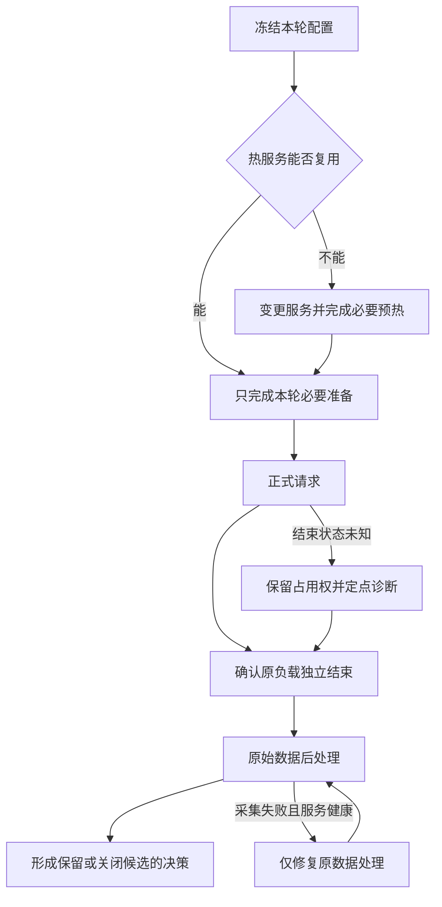

# 让 AI 连续调优几天后，我发现实验流程也有瓶颈

“怎么还没启动啊”

调 DeepSeek-V4-Flash、Ascend 910C 时，我问过这句话。编码代理一直在读文件、改入口、补检查，正式请求却迟迟没有发出。我原本希望它连续提出候选、压测、分析，再决定下一轮。性能结果最后拿到了，但中间花在实验工具上的时间，比我预想的多得多。

最后一轮 640 条正式请求，跑完大约三分钟。此前一次只改并发的实验，从提出变更到控制器启动，已经等了接近四分钟；更早一次服务配置从准备到冻结用了 23 分钟，模型加载、预热和路由验证还在后面。

这些是 2026 年 10 月 18 至 21 日的记录，原始数值在[阶段计时摘录](../../assets/inference-tuning-workflow-postmortem/measurements.csv)里。回头看它们，有些“还没跑完”根本没跑到模型，有些模型早就跑完了，代理仍在修报告。它们曾被同一个失败状态遮住。

## 三分钟压测之前

这次是真实 PD，P8+D8，共 16 张物理卡。前期测 16K/1K、零缓存，后期换成 128K/1K，要求每条请求至少命中 90% 缓存。后者得先准备缓存，还要按实际负载采集、拟合 P/D 静态布局。

我把候选准备、服务与缓存准备、正式推理和收尾的计时放到一起，才看见正式推理在整轮里占了多少。

| 事件 | 已记录墙时 | 应当怎样理解 |
| --- | ---: | --- |
| 一次 noCP 候选准备到冻结 | 1382.354 秒 | 约 23 分 02 秒，主要暴露编排适配过重，不能归到模型加载 |
| 一次 128K 布局试验：控制器 / 正式推理 | 748.228 / 68.676 秒 | 正式推理约占控制器时间的 9.18% |
| 同轮两轮预热 / 路由验证 | 255.715 / 275.749 秒 | 属于上一行内部阶段；模型此前已加载 |
| 最后一轮 C90：控制器 / 正式推理 | 309.159 / 179.577 秒 | 热测没有新增模型启动、MF 或路由验证 |
| 同轮缓存 seed 与 check | 47.910 秒 | 正式测量之前的缓存准备，包含在控制器时间里 |

C90 这一轮，控制器总耗时比正式推理多约 129.583 秒。缓存准备用了 47.910 秒，余下约 81.673 秒分布在前置和收尾，日志没有继续拆开。加载、两轮预热、路由验证、清缓存有时已经计入服务阶段，上表的行之间也有包含关系，因此不能直接加出一个“浪费总时长”。

还有一个容易算错的数。seed 阶段的逐请求延迟加起来约 666.857 秒，seed/check 并行执行的墙时只有 47.910 秒。人和机器实际等的是后者。反过来，如果只报正式推理的三分钟，准备和收尾又全部消失了。

重启后的预热当然有用。我想省的是只改 C、热服务还在时，又重新走一遍同样的准备。时间记下来之后，这部分开销才有了可以讨论的对象。

## 已经预热两轮，却没发出一条请求

有一次，候选已经加载完，也通过了两轮预热，runner 却被旧的布局 SHA 断言拦住了。计划中的 640 条正式请求，一条都没发出去。当时没有性能结果可供比较，热服务倒是已经准备好了。修断言、接着跑，才用得上前面已经花掉的时间。

这种旧约定并不只藏在 SHA 里。只改 C 时，入口仍只接受旧 C；外层计划发 640 条，底层却只允许 160 条。配置、命令、身份校验、collector 和恢复入口，各存了一份自己的约定，改过一处还得找下一处。

另一次，DP16 被命令后面追加的参数覆盖成 DP4/CP。全局 chunk 又会随 DP 折算，最终执行的形状已经偏离了外层配置。复制旧配置时只改 CP，留下来的旧 chunk 和路由数，又需要新一轮适配。

后来一个热 CASE 已经约有 115KB，冻结清单关联数百个文件。计算哈希很快，重新弄清这些文件之间的约定很慢。复制一个成功入口，连带复制了旧布局、N 和恢复逻辑；下一轮为了确认差异，代理又得读更多历史、补更多检查。

我希望纯并发调整可以只提交一个参数。执行器从冻结 CASE 读取 N/C、布局和截止时间，负载、计数、报告共用这些值，历史结果另外归档。这样下一轮 C96 才能沿用这一轮修好的入口。假如改 N/C/r 仍要新建控制器、修改 collector 和恢复脚本，就还没做到参数化。

## 模型跑完了，报告还没出来

native 统计那次，推理已经结束，子进程却因没有继承 payload 搜索路径而导入失败。后续补齐环境，做了真实配置重载和禁止网络的 CPU 检查，再用原 selector 处理原数据，报告就能继续生成。模型请求没有重发，原计时也没有改变。

此前做过的检查，并没有走到这个子进程。AIS 扩展也出过类似问题，在父进程里能构造，到了 worker 的 registry 才失败；还有一次把模块对象混进配置，序列化时无法 dump。配置生成、序列化、新进程重载、registry 查找、采集，实际入口会经过的几步，在检查里被绕过去了。

G5 启动又是另一种晚失败。后部异步算子错误一度盖住了更早的容量断言，Draft/Verify 扩大后，非 Graph 路径超过旧容量，helper 还覆盖了外层设置。修正最终容量和设置顺序后，服务才启动成功。这些失败都在正式性能测量之前。

错误到了后面才暴露，就补一个断言，下一轮再把它随旧脚本复制过去，检查会越来越多，出错的位置却未必提前。后来我更在意某项检查究竟覆盖哪条真实路径。服务变更查最终命令和重载，N 变更查底层数量与大小，纯 C 则沿用已经验证的 tokenizer 和 observer。

恢复也得沿着实际走到的位置继续。本地入口退出，可能还没发过请求；P/D 都加载好了、正式请求尚未发出，可以保留热状态；推理完成、collector 出错，就处理原数据。统一回滚会把加载、预热和路由重做一遍。

图里的接续入口自己也出过错。漏传模式，误发了旧预热；资源期限已经延长，深层残留的旧截止时间仍拒绝执行。原本想省一次重启，最后又在修入口。

那时我没有分开记录“推理完成”和“报告完成”，只能临时翻日志，重新查哪一端已加载、做过哪轮预热、正式请求到底有没有发出。保留热状态需要这些记录，确认原负载结束也需要。结束状态不清楚就另起 watcher 或 collector，补不上证据，还可能与原任务竞争。

## 多个 AI 代理也会一起等

有些工作本来可以并行。加载时备数据，正式运行时处理另一轮已经结束的结果，CPU 都有事可做。设备任务仍交给唯一的 owner，彼此没有冲突。

实际拆任务后，也出现过大家一起等的情况。几个代理审同一份配置，根代理最后还要重新合并结论；多人同时改 CASE 或冻结清单，刚算好的哈希马上失效。一次普通消息甚至发给了已经结束的子代理，却没有真正重新派发任务，后面等了半天，既没有计算，也没有实验在运行。

后来才明确一份产物只留一位写者，完成后交接、停止，由根代理绑定和冻结。控制器正常运行时，根代理跟踪原进程和产物；其他代理准备独立的后续材料。多人反复扫描同一组健康状态，并没有让实验提前。

## 只改 C，下一轮还要等多久

“少做 review”“复用热服务”“准备两分钟”，这些要求我都说过。入口却仍依赖旧适配，新参数进来，代理还得读大量历史，临时判断该改哪里。提示词不会替 collector 去掉白名单，也不会凭空变出一条已经验证的 C 入口。

历史越堆越多也有代价。旧阶段、PID、失败条件逐轮进入提示，过期的 PENDING 会盖过后来已经完成的结果，新会话又把查过的事情查一遍。我需要的接续入口应该足够短，先交代暂停状态、场景最佳配置、当前 owner 和下一步；出了哪类事故，再去查对应记录。

流程最后还是得回到性能目标。布局拟合成功、AL 到了 5.5，都不能单独回答 PD 吞吐有没有提高。在 128K 高缓存的 N160/C64/r6 配对里，whole 吞吐从 147.9064 到 149.1070 tok/s/卡，约增加 0.81%。这点变化还不足以让我只盯着布局拟合，其他开销仍值得查。

窗口选法甚至会改变对一次调整的评价。同一份 128K 数据复制、N640/r6、逐条缓存 90.6222% 的对照，C128 的 whole 是 240.3715 tok/s/卡，C90 是 228.0921。C90 等待较短，整轮吞吐却低约 5.11%。若拿 C90 的 native 244.8612 去和前者的 whole 比，结论就反过来了。

所以回执里，我更想看到正式请求发出没有、原请求结束没有、结果会改变哪个选择。代理读了多少文件、完成了多少检查，回答不了这些问题。

下一步我倾向修现有入口，暂时不再造一个大框架。纯 C 从 CASE 读取，继续使用同一负载和采集；底层不支持，就修共享入口，让后面的 C96 也能用。推理完成便处理原数据，单端成功便保留该端，阶段的开始和结束同时用于计时和恢复。

检查跟着变更走。源码、布局、拓扑变了，验证相应路径；纯 N/C/r 调整继续复用热服务。重启后的预热、覆盖某个机制所需的输入单独安排，不把历史某次长度固定为每轮步骤。

热 CASE 准备两分钟，这是我暂定的目标，还没有稳定做到。超时就报清卡在哪个入口；等待没有变化时可以安静，有新故障再及时说明，并带上本轮新增的启动、预热成本。原负载是否结束仍得确认，不能为了赶准备时间叠上新负载。

这些修改有没有用，就看下一轮从提出到发出花多久，已完成的步骤有没有重做，报告能不能一次交齐，同一个错误是否又出现。我把实验选择和执行分别整理在[下一轮实验怎么选](ai-driven-inference-autotuning-decision-loop.md)、[实验怎样执行和收尾](ai-driven-inference-autotuning-execution-and-evidence.md)里。对我来说，自动化省下多少等待，要从提出问题一直算到拿到可靠结果。
