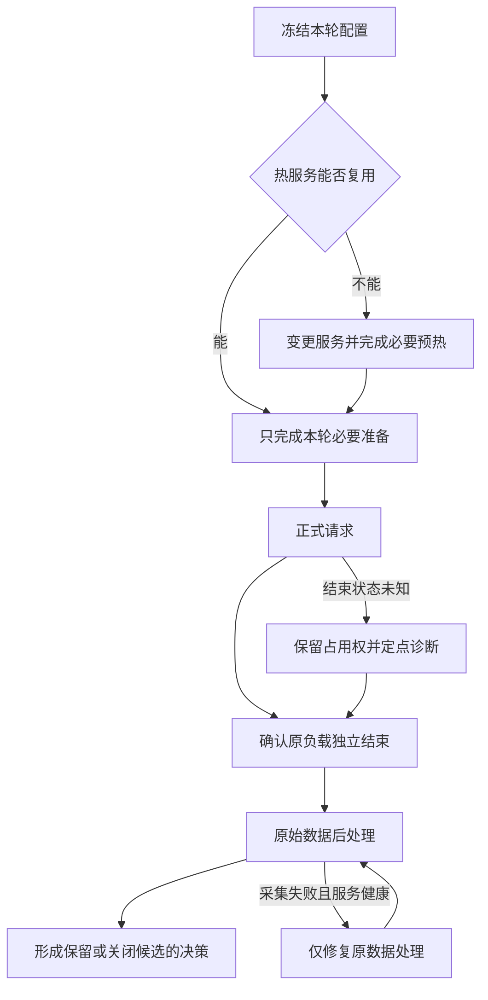

# 推理只跑了三分钟，调优为什么花了几天

一次 DeepSeek-V4-Flash / Ascend 910C 实验流程复盘：时间花在哪里，哪些弯路本可避免，以及怎样让自动化更快地产生可信结论。

最后一轮压测，640 条正式请求跑了约三分钟。它之前的一次纯并发调整，从提出要求到控制器真正启动，却用了接近四分钟。更早的一次服务配置调整，仅准备到冻结就用了 23 分钟，之后还要加载、预热、验证路由，才能开始回答性能问题。

这几天的调优最终得到了可用的性能结果，但过程远没有达到预期的效率。我把大量实验编排交给了 AI 编码代理，原本希望它持续提出候选、执行压测、分析结果，再根据证据选择下一步。实际运行中，代理花了太多时间改入口、补断言、修采集、重复核验；我还需要不断催问它究竟有没有发出请求。

问题值得认真复盘，因为这些时间并不都花在模型上。有些是大模型实验必要的成本，有些来自当时的网络和运行环境，还有相当一部分，是实验工具自身制造的返工。把它们混在一起，就只能得到“模型启动很慢”或者“以后少检查一些”这种没有操作价值的结论。

本文依据 2026 年 10 月 18 日至 21 日保存的阶段计时、失败记录和 AISBench 结果展开。涉及的是当时的本地 SGLang 适配与实验编排工具，不能据此归因于某个上游版本。公开的[数值摘录](../../assets/inference-tuning-workflow-postmortem/measurements.csv)保留了文中时间和性能数据；原始请求、设备日志与内部运行信息没有公开，因此它也不构成完整的性能复现包。

## 一、先算时间账：正式压测之外，机器和人都在做什么

这次实验使用真实的 Prefill / Decode 分离部署，P8+D8，共 16 张物理卡。前半段是 16K 输入、1K 输出、零缓存，后半段切换到 128K 输入、1K 输出、逐条前缀缓存至少 90%。后者还需要独立的缓存预热，以及针对实际场景采集、拟合 P 和 D 的静态专家布局。

因此，一轮实验的时间至少有四部分：候选准备、服务与缓存准备、正式推理、结果收尾。服务准备又可能包含加载、两轮预热、跨 P/D 路由验证与缓存清理。只有明确这些边界，才知道该优化哪里。

| 事件 | 已记录墙时 | 应当怎样理解 |
| --- | ---: | --- |
| 一次 noCP 候选准备到冻结 | 1382.354 秒 | 约 23 分 02 秒，主要暴露编排适配过重，不能归到模型加载 |
| 一次 128K 布局试验：控制器 / 正式推理 | 748.228 / 68.676 秒 | 正式推理约占控制器时间的 9.18% |
| 同轮两轮预热 / 路由验证 | 255.715 / 275.749 秒 | 属于上一行内部阶段；模型此前已加载，不能再称为新增权重加载 |
| 最后一轮 C90：控制器 / 正式推理 | 309.159 / 179.577 秒 | 热测没有新增模型启动、MF 或路由验证 |
| 同轮缓存 seed 与 check | 47.910 秒 | 属于控制器时间，必须与正式测量分开 |

这些行有包含关系，不能相加成“总共浪费了多少小时”。最后一轮控制器比正式窗口多约 129.583 秒，扣除缓存预热后，还有约 81.673 秒没有充分细分。它包括前置检查和收尾，但目前不能证明每一秒都可以省掉。

另一个容易算错的地方是并行时间。缓存 seed 的单请求延迟之和约为 666.857 秒，seed 和 check 的实际并行墙时却只有 47.910 秒。把延迟之和当作流程耗时，会夸大成本；只展示三分钟正式窗口，又会掩盖用户真正等了多久。

这张账首先说明，减少准备成本的价值可能比尝试一个小幅算子优化更直接。不过，它并不支持一刀切取消预热。真正应该追问的是：这一轮究竟改变了什么，哪些准备因此必须重做，哪些已有事实可以直接继承？

## 二、“只改一个参数”，为什么会变成一轮小型开发

最反复的问题，是配置看似参数化，执行链却没有贯通。

一次只改并发数，本应读取同一份数据、复用同一组热服务，把 C 从一个值改为另一个值，然后发出请求。实际却可能发现：启动脚本接受新值，正式入口仍只允许旧值；外层支持 640 条，底层计数器还只接受 160 条；候选布局已经更新，远端 runner 仍断言旧布局的 SHA。每个地方单独看都有“校验”，组合起来却成为互相矛盾的配置来源。

一次旧布局事件尤其典型：新布局已经加载，两轮预热也已通过，正式 runner 才因期待旧 SHA 而退出。那一轮计划中的 640 条正式请求根本没有执行。它说明的是编排合同过期，不能被记录成新布局性能回归，更不应靠重跑模型来修复。

CP 与 DP 的解释也踩过类似的坑。基础脚本写着 DP16，但末尾允许追加参数，实际启动时又覆盖为 DP4 并开启 CP。只把基础脚本发给读者，无法回答“现在到底开没开 CP”。同样，一个全局 chunk 数值，在不同 DP 划分下对应不同的有效工作量；复制旧脚本后只替换 CP 开关，保留旧 chunk 和路由数量，会让一个简单候选逐渐长成一串补丁。

根因不在于需要计算 SHA。计算几个哈希通常不是最大的时间项。问题在于，配置、最终命令、运行身份、采集器和恢复路径各自维护了答案。一个热测 CASE 后来膨胀到约 115KB，冻结清单还关联了数百个文件；这些文件并非都在做重复检查，但它已经很难称为一个轻量参数入口。

更合理的结构，是稳定的执行器读取一份不可变实验配置。配置同时决定本轮负载、实际服务身份、计数需求和结果目录；其它阶段消费它，而不是再次手写 N、C、布局与截止时间。历史实验各自留档，行为代码则尽量共享。

这里的验收条件也应当具体：**下次只改 N、C 或到达速率时，能否直接生成 CASE 并执行，而无需新建控制器、collector 和恢复分支？** 如果仍然需要改一串 Python 文件，参数化就还没有完成。

## 三、检查很多，为什么错误仍在昂贵步骤之后出现

这次流程并不缺检查，缺的是对真实执行边界的覆盖。

AISBench 扩展曾经在直接构造类时通过，真正交给 worker 的 registry 构建却失败；另一次修复把模块对象混入配置，随后在配置 dump 时出错。到了原始稳态统计阶段，又出现子进程无法导入自定义模块：正式推理已经成功，后处理启动时没有继承原 payload 所需的 Python 搜索路径。

这些问题有共同结构。验证走的是父进程里的近路，生产执行走的是“生成配置 → 序列化 → 新进程重载 → registry 构建 → 子进程采集”。近路通过，只能证明近路能走。

因此，增加十个相似的类构造测试，未必比一次真实的 fresh-process reload 更有价值。针对导入问题，后来采用的修复是补齐原后处理环境，再用真实配置重载和禁止网络连接的 CPU 检查验证，最后对原始数据执行一次原 AISBench selector。没有重新发送模型请求，也没有修改原计时点。

G5 启动异常则说明，错误分类也会决定排障速度。最初日志后面出现了异步算子错误，但更早已有容量断言。仅按最后一条错误猜测算子故障，会把调查带偏。实际需要核对的是草稿与验证宽度变化之后，非 Graph 路径的工作量是否超过容量，以及 helper 是否在最终启动前又覆盖回旧值。修复启动顺序和有效容量之后，才有条件重新验证候选；未执行过正式压测的失败，不能叫性能回归。

检查应当更少、更靠近实际失败位置。服务变更前验证最终有效命令、配置重载与恢复路径；N 改变时验证真实目标 N 能通过最底层采集和大小限制；只改 C 时继承未变的 tokenizer、源码和观测逻辑证明。检查的理由应当能回答一句话：**它会阻止哪一种本轮可能发生的错误？** 回答不出来的检查，就不应自动加入关键路径。

## 四、恢复热状态，比重新部署更需要明确边界

多阶段实验最危险的地方，是一个笼统的“失败”覆盖了不同事实。

本地入口在连接远端之前退出，意味着零模型请求；两端已加载、正式负载未发送，是可接续的热状态；请求全部完成而 collector 导入失败，则属于采集问题。三者都可能表现为控制器返回非零，但后续动作完全不同。

如果一律回滚重启，就会把已经支付的加载、预热和路由成本再付一遍。反过来，如果原请求或客户端是否结束仍不清楚，直接发下一轮也可能叠加负载，破坏数据甚至制造故障。

这次曾经为了接续已加载的服务，写出一条 continuation 路径，却因漏掉模式参数，误入旧的预热负载。还有资源窗口已经延长，深层 helper 仍检查旧截止时间，导致接续在发请求前被拒绝。它们再次说明，恢复并不是跳过几行代码；它也是一条需要明确输入、阶段和副作用的执行路径。

更可靠的做法，是记录哪些步骤已经成功，绑定原进程与对应阶段产物，只接未完成部分。单端已启动就尽量保留该端，已完成的预热不重复。未知结束状态时保留唯一 GPU 执行权，等待原始结束证据，而不是另起 watcher 和 collector 争抢同一轮结果。

这个边界也应当限制代理行为。CPU 分析可以与已有实验并行，GPU 压测仍然只有一个 owner。等待 owner 时，不需要另一个代理不断做全量健康扫描。并行的价值来自独立工作提前完成，不能靠增加检查者数量体现。

## 五、有数据，不等于已经回答了性能问题

有几条方向本身合理，却因为结论尺度没控制好，消耗了过多注意力。

首先是接受长度。为测量较长的 AL，我们构造了容易预测的原文复制展示负载，并把草稿长度调整到 5、验证宽度调整到 6。它最终能够得到约 5.5 以上的平均接受长度，但这是有利负载的表现，不能代表通用问答，也不意味着吞吐必然提高。

AL 衡量一轮推进了多长；吞吐还取决于一轮花多久，以及整个 PD 系统能持续供应多少请求。P 侧排队、D 侧没有等待队列，与 decode 本身很快可以同时成立。高 AL 并不能绕过 Prefill、调度、通信和流水线供给。相关机制可以结合[投机解码性能分析](deepseek-v4-speculative-performance-analysis.md)和[Prefill / Decode 性能差异](../fundamentals/prefill-vs-decode-performance.md)阅读。

接受率的分母尤其容易混淆。实际生成的草稿 proposal、送入验证的预算槽、最终输出 token，是不同的量。当前 Compact 路径仍有实际 proposal 分母未观察到的情况，必须标为未采到，不能用 `(AL-1)/草稿长度` 换算成实测严格接受率。ITL 同样不能拿 TPOT 代替，更不能拿它推算 draft 与 verify 的阶段成本。

其次是静态 EPLB。128K、90% 缓存场景应采自己的 P/D 专家分布，不能把 16K 布局称为已经适配。我们确实完成了场景计数与独立拟合，但一次同负载 N160 对照，whole 单卡输出吞吐仅从 147.9064 提高到 149.1070 tok/s，约 0.81%。计数平衡改善与端到端收益并不等价，这个单点差异也不足以证明稳定提升。

Profiling 也有类似风险。某个 rank 的时间线空隙，不等于全机都空闲；一个算子的跨度，不等于可以全部从关键路径上删除。把局部现象直接乘到整机吞吐上，很容易追逐收益上限很小的机会。对于已采集的大文件，更合适的是留在服务器做有界分析，只回传能改变决策的小摘要，避免传输和反复解读本身变成新的瓶颈。

最后，参数负例必须绑定场景。某次 Pcap2 没有收益，不代表所有负载下都应禁用它。后来在复制负载的尾块合批中，增加请求槽确实改善了整体供给。CPU 模拟可以解释批次数为什么减少，却仍需要 NPU 实测确认。反过来，看到 running 没达到请求槽上限，也不能机械加并发，因为 token 预算可能已经限制了批次。

这些例子共同要求：下一轮实验要对应一个尚未回答、而且会改变选择的问题。没有新的瓶颈证据，就不应该用扫描更多参数代替分析；也不应该让旁支分析挡住已经准备好的热测。

## 六、把“跑得更快”与“统计得更好看”分开

最后的 128K / 1K 对照，能说明为什么统计区间也必须进入实验定义。下表是同一套高 AL 复制数据、静态布局与服务配置下的两轮物理 640 请求，配置到达速率均为 6 req/s，区别是并发上限。输入正文为 131072 token，Chat 输入为 131076 token，实际输出固定 1024 token；每条缓存命中均为 118784 / 131076，约 90.6222%。两轮均为 640 成功、0 失败。

| 区间 | 纳入请求数 | 配置 C | 平均系统并发 | TTFT 均值 / P90（ms） | TPOT 均值 / P90（ms） | E2E 均值（s） | 输出总吞吐（tok/s） | 每 PD16 物理卡（tok/s） |
| --- | ---: | ---: | ---: | ---: | ---: | ---: | ---: | ---: |
| C128 whole | 640 | 128 | 112.3225 | 18140.7 / 20323.6 | 11.5 / 12.6 | 29.9064 | 3845.9447 | 240.3715 |
| C90 whole | 640 | 90 | 82.8179 | 12681.9 / 14325.9 | 10.3 / 10.9 | 23.2377 | 3649.4736 | 228.0921 |
| C90 AISBench native | 549 | 90 | 87.4978 | 12250.2 / 13927.3 | 10.4 / 11.0 | 22.8695 | 3917.7796 | 244.8612 |

单卡值按整套 P8+D8 的 16 张物理卡计算。若只除以 D8，会得到另一个值，不能与这里混用。配置的 6 req/s 也不是实测 QPS：C90 whole 为 3.5639 QPS，native 为 3.8260 QPS。

C90 的 native 区间来自原 AISBench selector，持续 143.494 秒，纳入 549 条请求；不是手工挑出最快的请求。它满足这次项目约定的至少 128 条、60 秒的筛选门槛，但这仍不等于证明任意长时间的稳态容量。C128 的 native 后处理当时失败，表中就不补造一个值。

从 whole 看，降低并发使 TTFT 和 E2E 明显下降，输出吞吐却下降约 5.11%。如果只把 C90 native 的 244.8612 与 C128 whole 的 240.3715 放在一起，就会制造“降低并发还能提高吞吐”的错误结论。它们回答的不是同一个统计问题。

C90 whole 的 AL 为 `655360 / 113463 = 5.7760`。这符合展示负载的高 AL 目标，却仍不能补齐缺失的严格 proposal 接受率和阶段 wall time。一个结果可用，不代表所有机制都已经解释清楚。

自动调优首先要保证这些边界稳定，然后才能比较候选。否则，所谓最优配置可能只是换了统计窗口、缓存分母或设备数量之后的数值最大值。

## 七、防止重演，需要把教训变成执行约束

回看这几天，自动化完成了持续实验、场景数据生成、静态布局采集和结果整理，但它没有足够好地管理自己的开销。写出“少做 review”“两分钟准备”之后，下一轮仍然出现硬编码和数分钟等待，说明文字规则还没有转化为可靠能力。

改进应从现有执行器的几个具体边界开始，而不是再造一套更大的自动化框架。

**每轮开始前，先写清一个决策。** 例如“只提高 C，判断当前供给是否仍受并发限制”，或者“只更换 D 布局，比较相同负载下的吞吐”。同时固定数据、缓存、采样、统计区间和保留条件。一次叠加多项改动，可能更快得到一个高分，却会失去后续继续优化的依据。

**把准备、执行和后处理分离，但共用一份状态。** CPU 可以提前准备下一候选和分析已有数据；只有唯一 owner 能发模型请求。后处理默认走同一条已验证路径，失败时修原数据。每个阶段自动记录起止墙时，避免下一次还需要翻大量日志才能解释时间花在哪里。

**对检查采用变更驱动。** 服务源码、布局、拓扑变化，验证最终身份和必要的服务准备；纯 N/C/r 变化，复用热服务与原证明，只检查变化的实际边界。两轮预热用来处理重启后的状态，不应在每个热参数点再次执行；其输入规模也应由需要覆盖的机制决定，不能把历史上的一个长度永远固化成仪式。

**给编排成本设预算，也给超预算设置动作。** 热 CASE 准备以两分钟为目标；超过后记录具体阻断，只修阻断点。这个目标还没有被所有路径稳定实现，不能提前宣称流程已经优化完成。必要的结束确认与占用保护仍要保留，不能为了赶时间让两轮压测重叠。

**用结果验收记忆。** 新会话应先读短交接入口：当前暂停还是运行、最佳配置对应哪个场景、原 owner 是否结束、下一步只做什么。详细事故与证据留在项目文档中，需要时定点查。把几天历史复制进每次自动唤醒的长提示，会增加 token 开销，也容易让旧阶段冒充当前状态。真正有效的传承，是旧坑对应的入口已经修复，下一轮不再要求代理重新理解一遍。

全自动调优的成效，最终应该看单位时间内形成了多少可靠决策、保留了多少可复用的健康状态，以及相同失败是否再次出现。配置数量、检查数量、报告页数，都不能替代这些指标。

这次最值得保留的教训是：实验工具本身也是被优化的系统。模型性能之外，还要测量从提出问题到得到可信答案的时间；否则，推理已经跑完，调优却仍困在自己的流程里。
