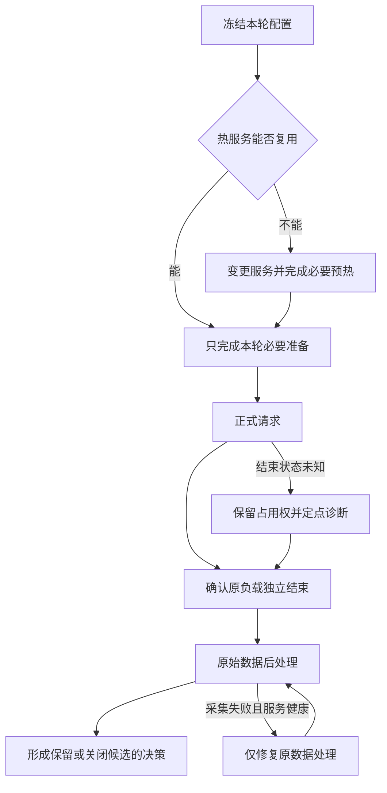

# 让 AI 连续调优几天后，我发现实验流程也有瓶颈

一次 DeepSeek-V4-Flash / Ascend 910C 实验流程复盘：代理一直在改脚本、做检查，正式实验却迟迟没有发出。回头看，这些时间究竟花在了哪里？

这次经历还整理成了两篇方法文章：[下一轮实验怎么选](ai-driven-inference-autotuning-decision-loop.md)，以及[实验怎样执行和收尾](ai-driven-inference-autotuning-execution-and-evidence.md)。

最后一轮压测，640 条正式请求跑了约三分钟。它之前的一次纯并发调整，从提出要求到控制器真正启动，却用了接近四分钟。更早的一次服务配置调整，仅准备到冻结就用了 23 分钟，之后还要加载、预热、验证路由，才能开始回答性能问题。

我把大量实验编排交给了 AI 编码代理，原本希望它持续提出候选、执行压测、分析结果，再根据证据选择下一步。最后确实拿到了可用的性能结果，可中间的等待很难让人满意：代理一直在改入口、补断言、修采集、做核验，我却还在反复问“怎么还没启动啊”。

起初看起来是服务难启动，后来发现，很多时候模型甚至还没收到请求。另一些时候，推理早就成功了，代理仍在修统计程序。真正拖住进度的对象，得从这一轮究竟走到了哪一步查起。

下面按 2026 年 10 月 18 日至 21 日保存的阶段计时和失败记录，挑几件反复发生的事展开。文中用到的时间与性能数据放在这份[数值摘录](../../assets/inference-tuning-workflow-postmortem/measurements.csv)中。

## 一、先算时间账：正式压测之外，机器和人都在做什么

这次实验使用真实的 Prefill / Decode 分离部署，P8+D8，共 16 张物理卡。前半段是 16K 输入、1K 输出、零缓存，后半段切换到 128K 输入、1K 输出、逐条前缀缓存至少 90%。后者还需要独立的缓存预热，以及针对实际场景采集、拟合 P 和 D 的静态专家布局。

因此，一轮实验的时间至少有四部分：候选准备、服务与缓存准备、正式推理、结果收尾。服务准备又可能包含加载、两轮预热、跨 P/D 路由验证与缓存清理。只有明确这些边界，才知道该优化哪里。

| 事件 | 已记录墙时 | 应当怎样理解 |
| --- | ---: | --- |
| 一次 noCP 候选准备到冻结 | 1382.354 秒 | 约 23 分 02 秒，主要暴露编排适配过重，不能归到模型加载 |
| 一次 128K 布局试验：控制器 / 正式推理 | 748.228 / 68.676 秒 | 正式推理约占控制器时间的 9.18% |
| 同轮两轮预热 / 路由验证 | 255.715 / 275.749 秒 | 属于上一行内部阶段；模型此前已加载 |
| 最后一轮 C90：控制器 / 正式推理 | 309.159 / 179.577 秒 | 热测没有新增模型启动、MF 或路由验证 |
| 同轮缓存 seed 与 check | 47.910 秒 | 正式测量之前的缓存准备，包含在控制器时间里 |

最后一轮控制器比正式窗口多约 129.583 秒。其中，缓存预热占了 47.910 秒，余下约 81.673 秒分布在前置检查和收尾。现有日志还没有把这部分拆细，这也是流程留下的一笔糊涂账。表中的几个阶段又互相包含，所以这里只逐项看成本，不估算一个“总浪费时长”。

另一个容易算错的地方是并行时间。缓存 seed 的单请求延迟之和约为 666.857 秒，seed 和 check 的实际并行墙时却只有 47.910 秒。把延迟之和当作流程耗时，会夸大成本；只展示三分钟正式窗口，又会掩盖用户真正等了多久。

看到这张账，再去追一个收益很小的算子机会就显得不着急了。先缩短准备流程，更有机会节省时间。具体从哪里省，要看这一轮改了什么：重启后的预热有作用，只改并发时重复预热，就是另一回事。

## 二、“只改一个参数”，为什么会变成一轮小型开发

最反复的问题，是每次说“复用上一轮”，最后都变成了修改上一轮的脚本。

一次只改并发数，本应读取同一份数据、复用同一组热服务，把 C 从一个值改为另一个值，然后发出请求。实际却可能发现：启动脚本接受新值，正式入口仍只允许旧值；外层支持 640 条，底层计数器还只接受 160 条；候选布局已经更新，远端 runner 仍断言旧布局的 SHA。每个地方单独看都有“校验”，组合起来却成为互相矛盾的配置来源。

一次旧布局事件尤其典型：新布局已经加载，两轮预热也已通过，正式 runner 才因期待旧 SHA 而退出。计划中的 640 条正式请求一条都没发出去。时间已经花了，性能问题却完全没有得到回答；需要修的是 runner 里的旧配置，热服务本来可以留下来。

CP 与 DP 的解释也踩过类似的坑。基础脚本写着 DP16，但末尾允许追加参数，实际启动时又覆盖为 DP4 并开启 CP。只把基础脚本发给读者，无法回答“现在到底开没开 CP”。同样，一个全局 chunk 数值，在不同 DP 划分下对应不同的有效工作量；复制旧脚本后只替换 CP 开关，保留旧 chunk 和路由数量，会让一个简单候选逐渐长成一串补丁。

继续追下去，发现配置、最终命令、运行身份、采集器和恢复路径各自维护了一份答案。修好一处，另一处还可能是旧值。一个热测 CASE 后来膨胀到约 115KB，冻结清单还关联了数百个文件。计算哈希本身通常只占很短时间，真正麻烦的是每次变更都要重新理清这些旧约定。

为什么代理总在复制？已有脚本至少完整跑过一次，拿来改几个值，很容易得到一个局部可用的版本。问题是被一起复制的还有旧布局、旧请求数和旧恢复分支。候选越来越多，脚本之间的差别也越来越难解释。下一轮为了确认自己没改错，代理又得读更多文件、增加更多检查。

这让我意识到，给代理修改整套工具的能力，还得配一个稳定的实验入口。只调整并发时，它理应交出一份参数配置；现在却经常顺手承担了控制器开发。机器在等一个性能实验，代理做的却是一轮软件适配。

我希望下一轮能收敛成一个更简单的动作：执行器读取一份冻结的实验配置，后面的负载、计数和报告都从这里取值。N、C、布局与截止时间只写一处。历史结果继续各自留档，执行代码则共用。

这个改动有没有用，下次只改 N、C 或到达速率就能看出来。如果仍然要新建控制器、改 collector，再修恢复分支，那么所谓参数化只是把硬编码换了位置。

## 三、检查很多，为什么错误仍在昂贵步骤之后出现

这次流程并不缺检查，缺的是对真实执行边界的覆盖。

AISBench 扩展曾经在直接构造类时通过，真正交给 worker 的 registry 构建却失败；另一次修复把模块对象混入配置，随后在配置 dump 时出错。到了原始稳态统计阶段，又出现子进程无法导入自定义模块：正式推理已经成功，后处理启动时没有继承原 payload 所需的 Python 搜索路径。

这些问题有共同结构。验证走的是父进程里的近路，生产执行走的是“生成配置 → 序列化 → 新进程重载 → registry 构建 → 子进程采集”。近路通过，只能证明近路能走。

检查越积越多，也与前面的失败有关。某个错误暴露得晚，就补一条断言；下一次又把这条断言随旧脚本带过去。于是我们既承担了检查的时间，又得修检查自身的适用条件。最初想防住的风险还在，流程却更难启动了。

因此，增加十个相似的类构造测试，未必比一次真实的 fresh-process reload 更有价值。针对导入问题，后来采用的修复是补齐原后处理环境，再用真实配置重载和禁止网络连接的 CPU 检查验证，最后对原始数据执行一次原 AISBench selector。没有重新发送模型请求，也没有修改原计时点。

G5 启动时还有一次误导性很强的报错。日志后面出现了异步算子错误，前面却已经有容量断言。沿着第一处失败查，才发现草稿和验证宽度变化以后，非 Graph 路径的工作量会超过旧容量；外层改过的容量又被 helper 覆盖了回去。修复启动顺序和最终容量后，候选才真正跑起来。此前那轮连正式压测都没走到，性能自然无从比较。

这些经历让我更在意检查放在哪里。改服务，就在启动前看最终命令和配置重载；改 N，就走到最底层采集器，看数量和大小限制；只改 C，原来已经验证过的 tokenizer 和观测代码直接复用。增加一项检查之前，先说清它能提前发现什么。这样留下的检查会少一些，却更接近真正出过问题的位置。

## 四、恢复热状态，比重新部署更需要明确边界

多阶段实验最危险的地方，是一个笼统的“失败”覆盖了不同事实。

本地入口在连接远端之前退出，意味着零模型请求；两端已加载、正式负载未发送，是可接续的热状态；请求全部完成而 collector 导入失败，则属于采集问题。三者都可能表现为控制器返回非零，但后续动作完全不同。

如果一律回滚重启，就会把已经支付的加载、预热和路由成本再付一遍。反过来，如果原请求或客户端是否结束仍不清楚，直接发下一轮也可能叠加负载，破坏数据甚至制造故障。

为了接续已加载的服务，这次还写过一条 continuation 路径。结果漏掉模式参数，又发出了旧的预热负载。另一次，资源窗口已经延长，深层 helper 还拿旧截止时间做判断，接续在发请求前就停了。原本是想省掉重启，最后又多出一轮修脚本。

后处理失败的那次，正确的恢复范围其实很小：补齐子进程导入环境，处理原数据。后来也正是这样拿到了 native 结果。只是控制器最初把整段工作包在一个总退出码里，“推理完成”和“报告完成”没有分开，代理才需要临时翻日志重新判断。

恢复流程需要知道前面已经完成了什么：哪一端启动了，预热做到哪一轮，正式请求有没有发出。接续从这些记录出发，才能保住已经花掉的机器时间。如果原负载是否结束还不清楚，就先保留 GPU 占用，查原进程和结束文件；另起 watcher 或 collector，只会多出几个互相竞争的判断者。

CPU 分析可以在这期间准备下一候选，GPU 压测则由一个 owner 负责。这样，当前实验结束时，下一步的数据和分析已经就绪。相比之下，几个代理一起反复扫健康状态，看起来很忙，实际没有缩短任何依赖。

## 五、开了多个代理，实验为什么还是在等

实验进行时，确实有适合并行的事：一边等模型加载，一边准备下一组数据；一边跑正式请求，一边分析已经结束的结果。这些工作交给不同代理，能提前拿到独立产物。

但有几次，准备任务虽然分出去了，最后却还在串行等待。一个原因是工作没有拆清：多个代理都在审同一份配置，根代理还要把几份意见重新合起来。另一个原因是多人写同一个 CASE 或冻结清单，某处刚计算完哈希，文件又被另一个写者更新，前置检查于是拒绝执行。

还有一次更简单：给已经结束的子代理发了普通消息，以为任务已经继续，实际调用并没有唤醒它。等待的那段时间，没有计算，也没有实验，只是在等一个尚未触发的任务。

这几件事都发生在模型之外。增加代理数量，解决不了共享文件的写入顺序，也解决不了没有真正发出的任务。后来约定独立产物各自一名写者，写完交接停止，再由根代理做最终绑定与冻结。这个顺序有点像代码合并：前面可以并行，最后生成执行版本时得有人负责。

GPU 这边则保留一个 owner。已有控制器在运行，根代理再去反复扫全量健康状态，通常只是多查了一遍相同事实。如果当前没有异常，等原进程和原产物更直接；空出的 CPU 工作去准备下一轮，才有机会缩短整个队列。

## 六、为什么我说了很多次“快一点”，流程还是没变

“少做 review”“复用热服务”“准备两分钟”，这些话都说过，也写进了规则。可下一轮仍然会遇到旧断言和新的薄适配器。回头看，要求变了，入口却没怎么变：一个新参数仍然需要代理读许多历史文件，临时判断哪段代码该改。

自然语言规则能提醒方向，却没有给执行器增加一个已经验证过的 C 参数，也没有消除 collector 深处的 N 白名单。代理读完“不要重复核验”，仍要在一条陌生、易变的执行链上决定哪些步骤能省。结果常常是再读一轮，再补几项检查。

提示越长，这个问题还会加重。我们为了交接，把旧阶段、旧进程和各种失败条件不断带进下一轮。新会话于是花更多时间分辨哪些话仍有效。一个历史 PENDING 标签甚至会盖住已经完成的结果，让代理重新调查本来已经闭合的事情。

看起来完成了很多工作，也不一定在接近性能目标。静态布局拟合成功是一项产物，真正要看的吞吐还得对照；AL 达到 5.5，整套 PD 仍可能受 Prefill 供给影响。128K、90% 缓存场景专属布局的一次 N160/C64、6 req/s 对照，whole 单卡输出只从 147.9064 提到 149.1070 tok/s，约 0.81%。这时先放下布局、找更大的时间开销，比继续围着拟合结果打转更合适。

指标窗口也会改变表面的进展。在相同 128K 复制数据、物理 640 请求、配置 6 req/s、逐条缓存约 90.6222% 下，C128 的 whole 吞吐是 240.3715，C90 是 228.0921 tok/s/PD16 卡，后者等待更短，整轮吞吐约低 5.11%。C90 自己的 native 又达到 244.8612。只挑最大数字拼起来，代理很容易交出一份“持续提高”的报告，却解释不了下一轮该选哪套配置。

我真正需要的进度是：已经发出了吗，原请求结束了吗，这个结果改变了哪个选择。规则文件、检查回执和漂亮的统计表都可以辅助回答，但它们本身没有回答这些问题。

## 七、防止重演，需要把教训变成执行约束

这几天的自动化做成了不少事，准备时间却始终没有像模型性能那样被认真测量。真正需要继续改的，是代理每次都要重新理解、重新判断的那部分执行流程。

接下来我更想先修现有入口。再造一个大框架，很可能又把时间花在编排本身。

先收紧参数变更的范围。只提高 C，就让执行器从 CASE 读取 C，运行相同的负载和采集路径。某个底层入口还不支持，就修这个共用入口，别再复制一个只服务于 C90 的控制器。这个改动落到代码里，下次 C96 才有机会直接走通。

再把已完成的工作写成可以接续的状态。正式负载已经结束，后处理失败就接原数据；某端已加载，另一端需要修复就尽量保留已成功的一端。开始与结束时间跟阶段一起记，既能恢复，也能看出等待花在了哪里。

检查跟着变更走。服务源码、布局或拓扑变化了，再验证相应路径；纯 N/C/r 变化就复用热服务。两轮预热留给重启后的状态准备，输入规模则按要覆盖的机制选择。过去某次用过一个长度，后面每次都照抄，是我们自己把步骤固化了。

热 CASE 准备暂时以两分钟为目标。超时就把卡点写出来，只修这一处。目前还没有稳定做到，这个数字更像一条提醒：又开始扩范围时，该停下来看看了。原负载的结束确认仍然要做，否则省下几秒，可能换来两轮重叠和一整份不可用结果。

让代理汇报时，也改成几项实际状态：当前阶段，是否已发模型请求，阻断是什么，是否会新增启动与预热。普通等待安静一点，有新故障就直接说失败点。这样我看到“还在准备”时，至少能知道是在生成新数据，还是又卡在旧脚本里。

换会话时，先给一个短入口：当前暂停还是运行，最佳配置属于哪个场景，原 owner 有没有结束，下一步做什么。详细事故留在项目文档，遇到相同问题再查。几天历史反复塞进提示，既费 token，又会让旧状态冒出来。入口真的修好、下一轮直接走通，比“已经记住”更有说服力。

下一轮我会更关心几个很直接的结果：要求提出后多久发出了实验，已经完成的步骤有没有重复，报告能否一次交齐，同一种错误有没有再发生。

这次最值得保留的教训是：实验工具本身也是被优化的系统。模型性能之外，还要测量从提出问题到得到可信答案的时间；否则，推理已经跑完，调优却仍困在自己的流程里。
