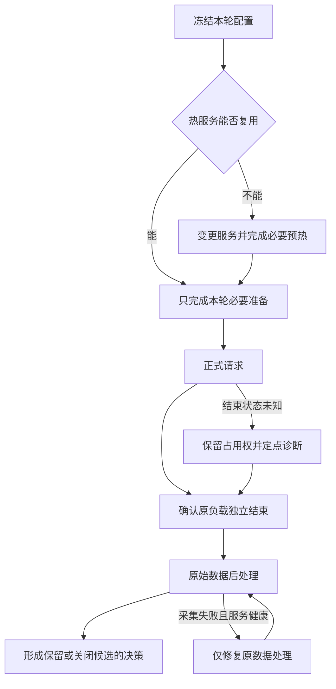

# 让 AI 连续调优几天后，我发现实验流程也有瓶颈

这次调 DeepSeek-V4-Flash、Ascend 910C 时，我遇到过一种很耗时间的情况：代理一直在改脚本、做检查，正式请求却迟迟没有发出。把各阶段的记录摊开后，才发现相当一部分等待来自实验工具本身。

这次经历还整理成了两篇方法文章：[下一轮实验怎么选](ai-driven-inference-autotuning-decision-loop.md)，以及[实验怎样执行和收尾](ai-driven-inference-autotuning-execution-and-evidence.md)。

最后一轮 640 条正式请求只跑了约三分钟。相比之下，之前一次只改并发的实验，从提出变更到控制器启动就接近四分钟；更早一次服务配置从准备到冻结用了 23 分钟，之后还要加载、预热、验证路由，才轮到正式测量。

我原本希望编码代理连续提出候选、压测、分析，再决定下一轮。最终拿到了可用结果，中间却反复改入口、补断言、修采集，我仍得问“怎么还没启动啊”。

同样一句“还没跑完”，背后的状态可能完全不同：有时模型根本没收到请求，有时推理已经结束，只剩统计脚本在修。先确认已经走完哪些阶段，才能判断下一步该处理服务、入口还是结果采集。

下面使用 2026 年 10 月 18—21 日的阶段计时与失败记录，数值保存于[摘录](../../assets/inference-tuning-workflow-postmortem/measurements.csv)。

## 一、先算时间账：正式压测之外，机器和人都在做什么

这次使用真实 PD，P8+D8，共 16 张物理卡。前期场景为 16K/1K、零缓存，后期改为 128K/1K，并要求每条请求至少命中 90% 缓存。后者还需要准备缓存，按实际负载采集并拟合 P/D 静态布局。

为了看清时间花在哪里，我把候选准备、服务与缓存准备、正式推理、收尾分别记录。加载、两轮预热、路由验证和清缓存有时已经包含在服务阶段内，统计时还要辨明包含关系，避免重复相加。

| 事件 | 已记录墙时 | 应当怎样理解 |
| --- | ---: | --- |
| 一次 noCP 候选准备到冻结 | 1382.354 秒 | 约 23 分 02 秒，主要暴露编排适配过重，不能归到模型加载 |
| 一次 128K 布局试验：控制器 / 正式推理 | 748.228 / 68.676 秒 | 正式推理约占控制器时间的 9.18% |
| 同轮两轮预热 / 路由验证 | 255.715 / 275.749 秒 | 属于上一行内部阶段；模型此前已加载 |
| 最后一轮 C90：控制器 / 正式推理 | 309.159 / 179.577 秒 | 热测没有新增模型启动、MF 或路由验证 |
| 同轮缓存 seed 与 check | 47.910 秒 | 正式测量之前的缓存准备，包含在控制器时间里 |

最终 C90 的控制器总耗时比正式推理多约 129.583 秒，其中缓存准备占 47.910 秒，其余约 81.673 秒分布在前置与收尾阶段，日志没有进一步拆开。这部分值得继续查，但表中有些阶段相互包含，不能把每一行相加后统称为浪费。

seed 阶段的逐请求延迟相加约 666.857 秒，seed/check 并行执行的墙时却只有 47.910 秒。前者不能当作流程耗时；反过来，只报三分钟正式推理，也会遗漏我实际经历的准备与收尾等待。

这组时间账让我把流程准备放到了更高优先级。不过，哪些步骤可以省，仍要看本轮变更：服务重启后的预热有作用，只改 C、复用热服务时，再做同样的预热就可能重复。

## 二、“只改一个参数”，为什么会变成一轮小型开发

最反复的情形是，名义复用上一轮，实际又改写了一份旧脚本。

只改 C 时，本应复用数据和热服务，却先后遇到入口只接受旧 C、外层计划 640 条而底层只允许 160 条、布局已经替换而 runner 仍断言旧 SHA。多处校验各自保存了一份配置，组合起来反而互相冲突。

在旧布局 SHA 那次故障中，候选已经加载，并通过两轮预热，runner 才因旧断言退出。计划的 640 条正式请求一条也没有发出，所以当时还没有性能结果。合理的接续动作是修正断言、保住热状态，而不是把它当成性能退化再回滚。

还有一次，DP16 被后面追加的参数覆盖成 DP4/CP。全局 chunk 会随 DP 折算，不检查最终命令，就无法解释真正执行的形状。复制旧配置时若只换 CP，却保留旧 chunk 与路由数，后续又得增加适配分支。

配置、命令、身份校验、collector 和恢复入口各有旧约定，改过一处仍可能漏掉另一处。后来热 CASE 约有 115KB，冻结清单关联数百个文件。计算哈希本身很快，真正耗时的是重新梳理这些约定。

复制已成功入口，短期容易得到可用候选，却同时复制了旧布局、N 与恢复逻辑。下一轮差异更难理解，代理于是读更多文件、再增加检查，准备继续变重。

所以我需要稳定入口来限制改动。纯并发调整应提交参数，而不是临时开发整套控制器，否则机器等压测，代理仍在软件适配。

我希望后续由执行器读取冻结 CASE，让负载、计数和报告都从同一处取得 N/C、布局和截止时间。历史结果独立归档，执行代码则继续共用。

是否真的参数化，可以在下一次 N/C/r 变更直接检验。若仍新建控制器、改 collector 及恢复，硬编码只是换了位置。

## 三、检查很多，为什么错误仍在昂贵步骤之后出现

检查数量不少，实际 worker 和子进程路径却没有被覆盖。

AIS 扩展曾在父进程中构造成功，到了 worker 的 registry 才失败；另一次则把模块对象混入配置，序列化时无法 dump。还有一轮推理已经完成，native 统计子进程却因没有继承 payload 搜索路径而导入失败。

真正的执行路径包括配置生成、序列化、新进程重载、registry 查找和结果采集，先前的检查却绕过了其中几步。只在父进程里构造成功，无法证明 worker 和采集子进程也能走通。

每次晚失败便补断言，下一次又随旧脚本复制。于是既花时间检查，还要修断言适用范围，原风险却未消失。

针对导入问题，后续补齐了子进程所需环境，执行真实配置重载与禁止网络的 CPU 检查，再用原 selector 处理原数据。整个修复没有重发模型请求，也没有改变计时。相比再次验证父进程构造，这项检查覆盖了真正失败的位置。

G5 启动时，后部异步算子错误一度掩盖了更早的容量断言。Draft/Verify 扩大后，非 Graph 路径的工作量超过旧容量，helper 又覆盖了外层设置。修正最终容量与设置顺序后，服务才成功启动；此前的失败都发生在正式性能测量之前。

因此我更关心检查的落点。服务变更核最终命令和重载，N 变更查底层数量/大小，纯 C 复用已验证 tokenizer 与 observer。每项检查都应说明能提前发现哪种问题。

## 四、恢复热状态，比重新部署更需要明确边界

恢复时，先将笼统失败拆成已经发生的事实。

本地入口退出，可能意味着没有发过模型请求；两端已经加载、正式请求尚未发出，则可能留下可接续的热状态；推理完成后 collector 才失败，往往只需修采集。它们可能给出相同的总退出码，恢复动作却不应相同。

统一回滚会重复加载、预热和路由；状态未知时直接加新负载，则可能造成重叠。因此保留与接续都需要原任务的结束证据。

continuation 入口自己也出过问题：漏传模式后误发旧预热，资源期限已经延长，却又被深层保留的旧截止时间拒绝。原本想省一次重启，最后仍增加了修入口的成本。

开头的 native 故障后来只补子进程导入、读原数据就解决。最初没有分开记录推理完成与报告完成，才需要临时翻日志重建状态。

恢复时需要核对哪一端已加载、做过哪轮预热、正式请求是否发出。原任务是否结束还不清楚，就保留占用，继续查原进程和产物；另起一份 watcher 或 collector，既不能补上结束证据，还可能造成竞争。

CPU 可以在这时准备下一候选，设备任务仍由唯一 owner 执行。几名代理重复扫描同一组健康状态，没有缩短实验依赖；让它们准备彼此独立的产物，才可能提前下一步。

## 五、开了多个代理，实验为什么还是在等

加载时备数据、正式时处理已结束结果，确实可并行，并能提前交付独立产物。

实际也出现过任务拆出去后仍串行等待的情况。多个代理审同一份配置，根代理还得重新合并结论；多人同时改 CASE 或冻结清单，又会让刚算好的哈希失效。

有一次，普通消息被发给了已经结束的子代理，却没有真正重新派发任务。后续等待期间没有计算或实验在运行，等的其实是一个尚未触发的任务。

增加代理不能解决共享写入或任务派发。后来明确每产物一位写者，完成后交接停止，再由根代理绑定和冻结，保持执行版本确定。

设备执行仍只有一个 owner。控制器正常运行时，根代理跟踪原进程与产物即可，不必再重复全量健康检查；空余 CPU 可以用于独立的后续准备。

## 六、为什么我说了很多次“快一点”，流程还是没变

“少做 review”“复用热服务”“准备两分钟”都写过，入口却继续依赖旧适配，新参数仍需读大量历史并临时决定改哪里。要求并未自动变成可执行能力。

规则无法直接消除 collector 白名单，也没有为执行器新增已验证 C 入口。在陌生易变流程上，代理仍难判断哪些可省，因而继续读、继续补检查。

提示里逐轮堆入旧阶段、PID 和失败条件，也增加了重新辨认状态的成本。历史 PENDING 甚至会盖过后来已经完成的结果，让新会话再查一遍已解决的问题。

实验产物也要回到目标上判断。布局拟合成功、AL 达到 5.5，都不能单独保证 PD 吞吐提高。在 128K 高缓存的 N160/C64/r6 布局配对中，whole 吞吐由 147.9064 提到 149.1070 tok/s/卡，约 0.81%。这次变化很小，继续寻找更大的开销，比只看拟合结果更有价值。

统计窗口还可能把取舍写成进步。同一份 128K 数据复制、N640/r6、逐条缓存 90.6222% 的对照中，C128 的 whole 为 240.3715 tok/s/卡，C90 为 228.0921。C90 的等待较短，整轮吞吐却低约 5.11%。如果拿 C90 的 native 244.8612 与前者的 whole 混比，就会得出相反结论。

我更需要知道正式是否发出、原请求是否结束、结果改变哪个选择。回执和表格应回答这些问题，而不只说明代理做了多少工作。

## 七、防止重演，需要把教训变成执行约束

这几天取得了性能结果，却没有同样认真测量准备。接下来要减少的是每次重新理解和临时判断流程的时间。

我倾向先修现有入口，而非再造大框架，避免又在编排上增加投入。

纯 C 由执行器从 CASE 读取，继续同一负载和采集。底层不支持就修共享入口，而非再复制 C90 控制器，才能让后续 C96 直接复用。

同时记录可接续阶段：推理完成便处理原数据，单端成功便保留该端。阶段开始结束既支持恢复，也能定位时间去向。

检查按变更选择，源码、布局、拓扑变化才验证相应路径，纯 N/C/r 保持热服务。重启预热与覆盖机制所需输入另外安排，不将某次历史长度固定为每轮步骤。

我把热 CASE 的准备目标暂定为两分钟，目前尚未稳定做到。超时后应指出具体卡点，只修相关入口。原负载是否结束仍必须确认，否则省下几秒准备，可能换来两轮负载重叠。

进度报告需要写清当前阶段、正式请求是否发出、卡在哪里，以及这轮新增了哪些启动和预热成本。等待没有变化时可以安静；出现新故障则及时说明，让我能分辨是在准备新数据，还是又在修旧入口。

跨会话先读短入口，确认暂停状态、场景最佳配置、owner 和下一步。事故按需查项目文档，避免反复携带旧状态。入口修好、下一轮走通，才证明教训落实。

下一轮我会继续看提出到发出的时间、已完成步骤是否重复、报告是否一次交齐，以及相同错误是否复发。

正式推理时间之外，还应量从提出问题到取得可靠结果的全程。只有把实验流程也计入成本，才能判断自动化到底省下了多少等待。
