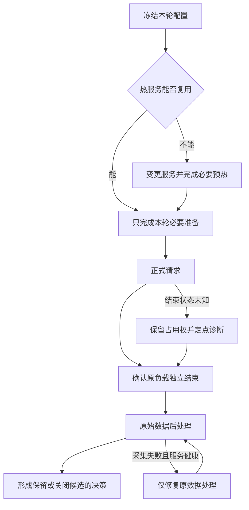

# 推理只跑了三分钟，调优为什么花了几天

一次 DeepSeek-V4-Flash / Ascend 910C 实验流程复盘：时间花在哪里，哪些弯路本可避免，以及怎样让自动化更快地产生可信结论。

这次经历还整理成了两篇方法文章：[下一轮实验怎么选](ai-driven-inference-autotuning-decision-loop.md)，以及[实验怎样执行和收尾](ai-driven-inference-autotuning-execution-and-evidence.md)。

最后一轮压测，640 条正式请求跑了约三分钟。它之前的一次纯并发调整，从提出要求到控制器真正启动，却用了接近四分钟。更早的一次服务配置调整，仅准备到冻结就用了 23 分钟，之后还要加载、预热、验证路由，才能开始回答性能问题。

这几天的调优最终得到了可用的性能结果，但过程远没有达到预期的效率。我把大量实验编排交给了 AI 编码代理，原本希望它持续提出候选、执行压测、分析结果，再根据证据选择下一步。实际运行中，代理花了太多时间改入口、补断言、修采集、重复核验；我还需要不断催问它究竟有没有发出请求。

问题值得认真复盘，因为这些时间并不都花在模型上。有些是大模型实验必要的成本，有些来自当时的网络和运行环境，还有相当一部分，是实验工具自身制造的返工。把它们混在一起，就只能得到“模型启动很慢”或者“以后少检查一些”这种没有操作价值的结论。

回看 2026 年 10 月 18 日至 21 日的阶段计时、失败记录和 AISBench 结果，最突出的问题集中在本地实验编排：同一配置有几处副本，恢复流程不知道前面已经做完什么，采集错误又拖住了已经成功的实验。文中用到的时间和性能数据整理在这份[数值摘录](../../assets/inference-tuning-workflow-postmortem/measurements.csv)中。

## 一、先算时间账：正式压测之外，机器和人都在做什么

这次实验使用真实的 Prefill / Decode 分离部署，P8+D8，共 16 张物理卡。前半段是 16K 输入、1K 输出、零缓存，后半段切换到 128K 输入、1K 输出、逐条前缀缓存至少 90%。后者还需要独立的缓存预热，以及针对实际场景采集、拟合 P 和 D 的静态专家布局。

因此，一轮实验的时间至少有四部分：候选准备、服务与缓存准备、正式推理、结果收尾。服务准备又可能包含加载、两轮预热、跨 P/D 路由验证与缓存清理。只有明确这些边界，才知道该优化哪里。

| 事件 | 已记录墙时 | 应当怎样理解 |
| --- | ---: | --- |
| 一次 noCP 候选准备到冻结 | 1382.354 秒 | 约 23 分 02 秒，主要暴露编排适配过重，不能归到模型加载 |
| 一次 128K 布局试验：控制器 / 正式推理 | 748.228 / 68.676 秒 | 正式推理约占控制器时间的 9.18% |
| 同轮两轮预热 / 路由验证 | 255.715 / 275.749 秒 | 属于上一行内部阶段；模型此前已加载 |
| 最后一轮 C90：控制器 / 正式推理 | 309.159 / 179.577 秒 | 热测没有新增模型启动、MF 或路由验证 |
| 同轮缓存 seed 与 check | 47.910 秒 | 正式测量之前的缓存准备，包含在控制器时间里 |

最后一轮控制器比正式窗口多约 129.583 秒。其中，缓存预热占了 47.910 秒，余下约 81.673 秒分布在前置检查和收尾。现有日志还没有把这部分拆细，这也是流程留下的一笔糊涂账。表中的几个阶段又互相包含，所以这里只逐项看成本，不估算一个“总浪费时长”。

另一个容易算错的地方是并行时间。缓存 seed 的单请求延迟之和约为 666.857 秒，seed 和 check 的实际并行墙时却只有 47.910 秒。把延迟之和当作流程耗时，会夸大成本；只展示三分钟正式窗口，又会掩盖用户真正等了多久。

看到这张账，再去追一个收益很小的算子机会就显得不着急了。先缩短准备流程，更有机会节省时间。具体从哪里省，要看这一轮改了什么：重启后的预热有作用，只改并发时重复预热，就是另一回事。

## 二、“只改一个参数”，为什么会变成一轮小型开发

最反复的问题，是配置看似参数化，执行链却没有贯通。

一次只改并发数，本应读取同一份数据、复用同一组热服务，把 C 从一个值改为另一个值，然后发出请求。实际却可能发现：启动脚本接受新值，正式入口仍只允许旧值；外层支持 640 条，底层计数器还只接受 160 条；候选布局已经更新，远端 runner 仍断言旧布局的 SHA。每个地方单独看都有“校验”，组合起来却成为互相矛盾的配置来源。

一次旧布局事件尤其典型：新布局已经加载，两轮预热也已通过，正式 runner 才因期待旧 SHA 而退出。计划中的 640 条正式请求一条都没发出去。时间已经花了，性能问题却完全没有得到回答；需要修的是 runner 里的旧配置，热服务本来可以留下来。

CP 与 DP 的解释也踩过类似的坑。基础脚本写着 DP16，但末尾允许追加参数，实际启动时又覆盖为 DP4 并开启 CP。只把基础脚本发给读者，无法回答“现在到底开没开 CP”。同样，一个全局 chunk 数值，在不同 DP 划分下对应不同的有效工作量；复制旧脚本后只替换 CP 开关，保留旧 chunk 和路由数量，会让一个简单候选逐渐长成一串补丁。

继续追下去，发现配置、最终命令、运行身份、采集器和恢复路径各自维护了一份答案。修好一处，另一处还可能是旧值。一个热测 CASE 后来膨胀到约 115KB，冻结清单还关联了数百个文件。计算哈希本身通常只占很短时间，真正麻烦的是每次变更都要重新理清这些旧约定。

我希望下一轮能收敛成一个更简单的动作：执行器读取一份冻结的实验配置，后面的负载、计数和报告都从这里取值。N、C、布局与截止时间只写一处。历史结果继续各自留档，执行代码则共用。

这个改动有没有用，下次只改 N、C 或到达速率就能看出来。如果仍然要新建控制器、改 collector，再修恢复分支，那么所谓参数化只是把硬编码换了位置。

## 三、检查很多，为什么错误仍在昂贵步骤之后出现

这次流程并不缺检查，缺的是对真实执行边界的覆盖。

AISBench 扩展曾经在直接构造类时通过，真正交给 worker 的 registry 构建却失败；另一次修复把模块对象混入配置，随后在配置 dump 时出错。到了原始稳态统计阶段，又出现子进程无法导入自定义模块：正式推理已经成功，后处理启动时没有继承原 payload 所需的 Python 搜索路径。

这些问题有共同结构。验证走的是父进程里的近路，生产执行走的是“生成配置 → 序列化 → 新进程重载 → registry 构建 → 子进程采集”。近路通过，只能证明近路能走。

因此，增加十个相似的类构造测试，未必比一次真实的 fresh-process reload 更有价值。针对导入问题，后来采用的修复是补齐原后处理环境，再用真实配置重载和禁止网络连接的 CPU 检查验证，最后对原始数据执行一次原 AISBench selector。没有重新发送模型请求，也没有修改原计时点。

G5 启动时还有一次误导性很强的报错。日志后面出现了异步算子错误，前面却已经有容量断言。沿着第一处失败查，才发现草稿和验证宽度变化以后，非 Graph 路径的工作量会超过旧容量；外层改过的容量又被 helper 覆盖了回去。修复启动顺序和最终容量后，候选才真正跑起来。此前那轮连正式压测都没走到，性能自然无从比较。

这些经历让我更在意检查放在哪里。改服务，就在启动前看最终命令和配置重载；改 N，就走到最底层采集器，看数量和大小限制；只改 C，原来已经验证过的 tokenizer 和观测代码直接复用。增加一项检查之前，先说清它能提前发现什么。这样留下的检查会少一些，却更接近真正出过问题的位置。

## 四、恢复热状态，比重新部署更需要明确边界

多阶段实验最危险的地方，是一个笼统的“失败”覆盖了不同事实。

本地入口在连接远端之前退出，意味着零模型请求；两端已加载、正式负载未发送，是可接续的热状态；请求全部完成而 collector 导入失败，则属于采集问题。三者都可能表现为控制器返回非零，但后续动作完全不同。

如果一律回滚重启，就会把已经支付的加载、预热和路由成本再付一遍。反过来，如果原请求或客户端是否结束仍不清楚，直接发下一轮也可能叠加负载，破坏数据甚至制造故障。

为了接续已加载的服务，这次还写过一条 continuation 路径。结果漏掉模式参数，又发出了旧的预热负载。另一次，资源窗口已经延长，深层 helper 还拿旧截止时间做判断，接续在发请求前就停了。原本是想省掉重启，最后又多出一轮修脚本。

恢复流程需要知道前面已经完成了什么：哪一端启动了，预热做到哪一轮，正式请求有没有发出。接续从这些记录出发，才能保住已经花掉的机器时间。如果原负载是否结束还不清楚，就先保留 GPU 占用，查原进程和结束文件；另起 watcher 或 collector，只会多出几个互相竞争的判断者。

CPU 分析可以在这期间准备下一候选，GPU 压测则由一个 owner 负责。这样，当前实验结束时，下一步的数据和分析已经就绪。相比之下，几个代理一起反复扫健康状态，看起来很忙，实际没有缩短任何依赖。

## 五、有数据，不等于已经回答了性能问题

有几条方向本身合理，却因为结论尺度没控制好，消耗了过多注意力。

首先是接受长度。我们构造了容易预测的原文复制展示负载，把草稿长度调整到 5、验证宽度调整到 6，最终测到了 5.5 以上的 AL。有意思的是，接受长度已经达到目标时，吞吐还在较低的位置。D 每轮推进得更远了，整套 PD 的供给却没有一起跟上。

AL 衡量一轮推进了多长；吞吐还取决于一轮花多久，以及系统能持续供应多少请求。P 侧排队、D 侧没有等待队列，完全可能与 decode 本身很快同时出现。接下来要查的是 Prefill、调度、通信和交接。相关机制可以结合[投机解码性能分析](deepseek-v4-speculative-performance-analysis.md)和[Prefill / Decode 性能差异](../fundamentals/prefill-vs-decode-performance.md)阅读。这组成绩对应的是复制展示负载，普通问答还得用自己的数据测。

接受率则卡在观测上。实际生成的草稿 proposal、送入验证的预算槽、最终输出 token，各有自己的分母。当前 Compact 路径缺少实际 proposal 总数，严格接受率就留空；`(AL-1)/草稿长度` 只是换算。ITL 和 TPOT 也分别保留，draft 与 verify 的阶段成本等待实际计时来回答。

静态 EPLB 也花了不少时间。切到 128K、90% 缓存后，我们重新采了 P/D 专家分布并分别拟合布局。同负载 N160 的 whole 单卡输出吞吐，却只从 147.9064 提高到 149.1070 tok/s，差约 0.81%。分布图更均衡了，端到端提升却很小。只有这一次对照，我会把它记成一个小幅正向结果，先去找更大的瓶颈。

看 profile 时，局部空隙很容易吸引注意力。但一个 rank 在等，别的 rank 可能还在算；某个算子跨度很长，其中一部分又可能与其它工作重叠。真要估算能省多少时间，还是得回到关键路径。已有大文件留在服务器分析、只回传小摘要，也比把传输本身变成新的等待更合适。

Pcap2 则给了一个相反的提醒：旧普通负载里测过负向，换到复制负载和新组合，尾块合批却带来了明显收益。失败记录里要留下当时的负载和父配置，才知道什么时候值得重试。观察并发也一样：running 还没达到请求槽上限时，token 预算可能早已用满，继续加 C 只会增加等待。

这些例子共同要求：下一轮实验要对应一个尚未回答、而且会改变选择的问题。没有新的瓶颈证据，就不应该用扫描更多参数代替分析；也不应该让旁支分析挡住已经准备好的热测。

## 六、把“跑得更快”与“统计得更好看”分开

最后再看一组 128K / 1K 对照。同一套高 AL 复制数据、静态布局与服务配置，两轮都发了物理 640 请求，配置速率均为 6 req/s，只改并发上限。正文 131072 token、Chat 输入 131076 token，实际输出固定 1024 token；每条缓存命中均为 118784 / 131076，约 90.6222%。两轮都是 640 成功、0 失败。

| 区间 | 纳入请求数 | 配置 C | 平均系统并发 | TTFT 均值 / P90（ms） | TPOT 均值 / P90（ms） | E2E 均值（s） | 输出总吞吐（tok/s） | 每 PD16 物理卡（tok/s） |
| --- | ---: | ---: | ---: | ---: | ---: | ---: | ---: | ---: |
| C128 whole | 640 | 128 | 112.3225 | 18140.7 / 20323.6 | 11.5 / 12.6 | 29.9064 | 3845.9447 | 240.3715 |
| C90 whole | 640 | 90 | 82.8179 | 12681.9 / 14325.9 | 10.3 / 10.9 | 23.2377 | 3649.4736 | 228.0921 |
| C90 AISBench native | 549 | 90 | 87.4978 | 12250.2 / 13927.3 | 10.4 / 11.0 | 22.8695 | 3917.7796 | 244.8612 |

这里的单卡值统一按 P8+D8 的 16 张物理卡计算。配置速率为 6 req/s，实际完成速率则是 C90 whole 的 3.5639 QPS、native 的 3.8260 QPS。

C90 的 native 区间由原 AISBench selector 选出，持续 143.494 秒，纳入 549 条请求，满足本项目约定的至少 128 条、60 秒门槛。C128 的 native 后处理当时失败，所以表中只有它的 whole 结果。更长时间的持续容量还没有测。

按 whole 比较，降低并发使 TTFT 和 E2E 明显下降，输出吞吐也下降了约 5.11%。这就是这次调整的取舍。若拿 C90 native 的 244.8612 去比 C128 whole 的 240.3715，看起来吞吐也提高了，实际只是换了统计窗口。

C90 whole 的 AL 为 `655360 / 113463 = 5.7760`。高 AL 目标已经达到；严格 proposal 接受率和阶段 wall time 则仍留在待补的观测项里。

自动调优首先要保证这些边界稳定，然后才能比较候选。否则，所谓最优配置可能只是换了统计窗口、缓存分母或设备数量之后的数值最大值。

## 七、防止重演，需要把教训变成执行约束

回看这几天，自动化完成了持续实验、场景数据生成、静态布局采集和结果整理，但它没有足够好地管理自己的开销。写出“少做 review”“两分钟准备”之后，下一轮仍然出现硬编码和数分钟等待，说明文字规则还没有转化为可靠能力。

接下来我更想先修现有入口。再造一个大框架，很可能又把时间花在编排本身。

每轮先确定要回答什么。例如只提高 C，看供给是否还受并发限制；或者只更换 D 布局，看同一负载的吞吐会不会提高。数据、缓存、采样和统计区间随之固定。这样跑完以后，才知道下一步该保留什么。

准备、执行和后处理可以分开，状态共用一份。CPU 提前准备下一候选，owner 负责模型请求，后处理沿已验证路径读原数据。各阶段顺手记下起止时间，下次解释成本时，就不用再翻几天日志。

检查跟着变更走。服务源码、布局或拓扑变化了，再验证相应路径；纯 N/C/r 变化就复用热服务。两轮预热留给重启后的状态准备，输入规模则按要覆盖的机制选择。过去某次用过一个长度，后面每次都照抄，是我们自己把步骤固化了。

热 CASE 准备暂时以两分钟为目标。超时就把卡点写出来，只修这一处。目前还没有稳定做到，这个数字更像一条提醒：又开始扩范围时，该停下来看看了。原负载的结束确认仍然要做，否则省下几秒，可能换来两轮重叠和一整份不可用结果。

换会话时，先给一个短入口：当前暂停还是运行，最佳配置属于哪个场景，原 owner 有没有结束，下一步做什么。详细事故留在项目文档，遇到相同问题再查。几天历史反复塞进提示，既费 token，又会让旧状态冒出来。入口真的修好、下一轮直接走通，比“已经记住”更有说服力。

下一轮我会更关心几个很直接的结果：要求提出后多久发出了实验，已经完成的步骤有没有重复，报告能否一次交齐，同一种错误有没有再发生。

这次最值得保留的教训是：实验工具本身也是被优化的系统。模型性能之外，还要测量从提出问题到得到可信答案的时间；否则，推理已经跑完，调优却仍困在自己的流程里。
