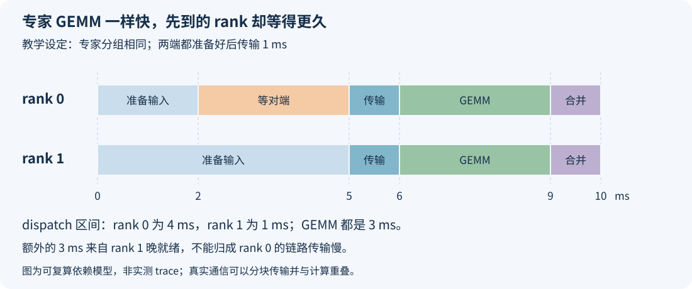

# 专家收到的 token 一样多，为什么有的卡还是更慢？

看 EPLB 的热度表，几张卡的专家都收到了差不多的 token，均衡度也接近 1；打开 profiling，却仍然有某张卡先算完、某张卡迟迟进不了下一阶段。继续搬专家，热度表变得更平，forward 时间却未必跟着降。

这种情况要把问题拆开看。卡上的路由总数相同，保留的是工作量的一项统计；算子还要处理每位专家的矩阵形状、数据排列和读写，通信还要等数据与依赖就绪，MoE 之前的 Attention 也有自己的工作。计数没有记录这些时间。

下面沿一层 DeepSeek MoE 展开：先确认热度表数的是什么，再看相同总数怎样形成不同的分组，最后用一张两 rank 时间线解释等待该算在谁头上。源码固定在 SGLang [`2914be60`](https://github.com/sgl-project/sglang/tree/2914be608009b65099c4c52ba118a597bf1b1421)。文中的矩阵分组、64 行 tile 和毫秒时间线用于教学复算；引用已有 Ascend 910C 实验时，会给出它实际验证的内容。

## 一、先问“一样多”是在数哪一层

一个 token 经过 TopK 路由，会选择多位专家。TopK 8 时，一行有效 token 形成八条 token→expert 关系。因此专家热度通常数的是**路由条数**，不是八个不同请求，也不是客户端输出了八个 token。

EP 把专家分在不同 rank。本 rank 的专家会接到多个来源 rank 的路由，所以它们的合计也不等于本 rank 在 Attention 阶段处理的原始 token 行数。到了专家计算前，这些路由通常已经按本地专家重新组织。

比较时还要分清三个问题：两张卡的专家路由合计是否相同；卡内每位专家的计数向量是否相同；统计是否对应同一层、同一次 forward。第一个条件最弱，把向量求和以后，分布信息就丢掉了。

在固定源码中，[`compute_gpu_physical_count`](https://github.com/sgl-project/sglang/blob/2914be608009b65099c4c52ba118a597bf1b1421/python/sglang/srt/eplb/expert_distribution.py#L1183-L1211)先把本 rank 的物理专家计数相加，再用各 rank 的平均值除以最大值计算均衡度，公式中另有防止除零的小量。两张卡都是 1,024 条时，这个比值就是 1。函数名里的 `utilization_rate` 表示这份计数的均衡程度，没有读取设备忙碌率或 kernel 时长。

更早的一步，是确认这些路由来自有效 token。我们此前在两个 Ascend 910C 逻辑设备上做过一个小实验：两端分配形状各有八行，只有四行有效。真实行全部路由到 rank 0，padding 行路由到 rank 1，得到：

| 同一次双 rank 实验 | rank 0 专家合计 | rank 1 专家合计 |
| --- | ---: | ---: |
| DeepEP 接收条目 | 64 | 64 |
| 有效 TopK 路由 | 64 | 0 |

接收端确实收到了这些条目。padding 的路由权重为零，仍不等于 dispatch 已经省略它们。这个实验验证了计数与 combine 结果，没有测实际专家 MLP 的执行时间；它首先提醒我们，看到 `64/64` 时，真实需求未必均匀。完整向量和条件见[有效路由与接收计数](deepep-received-vs-valid-routes.md)。

后面的例子假定已经排除了这项混淆，讨论真实路由总数也相同的情况。

## 二、1,024 条路由，可以交给四位专家，也可以交给十六位

设两张卡都分配了 16 个本地专家槽位，在同一层各收到 1,024 条有效路由：

```text
rank 0：[256, 256, 256, 256, 0, 0, ...]，4 位专家有工作
rank 1：[ 64,  64,  64,  64, ...   ]，16 位专家各 64 条
```

这里的数字是本 rank 从整个 EP 组接收后的路由，不能再拿本 rank 的原始 token 数限制其中某一项。每位被选中的专家会拿到一个形如 `[M, H]` 的输入矩阵，其中 M 是分给它的行数，H 是输入的 hidden 维度。

在同一普通 DeepSeek MoE 层里，路由专家的矩阵维度相同。一条内容复杂的 token，不会因为“问题更难”就让专家 MLP 多循环几次。设 I 为专家中间层的宽度。若忽略量化辅助操作，gate、up、down 的主要矩阵乘工作量与 `M × H × I` 成正比；将各专家的 M 相加，两张卡的理论主计算量相同。

Grouped GEMM 会把不同专家的矩阵乘组织到分组算子中执行，各组仍使用各自的权重。上例交给它的分组不同：一边是四个较大的 M，另一边是十六个较小的 M。固定源码的 [NPU GroupedMatmul](https://github.com/sgl-project/sglang/blob/2914be608009b65099c4c52ba118a597bf1b1421/python/sglang/srt/hardware_backend/npu/moe/matmul.py#L24-L50)直接把 `expert_tokens` 传作 `group_list`；[官方接口说明](https://ascend.github.io/docs/sources/pytorch/api_doc.html#torch_npu.npu_grouped_matmul)也把它解释为输入 M 轴的分组信息。算子需要知道完整分组，单独一个 1,024 无法替代。

M 较大时，一份专家权重可以被更多行使用；M 较小时，权重搬入、分组调度和尾块处理的成本分摊到更少行上。上例的有效计算分别涉及四份与十六份专家权重，工作集不同，缓存和 HBM 访问也要跟着看。

这不意味着四个大组一定更快。分组变多也可能提供更多并行任务，较大的单组还可能改变 tiling 与分核策略；Grouped GEMM 通常也不会简单地为每位专家各启动一次独立 kernel。应当从真实算子看到它怎样调度，而不能把活跃专家数直接当成启动次数。

如果两边连每位专家的计数都相同，那么这一节的分组差别就可以排除。接下来应查通信、执行依赖和系统状态，不能继续用“分布不同”解释已经对齐的向量。

## 三、有效行数相同，设备处理的块数还能不同

矩阵乘通常按块调度。为了看清总行数为什么不够，再做一个明确的教学设定：每位专家的 M 轴按 64 行分块，非空尾块也占一个块。这个 64 不是本文测出的 Ascend kernel 参数，也没有用它替代任何后端的真实对齐值。

在该设定里，一个专家有 m 行，需要 `ceil(m / 64)` 个 M 块。对所有专家求和，三种总数相同的分布会得到：

| 本地专家分布 | 有效路由总数 | 活跃专家 | 按 64 行块折算的行容量 |
| --- | ---: | ---: | ---: |
| 四位各 256，其余为零 | 1,024 | 4 | 1,024 |
| 十六位各 64 | 1,024 | 16 | 1,024 |
| 一位 1,009，其余十五位各 1 | 1,024 | 16 | 1,984 |

第三种分布里，1,009 行需要 16 个块，对应 1,024 行容量；十五个只有一行的小组各需要一个块，再占 960 行容量，总计 1,984。有效工作一样多，尾部留下的空位却多了起来。

1,984/1,024 是 **1.9375 倍块容量**，不等于设备时间也变成 1.9375 倍。真实内核会屏蔽无效元素，可能跳过部分访问，还会受 N/K 方向切分、分核和量化流程影响。这个算例要说明的是：逻辑行数相同，不足以唯一决定执行形状。

这里还要区分两种补齐。前面图桶的 padding 在 TopK 或 dispatch 之前就存在，影响有效行与交付条目的关系；本节的尾块发生在某个专家的矩阵分组内部。把前者从热度表屏蔽掉，并没有替后者消除尾部开销。

不同后端也有不同约定。例如固定源码的 [DeepEP normal dispatch 调用](https://github.com/sgl-project/sglang/blob/2914be608009b65099c4c52ba118a597bf1b1421/python/sglang/srt/layers/moe/token_dispatcher/deepep.py#L638-L690)显式传递 `expert_alignment`，该分支按是否启用对应 DeepGEMM 实现选择 128 或 1。这是那个分支的参数，不能据此认定 NPU 的 GroupedMatmul 也使用相同的块大小。

实际排查时，先保留每专家的有效 M，再查看 dispatcher 交付的计数、实际输入 shape 和 kernel 的执行信息。只有确认某份 padding 真正进入了当前路径，才能把它计入本次开销。

## 四、收得一样多，也不代表走了相同的通信路径

到达本地专家的总数，是按目的端统计的结果。它没有保留路由来自哪些 rank、经过哪些链路，也没有说明各个来源何时准备好发送。

例如，两张卡最终都交付 1,024 条专家路由，一边主要来自本机邻近设备，另一边主要跨节点。即使激活 dtype 和 hidden size 相同，链路、拓扑和争用条件也不同。同样的总量分给一个 peer 或多个 peer，发送接收的组织方式也会变化。

此外，一条 token 在同一个目标 rank 选择多位专家时，后端有机会复用传输后的激活，再在本地展开；是否这样实现，要看当前 dispatcher。固定源码的 normal 路径同时保留 `num_tokens_per_rank`、`num_tokens_per_rdma_rank`、`num_tokens_per_expert` 等不同维度，不能把它们都压成一个“token 总数”。元数据、量化 scale、对齐和打包方式也影响实际传输字节。

所以，不应直接用“专家路由数 × hidden 字节数”宣布测到了网络流量。它可以作为某个明确传输模型下的估计，真实字节和链路耗时仍需设备通信记录来核对。

这件事也影响 EPLB 的摆放。把某位专家搬到路由计数较少的卡，能改变目的端工作量，同时也改变谁把激活发往哪里。计数上的改善，要和新的通信路径合起来验收。

不过，看到通信 API 或通信 kernel 很长，也不能立刻认定链路传得慢。它还可能在等另一边到达。

## 五、最长的通信区间，可能出现在先准备好的卡上

假设两张卡这层 MoE 的有效计数和专家分组完全相同，专家 GEMM 都需要 3 ms。rank 0 在第 2 ms 准备好 dispatch 输入，rank 1 到第 5 ms 才准备好。为了单独演示等待，暂设两端都到齐后，传输用 1 ms，combine 再用 1 ms。



图中 rank 0 的 dispatch 区间从 2 ms 延续到 6 ms，共 4 ms；rank 1 从 5 ms 到 6 ms，只有 1 ms。两边随后做相同的 3 ms GEMM，在 10 ms 完成这段依赖链。实际通信可以分块、提前发送并与计算重叠；图里采用的是便于复算的共同就绪模型。

如果只把两段通信时长排序，会认为 rank 0 更值得优化。可这段教学链路中，真正多出的 3 ms 在 rank 1 的准备阶段。让 rank 1 也在 2 ms 就绪，整段链路就能从 10 ms 缩到 7 ms；只修改 rank 0 的“等待代码”，没有办法让尚未准备好的数据提前出现。

真实准备阶段可能包含当前 rank 的 Attention、路由、permute、量化或 Host 提交依赖。Attention DP 下，各 rank 在 MoE 前处理的本地请求和上下文长度也可能不同。专家接收计数描述不了这些工作，即使 MoE 内部已经完全均衡，前面的慢端仍会传递到后续通信。

因此，profiling 中至少要把“何时开始等”“数据何时就绪”“通信何时实际推进”“专家计算何时结束”连起来。Host 函数返回、设备任务完成和跨 rank 进入下一阶段，是不同事件。通信 duration 里包含的等待，也不能再作为一项独立开销重复加到 forward 上。

跨主机比较开始时间时还要校准时钟；没有校准，就先用同一条 trace 里的关联与事件依赖建立关系，不能直接把两份绝对时间戳相减。计时范围怎样闭合，可以参照[设备区间与时间线分析](npu-timeline-gaps-and-recoverable-speedup.md)。

## 六、热度表和时间线怎样放在一起看

首先把统计缩到同一层、同一次 forward，并保留当前物理专家映射。EPLB 更新后，同一个物理槽位可能已经换成别的逻辑专家；跨更新直接把槽位编号相同的记录相加，会混合两位专家的负载。

还要检查窗口聚合是否掩盖瞬时慢端。设两轮路由合计分别是 `[1024,0]` 和 `[0,1024]`，整个窗口加完得到 `[1024,1024]`，按窗口总数计算的均衡度为 1；每一轮却都只有一张卡承担工作，逐轮均衡度均约为 0.5。

固定版本的 SGLang 日志采用另一种聚合顺序：[均衡度报告入口](https://github.com/sgl-project/sglang/blob/2914be608009b65099c4c52ba118a597bf1b1421/python/sglang/srt/eplb/expert_distribution.py#L828-L885)先对单次记录计算，再保存历史；而普通 [DeepSeek planner 的入口](https://github.com/sgl-project/sglang/blob/2914be608009b65099c4c52ba118a597bf1b1421/python/sglang/srt/eplb/eplb_algorithms/__init__.py#L18-L38)会沿记录维求和。两者回答的问题不同。自己从导出文件画热度表时，也必须写清采用哪种聚合顺序。

拿到同一轮的计数后，再沿实际后端拆开路由/permute、dispatch、专家矩阵乘与激活、combine。融合 kernel 可能把几项合在一起，此时就保留真实融合范围，不凭空拆出独立耗时。事件之间有重叠，就按依赖和区间看，不把所有 stream 的 duration 相加当成墙时。

我会优先整理下面这些对应关系，让热度表能和慢端对上：

| 看到的现象 | 同轮需要补看的信息 |
| --- | --- |
| rank 合计相同，专家 GEMM 时长不同 | 每专家 M、活跃组数、实际 shape、dtype、量化与算子路径 |
| GEMM 接近，dispatch/combine 区间不同 | peer 分布、各 rank 的到达时间、数据就绪依赖和链路活动 |
| 单轮接近，完整 forward 不同 | Attention、共享专家、Host 提交和其他阶段的执行与重叠 |
| 窗口合计接近，逐轮有尖峰 | 每步、每层的计数和最慢 rank，更新前后的映射与负载变化 |

只有这些条件已经对齐，同形状 kernel 的差异仍然稳定存在，才继续检查频率、温度、设备错误、其他任务的资源争用，以及内存访问状态。系统状态需要用监控和隔离对照确认，不能仅凭“这张卡慢”就说硬件有问题。

## 七、这对 EPLB 优化意味着什么

路由计数仍然是很有用的输入。同一模型、同一层、同样的后端路径下，它便宜、容易聚合，也能直接发现某些专家和 rank 明显过热。

固定源码的 [DeepSeek 副本分配](https://github.com/sgl-project/sglang/blob/2914be608009b65099c4c52ba118a597bf1b1421/python/sglang/srt/eplb/eplb_algorithms/deepseek.py#L57-L83)用逻辑负载除以副本数估计单份负担，再通过 [packing](https://github.com/sgl-project/sglang/blob/2914be608009b65099c4c52ba118a597bf1b1421/python/sglang/srt/eplb/eplb_algorithms/deepseek.py#L140-L150)尽量把预计负载装平。这是一份基于计数的成本估计，没有把每一次通信等待都喂回去。看到均衡度达到 1，要继续核实它覆盖的那部分是否正是当前瓶颈。

如果热点 rank 确实在专家计算阶段更慢，而且副本分流后慢端的 GEMM 与整层时间都下降，那么继续优化放置有依据。如果计数已经相近，差距主要来自早先的 Attention 或对端晚到，继续搬专家就很难解决根因，还会增加迁移和显存成本。

也不要急着把 kernel 耗时直接换成专家权重交给 planner。被计时的区间可能混有等待；分组、batch 和硬件状态又会改变一次观测。更稳妥的改进，是先固定模型、层、量化和算子路径，在有代表性的 M 分布上测执行成本，确认计数模型在哪个范围明显失准，再决定是否需要分段成本或通信拓扑约束。新的估计最终仍要通过完整 forward 与服务延迟、吞吐验证。

文中的三个计数分布、窗口聚合与等待时间线放进了[可运行示例](../../examples/moe-equal-token-counts-unequal-latency/count_examples.py)。在博客仓库根目录，或解压后的示例包根目录执行：

```bash
python examples/moe-equal-token-counts-unequal-latency/count_examples.py --output results
```

输出包含 [count_profiles.csv](../../assets/moe-equal-token-counts-unequal-latency/data/count_profiles.csv)、[dependency_timeline.csv](../../assets/moe-equal-token-counts-unequal-latency/data/dependency_timeline.csv) 和 [checks.json](../../assets/moe-equal-token-counts-unequal-latency/data/checks.json)。[下载示例包](https://raw.githubusercontent.com/AkiYangDev/llm-inference-notes/main/assets/moe-equal-token-counts-unequal-latency/examples.zip)，固定源码与证据范围见[evidence.json](../../assets/moe-equal-token-counts-unequal-latency/evidence.json)。这些输出复算文章里的形状和依赖，不生成设备性能预测。

下一次再遇到“专家收到一样多，某张卡却更慢”，先把同一轮的专家向量和阶段结束时间摆在一起。慢在专家计算里，就查分组与执行形状；慢在进入计算以前，就沿数据和依赖往前找。这样才知道下一次迁移到底有没有东西可改善。
