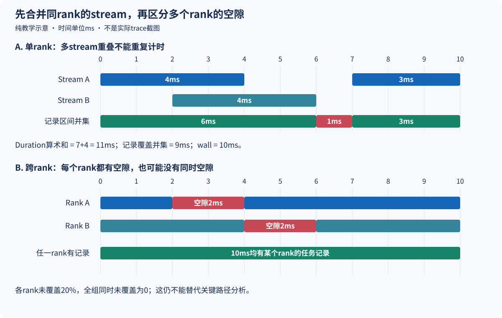

# NPU 时间线里有 19% 空隙，为什么不能直接得到 19% 加速？

分析一次 DeepSeek-V4-Flash / Ascend 910C 的 Decode trace 时，我们算出了一个很诱人的数字：rank0 的采样窗口约 2.085 秒，其中有 391.37ms 没有被已记录的 device kernel 区间覆盖，占 18.77%。rank1 的对应比例更高，为 20.68%。

如果把这些空白都填上，吞吐是不是就能提高约两成？沿时间线继续查，答案没有这么直接。部分空隙伴随 host collective，部分出现在动态元数据准备附近；后续定位到的两次小 Tensor 拷贝，在整个窗口里累计却只有约 3ms。我们找到了值得追踪的线索，但没有得到“19% 可以回收”的证据。

本文沿这次真实分析解释：空隙怎么计算，等待为什么容易被归错对象，以及从一个局部百分比到整机加速，中间还缺哪些关系。采集来自 2026 年 10 月 20 日冻结的 SGLang/Ascend 运行环境；本文复用已有 rank0/1 分析和源码材料，没有重新采集 trace 或运行模型。完整数字与范围见[证据摘录](../../assets/npu-timeline-gaps-and-recoverable-speedup/evidence.json)。

## 1. 先把“19%”的分母和覆盖范围写出来

这次处理的是两个 rank 的 `kernel_details.csv` 及对应 host trace。对每条 device 任务，取开始时间与执行时长，形成区间，再把同一 rank 所有已记录 stream 的区间合并。采样窗口内剩余的补集，就是这里讨论的空隙。

用集合写出来，观察窗口为 W，已记录任务的执行区间为 I：

```text
recorded_busy = union(I_1, I_2, ...)
recorded_gap  = W - recorded_busy
gap_ratio     = length(recorded_gap) / length(W)
```

实际结果如下，数字按毫秒展示：

| 统计量 | rank0 | rank1 |
| --- | ---: | ---: |
| 窗口 wall | 2085.2914 | 2085.7130 |
| 已记录任务区间并集 | 1693.9219 | 1654.3460 |
| 并集未覆盖时间 | 391.3695 | 431.3671 |
| 未覆盖比例 | 18.7681% | 20.6820% |
| 单次最大空隙 | 9.4046 | 9.4402 |
| kernel Duration 算术和 | 2319.7540 | 2286.0664 |
| Duration + Wait 算术和 | 2734.9002 | 2738.0109 |

这里最准确的措辞是**“该 rank 全部已记录任务区间没有覆盖的时间”**。记录中包含 AI Core、Vector、AI CPU 及相应通信路径任务；只看 AI Core 那一行会漏掉其他活动。反过来，任务占据了时间也不说明它在高效完成矩阵计算，轮询与等待型任务同样可能占据设备资源。

因此，18.77% 既不是硬件利用率的直接读数，也不是全机空闲率。如果采集没有包含某些 Event/Notify 或其他任务，空白里还可能有未被这份导出表达的活动。先保留这个范围，后面的分析才能逐步缩小问题。

## 2. 同一段时间，为什么会有四种“耗时”

rank0 的 kernel Duration 总和约 2319.75ms，竟然比 2085.29ms 的窗口还长。这不矛盾：不同 stream 可以重叠执行，同一毫秒在算术和里被多次计入。并集只计一次，所以得到约 1693.92ms。

下面是一张纯教学示意图，时间和形状均为构造例子，不是实际 trace 截图：



上半图中，stream A 的任务长度共 7ms，stream B 为 4ms，算术和是 11ms；合并重叠后，记录覆盖 9ms；观察窗口则是 10ms。三个数字分别回答工作量累加、记录覆盖和实际经过多久，不能相互替代。

第四种数字是每任务 `Duration + Wait` 的总和。这里的 Wait 是任务等待统计，不能当作又一段独占的 device 执行区间直接接到 Duration 后面。某个任务等待时，另一条 stream 可能正在工作；多个任务也可能同时等待同一项依赖。把它们全部相加，会重复计算同一段经过时间。

我们在分析中同时保留 wall、busy union、Duration sum 和 Duration+Wait sum，是为了发现这种差别。最后一个数适合筛查“谁承接了很多等待”，不适合回答“整机一共闲了多久”。仅有 `op_summary` 的累计时长、没有逐次时间戳时，也无法恢复这里的区间并集。

实际计算还有一个小细节：原始时间戳是很大的绝对微秒数，不能先粗略转成低精度数再相减。原分析先用 Decimal 减去共同时间原点，再进入局部区间计算，纠正了早期预览约 0.42ms 的累计差异。补齐精度不会创造性能收益，却能避免把解析误差误当成很小的优化。

## 3. 空隙后面的算子，未必制造了这段空隙

rank0 最大空隙约 9.405ms，紧邻的前后任务是：

| 位置 | 原始任务名 | stream | Task ID | 执行时长（μs） | 记录 Wait（μs） |
| --- | --- | ---: | ---: | ---: | ---: |
| 空隙前 | `assign_req_to_token_pool` | 27 | 3426 | 2.72 | 230.15 |
| 空隙后 | `aclnnIndex_IndexCheck_IndexCheck` | 30 | 12336 | 2.96 | 9404.53 |

如果按总成本排序，后面的 IndexCheck 看起来可能很昂贵；但它真正执行只有 2.96μs，接近 9.4ms 的部分在 Wait 里。由此直接决定“重写 IndexCheck 算子”，就把承担等待的任务错当成了等待来源。

对应的 host 窗口中，`gloo:all_gather` 覆盖了这段空隙约 85.4%。前后任务还能通过 Task ID、stream、时间和 `connection_id` 对应到 `Node@launch`，这比仅靠操作名相近强得多。它让“跨 rank 的 host collective 等待”成为有依据的排查方向，但仍没有测出网络带宽，也没有证明是哪一个 peer 迟到。

另一个更短的例子是 Fill→Clamp：rank0 的 Fill 任务执行 1.44μs，后续 Clamp 执行 3.00μs，中间约 540.86μs；对应 stream43，Task ID 从 21924 到 21925。host 侧能看到 `aten::to`、`_to_copy` 与 `copy_` 等事件。它提示需要检查输入准备，却不能证明 Clamp 自己算了半毫秒。

这一步需要区分三种强度：前后执行区间是直接记录；关联到提交事件是更具体的锚点；认定哪个调用导致等待，则还需要依赖关系。host 上一个很宽的 Scheduler 标记即使覆盖整个空隙，也可能只是外层包装。本次覆盖计算排除了这些宽包装，没有把“在同一时间出现”当作根因。

## 4. 从动态端点追到两次拷贝，收益预算反而缩小了

原分析按空隙紧邻前后任务的 Model ID 分类，发现 dynamic→dynamic 类别占未覆盖时间的 88.28% 和 89.41%。这个结果让动态输入准备成为优先方向，但 dynamic 标签不等于所有任务都在 Graph 外；没有具体 Model ID 的导出任务，也可能与整个 replay 区间交错。

同样，前后端点都标为 Model47 的空隙，最大只有 4.22μs 和 5.34μs，没有达到 100μs 的实例。这只能描述这个端点类别，不能证明整个 Graph47 replay 内部不存在大空隙。要作后者判断，需要真实 replay 起止区间和完整嵌套关系，不能用两端标签替代。

继续追 Fill→Clamp，两个 rank 各出现 28 次相同结构：Clamp 处理 FLOAT `[bs]`，后面跟相同 bs 的比较；前面能找到两次 int64 `[16]` 的传输准备。它与保存的 DSpark 源码路径吻合：

```text
DraftBlockProposer._run_forward
  → _fill_dp_moe_sync_metadata
  → stage_sampling_params
  → draft model forward / graph
```

`_fill_dp_moe_sync_metadata` 分别建立用于全局 Token 数和 logprob Token 数的两个 host 向量，并各自搬到设备；随后 sampling 参数准备会对温度做 clamp，生成 greedy mask。两个 helper 的源码在当时后续只读核对中与安装源 SHA 匹配。形状、顺序与源码共同增强了关联，但采集未打开 Python stack，仍不能伪造一条完整采集时调用栈。

定位更具体后，成本也能收窄：

| 指标 | rank0 | rank1 |
| --- | ---: | ---: |
| 重复 Fill→Clamp 空隙累计（ms） | 11.4883 | 12.3239 |
| 占各自整个采样窗口 | 0.5509% | 0.5909% |
| 两向量对应 host `_to_copy` 时长累计（ms） | 3.3663 | 3.1080 |
| 占各自整个采样窗口 | 0.1614% | 0.1490% |

391ms 的总空隙、11ms 的这一类空隙和 3ms 的 host 拷贝相关时长，是三个不同范围。把两次传输合包，最多只是减少其中一部分准备或提交工作，不能把整段空隙都算作收益；host 拷贝时长本身还可能包含等待，也不是纯 DMA 时间。

更不能把两个向量删掉一个或跨批次缓存起来。两个计数列表未必相等，序列长度、接受结果和本批 Token 数会变化；异步使用还涉及缓冲区存活和覆盖顺序。本次据此把小合包方向降为低优先级，没有为它单独重启服务，也没有宣称已经得到 NPU 加速。

## 5. 一个 rank 的空白，为什么不是整机可消除的时间

设某 rank 的记录空隙集合为 G。对整个分布式组而言，所有 rank 同时未被记录覆盖的时间，是这些 G 的**交集**，不是它们的相加或平均。图中下半部分给出了反例：两个 rank 各有 20% 空白，但位置错开，全组同时空白为零。

计算交集之前，还必须确认时钟已对齐，rank 集合属于同一个作用范围，采集窗口也覆盖同一阶段。不能只看时间戳数值接近，就把不同设备 CSV 拼成全局时间线。本次只有相邻 rank0/1 的完整材料完成了这一级分析，没有得到所有参与 rank 的公共时钟及覆盖证明，因此没有公布全组空闲比例。

即使全组同时有空白，也仍不能直接删掉。大家可能共同等待 host 决策或必要的同步，消除它需要改变真正的依赖来源。反过来，即使全组空隙交集为零，也不代表没有优化机会：另一个 rank 可能在做不影响完成时间的旁路工作，关键路径仍被当前等待卡住。交集回答“是否同时没有记录覆盖”，关键路径回答“什么决定这项工作何时完成”，二者不能互相替代。

吞吐还比单步完成时间多一层。PD 分离中，P 交付速度、D 批次组织和客户端在途限制共同影响输出；缩短一个 D 端局部空隙，未必能在 P 供给不足时增加请求完成数。[尾块合批实验](decode-fast-throughput-limited-by-prefill.md)就展示过：TPOT 略高，系统吞吐反而更高。

连“减少 19% 时间”和“提高 19% 吞吐”也不是同一个算式。只作理想化演算：若一项固定工作原耗时 T，其中确有 `0.19T` 能完全删除，剩余工作不变且输出数不变，则吞吐倍率为 `1/0.81≈1.2346`，即提高约 23.46%。**这个假设不是本次 trace 的收益预测或上界**；本次连局部空隙中可删除的关键路径时间都没有测定。

## 6. 旧 trace 与采集扰动，还会再改变一次判断

这份 trace 对应的 P/D 软件版本记录为 `0.0.0.dev18433+gce0a8fea5.d20261013`，还带有当时的适配源码。采样时 IndexCache 关闭，D 为草稿3/验证宽度4，Graph 档位 `[1,2,4,8,12,16]`；它不包含后来增加的档位6、G5/Compact 和其他场景变化。因此，这 18.77% 不能贴到后来的最优配置旁边，作为它仍然具有的优化空间。

采集配置则是 CPU+NPU、Level1、PipeUtilization 指标，`record_shapes=True`、`with_stack=False`。它保留了有用的形状信息，却没有完整 Python 栈。PyTorch 的 [Profiler 文档](https://docs.pytorch.org/docs/2.14/profiler.html)明确说明形状和栈追踪会引入额外开销；Ascend 的 [服务性能采集说明](https://github.com/Ascend/msserviceprofiler/blob/master/docs/en/msserviceprofiler_serving_tuning_instruct.md)也区分了不同采集层级的成本。它们支持“采集可能扰动时间线”，不提供本次扰动的精确数值。

本次没有同条件开关采集的配对测量，所以既不能认为 19% 全是 profiler 造成的，也不能认为它完全代表未采集服务的状态。约 2.085 秒的观察窗口和 28 次相关标记，还不足以对齐完整 AISBench native 区间的吞吐、AL 或每轮 Draft/Verify 成本。

负载记录本身也有过一次纠正：原计划写160请求，实际成功完成的是640，且已有独立核对记录。文章和分析使用实际产物身份，没有把这段 profiling 运行作为正式性能得分。先核对采集属于哪一轮，往往比多画一张漂亮的时间线更重要。

## 7. 怎样把空隙变成一个值得做的实验

有用的分析不必从“证明 host-bound”开始。可以先把判断缩到具体问题：某类重复空隙是否来自每轮两次小向量准备？哪份输入真正不变？是 host 晚提交，还是设备在等 peer？答案不同，对应的代码改动和风险也不同。

本次的证据链走到了形状、执行顺序、提交锚点与两个 helper 源码；缺口停在部分动态路径的唯一调用来源、跨 rank 的对应关系，以及未采集条件下的实际阶段成本。这些缺口不影响确认局部空隙存在，却影响是否值得改代码、该改哪里。

验证一个候选时，应当先预计它能改变什么，再核对实际变化。例如合包两次传输，应该观察相关 host 调用数和准备时长，而不是期待所有空白消失；最终还要在同数据、同缓存、同采样和同并发下比较未采集的 TTFT、TPOT、ITL、E2E 与 native/whole 吞吐。状态语义和输出质量也必须保留，不能靠删同步或缓存变化中的元数据来获得一个更好看的 trace。

为便于复现区间口径，配套提供了一个[纯 CPU 区间统计脚本](../../examples/npu-gap-accounting/gap_accounting.py)和[教学 CSV](../../examples/npu-gap-accounting/example.csv)。从仓库根目录执行：

```bash
python examples/npu-gap-accounting/gap_accounting.py examples/npu-gap-accounting/example.csv
```

示例会得到 wall10ms、Duration sum11ms、busy union9ms、gap1ms。脚本包含所有输入记录，不按单一 stream 筛选，支持显式观察窗口与边界裁剪；它只计算一个 CSV 的记录区间，没有解决多 rank 时钟对齐、漏采、关键路径或根因归属。不能把脚本输出的 `gap_ratio` 改个名字就当成可回收容量。

这次分析最有用的结果，是把一个看起来很大的“19%机会”，拆成了可以逐步查证的问题。其中一组小拷贝得到具体解释，也因为成本范围很小而被降级。确认某处值得看，与决定为它投入一次昂贵实验，是两个需要分别作出的判断。

## 配套数据与延伸阅读

- [rank0/1 四种时间统计 CSV](../../assets/npu-timeline-gaps-and-recoverable-speedup/rank-clocks.csv)、[脱敏证据 JSON](../../assets/npu-timeline-gaps-and-recoverable-speedup/evidence.json)：原数值、任务锚点、采集配置、源码 SHA 与未观测项。
- [在 Ascend 910C 上分析 DSpark](deepseek-v4-speculative-decoding-ascend-profiling.md)：阶段、Graph 与 NPU 时间线的对应方法。
- [Graph、多流与通信的执行依赖](deepseek-v4-speculative-ascend-performance-critical-path-analysis.md)：进一步理解关键路径与重叠。
- [合理优化没有吞吐收益的负例](ascend-910c-inference-tuning-negative-results-and-stop-rules.md)：如何用实验改变优先级。

[返回性能分析](README.md)
