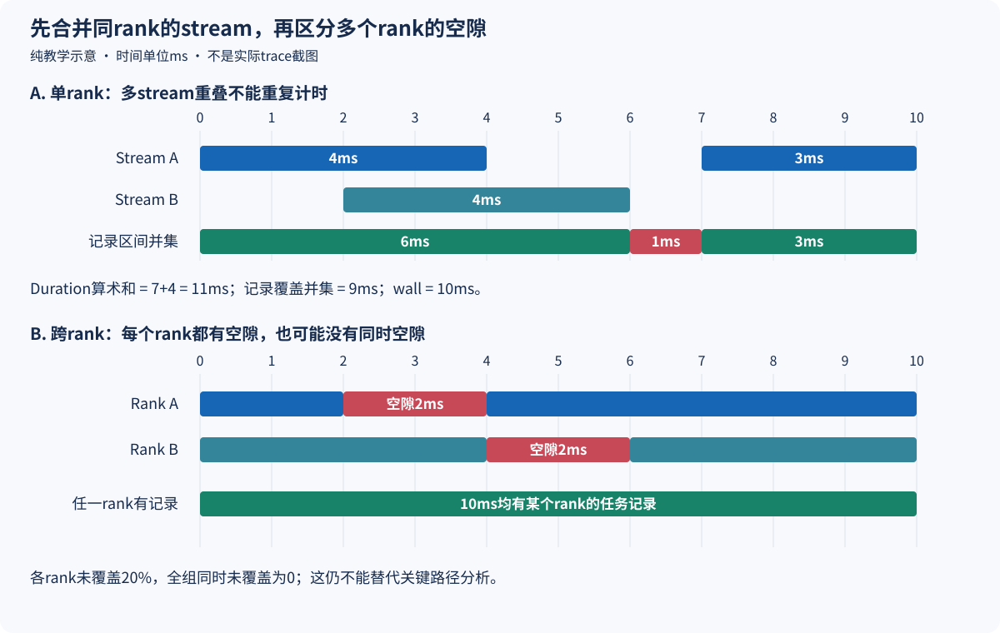

# NPU 时间线里有 19% 空隙，为什么不能直接得到 19% 加速？

rank0 约 2.085 秒的 Decode trace，有 391.37ms 未被记录的 device 任务覆盖，占 18.77%；rank1 为 20.68%。这给了一个可查的方向，还没给出可删时间。

继续关联 Host、源码后，一些空隙重叠 collective，另一些靠近 metadata 准备。能具体追到的两次小 Tensor 拷贝，相关 Host 成本全窗口仅约 3ms，已经远小于最初的 19%。

这里复用2026年10月20日DeepSeek-V4-Flash、Ascend 910C冻结材料，只分析rank0/1，没有新采trace、运行模型。数值、范围见[摘录](../../assets/npu-timeline-gaps-and-recoverable-speedup/evidence.json)。

## 1. 先把“19%”的分母和覆盖范围写出来

输入为两个 Rank 的`kernel_details.csv`和 Host trace。把 device 开始、Duration 转成区间，同 Rank 全部已记录 stream 取并集，再从窗口扣除。

观察窗口 W、任务区间 I，定义为：

```text
recorded_busy = union(I_1, I_2, ...)
recorded_gap  = W - recorded_busy
gap_ratio     = length(recorded_gap) / length(W)
```

毫秒口径结果：

| 统计量 | rank0 | rank1 |
| --- | ---: | ---: |
| 窗口 wall | 2085.2914 | 2085.7130 |
| 已记录任务区间并集 | 1693.9219 | 1654.3460 |
| 并集未覆盖时间 | 391.3695 | 431.3671 |
| 未覆盖比例 | 18.7681% | 20.6820% |
| 单次最大空隙 | 9.4046 | 9.4402 |
| kernel Duration 算术和 | 2319.7540 | 2286.0664 |
| Duration + Wait 算术和 | 2734.9002 | 2738.0109 |

记录除 AI Core，还含 Vector、AI CPU、通信任务。只筛 AI Core 会漏掉活动；已覆盖也可能在轮询、等待，不表示一直高效计算。

18.77% 因此只描述本 Rank 的记录覆盖。Event/Notify 等若没导出，白区还可能有没被表达的活动。

## 2. 同一段时间，为什么会有四种“耗时”

rank0 Duration 相加 2319.75ms，大于 2085.29ms 墙时，重叠 stream 重复计算同一毫秒；并集 1693.92ms 只数一次。

用构造的教学图说明，非实测截图：



图上 A 共 7ms、B 共 4ms，加和 11ms，合并只覆盖 9ms，窗口 10ms。任务和、覆盖、墙时各有分母。

Wait 也不能简单接在 Duration 后当独占执行。任务等依赖时，别流可能在跑，多任务也可能等同一件事，累加会重复计时。

因此保留 wall、busy union、Duration sum、Duration+Wait sum。最后一项帮助找等待任务，单有 op_summary 累计值则连区间并集也重建不了。

解析先用 Decimal 减共同原点，再算局部区间，避免大绝对微秒时间戳低精度相减。早期约 0.42ms 差异由此修正，属于解析修复。

## 3. 空隙后面的算子，未必制造了这段空隙

rank0 最大 gap 约 9.405ms，相邻任务为：

| 位置 | 原始任务名 | stream | Task ID | 执行时长（μs） | 记录 Wait（μs） |
| --- | --- | ---: | ---: | ---: | ---: |
| 空隙前 | `assign_req_to_token_pool` | 27 | 3426 | 2.72 | 230.15 |
| 空隙后 | `aclnnIndex_IndexCheck_IndexCheck` | 30 | 12336 | 2.96 | 9404.53 |

IndexCheck 自身仅 2.96μs，约 9.4ms 在 Wait 字段里。它承接了等待，不足以说明它制造了等待。

Host 的`gloo:all_gather`与该段重叠 85.4%。Task ID、stream、时间、`connection_id`还能关联前后`Node@launch`，因此优先追跨 Rank Host collective。哪个 peer 晚到、网络带宽多少，尚未测出。

另一类 Fill→Clamp，Fill 1.44μs、Clamp 3.00μs，中间 540.86μs，stream43、Task ID 21924/21925。Host 出现`aten::to`、`_to_copy`、`copy_`，指向输入准备，半毫秒并非 Clamp 执行。

任务区间是直接记录，提交关联提供锚点，因果还要靠依赖。宽 Scheduler 标记仅包住某段，本次已排除它，避免把外层范围误当来源。

## 4. 从动态端点追到两次拷贝，收益预算反而缩小了

dynamic→dynamic 端点占未覆盖时间 88.28%、89.41%，因此先查动态准备。dynamic 标签却未必等于 Graph 外，缺 Model ID 的任务也可能穿插 replay。

两端同为 Model47 的 gap 最大 4.22μs、5.34μs，没见 100μs 以上。这只限定端点类别，整个 Graph47 内部是否有大 gap，还需 replay 起止、嵌套记录。

两 Rank 各 28 组 Fill→Clamp：Clamp 为 FLOAT `[bs]`，之后比较相同 bs，之前有两次 int64 `[16]`准备，与保存 DSpark 路径对应：

```text
DraftBlockProposer._run_forward
  → _fill_dp_moe_sync_metadata
  → stage_sampling_params
  → draft model forward / graph
```

`_fill_dp_moe_sync_metadata`创建全局 Token、logprob Token 两份 Host 向量并复制，随后采样准备 clamp 温度、建 greedy mask。两个 helper 与安装源 SHA 一致，形状、顺序支持关联；未开 Python stack，尚无完整调用栈。

这类结构的相关时间为：

| 指标 | rank0 | rank1 |
| --- | ---: | ---: |
| 重复 Fill→Clamp 空隙累计（ms） | 11.4883 | 12.3239 |
| 占各自整个采样窗口 | 0.5509% | 0.5909% |
| 两向量对应 host `_to_copy` 时长累计（ms） | 3.3663 | 3.1080 |
| 占各自整个采样窗口 | 0.1614% | 0.1490% |

391ms 总 gap、11ms Fill→Clamp gap、3ms Host copy 相关时间，各统计不同对象。合包最多减少其中部分准备、提交，`_to_copy`还可能含等待，并非全是 DMA。

全局、logprob 向量未必相等，batch、接受、Token 数也在变化，不能随意删、跨批缓存；异步还要保护引用、覆盖顺序。考虑到成本小，本轮降低合包优先级，没有为它重启或报告加速。

## 5. 一个 rank 的空白，为什么不是整机可消除的时间

各 Rank gap 为 G，全组同时未覆盖取各 G 交集。下半图两个 Rank 各 20% 空白，位置错开，交集仍为 0。

求交还需时钟对齐、同一 Rank 范围、同一阶段窗口。本次只有 rank0/1 完整材料，没有所有参与者的共同时间、覆盖证明，所以没报全组空闲率。

即使共同空白存在，也可能是必要 Host 决策、同步；没有共同空白，别的 Rank 也可能只跑不影响完成的旁路。交集判断同时覆盖，关键路径才回答谁拖慢完成。

PD还取决于P交付、D组批、客户端供给。[尾块合批实验](decode-fast-throughput-limited-by-prefill.md)就曾在TPOT略升时提高系统输出，D局部等待少了未必有更多工作。

假设固定工作真的删掉`0.19T`，吞吐倍率是`1/0.81≈1.2346`，约+23.46%。这只演示算术，本次没测可删关键路径时间，不作为预测、上界。

## 6. 旧 trace 与采集扰动，还会再改变一次判断

trace 对应`0.0.0.dev18433+gce0a8fea5.d20261013`及当时适配，IndexCache 关，D 草稿 3/Verify 4、Graph`[1,2,4,8,12,16]`，尚无档位 6、G5/Compact。后续配置不能继承 18.77% 这个值。

采集CPU+NPU、Level1、PipeUtilization，`record_shapes=True`、`with_stack=False`。[PyTorch Profiler 文档](https://docs.pytorch.org/docs/2.14/profiler.html)、[Ascend 服务采集说明](https://github.com/Ascend/msserviceprofiler/blob/60b77faa071b16e54b76dc27d470206d63820980/docs/en/msserviceprofiler_serving_tuning_instruct.md#L81-L90)说明记录有开销，只能据此保留扰动可能，未量本次大小。

本轮没有采集开关配对，不能认定 19% 由 profiler 造成，也不能当作未采集服务。2.085 秒、28 标记更没有覆盖完整 AISBench native 与 AL、Draft/Verify 周期。

原计划 160 请求，实际产物核为 640 成功，采用实际身份；profiling 轮未记成正式性能分。

## 7. 怎样把空隙变成一个值得做的实验

下一候选先问具体来源：两向量准备是否真造成重复 gap，哪些输入不变，是 Host 晚提交、还是设备等 peer。不同来源才对应不同改动。

现有形状、顺序、提交锚点、源码支持部分关联，仍缺动态路径唯一来源、跨 Rank 对应、未采集成本，它们影响改哪里、值不值得。

若验证合包，先核 Host 调用和准备时间是否减少，再同数据、缓存、采样、并发测未采集的 TTFT、TPOT、ITL、E2E、whole/native。同步、metadata、输出语义继续保持。

[纯 CPU 区间脚本](../../examples/npu-gap-accounting/gap_accounting.py)、[教学 CSV](../../examples/npu-gap-accounting/example.csv)可从仓库根复算：

```bash
python examples/npu-gap-accounting/gap_accounting.py examples/npu-gap-accounting/example.csv
```

示例 wall 10ms、Duration sum 11ms、union 9ms、gap 1ms。脚本处理所有记录、显式窗口、边界裁剪，只解决单 CSV 区间，未解决跨 Rank 时钟、漏采、关键路径、因果。

最终留下的是两次拷贝的较具体关联，以及因成本很小而降低的优先级。下次可从这份局部证据继续，无需先为未测定的 19% 收益冷启动。

## 配套数据与延伸阅读

- [rank0/1 四种时间统计 CSV](../../assets/npu-timeline-gaps-and-recoverable-speedup/rank-clocks.csv)、[脱敏证据 JSON](../../assets/npu-timeline-gaps-and-recoverable-speedup/evidence.json)：原数值、任务锚点、采集配置、源码 SHA 与未观测项。
- [在 Ascend 910C 上分析 DSpark](deepseek-v4-speculative-decoding-ascend-profiling.md)：阶段、Graph 与 NPU 时间线的对应方法。
- [Graph、多流与通信的执行依赖](deepseek-v4-speculative-ascend-performance-critical-path-analysis.md)：进一步理解关键路径与重叠。
- [合理优化没有吞吐收益的负例](ascend-910c-inference-tuning-negative-results-and-stop-rules.md)：如何用实验改变优先级。

[返回性能分析](README.md)
