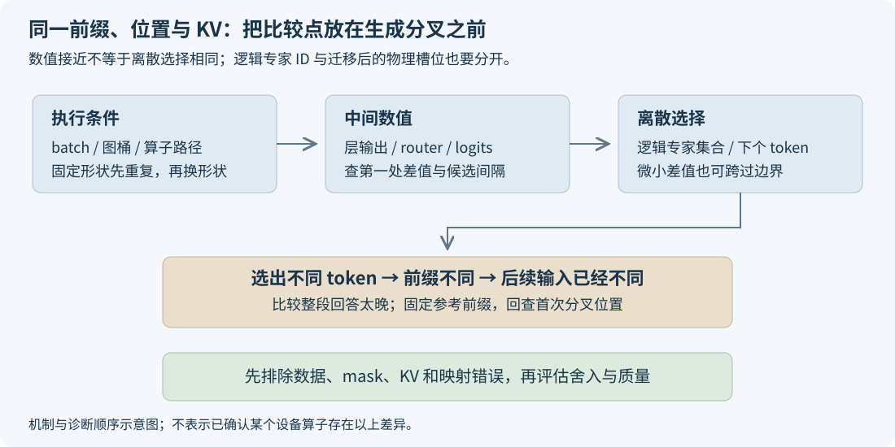

# 同样的输入，换个 batch，为什么答案会变？

调推理服务时，有一种结果特别容易把人带偏：同一个问题，单独发能答对，和其他请求一起发却换了答案。把 temperature 设为 0，固定 seed，问题仍然存在。于是怀疑开始在采样、KV Cache、路由和算子之间来回移动。

这里应该先分清两件事。对一个正确隔离请求的模型，别人的文本不应该进入这条请求的 Attention；但把这条请求放进不同 batch，执行它的计算形状和数值路径可以改变。前者涉及请求隔离，后者涉及浮点计算。最终文字不同，单凭这个现象还分不出是哪一种。

这篇从一个能实际运行的舍入例子开始，沿 logits、专家路由和生成前缀走到排查方法。小数例子通过 CPU 脚本逐步执行舍入，SGLang 的调用位置则链接到固定源码。

## 一、固定了问题，还没有固定执行条件

一条 Decode 请求的输入不只有最初的 prompt。当前已经生成的前缀、位置编码、KV 内容、采样参数，以及读写这些状态的索引，都决定这一步应该计算什么。即使 prompt 相同，两次运行生成到第 100 个 token 时的前缀不同，后面的 logits 也已经是在回答两个不同的数学问题。

先把这些逻辑状态固定，batch 仍会影响实现。例如，单独跑一条请求时，线性层面对的是较少的 token 行；合入更多请求后，矩阵的行数变大。算子库可以针对形状选择不同分块、归约方式或内核。数学上每一行仍只乘同一份权重，实际浮点运算的组合却未必一样。

PyTorch 2.10 的[数值精度说明](https://docs.pytorch.org/docs/2.10/notes/numerical_accuracy.html#batched-computations-or-slice-computations)明确指出，批量计算再取其中一项，与单独计算这一项，不保证逐位相同。这条接口约定解释了为什么“没有串请求”与“数值存在小差异”可以同时成立。

对 DeepSeek 的部署，实际执行条件还包括 Prefill 的切块、Decode 的图桶、量化内核、并行归约和 MoE 各专家接收的 token 行数。记录这些条件，是为了查明两次计算在哪里不同。不能看到换 batch 后变了，就直接宣布某个 NPU 算子有问题；也不能只用“浮点误差”跳过 KV 索引和请求 mask 的检查。

## 二、没有随机数，加法顺序也会改变结果

先看三个数：`100000000`、`-100000000` 和 `1`。在精确算术中，无论先加哪两个，结果都是 1。换成每一步都舍入到 float32，就会出现：

```text
(100000000 + -100000000) + 1 = 1
100000000 + (-100000000 + 1) = 0
```

第二行先算 `-100000000 + 1`。这个数量级附近的 float32 无法保留差 1 的变化，它被舍回了 `-100000000`。最后再与正的 `100000000` 相加，就得到 0。第一行先把两个大数抵消，再加 1，因此留下了 1。

下面这段只用 Python 标准库，用 `struct` 明确模拟每一次 float32 舍入：

```python
import struct

def f32(value):
    return struct.unpack("f", struct.pack("f", value))[0]

def add(a, b):
    return f32(f32(a) + f32(b))

a, b, c = 100000000.0, -100000000.0, 1.0
print(add(add(a, b), c))  # 1.0
print(add(a, add(b, c)))  # 0.0
```

这个例子故意选择容易看清的数值抵消，不表示真实模型每次都会产生这样大的差值。它只证明一个具体机制：两套完全固定的加法顺序，都可以反复稳定地给出各自结果，结果之间却不一样。整个过程不需要随机采样，也不需要线程争抢。

矩阵乘法里的一个输出值，需要累加多个乘积。并行实现可以先分别算若干段，再合并部分和。改变分段或合并顺序，就触及同一个问题。量化、累加精度和后续转换还会影响误差大小；“输入是 BF16”本身，并不能告诉我们每个中间步骤采用什么精度。

因此，调试时要记录完整的输入输出 dtype 与实际算子路径，而不是把所有差异归到一个“低精度”标签。一次误差是否异常，应对照该算子的数值约定、正常基线和后续决策的敏感程度来判断。

## 三、很小的 logits 差异，为什么能变成两段文字

假设某一步词表中最靠前的两个候选分数为：

| 同一个生成位置 | 候选 A | 候选 B | 贪心选择 |
|---|---:|---:|---|
| 路径一 | 1.0000 | 1.0001 | B |
| 路径二 | 1.0002 | 1.0001 | A |

两条路径只把 A 的分数改了 0.0002，argmax 就变了。分数可以很接近，输出 token 却是离散选择，没有“生成 0.2 个 A 加 0.8 个 B”这种过渡。temperature 为 0 时同样如此：它按最终分数选最大项，并不会把上游数值差异消掉。

再走一步，两条路径会把不同 token 写进各自生成前缀，更新出的 KV 也跟着不同。后面即使使用完全相同的算子，两条请求也不再拥有相同输入。最终一段用了另一种措辞，甚至一道题答对、一道题答错，都需要回到第一个分叉位置才能解释。

因此，比较日志时应先找到第几个 token 开始不同。分叉之前，两条路径还在处理同一个前缀，适合比较同一位置的 logits；分叉之后，一条已经读了 A，另一条读了 B，继续逐层相减就混入了输入差异。先对齐前缀，才能判断最初那一点数值变化从哪里来。

有一个简单的判断办法。设最大分数与次大分数的差为 `gap`，每个分数的误差绝对值都不超过 `epsilon`。最坏情况下，第一名下降 `epsilon`，第二名上升 `epsilon`；因此 `gap > 2 × epsilon` 时，名次不会被这次误差颠倒。接近边界时，则需要直接核对选择结果。

使用这个判断，需要在同一生成位置比较同一份 logits，并确认误差界覆盖全部候选。全模型其他层测到的最大误差，无法直接当成这里的 epsilon。实际排查可以先保存领先候选的分数和间隔，检查选择是否贴近边界；若分数完全相同，还要继续检查并列候选的选择规则，也就是 tie-breaking。

MoE 中还多了一处离散决策：专家 Top-K。即使最终 token 尚未改变，靠近路由边界的分数变化也能改变进入后续计算的专家集合。带分组、修正 bias 的路由，要看实际用于选择的分数和分组边界，不能只按原始 logits 的最大两项判断。

固定版本 SGLang [`2914be60` 的 NPU Top-K](https://github.com/sgl-project/sglang/blob/2914be608009b65099c4c52ba118a597bf1b1421/python/sglang/srt/hardware_backend/npu/moe/topk.py#L32-L52)在 DeepSeek-V4 的相关分支中，把 router logits 和 correction bias 交给 gating 算子；后续[再把逻辑专家 ID 映射为物理槽位](https://github.com/sgl-project/sglang/blob/2914be608009b65099c4c52ba118a597bf1b1421/python/sglang/srt/hardware_backend/npu/moe/topk.py#L125-L142)。所以排查 EPLB 时，需要分清“选了哪个逻辑专家”与“同一个专家被放到了哪里”。只比较物理槽位编号，会把正常迁移当作路由变化。



## 四、seed、确定性与 batch 不变性，各管哪件事

固定 seed 管的是随机数。若请求使用随机采样，随机数状态、消费顺序和请求之间如何分配随机数也需要一致。即使这些都处理好了，也没有改变前面 float32 加法的舍入规则。

PyTorch 的[可复现性文档](https://docs.pytorch.org/docs/2.10/notes/randomness.html)把随机源控制和确定性算法选择分开说明。`torch.use_deterministic_algorithms` 也有其支持范围；不能把一个框架开关当作所有第三方自定义算子的证明，更不能把 CUDA 专用配置直接当作 Ascend 的解决办法。

确定性通常回答的是：相同输入、相同形状和相同执行条件下，重复执行是否给出同一结果。batch 不变性还要求：把某条请求放进不同 batch，这条请求对应的结果仍保持一致。前面的两套加法顺序各自确定，却不跨顺序相同。

Thinking Machines 的[推理可复现性研究](https://thinkingmachines.ai/blog/defeating-nondeterminism-in-llm-inference/)专门区分了这两个要求，并通过控制归约等计算路径实现 batch 不变性。它给出的价值是一个可执行的设计目标：保持请求自己的数值计算不随组批改变。文中 GPU 实现的性能数字不用于预测 Ascend 上的成本。

对服务排障，这个区分很省时间。如果固定 batch 连续重复就不同，先查同路径中的非确定性、状态污染与异步依赖。如果 batch 1 内部稳定、batch 32 内部也稳定，只有跨 batch 不同，就重点比较两种形状的执行路径。两种现象对应的实验不一样，混着测很难收敛。

## 五、怎样找到第一处真正不同的计算

直接比较两段完整回答，往往太晚。更有效的顺序是先固定前缀，再比较下一个 token 的计算。可以让两条路径都读取同一份已知前缀，这通常称为 teacher forcing：即使路径一原本想输出 A，也先让两边沿相同参考前缀往前走，避免后续输入已经不同。

同时核对 token IDs、位置、attention mask、KV 的内容与有效长度。单独执行和合批执行的同一请求应该读取同一段历史。若 KV 页表指到了其他请求、padding 被当成有效 token，后面的差异就是输入错误，不能用舍入解释。

还要区分两种固定方法。复用同一份 KV 快照，可以隔离“这一步 Decode 怎么算”；让两条路径各自从相同 token 前缀重算 KV，则把 Prefill 的数值差异也纳入了对照。两者都值得做，但必须分别记录，否则看到 Decode 输入不同，还会误以为差异刚发生在当前层。

接下来做四组小对照，让每一组只回答一个问题：

| 对照 | 要回答什么 |
|---|---|
| 固定 batch、固定状态，重复执行 | 同一路径是否稳定 |
| 同一请求放到不同 batch 的同一位置 | 跨形状是否有差异 |
| 固定 batch，仅换这条请求的位置 | 与行位置、排列或索引是否有关 |
| 固定完整输入，改变 eager / graph 路径 | 是否由不同执行路径引入 |

在每组里保留逐层输出或关键节点的独立快照，沿计算顺序寻找第一个超出约定的差值。输出张量会被后续图回放覆盖时，快照要在完成依赖后复制，不能存一串指向同一输出缓冲的引用。

到 MoE 层，记录逻辑专家集合、路由权重，以及与 token 对应的专家输出。比较前要消除 token 排列差异，并按逻辑专家对齐。专家算子的 M 维来自实际接收 token，未必等于客户端并发或原始 batch；同样的客户端设置，专家端仍可能形成不同分组。

若路由相同、专家输出先出现差值，就继续查对应矩阵计算、量化参数和归约。如果路由已经不同，应先看 router 输入及选择边界。比较 batch 差异时，还要冻结 EPLB 的统计与布局；若专门比较迁移前后，则保持请求组批不变，并按逻辑专家对齐两份布局。一次对照只改变所研究的条件，才能区分差异来自组批还是迁移。如果进入 Attention 前就错，直接去看最后的采样器不会缩小问题。第一处分叉通常比最后的答案更有诊断价值。

## 六、哪些差异该接受，哪些必须修

“存在浮点舍入”不等于“这次精度变化可以接受”。纯粹搬运权重而不做格式数值转换时，主权重与 scale 的有效字节就应该保持一致。专家映射错误、漏搬辅助参数、读错 KV 或旧地址，也都是明确的实现问题。它们应先用字节、索引和执行依赖检查排除，详见[迁移正确性验证](eplb-weight-migration-correctness.md)。

输入状态和权重检查通过后，再评估计算路径带来的数值差异。先看逐元素容差、logits 误差和路由边界，确认变化发生在哪里；再统计 token 一致率、逐题对错变化和任务评分，观察这些变化是否影响最终结果。一道题提供定位线索，一组固定题目的完整结果才适合评估任务质量。

对一组题，保留 OFF 对 ON 的逐题转移也很有用：哪些从对变错，哪些从错变对，哪些因截断或解析失败失分。总分接近时，这张对应关系能揭示变化是否集中在某类问题。评测集、推理配置和样本数应固定；发现异常后再针对第一处分叉做小输入复现。

如果产品要求同一问题在不同负载下返回相同文字，就应把 batch 不变性列为明确目标，逐项验证相关算子、路由与采样状态。可以先在诊断环境固定 batch 或图桶缩小范围，再评估保持稳定计算路径的实现成本。固定 padding 尺寸也要实际验证：底层若仍根据有效长度换算法，只固定外层 shape 未必足够。

如果产品允许措辞变化，验收重点仍应包括任务质量和稳定性，而不是默许任意数值偏差。无论选择哪种目标，性能都要在相同约束下比较：要求更强的不变性时，测量其延迟、吞吐与显存成本；保留更快的路径时，说明测试覆盖到哪些 batch 和上下文条件。

实际排查顺序可以固定下来：先核输入状态和权重字节，再找首个数值分叉，接着看它是否改变了路由或 token 选择，最后统计任务结果。每往后一步，都使用前一步保存的对应数据。这样发现输出变化时，能说清它从哪一层开始，又怎样影响了最终回答。

### 可运行算例与证据

[下载标准库算例 ZIP](https://raw.githubusercontent.com/AkiYangDev/llm-inference-notes/main/assets/same-prompt-different-batch-numerics/examples.zip)，解压后执行：

```bash
python examples/same-prompt-different-batch-numerics/numerical_boundaries.py --output numerical-results.json
```

[脚本](../../examples/same-prompt-different-batch-numerics/numerical_boundaries.py)验证加法顺序、同路径重复、近边界与远边界选择，并明确区分数学算例和设备实验。[输出 JSON](../../assets/same-prompt-different-batch-numerics/numerical-results.json)可直接核对；[来源记录](../../assets/same-prompt-different-batch-numerics/evidence.json)包含固定源码和文档链接。
