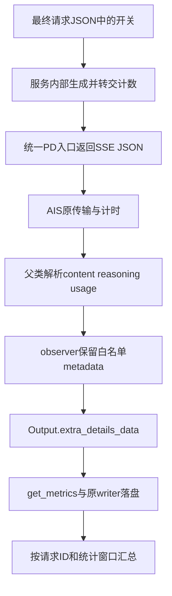

# SGLang 流式压测：怎样保留接受率和缓存计数，又不改坏计时

那轮 8 条请求的文本都正常生成，实际输入 16388 token，输出 1024。我们也确认，最终请求体里确实带着 `return_spec_tokens_details=true`、`stream=true`；n 未显式指定，诊断按默认 1 处理。

结果里却没有投机明细。把解析到的事件数量记下来，每条约 180～182 个 SSE JSON，8 条请求的 `sglext` 出现次数全部为零。

这个现象把问题分成了两段：服务究竟有没有把计数发出来，客户端收到以后又有没有保留下来。只在配置里打开一个开关，完成不了整条链路；而为了补齐字段重新写一套流式客户端，又容易连性能统计一起换掉。

本文沿我们实际使用的 SGLang Ascend 适配与 AISBench 路径展开。模型是 DeepSeek-V4-Flash，设备为 Ascend 910C，真实 PD。AISBench 基准为固定提交 [`e00d1f7`](https://github.com/AISBench/benchmark/tree/e00d1f758310c45580576af291a3126919776c89)，现场API源码另有精确SHA绑定；SGLang侧按冻结文件记录，不把这套扩展字段当作所有版本的统一接口。[脱敏证据](../../assets/sglang-stream-acceptance-cache-timing/evidence.json)和[离线回放示例](../../examples/sglang-stream-telemetry/README.md)随文保留。

## 一、一个网络片段、一个SSE事件和一个token是三件事

网络读取的一块字节，不一定刚好是一条完整消息。一条JSON可能被拆开，多个事件也可能在同一次读取中到达。SSE以自己的边界组织事件；[事件流规范](https://html.spec.whatwg.org/multipage/server-sent-events.html#event-stream-interpretation)定义了文本字段与事件解释方式，并没有承诺每次网络读取就是一个模型token。

我们这版AISBench的`iter_lines()`先按事件分隔符拼接字节，`stream_infer()`再解析`data:`中的JSON，遇到`[DONE]`结束。这个过程应由原客户端继续负责，observer接在已经解析好的JSON之后。

SGLang回包里的事件也各有用途。普通`choices[].delta.content`带文本，reasoning走对应字段；我们冻结的聊天服务实现还会在响应尾部构造`choices=[]`的`sglext`事件，随后按设置发送usage事件。它们没有新正文，仍然是流的一部分。

投机解码尤其容易暴露“一个事件等于一个token”的误解。一次验证可能接受多个token，文本又经过解码和输出缓冲，最终事件数量可以远少于completion token数。不能数SSE条数代替输出长度，也不能拿相邻事件的间隔当作每个token独立完成的耗时。

## 二、先确认字段走到了哪一层

我们关心的响应字段分两组。投机明细在`sglext.spec_tokens_details`，缓存计数在`usage.prompt_tokens_details.cached_tokens`，并配合usage里的输入、输出token数使用。



第一步看最终发送体。我们用的适配器把`generation_kwargs`合并到请求JSON根部，并在stream模式下设置`stream_options.include_usage=True`。因此，投机开关放在这一层；不能把其他SDK的`extra_body`调用习惯直接抄成JSON里额外嵌套的一层。

第二步看实际到达解析器的事件。文章开头那8条诊断已经证明，请求开关存在，但这次客户端解析到的SSE没有`sglext`。排查应继续沿服务计数生成、响应封装和PD转发路径推进。继续给客户端增加一个“读取sglext”的函数，无法补出没收到的数据。

缓存也一样。客户端请求usage，不等于服务一定返回cached token；这次服务还需要相应的缓存报告支持和设置。缺少字段时保存“未观测”，而不是填0。0意味着观测到了零命中，和不知道命中多少，会引导出不同的性能判断。

## 三、原解析器处理完，再补充保存

原`VLLMCustomAPIChat.parse_stream_response()`会累积content、reasoning并读取usage，但这个版本的流式方法没有自动把上述自定义投机字段放进结果。非流式路径有额外数据处理，stream需要核对它自己的分支。

我们选择了一个很薄的子类：

```python
class SGLangTelemetryChat(VLLMCustomAPIChat):
    async def parse_stream_response(self, json_content, output):
        await super().parse_stream_response(json_content, output)
        retain_metadata(json_content, output)
```

代码只接在父类后面。内容拼接、usage更新继续沿原实现；传输方法和`record_time_point()`都没有重写。计数放进`output.extra_details_data`，后处理从这一附加字段读取。

保留时也有范围。历史observer针对n=1的响应级字典，复制计数与直方图白名单，序列化后限制在8KiB以内。n>1可能返回列表，不能默认为第一项就是整条请求。额外字段异常也不应把已经生成成功的请求改成失败，模型结果状态与计数可用状态分别保存。

usage通常是快照，连续多次返回时保留最后观测值，不能把每次`completion_tokens`相加。投机明细则按本次协议期望一份final metadata。出现多份，要记录事件数量、判断是否符合协议；不能每来一份就把累计correct、proposed和verify再加一遍。

例如，一条请求的连续usage分别报告已输出20、50、100个token，最后完成数是100，逐事件相加却会变成170。遇到持续usage模式，要先确定哪一份是完整终态；本次独立observer保留最后一次快照，仍由离线检查核对它与约定输出长度是否一致。

原工具的性能写盘路径也核对过：`BaseInferencerOutputHandler`在perf模式下调用`Output.get_metrics()`，附加字段随结果交给原writer，数组类时序另有关联数据库存储。内存里能打印出一份字典，只说明前半段完成；还需要在实际details文件中找到它。

## 四、不动计时函数，也要看metadata事件落在哪里

关键顺序在[`BaseAPIModel.stream_infer()`](https://github.com/AISBench/benchmark/blob/e00d1f758310c45580576af291a3126919776c89/ais_bench/benchmark/models/api_models/base_api.py#L482)：发送前记录一次时间；收到一个进入解析路径的SSE JSON，在调用`parse_stream_response()`之前，又记录一次时间。`[DONE]`在这一步之前退出，不再记点。

这意味着，`choices=[]`不等于“没有计时点”。metadata钩子开始执行时，这个事件的时间已经在列表里了。原汇总随后采用首尾时刻计算E2E，以第二个点减第一个点计算TTFT，并从后续时间点相邻差计算ITL。

下面是一条人工构造的时间线，输出计数假定为8，只用于演示规则：

| 时刻 | 事件 |
| ---: | --- |
| 0 ms | 请求发送前记点 |
| 100 ms | 第一条文本事件 |
| 140 ms | 第二条文本事件 |
| 160 ms | 仅投机明细，choices为空 |
| 180 ms | 仅usage，choices为空 |

按该版本的原规则，E2E为180ms，TTFT为100ms，TPOT为`(180-100)/(8-1)=11.4286ms`，ITL样本为40、20、20ms。若后处理偷偷删除两条尾部事件，E2E就变成140ms，TPOT变成5.7143ms，ITL也只剩40ms。同一条流被换了统计口径，数字却很像一次性能变化。

反过来，增加metadata事件有时还会降低ITL的均值，因为增加了更短的事件间隔。这同样不等于模型生成更快。该版TTFT也按第一个被记录的SSE计算，不能自动改称“第一个非空文本token时间”；若要研究可见文本延迟，可以另外定义并保留对照。

因此，我们保留原事件时间线，明确标注metadata ON。旧metadata OFF与新ON之间，响应内容和事件序列可能已发生变化，不能只因请求数据一样，就把二者称为纯数据对照。

## 五、时钟规则沿用，观测开销仍然存在

保留原计时函数，解决的是统计规则被悄悄替换的问题，并不保证observer零开销。

字典复制、字段校验和序列化检查都消耗CPU时间。它们接在事件解析之后，可能影响客户端处理下一条事件的时机；服务生成额外metadata也有自己的成本。没有测过这些阶段，就不把影响写成“可以忽略”，更不从SSE间隔推算draft或verify设备耗时。

随文回放把两种问题分开。它提取固定源码中的原`iter_lines`、`stream_infer`和父类解析方法，用相同人工事件、假响应和确定性时钟，对比普通类与observer类。检查content、reasoning、输入输出计数、成功状态和时间点序列完全一致；再把UTF-8字节流按7字节拆开，重新走原事件拼接逻辑。

回放已经通过，缺失cached token、多份final metadata和错误直方图也有检查。它没有HTTP、模型或NPU，人工时间不是实际性能。真实registry导入和writer路径则用此前绑定的执行证据说明，没有把这份CPU fixture冒作完整端到端验证。

实际接入时，新模块还要进入worker的导入路径，并能在配置dump后重新加载。我们曾因后处理进程缺少扩展模块而丢掉native报告，所以运行、worker和离线汇总使用相同的模块路径，是这条数据链的一部分。[完整小样例](../../examples/sglang-stream-telemetry/README.md)给出了与前一篇独立配置衔接的方法。

## 六、拿到整数以后，接受率和AL还得分别计算

字段保留下来，下一步才是解释字段。输出AL在这次实现里按completion token数除以verify调用数计算；严格draft接受率则需要接受的draft数与实际提出的draft数。分子分母所处阶段、bonus和结束截断，都要与服务源码对应。

例如，保留的本地`tokenizer_manager`实现里，返回的proposed字段按`verify_ct × (speculative_num_draft_tokens-1)`生成。固定每轮五草稿时可以按对应合同核对；到了可变预算或Compact路径，仅凭字段名仍叫proposed，不能证明它已经记录了实际生成候选的数量。

一轮旧静态G5/verify6、带专家诊断的N160记录，覆盖160/160，保留了以下整数：

| 项目 | 值 |
| --- | ---: |
| completion tokens | 163840 |
| verify调用数 | 28434 |
| accepted drafts，结束截断前计数 | 135905 |
| 固定五草稿合同下的proposed分母 | 142170 |
| output AL | 5.7621 |
| 该固定合同下draft接受比例 | 95.5933% |

这里AL用`163840/28434`，接受比例用`135905/142170`。bonus不混进draft接受分子；输出AL又可能受prefill首token和终止截断影响，不能拿`(AL-1)/gamma`替代真实分母计算。当前Compact若没有实际proposal分母，严格接受率就继续标为未观测。

直方图提供另一种校验。若`H[k]`表示接受k个draft的轮数，应核对`sum(H)=verify_ct`和`sum(k×H[k])=correct_drafts`。汇总多条请求时先加整数再求比值，保留覆盖数与缺失数；逐请求百分比直接平均，会给不同分母的请求相同权重。

用两条构造请求就能看出差别：一条接受5/5，另一条接受25/50，平均百分比为75%；合并整数后是30/55，约54.55%。如果报告的是这组请求所有候选的接受比例，就应该使用后一个结果。平均每请求接受率也可以研究，但要单独命名。

缓存也先保整数：prompt、completion、cached各是多少，cached是否落在0到prompt之间。128K那轮640条的逐请求计数都是`118784/131076=90.6222%`，这比只报一个平均90%更具体。[缓存场景文章](128k-prefix-cache-benchmark-calibration.md)保留了从未达标到逐条达标的过程。

## 七、让计数与性能表对应同一组请求

最后一个容易漏掉的连接点，是统计窗口。whole计数覆盖640条，native性能表可能只纳入其中549条；没有把实际选中ID关联起来，就不能把whole AL或接受比例填到native那一行。

我们使用独立CPU后处理读取已结束的原details，核对请求ID、数量、原文件SHA和metadata状态，按已证明的计数合同汇总。原始JSONL和时序数据库保持不变，采集或解析错误先修已有结果，不自动重发模型请求。缺字段的请求仍计入覆盖说明，不能从接受率统计里静默消失。

收到metadata也不替代请求结束证据。实际completion是否完整、原任务是否退出，以及服务是否还留有请求，都与保存了一份字典不同。需要观察`[DONE]`或finish reason时，可以增加独立诊断记录；如果进一步更改原客户端的结束判据，就要把这项变化也记录下来，不能继续当成只增加字段。

报告里于是同时有两类状态：推理是否成功，以及这条请求的metadata是否足以计算某项指标。成功生成但缺proposed分母，是可以存在的结果；它告诉我们该补哪段观测，不需要把接受率填成0来凑齐主表。

这次接入最后保留的边界也很清楚：原客户端负责传输、解码和计时，observer补充保存已收到的字段，离线工具按来源与窗口计算。以后升级服务或换投机模式，先检查字段在哪里产生、经哪些事件返回、怎样被写入，再判断旧分母还能不能继续使用。这样增加一项重要统计时，原来的性能表仍有可追查的含义。
