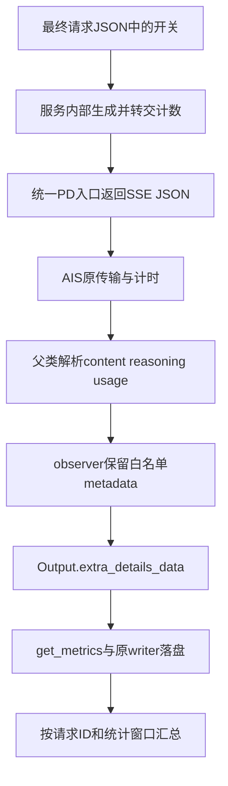

# SGLang 流式压测：怎样保留接受率和缓存计数，又不改坏计时

那轮诊断发了 8 条请求，实际输入 16388 token、输出 1024，文本均正常生成。检查最终请求体，`return_spec_tokens_details=true` 和 `stream=true` 都已带上；每请求返回的序列数 `n` 没有显式指定，诊断按默认 1 处理。

但结果中没有投机明细。逐条统计解析后的 SSE JSON，每条约 180～182 个事件，8 条请求中 `sglext` 的出现次数均为零。

因此要先区分两种情况：服务有没有返回计数，客户端有没有保存已收到的计数。配置开关存在，并不说明字段已经到达结果文件。接入观测时还要保留原流式客户端，否则字段补上了，计时规则却可能一并改变。

下文使用当时 SGLang Ascend 适配和 AISBench 的实际路径，模型为 DeepSeek-V4-Flash，设备为 Ascend 910C，采用真实 PD 服务。AISBench 基准固定在 [`e00d1f7`](https://github.com/AISBench/benchmark/tree/e00d1f758310c45580576af291a3126919776c89)，现场 API 源码另有精确 SHA；SGLang 也按冻结文件记录。这些扩展字段只适用于对应实现，不代表所有版本的统一接口。材料见[脱敏证据](../../assets/sglang-stream-acceptance-cache-timing/evidence.json)及[离线回放示例](../../examples/sglang-stream-telemetry/README.md)。

## 一、一个网络片段、一个SSE事件和一个token是三件事

网络读取以字节块返回，一条 JSON 可能跨多次读取，多条事件也可能同时到达。SSE 再按自身边界解释文本字段，[事件流规范](https://html.spec.whatwg.org/multipage/server-sent-events.html#event-stream-interpretation)没有规定网络块与模型 token 一一对应。

该版 AISBench 的 `iter_lines()` 先按事件分隔符拼接字节，`stream_infer()` 再解析 `data:` 中的 JSON，遇到 `[DONE]` 结束。接入 observer 时，继续使用原客户端完成这些工作，只在 JSON 已解析后补充处理。

返回事件还包含多种内容。`choices[].delta.content` 携带普通文本，reasoning 使用相应字段；冻结的聊天服务在末尾构造 `choices=[]` 的 `sglext` 事件，再按配置返回 usage。后两种即使没有正文，也仍属于响应流。

投机解码一次验证可以接受多个 token，输出又可能经过文本解码和缓冲，所以 SSE 事件数可以远少于 completion token 数。事件数量无法代替输出长度，相邻事件间隔也不能当作单个 token 的独立生成时间。

## 二、先确认字段走到了哪一层

这次保存两组字段：`sglext.spec_tokens_details` 中的投机明细，以及 `usage.prompt_tokens_details.cached_tokens` 中的缓存计数。解释缓存时，还要一并读取 usage 的输入与输出 token 数。



先检查实际发送的 JSON。该适配器将 `generation_kwargs` 合并到根部，在 stream 模式设置 `stream_options.include_usage=True`，投机开关也应放在这一层。其他 SDK 的 `extra_body` 是调用接口约定，不能直接照搬成请求 JSON 中的新嵌套层。

再看解析器实际收到什么。开头 8 条请求的开关存在，却未解析到 `sglext`，接下来应查服务计数生成、响应封装和 PD 转发。增加客户端读取函数无法补回尚未收到的数据。

缓存计数也需要相应服务实现和设置。请求 usage 不保证返回 cached token。缺失时记录未观测，只有实际返回零才能记为 0；否则会把未知命中量误判成零命中，影响性能解释。

## 三、原解析器处理完，再补充保存

原 `VLLMCustomAPIChat.parse_stream_response()` 已累积 content、reasoning 并读取 usage，但该版 stream 分支未自动保存这些自定义投机字段。非流式方法具有额外处理，不能据此推断流式方法也会保留。

接入采用下面的薄子类，先调用父类解析：

```python
class SGLangTelemetryChat(VLLMCustomAPIChat):
    async def parse_stream_response(self, json_content, output):
        await super().parse_stream_response(json_content, output)
        retain_metadata(json_content, output)
```

父类继续负责文本拼接和 usage 更新，子类只将计数放到 `output.extra_details_data`，供后处理读取。传输方法与 `record_time_point()` 均保留原实现。

历史 observer 只处理 n=1 的响应级字典，按白名单复制计数与直方图，并将序列化结果限制在 8KiB 内。n>1 可能返回列表，不能只取第一项当作完整请求。附加字段异常也不应改变已成功生成的状态，推理结果与计数是否可用需要分别保存。

usage 通常为累计快照，多次返回应保留最后观测值，不能累加各次 `completion_tokens`。投机协议在这里预期一份 final metadata，若收到多份，要记录次数并检查协议，而不能将每份累计 correct、proposed、verify 再相加。

例如 usage 先后报告已输出 20、50、100 个 token，最后结果为 100，累加会得到错误的 170。本次 observer 保存末次快照，再由离线检查确认它与约定输出长度是否一致。持续 usage 模式也应先确认终态快照的规则。

写盘路径同样需要核对。perf 模式由 `BaseInferencerOutputHandler` 调用 `Output.get_metrics()`，再将附加字段送给原 writer；数组时序另存于关联数据库。内存字典存在还不够，应在实际 details 中确认字段落盘。

## 四、不动计时函数，也要看metadata事件落在哪里

原 [`BaseAPIModel.stream_infer()`](https://github.com/AISBench/benchmark/blob/e00d1f758310c45580576af291a3126919776c89/ais_bench/benchmark/models/api_models/base_api.py#L482) 在发送前记录时间，并在每个进入解析路径的 SSE JSON 调用 `parse_stream_response()` 前再次记点。`[DONE]` 在这个位置之前退出，不会新增记点。

所以 `choices=[]` 的 metadata 事件仍可能带来时间点。执行 metadata 钩子时，记点已经完成；后续汇总用首尾时刻计算 E2E，第二点减第一点计算 TTFT，并用后续相邻时间差生成 ITL。

以下教学时间线假定输出计数为 8，用于演示事件对指标的影响：

| 时刻 | 事件 |
| ---: | --- |
| 0 ms | 请求发送前记点 |
| 100 ms | 第一条文本事件 |
| 140 ms | 第二条文本事件 |
| 160 ms | 仅投机明细，choices为空 |
| 180 ms | 仅usage，choices为空 |

按原规则，这条请求 E2E 为 180ms，TTFT 为 100ms，TPOT 为 `(180-100)/(8-1)=11.4286ms`，ITL 样本为 40、20、20ms。若删去两条尾部事件，E2E 就变为 140ms、TPOT 为 5.7143ms，ITL 只剩 40ms。输入流没有变，只是统计删了事件，就能产生很大的指标差别。

增加较短的 metadata 间隔，也可能拉低平均 ITL，却未加快模型计算。该版 TTFT 使用第一个已记点 SSE，未必对应首个非空正文 token。要研究可见文本延迟，可以单独定义指标，同时保留原结果。

因此接入保留原事件时间线，并将结果标记为 metadata ON。与旧 metadata OFF 相比，回包内容和事件序列都可能变化；即使请求相同，也不能将它们直接当作纯数据采集对照。

## 五、时钟规则沿用，观测开销仍然存在

沿用原计时函数可以避免替换统计规则，observer 本身仍然需要执行时间。

复制字典、校验和序列化会消耗 CPU，可能推迟下一事件的处理；服务生成 metadata 也有成本。没有测量就无法判断影响是否可忽略，更无法从 SSE 间隔分离 draft、verify 的设备耗时。

离线回放检查的是解析与计时规则。它从固定源码提取原 `iter_lines`、`stream_infer` 和父类解析方法，用相同人工事件、假响应与确定性时钟比较普通类及 observer 类，核对 content、reasoning、输入输出计数、成功状态和时间点序列一致。另将 UTF-8 字节流按 7 字节拆开，再经过原拼接逻辑。

回放已通过，并覆盖 cached token 缺失、多份 final metadata 和错误直方图。它没有运行 HTTP、模型或 NPU，人工时间不能用于性能结论。真实 registry 导入与 writer 路径沿用此前绑定的执行证据，本次 CPU fixture 未重新证明完整端到端流程。

实际 worker 还需要找到扩展模块，并能在配置 dump 后重新导入。我们曾因后处理进程缺少模块而丢失 native 报告，因此运行、worker 和离线汇总都要使用正确模块路径。[完整小样例](../../examples/sglang-stream-telemetry/README.md)展示了如何与独立配置衔接。

## 六、拿到整数以后，接受率和AL还得分别计算

字段落盘后，还需确认服务怎样生成这些整数。该实现的输出 AL 使用 completion token 数除以 verify 调用数；严格 draft 接受率需要接受的 draft 数与实际提出数。计数阶段、bonus 和结束截断必须与对应源码一致。

冻结的本地 `tokenizer_manager` 将 proposed 写为 `verify_ct × (speculative_num_draft_tokens-1)`。固定每轮五草稿时，可以按这个合同核对；切换到可变预算或 Compact 后，仍叫 proposed 的字段不一定代表实际生成候选数，需要重新检查来源。

一轮带专家诊断的旧静态 G5/verify6、N160 记录覆盖 160/160 请求，保存了这些计数：

| 项目 | 值 |
| --- | ---: |
| completion tokens | 163840 |
| verify调用数 | 28434 |
| accepted drafts，结束截断前计数 | 135905 |
| 固定五草稿合同下的proposed分母 | 142170 |
| output AL | 5.7621 |
| 该固定合同下draft接受比例 | 95.5933% |

表中 AL 由 `163840/28434` 计算，接受比例由 `135905/142170` 计算。draft 接受分子不含 bonus，输出 AL 则还可能受 prefill 首 token 和终止截断影响。因此 `(AL-1)/gamma` 不能替代实际分母；Compact 未采到实际 proposal 时，严格接受率仍应标为未观测。

还可用直方图核验累计数。若 `H[k]` 为接受 k 个 draft 的轮数，应有 `sum(H)=verify_ct`、`sum(k×H[k])=correct_drafts`。跨请求汇总先累加整数，再计算比例，并保存覆盖与缺失数；直接平均逐请求比例会忽略分母差别。

例如两条教学请求分别接受 5/5、25/50，等权平均百分比是 75%；合并整数为 30/55，约 54.55%。要描述全部候选的接受比例，应使用合并值。若研究平均每请求比例，则另行命名。

缓存也先保存 prompt、completion、cached 整数，核对 cached 是否位于 0 到 prompt 之间。128K 那轮 640 条请求均记录 `118784/131076=90.6222%`，比平均约 90% 更能说明实际负载。[缓存场景文章](128k-prefix-cache-benchmark-calibration.md)记录了校准过程。

## 七、让计数与性能表对应同一组请求

接受计数还要与性能表使用相同请求。whole 覆盖 640 条，native 可能只选 549 条；若未按实际入选 ID 关联，就不能把 whole AL 或接受比例放进 native 一行。

我们用独立 CPU 后处理读取已结束的原 details，核对请求 ID、数量、原文件 SHA 和 metadata 状态，再按已确认的计数合同汇总。原 JSONL 与时序数据库保持不变，采集解析错误先修原数据，不自动重发请求。缺字段的请求仍计入覆盖说明，不能静默从统计中移除。

metadata 到达也不足以证明请求结束。还需分别核对 completion 是否完整、任务是否退出、服务是否留有请求。需要时可独立记录 `[DONE]` 或 finish reason；若修改了客户端结束判据，就应明确记录这项行为变化。

最终报告分别保存推理状态和 metadata 可用状态。成功生成却缺少 proposed 分母是有效结果，说明观测仍有缺口。此时接受率应标为未观测，填 0 会错误表示已经测到了零接受。

这次接入由原客户端负责传输、解析和计时，observer 保存已收到字段，离线工具按来源与窗口计算指标。升级服务或投机模式时，应重新核对字段生成、返回事件和写盘路径，再决定原计数合同是否仍可使用。
