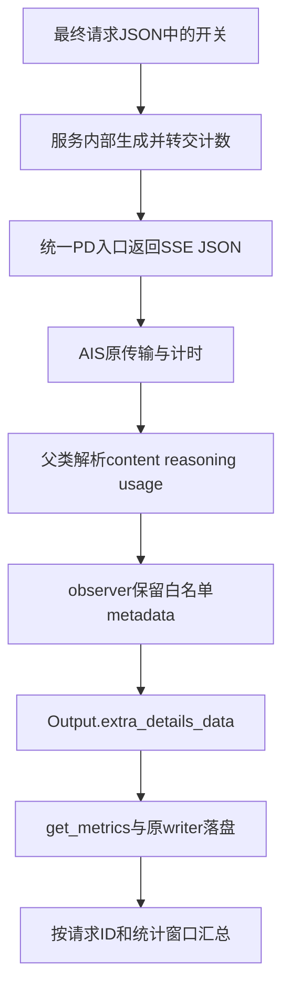

# SGLang 流式压测：怎样保留接受率和缓存计数，又不改坏计时

8 条诊断请求都生成了正常文本，输入各 16388 token，输出各 1024。最终发出的请求体里也能找到 `return_spec_tokens_details=true` 和 `stream=true`；`n` 没有显式设置，这次按默认的单序列响应处理。

投机明细却没有回来。我们逐条数过解析后的 SSE JSON：每条请求约 180～182 个事件，8 条里 `sglext` 的出现次数全是零。

问题到这里就分成了两段：服务是否返回计数，客户端是否把收到的计数写进结果。请求里有开关，只能证明开关发出去了。补齐这条链路时，还碰到了另一个容易漏掉的问题：新增的尾部事件本身就可能改变流式指标。

下面沿用当时真实 PD 服务的代码：DeepSeek-V4-Flash、Ascend 910C，AISBench 固定在 [`e00d1f7`](https://github.com/AISBench/benchmark/tree/e00d1f758310c45580576af291a3126919776c89)，现场 API 源码另记了精确 SHA，SGLang 也有对应冻结文件。自定义字段的解释以这些实现为准。[脱敏证据](../../assets/sglang-stream-acceptance-cache-timing/evidence.json)里保留了排查材料，[离线回放示例](../../examples/sglang-stream-telemetry/README.md)可以单独检查客户端行为。

## 一、一个网络片段、一个SSE事件和一个token是三件事

一次网络读取可能只拿到半条 JSON，也可能同时拿到几条事件。SSE 根据事件边界解释文本，[事件流规范](https://html.spec.whatwg.org/multipage/server-sent-events.html#event-stream-interpretation)没有要求网络块与模型 token 一一对应。

这版 AISBench 先用 `iter_lines()` 按事件分隔符拼接字节，再由 `stream_infer()` 解析 `data:` 里的 JSON，遇到 `[DONE]` 退出。observer 接在 JSON 解析完成之后，因此仍由原客户端处理拆包和拼包。

解析出来的事件也不全是正文。普通文本在 `choices[].delta.content`，reasoning 有相应字段；这份聊天服务还会在末尾发送 `choices=[]` 的 `sglext` 事件，再按配置返回 usage。它们没有可显示的文字，却仍然经过响应流。

一次投机验证可能接受多个 token，文本解码和缓冲又可能合并输出。于是，SSE 事件数远少于 completion token 数是正常现象。两个事件相隔多久，描述的是客户端看到事件的节奏，不能直接换成一个 token 的生成时间。

## 二、先确认字段走到了哪一层

我们要留下两组数据：`sglext.spec_tokens_details` 中的投机计数，以及 `usage.prompt_tokens_details.cached_tokens` 中的缓存计数。usage 里的输入、输出 token 数也要一起保存，后面计算比例还用得到。



排查从真正发出的 JSON 开始。这个适配器把 `generation_kwargs` 合并到根部，流式模式还设置 `stream_options.include_usage=True`；投机开关也放在根部。有些 SDK 把附加参数叫 `extra_body`，那是 SDK 的调用约定，照抄成 JSON 嵌套层就变成了另一种请求。

开头那 8 条请求已经排除了“开关没发出”这一项。接下来要沿服务计数生成、响应封装、PD 转发往下找，直到解析器能实际看到 `sglext`。客户端多写一个读取函数，解决不了上游没有返回字段的问题。

usage 也有相同的依赖：对应服务需要实现并启用 cached token 返回。字段缺失记为未观测，实际返回零才记 0，这样性能表才分得清“没有命中”和“没有采到命中量”。

## 三、原解析器处理完，再补充保存

原 `VLLMCustomAPIChat.parse_stream_response()` 已经负责累积 content、reasoning 和更新 usage，但这版 stream 分支没有自动保存自定义投机字段。非流式方法里的额外处理走的是另一条路径。

因此扩展只需要一个薄子类，先让父类完成原来的解析：

```python
class SGLangTelemetryChat(VLLMCustomAPIChat):
    async def parse_stream_response(self, json_content, output):
        await super().parse_stream_response(json_content, output)
        retain_metadata(json_content, output)
```

子类把收到的计数放进 `output.extra_details_data`，后处理再从这里取。正文拼接、usage 更新仍交给父类，传输方法和 `record_time_point()` 沿用原实现。

历史 observer 只接收 n=1 的响应级字典，按白名单复制计数和直方图，序列化后最多 8KiB。n>1 可能返回列表，只取第一项会漏掉其他序列。附加字段解析失败时，已经成功生成的文本仍然有效；结果中要分别记录推理状态和计数状态。

累计字段不能见一次加一次。usage 多次返回时保留最后观测值；这份投机协议则预期只有一份 final metadata。若收到了多份，先记录出现次数、核对协议，避免把累计的 correct、proposed、verify 重复求和。

例如 usage 依次报告已输出 20、50、100 个 token，最终输出是 100。把三个快照相加就成了 170。本次 observer 保存末次快照，离线再与输出长度核对；持续 usage 模式也需要确认末次快照的含义。

最后还得走到磁盘。perf 模式下，`BaseInferencerOutputHandler` 调用 `Output.get_metrics()`，再将附加字段交给原 writer；数组时序另存于关联数据库。真正能供后处理使用的是 details 中的字段，调试时看到内存字典还差这一步。

## 四、不动计时函数，也要看metadata事件落在哪里

计时差异藏在 [`BaseAPIModel.stream_infer()`](https://github.com/AISBench/benchmark/blob/e00d1f758310c45580576af291a3126919776c89/ais_bench/benchmark/models/api_models/base_api.py#L482) 中。它在发送前记一次时间，每个进入解析路径的 SSE JSON 又在调用 `parse_stream_response()` 前记一次。`[DONE]` 提前退出，不新增时间点。

这意味着 `choices=[]` 的 metadata 也可能占一个时间点，而且 observer 开始执行时已经记完了。后处理用首尾时刻求 E2E、第二点减第一点求 TTFT，后续相邻时间差则成为 ITL 样本。

拿一条输出计数为 8 的教学时间线来看：

| 时刻 | 事件 |
| ---: | --- |
| 0 ms | 请求发送前记点 |
| 100 ms | 第一条文本事件 |
| 140 ms | 第二条文本事件 |
| 160 ms | 仅投机明细，choices为空 |
| 180 ms | 仅usage，choices为空 |

原规则得到 E2E 180ms、TTFT 100ms、TPOT `(180-100)/(8-1)=11.4286ms`，ITL 样本为 40、20、20ms。若在统计时删去两条尾部事件，同一条流就成了 E2E 140ms、TPOT 5.7143ms，ITL 只剩 40ms。模型没有因此算得更快，变化来自删点。

反过来，新增几个很短的 metadata 间隔也可能拉低平均 ITL。这版 TTFT 取第一个已记点的 SSE，它也未必带有非空正文。可见文本延迟可以另算一个指标，但要给它独立的定义和名称。

本次接入保留原事件时间线，将结果标记为 metadata ON。与旧 metadata OFF 对比时，要把回包和事件序列的变化一起考虑进去，不能只把差值归到 observer 的执行时间。

## 五、时钟规则沿用，观测开销仍然存在

原计时函数保留下来以后，字典复制、校验、序列化仍会消耗 CPU，并可能推迟下一事件的处理，服务生成 metadata 也有成本。这些开销没有实测，不能先认定可以忽略；SSE 间隔同样不足以拆出 draft 和 verify 的设备耗时。

离线回放用来检查另一件事：加了 observer，原解析和记点规则有没有变。回放从固定源码提取 `iter_lines`、`stream_infer` 和父类解析方法，给普通类与 observer 类喂相同人工事件、假响应和确定性时钟，比较 content、reasoning、输入输出计数、成功状态、时间点序列。UTF-8 字节流还按每块 7 字节拆开，再走原拼接逻辑。

这些回放已经通过，也覆盖了 cached token 缺失、多份 final metadata、错误直方图。它们是 CPU fixture，没有发 HTTP 请求或运行模型、NPU，人工时钟只能验证规则。registry 导入和 writer 路径沿用此前绑定的执行证据，这次没有重新运行完整端到端流程。

扩展模块还必须能被实际 worker，以及配置 dump 后的新进程导入。我们曾因后处理进程缺少模块丢掉 native 报告，所以运行进程和离线汇总都要配好模块路径。[完整小样例](../../examples/sglang-stream-telemetry/README.md)给出了独立配置的接法。

## 六、拿到整数以后，接受率和AL还得分别计算

计数落盘后，先查它们从哪里来。该实现用 completion token 数除以 verify 调用数得到输出 AL；严格 draft 接受率则需要接受的 draft 数除以实际提出数。bonus、计数阶段和结束截断都会影响两个式子的关系。

冻结的本地 `tokenizer_manager` 把 proposed 写成 `verify_ct × (speculative_num_draft_tokens-1)`。每轮固定五个草稿时可以据此核对，切换到可变预算或 Compact 后，就要重查这个字段是否还等于实际候选数。字段名相同，不代表分母的来源仍然相同。

旧静态 G5/verify6、N160 的专家诊断记录覆盖了 160/160 请求，留下以下整数：

| 项目 | 值 |
| --- | ---: |
| completion tokens | 163840 |
| verify调用数 | 28434 |
| accepted drafts，结束截断前计数 | 135905 |
| 固定五草稿合同下的proposed分母 | 142170 |
| output AL | 5.7621 |
| 该固定合同下draft接受比例 | 95.5933% |

这里 AL 是 `163840/28434`，draft 接受比例是 `135905/142170`。后者分子不含 bonus，前者还可能受 prefill 首 token 和终止截断影响。直接套 `(AL-1)/gamma` 会绕开这些差别；Compact 若没采到实际 proposal，严格接受率就仍然缺少分母。

直方图可以再做一次交叉核对。令 `H[k]` 表示接受 k 个 draft 的轮数，应满足 `sum(H)=verify_ct`、`sum(k×H[k])=correct_drafts`。跨请求汇总先把整数加起来，再除，同时保留覆盖数和缺失数。

例如两条教学请求分别接受 5/5、25/50，逐请求百分比的平均值是 75%，合并后却是 30/55，约 54.55%。前者描述平均每请求的比例，后者才描述全部候选的接受比例，二者回答的问题不同。

缓存记录也保留 prompt、completion、cached 的原始整数，并检查 `0≤cached≤prompt`。128K 那轮 640 条请求逐条都是 `118784/131076=90.6222%`，这比一句“平均约 90%”多交代了实际覆盖情况。校准过程在[缓存场景文章](128k-prefix-cache-benchmark-calibration.md)中。

## 七、让计数与性能表对应同一组请求

计数齐了，还要选对请求。whole 有 640 条，native 可能只选了 549 条。需要按实际入选 ID 关联之后再汇总，否则就会把 whole 的 AL 或接受比例填进 native 的性能行。

我们在原任务结束后，用独立 CPU 后处理核对 details 的请求 ID、数量、原文件 SHA 和 metadata 状态，再按确认过的计数定义汇总。原 JSONL 和时序数据库保留；解析出了问题就修后处理，避免为这件事重发请求。缺字段的请求也留在覆盖说明里。

收到 metadata 与请求结束是两件事。completion 是否完整、任务是否退出、服务是否还有请求，需要分别确认。可以额外保存 `[DONE]` 或 finish reason 辅助判断；如果进一步用它们改变客户端的结束判据，也要记录这项变化。

最终结果中，成功生成与 metadata 可用各有一个状态。成功请求缺少 proposed，说明接受率还没观测完整。填 0 会把这个缺口写成“已测得零接受”，反而丢失了信息。

服务或投机模式升级后，最值得重查的是这条链路：整数如何生成、通过哪个事件返回、最终落在哪个字段。三处能对上，旧计数定义才有继续使用的依据。
