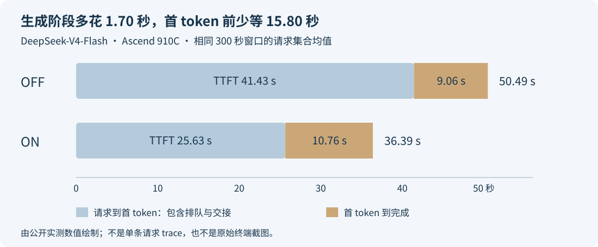

# 平均 TPOT 变差了，吞吐却提高了：这两个指标为什么不矛盾？

看动态 EPLB 的压测结果时，有一项很容易让人犹豫：输出吞吐提高了，平均 TPOT 却变差了。这究竟是优化有效，还是 Decode 被拖慢了？

我在 DeepSeek-V4-Flash 的一组 OFF/ON 对照里遇到了这个组合：输出吞吐从 2648.89 提高到 3627.05 token/s，平均 TPOT 从 8.85 增加到 10.52 ms/token。与此同时，平均首 token 等待从 41.43 秒缩短到 25.63 秒，整条请求从 50.49 秒缩短到 36.39 秒。

先从一条请求的经历看：它在首 token 之前少等了十几秒，开始输出后却比原来慢了一点。再从整套服务看：同时进入生成阶段的请求更多了，每秒收到的总 token 数反而增加。

TPOT 关心一条请求开始输出后的节奏，吞吐关心所有请求合起来的产出。PD 分离中，Prefill 端还决定了请求何时能交给 Decode。下面先拆开一条请求的时间，再看两端实际在忙什么，就能读懂这组结果。

## 一、先把这组对照的条件摆出来

本文使用 [SGLang PR #49701](https://github.com/sgl-project/sglang/pull/49701) 已公开的实测材料，测试版本为 [`08865d168`](https://github.com/sgl-project/sglang/tree/08865d168dc0c3b7946f46a93ef3854b4612311f)。这是同一版代码开启、关闭动态 EPLB 的比较。旧 ND 中转与新物理存储路径的比较是另一组实验，见[存储路径重构](ascend-eplb-physical-storage-migration.md)。

| 条件 | 本组设置 |
|---|---|
| 模型与量化 | DeepSeek-V4-Flash-0731，W8A8 / modelslim |
| 设备与部署 | Ascend 910C，PD 分离；P、D 各 8 张双芯片物理卡，共 16 卡、32 芯片 |
| 每端并行 | TP16、EP16、attention DP16；CP1、PP1 |
| 实际 KV 容量 | P 800000、D 480000 token；OFF/ON 相同 |
| 冗余专家 | 两组均为每层每 EP 组 16 个冗余槽位 |
| DSpark | gamma 5，verify width 6 |
| 请求 | 固定长文本复制用例；输入 16384、输出 1024 token，共 3072 条 |
| 客户端 | `sglang.benchmark.serving`，并发 128，不限请求速率 |
| 缓存 | prefix / index cache 关闭，实际 prefix 命中 0% |
| ON 的更新 / 统计 | P 为 I50/W50；D 为 I4000/W1000 |

P 端 chunk 配置为 131072，分摊到每个 attention DP rank 为 8192 token。每组在正式请求前完成两轮 MF 短测、短输出 priming 和长输出预热。这些请求不计入下面的正式结果。OFF/ON 都完整返回 3072 条、每条 1024 token，应用失败数均为 0；配对的 3072 条完整输出文本一致。

为了观察持续负载，取各自第一条正式请求发出后的 `[60,360)` 秒，共 300 秒。吞吐按这段墙钟时间内实际收到的生成 token 增量计算；延迟统计取这段时间内启动并成功完成的请求，完整保留它们的结束时间，包括窗口结束后才返回的部分。

这两个口径分别回答“这 300 秒收到了多少 token”和“在这期间进入系统的请求等了多久”。它们的样本边界不同，不能拿表里的平均延迟再反推出一份所谓精确吞吐。

| 相同 300 秒区间 | EPLB OFF | EPLB ON | ON 相对 OFF |
|---|---:|---:|---:|
| 输出吞吐，token/s | 2648.89 | 3627.05 | +36.93% |
| 单物理卡输出吞吐，token/s | 165.56 | 226.69 | +36.93% |
| 平均 TTFT，秒 | 41.43 | 25.63 | −38.13% |
| 平均 TPOT，ms/token | 8.85 | 10.52 | +18.82% |
| 平均 E2E，秒 | 50.49 | 36.39 | −27.91% |
| 平均流式 chunk 间隔，ms | 52.96 | 62.92 | +18.82% |

单卡分母是 P+D 的全部 16 张物理卡。两组窗口内客户端平均在途并发都接近 128。统计区间、原始精度与计数保留在[公开数据](../../assets/tpot-worse-throughput-better/observed.json)中。

## 二、TPOT 变差，具体是哪一段变长了

当前测试版本的 [TPOT 计算](https://github.com/sgl-project/sglang/blob/08865d168dc0c3b7946f46a93ef3854b4612311f/python/sglang/benchmark/serving.py#L1162-L1175)是对每条输出长度大于 1 的请求，用首 token 之后的耗时，除以剩余输出 token 数：

```text
TPOT = (请求完成时间 − 首 token 到达时间) / (输出 token 数 − 1)
E2E  = TTFT + TPOT × (输出 token 数 − 1)
```

本组每条都输出 1024 token，因此每条的后半程有 1023 个 token 间隔。输出长度相同、延迟取同一请求集合，平均值也能按这个关系拆开：

| 请求的两个阶段 | OFF | ON | 变化 |
|---|---:|---:|---:|
| 发出请求到收到首 token | 41.43 s | 25.63 s | 少等 15.80 s |
| 首 token 到完整输出 | 9.06 s | 10.76 s | 多花 1.70 s |
| 合计 | 50.49 s | 36.39 s | 提前结束约 14.09 s |

这里用原始未舍入值计算，展示时四舍五入。对这组请求，生成阶段确实变慢了，只是首 token 前节省的时间更多。用户更早看到开头，也更早拿到完整结果，但开始输出后的节奏比 OFF 慢。



如果输出长短不一，就不能直接把平均 TPOT 乘上平均输出长度。长请求和短请求在逐请求平均里各占一票，但它们消耗的 token 数不同，乘积还受两者相关性影响。此时应对每条请求先算首 token 后耗时，再对同一集合求平均。本文能够直接相乘，是因为全部输出固定为 1024 token。

TTFT 从客户端发出请求开始计时，直到收到首 token，入口排队、调度、输入计算和 PD 交接都在其中。读到约 41 秒时，应沿这些阶段继续拆分。后面的 P 端排队采样，就用来解释首 token 之前的等待怎样变化。

DSpark 下还要区分 TPOT 与流式消息间隔。一次 verify 可以产生多个 token，客户端也可能一次收到多个 token，所以约 63 ms 的 chunk 间隔和约 10.5 ms/token 的 TPOT 并不矛盾。讨论逐次显示的停顿要看原始流式事件；讨论每个输出 token 的摊销时间则看 TPOT。具体口径见[whole、native、TPOT 与 ITL](aisbench-whole-native-tpot-itl.md)。

## 三、客户端并发相同，D 端的实际负载却不同

“两边都是 128 并发”容易让人以为 D 端每轮都在处理 128 条请求。PD 分离里，128 条在途请求分散在不同阶段：一部分等待 P，一部分正在 Prefill 或传 KV，只有其中一部分进入 Decode。

客户端只知道这些请求还没结束，并不知道它们分别走到了哪一步。P 的队列积压时，很多并发额度花在等待输入处理；P 更快交付后，额度就更多地转到 D 的生成阶段。因此，同样是 128 条在途请求，D 每轮面对的工作量仍可以不同。

在这组窗口内，服务指标采样给出的平均值是：

| 采样指标 | OFF | ON |
|---|---:|---:|
| P 端排队请求数 | 77.07 | 61.79 |
| D 端 running 请求数 | 31.64 | 45.21 |
| D 端排队请求数 | 0 | 0 |

这些是低频指标快照的均值，D 端两组各有 14 个样本，并非逐轮 forward 的 batch 直方图。但它们已经确认：相同客户端并发下，ON 的 D 端实际承接了更多生成请求，平均 running 数增加约 43%。

这与 P 端更快地把请求送往 D 的解释一致。D 同时照顾的请求多了，一轮工作量可以变大，单请求推进间隔随之增加；每轮送出的 token 总数也可以增加。EPLB 的整服务收益，并不要求每个阶段的每个延迟指标同时下降。

用一个普通逐 token Decode 的教学算例就能看清：batch 32 时，一轮 10 ms，输出 32 个 token，吞吐为 3200 token/s；batch 48 时，一轮 12 ms，输出 48 个 token，吞吐变为 4000 token/s。每条请求的步进间隔增加 20%，总吞吐仍提高 25%。这里没有使用实测 DSpark 计数，只是在解释 `每轮产出 / 每轮耗时` 的关系。

真实系统还会有不同上下文长度、DP 分摊、draft 与 target 的开销、请求结束补入等因素。因此，不能用 `45.21 / 31.64` 和两组 TPOT 拼出一个精确的吞吐预测，更不能把本组结果写成“相同 batch 下 Decode forward 加速了 36.93%”。它确认的是这组完整服务配置的产出与请求延迟变化。

## 四、是不是 update 暂停把 TPOT 拉高了

EPLB 迁移有成本，这个问题应该查。但只看到 ON 比 OFF 多了 update，还不足以解释平均 TPOT 的差值。

本窗口内，P 完成两次更新，分别取整轮最慢 rank 的墙钟耗时为 524、510 ms；D 完成一次，为 547 ms。P 的累计更新时间为 1.034 秒，占自己这 300 秒的约 0.345%；D 为约 0.182%。P、D 是不同端，两个比例不能加成单个请求的暂停比例；更新墙钟也不能直接当作所有请求新增等待。

公开 PR 还做了按时间重叠的诊断：ON 延迟集合中的 1062 条请求里，有 1009 条在“首 token 到完成”之间没有覆盖 D 端更新，即使把日志定位区间向前后各扩 2 秒也如此。这部分请求的平均 TPOT 仍为 10.49 ms/token，接近 ON 全体的 10.52。

这部分请求没有跨过 D 更新，TPOT 却仍接近 ON 的总体均值，因此一次迁移暂停解释不了主要差值。与此同时，采样确认 ON 的 D running 请求更多。接下来应按实际 batch、上下文和图桶对正常 forward 分组，比较同类计算是否也变慢。这样可以继续区分“每轮接了更多工作”和“相同工作执行得更慢”，而无需把整个 18.82% 都归到迁移上。

首次更新也要与这些热更新分开：本组预热期间 P、D 的首次更新分别为 1.705、1.058 秒。把它们替换进稳态更新表，或者只挑后面较短的一轮当作所有更新的耗时，都会改变读者对成本的判断。

## 五、接受率和窗口，也会让“吞吐提高”变得难解释

这组测试开了 DSpark，必须确认吞吐提升是否只是因为 ON 碰巧接受了更多 draft token。对应延迟请求集合的原生服务计数为：

| DSpark 指标 | OFF | ON |
|---|---:|---:|
| 请求数 | 770 | 1062 |
| 返回 token / verify，AL | 5.988304 | 5.988304 |
| 实际接受 / 提议 draft token | 658350 / 658350 | 908010 / 908010 |
| 实测严格接受率 | 100% | 100% |
| verify 次数 | 131670 | 181602 |

这里的严格接受率来自服务计数，排除了 bonus token；AL 是返回 token 数除以 verify 次数，受请求结束截断影响。两组请求级 AL 和接受率的范围也相同：AL 最小值、最大值均为 5.988304，严格接受率均为 100%。本组看不到“ON 接受率更高”这个解释。

长文本复制任务产生了这组稳定的高接受率。换成代码、数学或开放问答时，草稿候选与 target 的一致程度也会变化，因此新对照需要重新记录 AL、严格接受率和原始分母，再比较该业务的吞吐。

原始终端还有另一组数：完整 3072 请求的输出吞吐为 OFF 2563.60、ON 3451.06 token/s。它包含正式负载的起步与排空，和本文共同 300 秒窗口的 2648.89、3627.05 并不相同。[原始终端日志、截图和统计文件](https://github.com/AkiYangDev/sglang/releases/tag/eplb-pr49701-validation-20261111)都保留着，阅读时先对齐区间，再比较数字。

## 六、这次结果该怎么用来做决定

对这组持续并发、长输入、固定输出的复制任务，ON 的价值很明确：单位时间产出更多，平均首 token 更早，完整请求也更早结束。它同时付出了生成阶段平均 TPOT 增加的代价。报告应该把这两件事并列写出。

上线决策还要看服务承诺。如果要求平均 TPOT 不超过 10 ms，ON 的 10.52 就没有达标，吞吐提高也不能替它过关。如果目标允许更慢一点的输出节奏，却要求更短的总等待，这组变化就更符合目标。两组平均 TTFT 都超过 25 秒，也说明本并发不是交互场景的最终配置。

平均值之外，还要看同窗口的尾部：

| P95 延迟 | OFF | ON |
|---|---:|---:|
| TTFT | 96.92 s | 68.97 s |
| TPOT | 9.63 ms/token | 10.85 ms/token |
| E2E | 106.05 s | 79.76 s |

这里也是首 token 与整条请求更快、生成节奏更慢。P95 E2E 不能由 P95 TTFT 加上 P95 生成耗时算出来，因为各项最慢的请求未必是同一批。应该从每条请求的原始事件算出完整耗时，再求分位数。

满足平均 TPOT 门槛，还不代表流式停顿达标。一次短暂停顿可能被上千个 token 摊薄；若产品重视逐字显示的连贯性，需要约定 chunk 间隔或长停顿的门槛，并核对一次消息包含几个 token。相反，批量离线生成更关注完成时间和总产出，未必需要相同的交互约束。验收目标应在压测前确定，不能在看到某个指标变差后临时换一种说法。

接下来值得做的是在同一套固定请求上扫并发或到达率，画出吞吐、TTFT、TPOT 及尾延迟随负载变化的曲线。比较两种东西：相同输入压力下谁延迟更低；满足同一延迟门槛时谁承载更多请求。后者得到的是符合服务目标的有效吞吐，而不只是把卡压满后的峰值。例如按同一批请求同时判断 TTFT 与 TPOT 是否达标，只把两项都通过的完整请求计入有效产出；超时、失败与截断不能从分母里消失。这里的阈值是业务约束，不能从吞吐最高的一组结果倒推。

并发 128 的闭环压测会在请求完成后继续补入。系统变快后，客户端实际发出的请求速率也会变快，这是容量测试的一部分。若想知道业务固定每秒进入若干请求时的体验，就需要再做固定到达率的对照。不能用同一个“并发相同”同时替代这两种问题。

这次最有用的发现，是瓶颈移动后整条流水线会重新分配工作。P 端少积压，D 端多接活，单请求生成节奏与整服务产出随之朝不同方向变化。下一轮优化应继续观察 D 的组批与执行时间，也保留 P 的队列、TTFT 和完整请求结果，避免为了压低一个指标，把刚释放的吞吐又压回去。

### 数据与可运行算例

实测来源为 PR #49701 的 [candidate-evidence.zip](https://github.com/AkiYangDev/sglang/releases/download/eplb-pr49701-validation-20261111/candidate-evidence.zip)，正文只使用该组 `08865d168` 数据。以下标准库脚本重新核算原始均值、窗口 token 分母和教学 batch 算例，不会启动模型或发送请求。

- [下载数据与算例 ZIP](https://raw.githubusercontent.com/AkiYangDev/llm-inference-notes/main/assets/tpot-worse-throughput-better/examples.zip)
- [计算脚本](../../examples/tpot-worse-throughput-better/compare_metrics.py)、[完整计算输出](../../assets/tpot-worse-throughput-better/calculations.json)

```bash
python examples/tpot-worse-throughput-better/compare_metrics.py --output calculations.json
```

[返回 EPLB 专题](../distributed/eplb-study-guide.md)。
