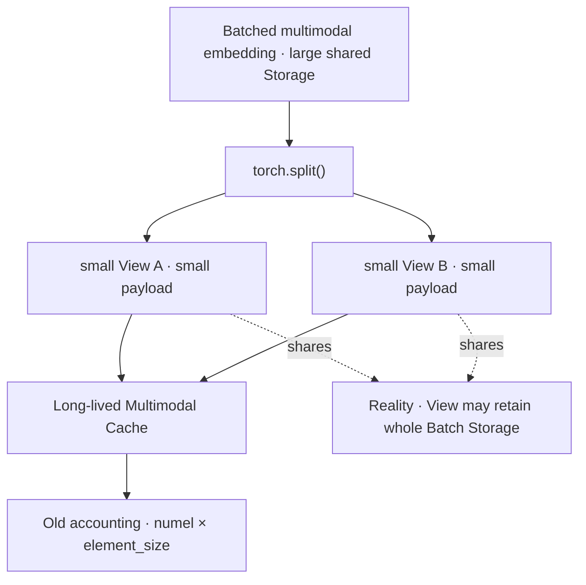
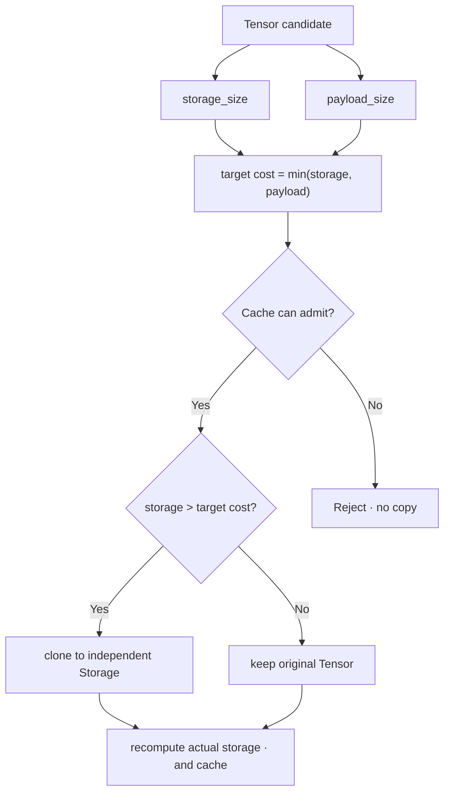

# 小 Tensor 为什么保活大内存：SGLang PR #39120 的 View 缓存修复

一个逻辑大小只有 0.8 MiB 的 Tensor，为什么会让约 7.8 MiB 内存迟迟不能释放？如果它由一个大 batch Tensor 切分而来，仍然引用整块 Storage，那么只要这个小 Tensor 留在缓存里，大块存储就会继续存活。

SGLang [PR #39120](https://github.com/sgl-project/sglang/pull/39120) 修复了多模态 Embedding Cache 的这种占用。旧实现按 Tensor 可见元素大小记账，未必覆盖它实际保活的存储；补丁在必要时让入库的 View 拥有独立 Storage。下面从切分 batch 的例子开始，追踪内存为何留下，以及复制应该放在哪里。

源码固定在 `sgl-project/sglang@24b6c1c7f5ba6c95a96acc9e77b4f5efb23eff97`。View 与 Storage 的语义对应 PyTorch 官方 [Tensor Views](https://docs.pytorch.org/docs/main/tensor_view.html)、[Storage](https://docs.pytorch.org/docs/2.14/storage.html) 和 [`Tensor.expand`](https://docs.pytorch.org/docs/stable/generated/torch.Tensor.expand.html) 文档。

## 一、小 View 怎样保活整个 Batch

先构造一个与 SGLang 调用无关的小例子：一次批量多模态编码有 10 个 item，每个产生 100 个 token，hidden size 为 4096，dtype 为 BF16。

合并后的 Batch Embedding 形状为 `[1000,4096]`，大小为 `1000 × 4096 × 2 ≈ 7.81 MiB`。

按 item 拆成 10 份：

```python
item_embeddings = torch.split(
    batch_embedding,
    [100, 100, 100, 100, 100, 100, 100, 100, 100, 100],
    dim=0,
)
```

每份的逻辑 shape 变为 `[100,4096]`，可见元素只有 `100 × 4096 × 2 ≈ 0.78 MiB`。

只计算 `tensor.numel() * tensor.element_size()`，这个 Entry 大约占 0.78 MiB。问题在于，这个计算没有说明底层存储是否已独立。

strided Tensor 除了 shape、dtype，还关联 Storage、stride 和 storage offset 等元数据。实际字节保存在 Storage 中，View 可以与 base Tensor 共享它。PyTorch 将 `split()` 列为 View operation，因此切分本身不会替每份数据分配独立存储。

切分后的引用关系更接近下面这样：

```text
                    one Batch Storage
┌──────────────────────────────────────────────────┐
│ img0 │ img1 │ img2 │ img3 │ ... │ img8 │ img9 │
└──────────────────────────────────────────────────┘
   ↑      ↑      ↑      ↑              ↑      ↑
 view0  view1  view2  view3           view8  view9
```

短期计算中，这种共享可以省去 copy，让 `split()` 保持便宜。但当某个 View 进入长期缓存，整块存储的生命周期也跟着延长。


假设 batch 计算结束，其他引用都已释放，Cache 中仍留着 view3。即使已经不需要 batch_embedding 对象，view3 也会继续引用原 Batch Storage，使整块存储无法释放。此时 Entry 的逻辑 payload 只有 0.78 MiB，因它存活的 Storage 却有 7.81 MiB。

如果 10 个 View 都来自同一个 Batch，它们共享一块 7.81 MiB Storage，核算底层存储时只能计一次。

长期运行时，Cache 还可能分别留下 Batch A、B、C 的一个小 View。每个 Entry 都保活自己的历史 Batch Storage，条目逻辑大小之和便可能远小于实际驻留量。

这类 unintended retention 来自缓存延长了 Storage 的引用生命周期，原本可以随 batch 释放的存储被留了下来。

## 二、逻辑大小与底层 Storage

理解旧记账方式，需要先分清两个字节数。

两种字节数对应不同对象：

| 读取方式 | 表示什么 | 本例 |
| --- | --- | --- |
| `tensor.numel() * tensor.element_size()` | Tensor 逻辑视图的 payload；`Tensor.nbytes` 也采用这一定义 | `[100,4096]`，约 0.78 MiB |
| `tensor.untyped_storage().nbytes()` | backing UntypedStorage 的字节数 | 原 `[1000,4096]` Batch Storage，约 7.81 MiB |

普通独立 Tensor 的两者通常近似相等，从大 Batch 切出的 View 则可能相差很多。

旧 Cache 采用下面的 helper，以可见元素计算 Entry 成本：

```python
def _get_tensor_size(embedding):
    return embedding.element_size() * embedding.numel()
```

也就是按 `Cache Cost = Tensor Payload` 记账。但决定能否释放内存的，还包括 Entry 保留了哪些底层资源。


`reshape()` 也可能返回 View，或者创建新的 Tensor。核算资源时仍需检查最终 Storage 的身份与字节数，不能仅凭操作名称判断数据是否独立。

## 三、缓存记账怎样遗漏真实占用

沿固定 merge commit 的调用路径看，这个差异就发生在多模态编码结果入库时。

`mm_schedule.py` 批量编码得到整体 Tensor 后，先执行：

```python
all_miss_embedding = data_embedding_func(miss_items)
```

当返回结果是一个整体 Tensor，而非 per-item list 时，继续按 item 切分：

```python
split_embeddings = torch.split(
    all_miss_embedding,
    token_counts,
    dim=0,
)
```

该版本的注释直接指出：只要一个 item 仍被缓存，`torch.split` 产生的 View 就会让整个 concatenated buffer 继续存活。可对应阅读 [`mm_schedule.py`](https://github.com/sgl-project/sglang/blob/24b6c1c7f5ba6c95a96acc9e77b4f5efb23eff97/python/sglang/srt/managers/mm_schedule.py#L380-L410) 与 [per-item 路径](https://github.com/sgl-project/sglang/blob/24b6c1c7f5ba6c95a96acc9e77b4f5efb23eff97/python/sglang/srt/managers/mm_schedule.py#L462-L490)。

从整体 Tensor 到缓存 Entry，数据经过以下路径：



`torch.split()` 的共享在短期计算中没有问题；进入长期 Cache 后，View 的引用随 Entry 保留，大块 Storage 也持续驻留。旧实现又按 Entry 的 payload 独立累加，于是预算未能反映这个生命周期。


修复需要让缓存预算覆盖 Entry 实际保活的资源。既然预算按 Entry 累加，入库数据的存储占用也要与这笔账对应。


把 Python Tensor 对象放入缓存，同时也会延长关联资源的生命周期。记账因而既要看共享关系，也要看引用何时释放。

## 四、在入库前分离不必要的共享存储

PR #39120 的核心改动位于 [`multimodal_cache.py`](https://github.com/sgl-project/sglang/blob/24b6c1c7f5ba6c95a96acc9e77b4f5efb23eff97/python/sglang/srt/mem_cache/multimodal_cache.py#L65-L130)。

补丁先调整 `_get_tensor_size()`：

```python
def _get_tensor_size(embedding):
    return embedding.untyped_storage().nbytes()
```

已入库 Entry 改为按实际 backing storage 的字节数计入预算。

随后在 `set()` 中处理需要接纳的数据：

```python
tensor = embedding.embedding
storage_size = _get_tensor_size(tensor)
data_size = min(
    storage_size,
    tensor.element_size() * tensor.numel(),
)
```

只有 Cache 可以接纳这个 Entry，且满足 `storage_size > data_size` 时，才执行复制：


```python
embedding = replace(
    embedding,
    embedding=tensor.clone(),
)
```

复制完成后，再按新 Tensor 的实际 Storage 大小更新 `current_size`。

### 为什么不直接让每个 View 都按完整 `storage_size` 记账？

如果 View A、B、C 都引用同一块 100 MiB Storage，每个 Entry 都记 100 MiB，账面就会变成 300 MiB，底层却只有一块。要准确统计共享存储，需要额外维护 Storage identity、引用关系和 per-storage accounting。

这个 PR 没有引入整套共享存储记账，而是在需要时把 oversized View 复制成独立 Storage，让长期 Entry 的占用能够单独计算。


复制后，Cached Entry 只引用自己的小 Storage，不再因这个 Entry 保活原 Batch Storage。预算也就不必继续追踪该 View 原先共享的整块存储。原 Batch 能否释放，仍取决于是否存在其他引用。

复制成本放在入库阶段：Entry 能被接纳且 `storage_size > data_size` 时才承担。

### 为什么只 clone 一部分 Tensor？

这一判断也避免了对所有 Entry 一律 `clone()`。各分支分别处理：

- 普通独立 Tensor 满足 `storage_size == payload_size`，无需复制；
- duplicate key 会更早返回；
- Cache 无法接纳的 Entry 会在复制前返回 `False`；
- 可以接纳、且 backing Storage 过大的 Entry，才复制为独立 Storage。

因此，短期计算仍使用共享 View，只有进入长期缓存且存在过大存储时才分离。

### `min(storage_size, payload_size)` 为什么重要？

还要考虑相反的大小关系：逻辑 payload 有时会超过真实 Storage。

例如 `expand()` 不分配新内存，而是用 stride=0 创建 View，同一份数据可以在逻辑视图中出现多次。

这时可能满足 `payload_size > storage_size`。

这种 Tensor 没有保活过大的 Storage。使用 `min(storage_size, payload_size)`，可以避免把它误判为需要 compact 的对象。

将接纳条件、大小比较和预算更新合在一起，修复流程如下：



## 五、验证修复与兼容行为

PR 报告的 CPU Smoke Checks 覆盖了普通切片、detached、strided、inference-mode、expanded Tensor 以及 LRU 记账，Base / Extra CI 最终通过。它们检查数值、存储独立性和预算更新；GPU 性能及模型精度没有单独测量。

回归测试由 `test_tensor_cache_entries_share_storage()` 改为 `test_tensor_cache_entries_own_storage()`，并断言 Entry 的 `emb.untyped_storage().nbytes()` 与 `emb.numel() * emb.element_size()` 相等。

测试由此同时检查数值与缓存 Entry 的 Storage ownership。固定版本可见 [`test_mm_chunked_embedding_unit.py`](https://github.com/sgl-project/sglang/blob/24b6c1c7f5ba6c95a96acc9e77b4f5efb23eff97/test/registered/chunked_prefill/test_mm_chunked_embedding_unit.py#L150-L180)。

因为 Tensor 的数值即使正确，也可能继续引用整块过大的 Storage，仅检查计算结果无法覆盖这个缓存问题。

## 六、把内存预算落到资源所有权

补丁在进入长期缓存时分离过大的 backing Storage，并以实际 Storage 更新驱逐预算。这样既让条目的预算与驻留资源对应，也让短期计算继续享受 View 的共享。

排查类似占用时，可以从创建大 Tensor 的位置往后追：哪些 View 共享它，哪个容器延长引用，驱逐条目后是否还有其他引用。看清这条生命周期，才能决定按 payload、按 Storage 身份去重，或在入库时复制。

本文的连续 Batch 切分使用 strided Tensor。其他缓存若有意共享 Storage，可以按身份去重记账；若要求各 Entry 独立驻留，则可以在入库时取得独立存储。选择取决于具体共享关系和生命周期。
