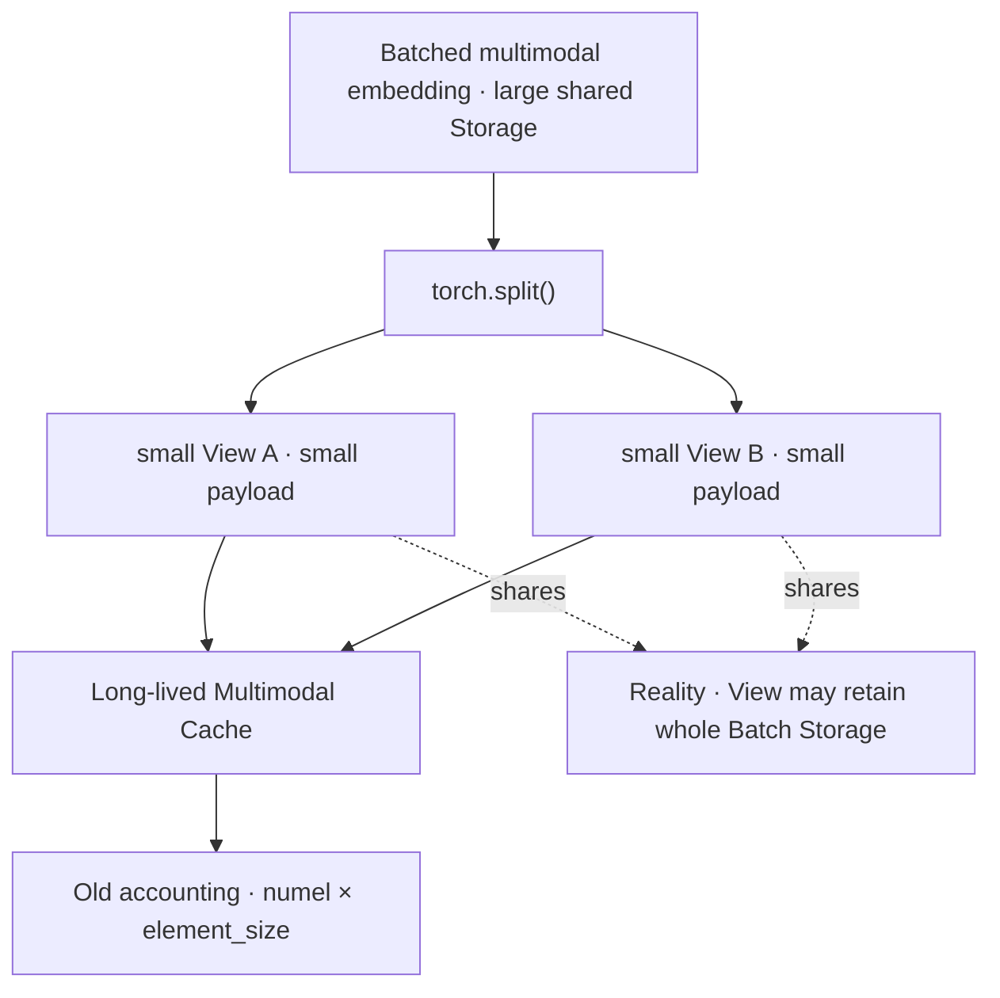
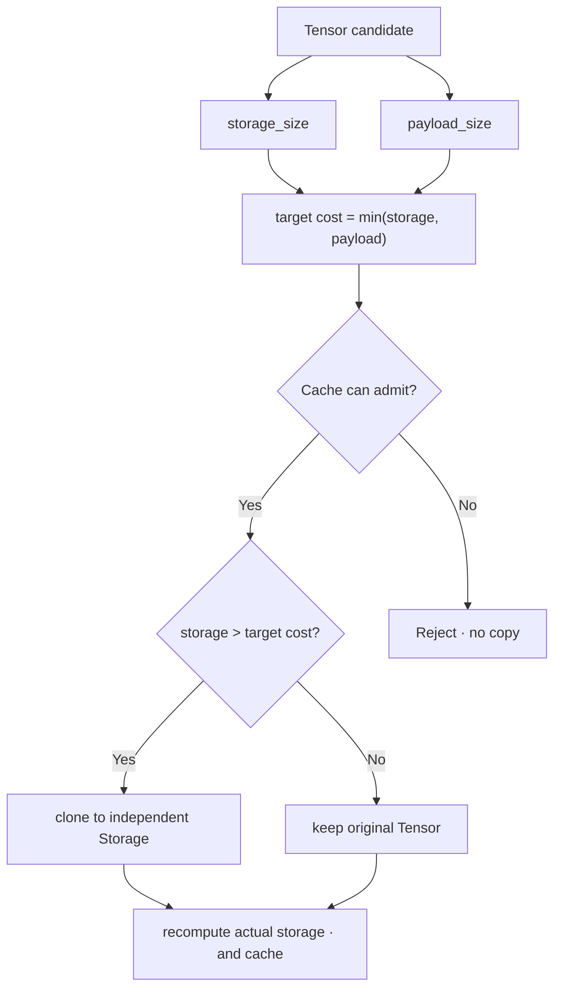

# 小 Tensor 为什么保活大内存：SGLang PR #39120 的 View 缓存修复

一个逻辑大小只有 0.8 MiB 的 Tensor，可能让约 7.8 MiB 的底层存储一直无法释放。原因是它来自一个更大的 batch Tensor 的切分：小 Tensor 保留了对整块 Storage 的引用。

SGLang [PR #39120](https://github.com/sgl-project/sglang/pull/39120) 修复了多模态 Embedding Cache 中的这一问题。旧缓存按可见元素大小记账，却可能保活更大的资源；补丁在需要时把入库的 View 复制成独立存储。下面用一个最小例子解释引用、内存计数和复制时机。

本文固定到 `sgl-project/sglang@24b6c1c7f5ba6c95a96acc9e77b4f5efb23eff97`。PyTorch View / Storage 语义参考官方 [Tensor Views](https://docs.pytorch.org/docs/main/tensor_view.html)、[Storage](https://docs.pytorch.org/docs/2.14/storage.html) 与 [`Tensor.expand`](https://docs.pytorch.org/docs/stable/generated/torch.Tensor.expand.html) 文档。

## 一、小 View 怎样保活整个 Batch

先不看 SGLang。假设一次批量多模态编码处理 10 个 item，每个 item 产生 100 个 token，hidden size 为 4096，dtype 为 BF16。

整个 Batch Embedding 是：

```text
[1000, 4096]

1000 × 4096 × 2 bytes
≈ 7.81 MiB
```

现在把它拆成 10 份：

```python
item_embeddings = torch.split(
    batch_embedding,
    [100, 100, 100, 100, 100, 100, 100, 100, 100, 100],
    dim=0,
)
```

每个 item 的逻辑 shape 是 `[100, 4096]`，所以：

```text
payload
= 100 × 4096 × 2 bytes
≈ 0.78 MiB
```

如果只看 `tensor.numel() * tensor.element_size()`，你自然会认为这个 Entry 大约只占 0.78 MiB。

但 PyTorch Tensor 不只有 shape 和 dtype。更完整地看，一个 strided Tensor 还关联着 Storage、stride、storage offset 等元数据；承载底层字节的是 Storage。PyTorch 官方文档也明确说明：View 与 base Tensor 可以共享同一个底层 Storage，而 `split()` 属于 View operation。

所以刚才的结构更接近：

```text
                    one Batch Storage
┌──────────────────────────────────────────────────┐
│ img0 │ img1 │ img2 │ img3 │ ... │ img8 │ img9 │
└──────────────────────────────────────────────────┘
   ↑      ↑      ↑      ↑              ↑      ↑
 view0  view1  view2  view3           view8  view9
```

创建这些 View 本来是好事：没有额外 copy，`split()` 很便宜。

问题出现在：**一个短生命周期计算流里的 View 被放进了长期存在的 Cache。**

假设 Batch 计算结束后，只剩 `view3` 还在 Cache：

```text
batch_embedding 对象不再需要
        │
        ▼
view3 仍然存活
        │
        ▼
它仍引用原来的 Batch Storage
        │
        ▼
整块 Batch Storage 不能释放
```

于是可能出现：

```text
Cache Entry 逻辑 payload：0.78 MiB
实际因它而继续存活的 Storage：7.81 MiB
```

10 个 View 若来自同一 Batch，会共享同一块 7.81 MiB Storage。统计底层占用时，这块存储只计一次。

危险的是 Cache 长时间运行之后：

```text
Batch A → 只剩一个小 View 被缓存 → pin 住 Batch A Storage
Batch B → 只剩一个小 View 被缓存 → pin 住 Batch B Storage
Batch C → 只剩一个小 View 被缓存 → pin 住 Batch C Storage
...
```

这时账面上的多个小 Entry，就可能分别延长多个历史 Batch Storage 的生命周期。

这属于 **unintended retention**：缓存引用延长了 Storage 的生命周期，使整块 Batch 存储持续驻留。

## 二、逻辑大小与底层 Storage

缓存记账涉及两个不同的字节数。

第一个：

```python
tensor.numel() * tensor.element_size()
```

它描述的是 Tensor 逻辑 view 中有多少元素数据。PyTorch 的 `Tensor.nbytes` 也是按 `numel() * element_size()` 定义。

第二个：

```python
tensor.untyped_storage().nbytes()
```

`untyped_storage()` 返回 Tensor 的底层 UntypedStorage；Storage 是保存实际字节的数据容器。

对一个普通独立 Tensor：`payload bytes ≈ storage bytes`

但对一个从大 Batch 切出来的 View：

```text
View shape: [100, 4096]
Logical payload: 0.78 MiB

Underlying Storage:
[1000, 4096]
Storage bytes: 7.81 MiB
```

于是：

```text
Logical Tensor Size
        ≠
Physical Backing Storage Size
```

这也解释了旧版 Cache 为什么会低估 retained memory。修复前的 helper 是：

```python
def _get_tensor_size(embedding):
    return embedding.element_size() * embedding.numel()
```

也就是默认：`Cache Cost = Tensor Payload`

但 Cache 需要约束的是：`只要这个 Entry 还活着，哪些底层资源必须继续活着？`

`reshape()` 可能返回 View，也可能创建新 Tensor。资源核算因此检查最终 Storage 身份与字节数，确认结果是否仍与原 Tensor 共享存储。

## 三、缓存记账怎样遗漏真实占用

回到固定 merge commit 的 SGLang 源码。

`mm_schedule.py` 在批量多模态编码得到一个整体 Tensor 时，会先：

```python
all_miss_embedding = data_embedding_func(miss_items)
```

如果返回值不是 per-item list，而是一个整体 Tensor，就会执行：

```python
split_embeddings = torch.split(
    all_miss_embedding,
    token_counts,
    dim=0,
)
```

固定版本源码甚至直接写了注释：一个 `torch.split` View 会让整个 concatenated buffer 在任意单个 item 仍被缓存时继续存活。对应源码可见 [`mm_schedule.py`](https://github.com/sgl-project/sglang/blob/24b6c1c7f5ba6c95a96acc9e77b4f5efb23eff97/python/sglang/srt/managers/mm_schedule.py#L380-L410) 和 [per-item 路径](https://github.com/sgl-project/sglang/blob/24b6c1c7f5ba6c95a96acc9e77b4f5efb23eff97/python/sglang/srt/managers/mm_schedule.py#L462-L490)。

数据流是：



`torch.split()` 通过 View 复用存储，适合短期计算；进入长期缓存后，引用关系延长，整块 Storage 的驻留成本也随之延长。

Root Cause 是：**共享 Storage 的短生命周期 View，被带进了按 Entry 独立记账的长期 Cache，而 accounting model 没有反映这种 ownership / lifetime。**

因此这个 PR 的核心 invariant 可以写成：

> **缓存预算需要覆盖 Entry 实际保活的资源。按 Entry 累加记账时，入库数据的存储占用也应与账面大小对应。**

这条预算规则涉及两类关系：

```text
Accounting
Lifetime
```

一个缓存条目“拥有”的不只是一个 Python Tensor 对象，它还会延长与该 Tensor 关联资源的 lifetime。

## 四、在入库前分离不必要的共享存储

PR #39120 的核心改动位于 [`multimodal_cache.py`](https://github.com/sgl-project/sglang/blob/24b6c1c7f5ba6c95a96acc9e77b4f5efb23eff97/python/sglang/srt/mem_cache/multimodal_cache.py#L65-L130)。

第一步，把 `_get_tensor_size()` 改成：

```python
def _get_tensor_size(embedding):
    return embedding.untyped_storage().nbytes()
```

这让已经入库的 Entry 按真实 backing storage 字节数记账。

入库时的处理在 `set()` 中：

```python
tensor = embedding.embedding
storage_size = _get_tensor_size(tensor)
data_size = min(
    storage_size,
    tensor.element_size() * tensor.numel(),
)
```

如果 Entry 能被 Cache 接纳，并且：`storage_size > data_size`

才做：

```python
embedding = replace(
    embedding,
    embedding=tensor.clone(),
)
```

最后重新按 clone 后的实际 Storage 大小计入 `current_size`。

### 为什么不直接让每个 View 都按完整 `storage_size` 记账？

因为多个 Entry 可能共享同一个 Storage。假设：

```text
View A ─┐
View B ─┼──→ same 100 MiB Storage
View C ─┘
```

如果每个 Entry 都独立记 100 MiB，Cache 账面可能变成 300 MiB，但底层其实只有一块 100 MiB Storage。要彻底做 shared-storage accounting，需要维护 Storage identity、引用关系和 per-storage accounting，复杂度会明显增加。

PR 选择的是另一条更简单的路径：

> **既然 Cache 按 Entry 独立记账，那就让长期缓存的 oversized View 拥有自己的独立 Storage。**

也就是：

```text
Before

Batch Storage
████████████████████████████████████
        ↑
      small View

After clone

Batch Storage
████████████████████████████████████

Cached Entry Storage
████
```

这是一个很典型的工程取舍：**通过改变 ownership，让 accounting model 重新变得简单而正确。**

从补丁的位置看，复制成本被放在入库时承担：Entry 被接纳且 `storage_size > data_size` 时，才创建独立存储。

### 为什么只 clone 一部分 Tensor？

PR 没有无脑 `clone()` 所有 Entry。

- 普通独立 Tensor：`storage_size == payload_size`，不 clone；
- duplicate key：在更早的位置直接返回，不 clone；
- Cache 无论如何都无法接纳的 Entry：在 clone 前返回 `False`，不做无意义 copy；
- oversized backing Storage 的被接纳 Entry：clone 成独立 Storage。

短期计算继续共享 View，长期缓存则在需要时取得独立 Storage。

### `min(storage_size, payload_size)` 为什么重要？

因为还有反方向的情况：逻辑 payload 可以比真实 Storage 大。

典型例子是 `expand()`。PyTorch 官方文档明确说明 `expand()` 不分配新内存，而是通过 stride=0 创建 View。

因此可能有：`payload_size > storage_size`

此时并不存在“小 Tensor pin 大 Storage”的问题。用 `min(storage_size, payload_size)` 可以避免把这种 Tensor 错判成需要 compact 的对象。

整个修复流程可以浓缩成：



## 五、验证修复与兼容行为

PR 报告的 CPU Smoke Checks 覆盖普通切片、detached、strided、inference-mode、expanded Tensor 和 LRU 记账，Base / Extra CI 最终通过。验证重点是数值保留、存储独立性与预算更新；GPU 性能和模型精度未单独测量。

修复后的 regression test 也从：

```python
test_tensor_cache_entries_share_storage()
```

变成：

```python
test_tensor_cache_entries_own_storage()
```

并直接断言：

```python
emb.untyped_storage().nbytes()
==
emb.numel() * emb.element_size()
```

也就是说，测试不再只验证 Tensor 数值，而是把**缓存 Entry 的 Storage ownership contract**也写进回归测试。对应固定版本测试见 [`test_mm_chunked_embedding_unit.py`](https://github.com/sgl-project/sglang/blob/24b6c1c7f5ba6c95a96acc9e77b4f5efb23eff97/test/registered/chunked_prefill/test_mm_chunked_embedding_unit.py#L150-L180)。

这个断言把资源生命周期也纳入回归检查：数值正确的 Tensor，仍可能引用过大的底层 Storage。对于本 PR 的缓存切分案例，测试同时检查这两件事。

## 六、把内存预算落到资源所有权

这次修复把三个量对齐了：缓存条目的逻辑大小、它实际保活的 Storage，以及缓存预算用于驱逐的计数。对于文中的切分 View，复制放在“进入长期缓存”的位置，避免短期计算过程提前承担不必要的拷贝。

检查类似代码时，可以沿引用关系走一遍：谁创建了大 Tensor，哪些 View 共享它，哪个容器延长了引用生命周期，驱逐一个条目后还有谁保活底层存储。只有这些关系明确，才知道按 payload 计数、按 Storage 去重计数，还是在入库时分离存储更合适。

文中的连续 Batch 切分采用 strided Tensor。推广到其他缓存时，再根据 Entry 的共享关系与生命周期选择预算方式：有意复用的 Storage 可以按身份去重记账，需要独立驻留的数据则在入库时复制。
