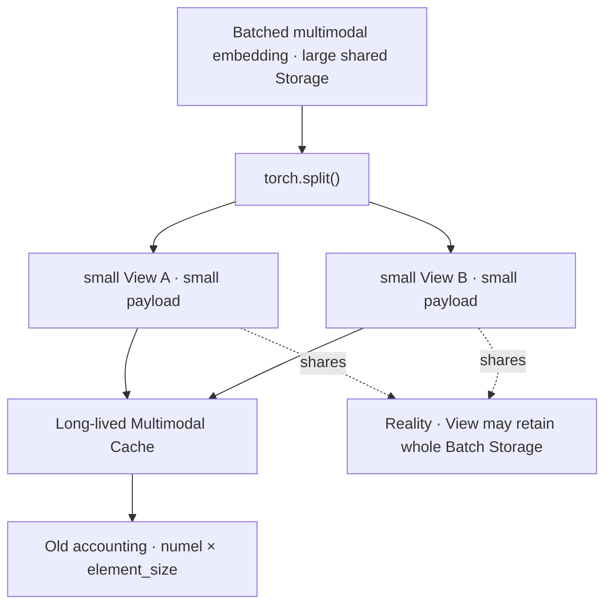
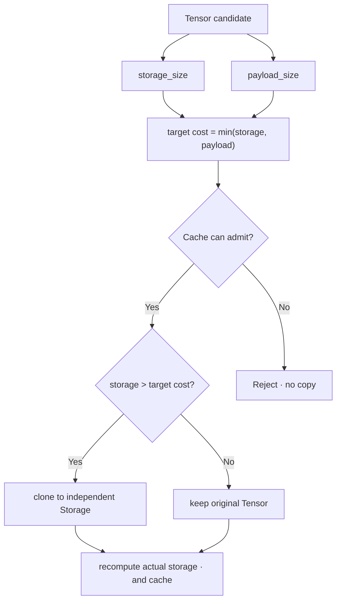

# 小 Tensor 为什么保活大内存：SGLang PR #39120 的 View 缓存修复

缓存留下一个约 0.8 MiB 的 Tensor，却可能保住约 7.8 MiB 的内存。它若是大 batch 切出的 View，仍引用整块 Storage，小 Tensor 活着，大存储就不会释放。

[PR #39120](https://github.com/sgl-project/sglang/pull/39120) 修复了多模态 Embedding Cache 的这类占用。旧预算只数可见元素，漏掉 View 保留的大块资源；补丁在入库时选择性复制，让 Entry 拥有可单独记账的 Storage。

源码固定为 `sgl-project/sglang@24b6c1c7f5ba6c95a96acc9e77b4f5efb23eff97`。View、Storage 语义依据 PyTorch 官方 [Tensor Views](https://docs.pytorch.org/docs/main/tensor_view.html)、[Storage](https://docs.pytorch.org/docs/2.14/storage.html)、[`Tensor.expand`](https://docs.pytorch.org/docs/stable/generated/torch.Tensor.expand.html)。

## 一、小 View 怎样保活整个 Batch

先构造独立算例：批量多模态编码处理 10 个 item，各产出 100 个 token，hidden size=4096，dtype=BF16。

整体 Embedding 为 `[1000,4096]`，占 `1000 × 4096 × 2 ≈ 7.81 MiB`。

按 item 切成 10 份：

```python
item_embeddings = torch.split(
    batch_embedding,
    [100, 100, 100, 100, 100, 100, 100, 100, 100, 100],
    dim=0,
)
```

每份 shape 为 `[100,4096]`，可见元素占 `100 × 4096 × 2 ≈ 0.78 MiB`。

按 `tensor.numel() * tensor.element_size()`，每 Entry 只记 0.78 MiB。这算出了 payload，却没说明数据背后的存储是否独立。

strided Tensor 用 Storage 保存字节，shape、dtype、stride、storage offset 描述怎样访问它。PyTorch 的 `split()` 属于 View operation，切分后各 Tensor 可以继续共用原 Storage。

引用关系为：

```text
                    one Batch Storage
┌──────────────────────────────────────────────────┐
│ img0 │ img1 │ img2 │ img3 │ ... │ img8 │ img9 │
└──────────────────────────────────────────────────┘
   ↑      ↑      ↑      ↑              ↑      ↑
 view0  view1  view2  view3           view8  view9
```

计算期间，共享省掉了 copy。某个 View 进入长期 Cache，也把整块 Storage 的生命周期带了进去。

假设其他引用都已释放，只剩 Cache 中的 view3。原 batch_embedding 对象即使不再需要，view3 仍引用 Batch Storage：0.78 MiB 的 Entry，保留了 7.81 MiB 的存储。

若 10 个 View 都来自同一 Batch，它们仍只占一块 7.81 MiB Storage，物理记账应去重。

长期 Cache 也可能从 Batch A、B、C 各留一个小 View。每个条目保住自己的历史存储，payload 之和便远小于实际驻留量。

这里的 unintended retention，来自容器延长了资源的引用。

## 二、逻辑大小与底层 Storage

旧记账方式与真实占用，对应两个字节数：

| 读取方式 | 表示什么 | 本例 |
| --- | --- | --- |
| `tensor.numel() * tensor.element_size()` | Tensor 逻辑视图的 payload；`Tensor.nbytes` 也采用这一定义 | `[100,4096]`，约 0.78 MiB |
| `tensor.untyped_storage().nbytes()` | backing UntypedStorage 的字节数 | 原 `[1000,4096]` Batch Storage，约 7.81 MiB |

普通独立 Tensor，两者通常接近；从大 Batch 切出的 View，两者就可能相差很多。

旧 Cache 使用这个 helper：

```python
def _get_tensor_size(embedding):
    return embedding.element_size() * embedding.numel()
```

即 `Cache Cost = Tensor Payload`，没有覆盖 Entry 保留的全部底层资源。

`reshape()` 则可能返回 View，也可能创建新 Tensor。具体共享关系要看最终 Storage 的身份、大小，操作名本身不足以决定。

## 三、缓存记账怎样遗漏真实占用

在固定 merge commit 中，多模态编码结果按下面的路径入库。

`mm_schedule.py` 批量编码后先运行：

```python
all_miss_embedding = data_embedding_func(miss_items)
```

结果若为整体 Tensor，而非 per-item list，再按 item 切分：

```python
split_embeddings = torch.split(
    all_miss_embedding,
    token_counts,
    dim=0,
)
```

该版本注释说明：只留一个缓存 item，`torch.split` 的 View 也会保住整个 concatenated buffer。对应 [`mm_schedule.py`](https://github.com/sgl-project/sglang/blob/24b6c1c7f5ba6c95a96acc9e77b4f5efb23eff97/python/sglang/srt/managers/mm_schedule.py#L380-L410)、[per-item 路径](https://github.com/sgl-project/sglang/blob/24b6c1c7f5ba6c95a96acc9e77b4f5efb23eff97/python/sglang/srt/managers/mm_schedule.py#L462-L490)。

数据路径为：



切分共享随 Entry 长期保留，旧预算却逐条累加 payload，生命周期与预算由此脱节。

既然预算按 Entry 累加，修复也要让入库数据的实际占用能够按 Entry 计算。

放入缓存的 Python 对象及其关联资源，会一起延长生命周期。

## 四、在入库前分离不必要的共享存储

核心改动位于 [`multimodal_cache.py`](https://github.com/sgl-project/sglang/blob/24b6c1c7f5ba6c95a96acc9e77b4f5efb23eff97/python/sglang/srt/mem_cache/multimodal_cache.py#L65-L130)。

先调整 `_get_tensor_size()`：

```python
def _get_tensor_size(embedding):
    return embedding.untyped_storage().nbytes()
```

已入库 Entry 改按 backing storage 的实际字节数计入预算。

`set()` 再处理待接纳的数据：

```python
tensor = embedding.embedding
storage_size = _get_tensor_size(tensor)
data_size = min(
    storage_size,
    tensor.element_size() * tensor.numel(),
)
```

Cache 能接纳，且 `storage_size > data_size`，才复制：

```python
embedding = replace(
    embedding,
    embedding=tensor.clone(),
)
```

最后按新 Tensor 的 Storage 更新 `current_size`。

<a id="view-storage_size"></a>

### 共享 Storage 怎样按 Entry 记账

A、B、C 三个 View 共享一块 100 MiB Storage，每 Entry 都记 100 MiB，就成了 300 MiB。要继续共享又准确核算，需额外维护 Storage identity、引用关系、per-storage accounting。

这个 PR 选择另一条路径：把 oversized View 复制为独立 Storage，让长期 Entry 各自占用、各自计费。

复制后，Entry 只引用自己的小存储。原 Batch 是否释放，还取决于是否存在其他引用，但这个缓存条目已经不会保住它。

copy 成本因此只出现在可接纳 Entry 的入库阶段。

<a id="clone-tensor"></a>

### clone 只作用于可接纳的 oversized Tensor

各分支为：

独立 Tensor 的 `storage_size == payload_size`，无需复制；duplicate key 更早返回；Cache 放不下的 Entry 在复制前返回 `False`。剩下可接纳、backing Storage 过大的条目，才取得独立存储。

短期计算继续使用共享 View，跨入长期缓存时再处理过大的引用。

<a id="minstorage_size-payload_size"></a>

### min(storage_size, payload_size) 处理 expanded View

还存在逻辑 payload 大于真实 Storage 的情况。

`expand()` 以 stride=0 创建 View，不分配新内存，让同一数据在逻辑上出现多次。

因此可能有 `payload_size > storage_size`。

它没有保住过大的存储，`min(storage_size, payload_size)` 避免将其误判为需要 compact 的对象。

合并接纳判断、复制和记账：



## 五、验证修复与兼容行为

PR 当时报告的 CPU Smoke Checks 覆盖普通切片、detached、strided、inference-mode、expanded Tensor、LRU 记账，Base / Extra CI 最终通过。检查内容是数值、存储独立性、预算更新，GPU 性能与模型精度未单独测量。

回归测试改名为 `test_tensor_cache_entries_own_storage()`，替代原 `test_tensor_cache_entries_share_storage()`，并断言 `emb.untyped_storage().nbytes()` 等于 `emb.numel() * emb.element_size()`。

固定测试见 [`test_mm_chunked_embedding_unit.py`](https://github.com/sgl-project/sglang/blob/24b6c1c7f5ba6c95a96acc9e77b4f5efb23eff97/test/registered/chunked_prefill/test_mm_chunked_embedding_unit.py#L150-L180)。

数值正确的 Tensor 也可能继续共享大块 Storage，所以这个回归还需要检查 ownership。

<a id="_4"></a>

排查类似占用，可以从大 Tensor 往后追：哪个 View 与它共享，哪个容器延长引用，条目驱逐后是否仍有其他持有者。引用生命周期决定了预算应如何记录。

本文切分使用 strided Tensor。其他 Cache 若有意共享，可以按 Storage 身份去重；若要求各 Entry 独立驻留，则在入库时分离。两种做法各自对应不同的共享关系。
