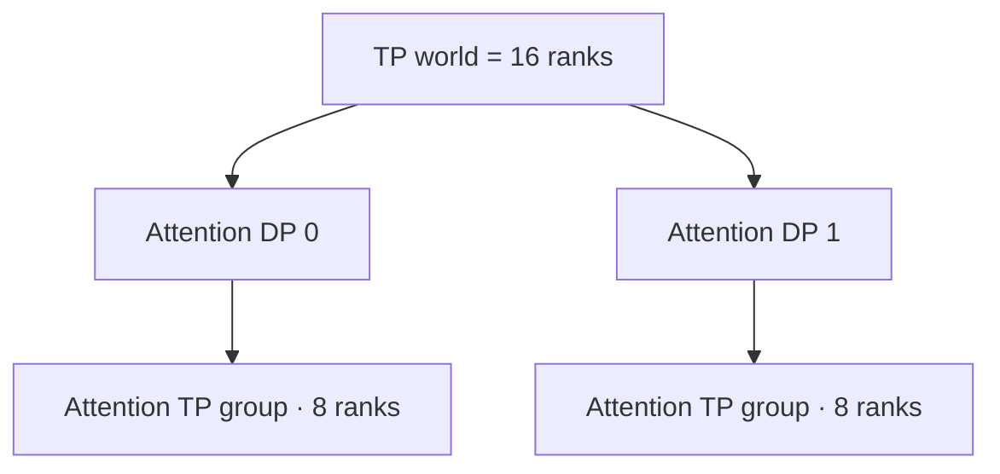
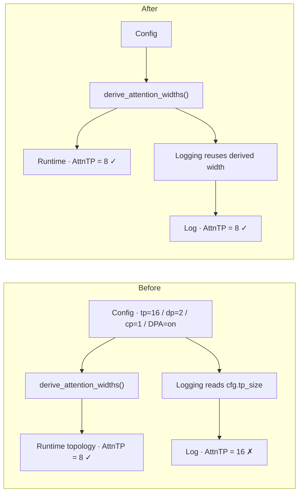

# 日志里的 TP16 为什么应是 TP8：SGLang PR #39871

设置 `tp_size=16、dp_size=2`，启用 DP Attention，且 `attn_cp_size=1` 时，Attention 的 TP 宽度应为 8。SGLang 的一条日志却曾直接读取原始 `tp_size`，打印成 16；运行时使用的派生宽度仍是正确的。

[PR #39871](https://github.com/sgl-project/sglang/pull/39871) 修改了这条日志，让它复用已有的派生结果。沿着这个小补丁往前看，可以看到一个配置经过 Runtime 解释后，日志怎样因为继续读取原始值而报错。

下面固定阅读 `sgl-project/sglang@803f0c93d20104cf19ff6a95f7ef580b9fe449a2`。本文只展开这个补丁涉及的宽度关系；WORLD、Rank、Group、DPA 与 MoE EP 的完整背景可见[《SGLang 里的 Rank 和 Group 到底是什么？》](../distributed/sglang-rank-group-deepseek-v4.md)。

## 一、日志里的宽度与实际运行值

PR 中给出的错误日志如下：

```text
DSA with TP mode is active,
dp_size=2,
tp_size=16,
attn_tp_size=16,
attention weights will be sharded across 16 ranks.
```

最后两处 `16` 与实际拓扑不符：此处 Attention 使用的 TP width 为 8。

触发这条 warning 的路径有具体条件：模型使用 DSA，`dp_size < tp_size`，未进入 Prefill CP，并且平台进入 CUDA / ROCm 的 model-specific adjustment。日志直接插入 `cfg.tp_size`，把 8-way Attention TP 写成了 16-way。

如果据此排查通信或权重分片，就可能去寻找一个并不存在的 Group 宽度。修复需要让日志描述实际派生出的拓扑。

## 二、从 TP16 / DP2 推导 Attention TP8

先从宽度的计算入口看起：

[`derive_attention_widths()`](https://github.com/sgl-project/sglang/blob/803f0c93d20104cf19ff6a95f7ef580b9fe449a2/python/sglang/srt/runtime_context.py#L138-L148)

这个 merge commit 下的实现如下：

```python
def derive_attention_widths(
    *, tp_size: int, attn_cp_size: int, dp_size: int, enable_dp_attention: bool
) -> tuple:
    attn_dp_size = dp_size if enable_dp_attention else 1
    return attn_dp_size, tp_size // attn_dp_size // attn_cp_size
```

函数先检查 DP Attention：启用时 `attn_dp_size=dp_size`，否则为 1，再计算 `attn_tp_size=tp_size/attn_dp_size/attn_cp_size`。合法配置因此满足：

```text
tp_size = attn_dp_size × attn_cp_size × attn_tp_size
```

代入本例，DPA 开启，attn_dp_size=2、attn_cp_size=1，所以 `attn_tp_size=16/2/1=8`。

对应的分组关系如下：



这里的 `tp_size = 16` 与 `attn_tp_size = 8` 可以同时成立，前者是总体配置，后者是 Attention 派生出的宽度。


同理，`attn_tp_size==1` 只说明 Attention 坐标中的 TP width 为 1，其他模型部分仍按各自的 TP/EP 布局执行。

因此，回到这条日志，要读取的是 Attention 的派生宽度。原始 `tp_size` 还需要经过运行时规则解释，才能对应到各子模块。


## 三、派生规则与错误日志的来源

计算入口已经存在，为什么日志还会报错？这需要看稍早的一次配置重构。


约在 #39871 之前两周，SGLang 合入了 [PR #38113](https://github.com/sgl-project/sglang/pull/38113)。它把 `attn_tp_size` 等 parallel quotients 明确为从 configured leaves 派生的值，并要求将相关算术集中到统一来源，避免各个消费者重复计算。

PR #38113 整理了派生规则，Runtime 已经通过统一入口解释配置，这条 warning 却仍直接读取 `cfg.tp_size`。#39871 补上了这个消费者，让日志也使用派生宽度。

固定源码中的 Runtime helper 注释也说明了集中计算的目的：

```text
Split out because the rank computation in
dp_attention.compute_dp_attention_world_info
needs the same two numbers and must not carry
a second copy of the arithmetic.
```

Runtime 将 `cfg.tp_size`、`cfg.dp_size`、`cfg.attn_cp_size` 和 `cfg.enable_dp_attention` 交给 `derive_attention_widths()`，取得 attn_dp_size 与 attn_tp_size。本例后者为 8。

旧日志则直接读取原始配置：



这使日志绕过了 Runtime 已经算好的 Attention 宽度。即使日志中的原始参数没抄错，读者看到的拓扑仍然会错。


如果日志和 Rank / Group 构建共用同一套 Attention Width 派生规则，它们就能保持相同的拓扑含义。


这个关系也适用于其他配置，不必为 `16 → 8` 单独维护一条修正规则。

## 四、补丁怎样复用统一计算入口

修复后的代码位于 [`model_hook.py`](https://github.com/sgl-project/sglang/blob/803f0c93d20104cf19ff6a95f7ef580b9fe449a2/python/sglang/srt/arg_groups/model_hook.py#L285-L300)。

补丁沿用现有计算入口，再把结果接入日志，改动可以顺着下面的代码看。

先调用已有的派生函数：

```python
_, attn_tp_size = derive_attention_widths(
    tp_size=cfg.tp_size,
    attn_cp_size=cfg.attn_cp_size,
    dp_size=cfg.dp_size,
    enable_dp_attention=cfg.enable_dp_attention,
)
```

warning 随后用这个结果替换原先直接读取的 `cfg.tp_size`。补丁到这里结束：Process Group、Attention Kernel、Collective 和 Weight Sharding 仍走原路径。

### 为什么不直接写 `cfg.tp_size // cfg.dp_size`？

直接相除虽然能算对当前例子，却会在日志里复制一份派生规则。

完整规则还要考虑 `enable_dp_attention` 和 `attn_cp_size`。如果 A.py 用 tp/dp，B.py 又加上 cp，C.py 检查 DPA 开关，D.py 仍直接打印 tp，以后调整规则就要同时修改多处，容易再次让日志偏离运行时。

`derive_attention_widths()` 提供共同入口，Rank 计算和日志都复用它，规则变化也只需在这一处维护。

## 五、检查日志变化与行为范围

补丁只改了 1 个文件，差异为 `+8/-2`。对应 Head 的 Lint 通过，较广的 PR Test 仍有失败记录；没有新增专门的拓扑 Runtime 测试，也没有运行性能或精度 Benchmark。

从 diff 能确认的是，warning 与 Runtime 开始使用一致的宽度规则。模型计算与 Group 创建仍走原路径，验证范围也应按这个改动理解。

### 补丁的行为范围

还需注意外层平台判断。此处 DSA 的 model-specific adjustment 进入 CUDA / ROCm 路径：


```python
if not get_platform().is_npu and not get_platform().is_xpu:
    # CUDA or ROCm GPU
```

所以，#39871 修正的是 CUDA / ROCm 上 partial DP Attention 的 warning。Ascend NPU 和 XPU 会跳过这条调整分支。

## 六、配置派生值的使用原则

`tp_size` 保存用户的原始配置意图，`attn_tp_size` 则描述经过 DP、CP 和启用条件解释后的 Attention 宽度。日志要描述实际运行拓扑，就应读取后一种语义。重新写一遍公式，即使当前能算出 8，也会多出一个需要维护的位置。

复核这类补丁时，可以从配置走到派生函数，再看 Runtime 和日志是否消费同一个结果，最后代入目标配置核对输出。这个 PR 没有改变并行执行，却修正了排查并行执行时依赖的一条信息。

### 固定源码与延伸阅读

- [SGLang PR #39871](https://github.com/sgl-project/sglang/pull/39871)
- [PR #38113：parallel quotients / derived config 的前置设计背景](https://github.com/sgl-project/sglang/pull/38113)
- [`model_hook.py`：修复后的 warning](https://github.com/sgl-project/sglang/blob/803f0c93d20104cf19ff6a95f7ef580b9fe449a2/python/sglang/srt/arg_groups/model_hook.py#L285-L300)
- [`runtime_context.py`：`derive_attention_widths()`](https://github.com/sgl-project/sglang/blob/803f0c93d20104cf19ff6a95f7ef580b9fe449a2/python/sglang/srt/runtime_context.py#L138-L148)
- [`runtime_context.py`：parallel width derivation](https://github.com/sgl-project/sglang/blob/803f0c93d20104cf19ff6a95f7ef580b9fe449a2/python/sglang/srt/runtime_context.py#L151-L205)
- [《SGLang 里的 Rank 和 Group 到底是什么？》](../distributed/sglang-rank-group-deepseek-v4.md)
