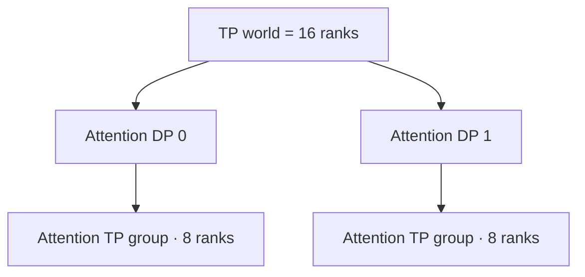
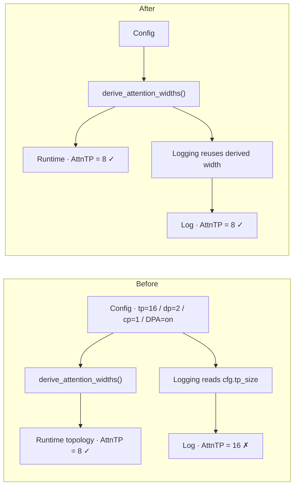

# 日志里的 TP16 为什么应是 TP8：SGLang PR #39871

配置 `tp_size=16、dp_size=2`，启用 DP Attention，且 `attn_cp_size=1` 时，Attention TP 宽度是 8。SGLang 曾在相关日志中直接打印原始 `tp_size`，把它误报成 16；实际运行时的宽度派生并没有算错。

[PR #39871](https://github.com/sgl-project/sglang/pull/39871) 让这条日志改用已有的派生结果。这个小补丁适合观察配置系统里常见的问题：输入参数经过 Runtime 解释后，下游日志是否仍在使用未经解释的原值。

本文固定到 `sgl-project/sglang@803f0c93d20104cf19ff6a95f7ef580b9fe449a2`。如果想完整理解 WORLD、Rank、Group、DPA 与 MoE EP，可继续阅读[《SGLang 里的 Rank 和 Group 到底是什么？》](../distributed/sglang-rank-group-deepseek-v4.md)；本文只保留读懂这个 PR 所需的最小背景。

## 一、日志里的宽度与实际运行值

PR 给出的原始日志是：

```text
DSA with TP mode is active,
dp_size=2,
tp_size=16,
attn_tp_size=16,
attention weights will be sharded across 16 ranks.
```

问题是最后两处 `16`。在这个配置下，Attention 实际 TP width 应该是 8。

这条 warning 出现在 DSA、`dp_size < tp_size`、未进入 Prefill CP，且平台进入 CUDA / ROCm model-specific adjustment 的路径。日志直接使用 `cfg.tp_size`，于是把实际 8-way Attention TP 打印成 16-way。

排查通信或权重分片时，工程师会据此寻找错误的 Group 宽度。补丁将日志改为读取派生后的值，使观察到的拓扑与实际运行一致。

## 二、从 TP16 / DP2 推导 Attention TP8

理解这个 PR，只需要先看一个函数：

[`derive_attention_widths()`](https://github.com/sgl-project/sglang/blob/803f0c93d20104cf19ff6a95f7ef580b9fe449a2/python/sglang/srt/runtime_context.py#L138-L148)

固定 merge commit 下的实现是：

```python
def derive_attention_widths(
    *, tp_size: int, attn_cp_size: int, dp_size: int, enable_dp_attention: bool
) -> tuple:
    attn_dp_size = dp_size if enable_dp_attention else 1
    return attn_dp_size, tp_size // attn_dp_size // attn_cp_size
```

先决定 Attention 是否真的使用 DP：

```text
enable_dp_attention = true  → attn_dp_size = dp_size
enable_dp_attention = false → attn_dp_size = 1
```

然后计算 Attention 自己的 TP width：

```text
attn_tp_size
=
tp_size / attn_dp_size / attn_cp_size
```

因此在合法配置里，可以把关系记成：

```text
tp_size
=
attn_dp_size
× attn_cp_size
× attn_tp_size
```

代入 PR 的例子：

```text
tp_size = 16
dp_size = 2
attn_cp_size = 1
enable_dp_attention = true

attn_dp_size = 2
attn_tp_size = 16 / 2 / 1 = 8
```

概念上可以画成：



所以：`tp_size = 16`

和：`attn_tp_size = 8`

完全可以同时成立。

这也是为什么看到：

```python
attn_tp_size == 1
```

这个值描述 **Attention 坐标中的 TP width 为 1**；其他模型部分仍按各自的 TP / EP 布局执行。

回到本 PR，日志需要读取的是派生后的 Attention 宽度：

> **原始 `tp_size` 经过派生，得到各子模块实际使用的并行宽度。**

## 三、派生规则与错误日志的来源

**在 #39871 之前，Attention TP 的派生规则是怎样组织的？**

这里能找到一个很有价值的前置设计背景。

在 #39871 之前约两周，SGLang 合入了 [PR #38113](https://github.com/sgl-project/sglang/pull/38113)。那次配置系统整理明确强调：`attn_tp_size` 等 parallel quotients 是由 configured leaves 派生的值，相关 arithmetic 应该有统一来源，而不是让各个消费者各写一份。

PR #38113 提供了统一派生值的设计背景，后来的 #39871 将这套规则接到 warning。两项改动的关系如下：

```text
#38113
Parallel quotient 语义进一步集中
attn_tp_size 明确属于 derived topology
        │
        ▼
Runtime 已有统一 width derivation
        │
        ▼
某个旧 Logging consumer
仍然直接打印 cfg.tp_size
        │
        ▼
#39871
让 Logging 回到同一个 derivation source
```

也就是说，#39871 很像一种常见的重构尾部 Bug：

> **核心语义已经集中，但还有一个边缘消费者没有迁移到新的 Single Source of Truth。**

固定 merge commit 中，Runtime helper 自己的注释已经把这个意图说得很清楚：

```text
Split out because the rank computation in
dp_attention.compute_dp_attention_world_info
needs the same two numbers and must not carry
a second copy of the arithmetic.
```

Runtime 路径因此已经是：

```text
cfg.tp_size
cfg.dp_size
cfg.attn_cp_size
cfg.enable_dp_attention
        │
        ▼
derive_attention_widths()
        │
        ├── attn_dp_size
        └── attn_tp_size = 8
```

旧 Logging 却旁路了它：



错误 warning 读取原始配置，绕过了已有派生结果：

> **Logging 直接消费了 configured leaf，而没有消费已经存在的 runtime-derived semantic value。**

进一步可以写出核心 invariant：

> **日志与 Rank / Group 构建共用同一套 Attention Width 派生规则，便能保持拓扑含义一致。**

这个 invariant 比 `16 → 8` 这个具体数字稳定得多。

## 四、补丁怎样复用统一计算入口

修复后的代码位于 [`model_hook.py`](https://github.com/sgl-project/sglang/blob/803f0c93d20104cf19ff6a95f7ef580b9fe449a2/python/sglang/srt/arg_groups/model_hook.py#L285-L300)。

如果按设计意图拆，只有三个动作。

**第一，复用现有的权威派生函数。**

```python
_, attn_tp_size = derive_attention_widths(
    tp_size=cfg.tp_size,
    attn_cp_size=cfg.attn_cp_size,
    dp_size=cfg.dp_size,
    enable_dp_attention=cfg.enable_dp_attention,
)
```

**第二，把 Logging 从原始配置值切到 derived value。**

旧逻辑等价于：

```python
attn_tp_size = cfg.tp_size
```

新逻辑变成：

```python
attn_tp_size = derive_attention_widths(...)[1]
```

**第三，保持 Runtime 行为完全不变。**

Process Group、Attention Kernel、Collective、Weight Sharding 都没有被这个 PR 修改。

### 为什么不直接写 `cfg.tp_size // cfg.dp_size`？

因为那只是“把当前样例算对”，却重新复制了一份系统规则。

真实公式还涉及：

```text
enable_dp_attention
attn_cp_size
```

如果不同消费者自己写：

```text
A.py → tp / dp
B.py → tp / dp / cp
C.py → DPA 开了才除
D.py → 直接打印 tp
```

迟早会再次漂移。

而 `derive_attention_widths()` 本身存在的理由，就是让 Rank 计算和其他消费者**不要持有第二份 arithmetic**。

`derive_attention_widths()` 集中保存派生规则，Rank 计算、Runtime 与日志共同使用其结果。以后规则调整时，也只需维护这一个入口。

## 五、检查日志变化与行为范围

补丁修改 1 个文件，差异为 `+8/-2`，将 warning 中的原始 TP 值改为派生后的 Attention TP 值。对应 Head 的 Lint 通过，较广的 PR Test 中仍有失败记录；这次没有新增专门的拓扑 Runtime 测试，也未运行性能或精度 Benchmark。

结合 diff，修复后的行为是日志与 Runtime 使用一致的宽度规则。模型计算与 Group 创建沿用原路径。

### 补丁的行为范围

这条 DSA model-specific adjustment 分支适用于 CUDA / ROCm，平台条件如下：

固定源码里的外层条件明确是：

```python
if not get_platform().is_npu and not get_platform().is_xpu:
    # CUDA or ROCm GPU
```

因此，#39871 的效果落在 CUDA / ROCm 的 partial DP Attention warning 上；Ascend NPU 和 XPU 跳过这条调整分支。

## 六、配置派生值的使用原则

原始配置和有效运行值承担不同职责。`tp_size` 用来表达用户的配置意图；日志描述 Attention 的实际宽度时，应使用同一套派生规则得到的 `attn_tp_size`。把算术公式再复制一遍，即使眼下能得到 8，也会多出一个需要跟随 DP、CP 和启用条件维护的位置。

因此，这个补丁的价值是让日志与 Runtime 共用含义一致的结果。复核时只需把链路走完：配置进入派生函数，Runtime 消费派生状态，日志读取同一语义，再用目标配置检查输出。

### 固定源码与延伸阅读

- [SGLang PR #39871](https://github.com/sgl-project/sglang/pull/39871)
- [PR #38113：parallel quotients / derived config 的前置设计背景](https://github.com/sgl-project/sglang/pull/38113)
- [`model_hook.py`：修复后的 warning](https://github.com/sgl-project/sglang/blob/803f0c93d20104cf19ff6a95f7ef580b9fe449a2/python/sglang/srt/arg_groups/model_hook.py#L285-L300)
- [`runtime_context.py`：`derive_attention_widths()`](https://github.com/sgl-project/sglang/blob/803f0c93d20104cf19ff6a95f7ef580b9fe449a2/python/sglang/srt/runtime_context.py#L138-L148)
- [`runtime_context.py`：parallel width derivation](https://github.com/sgl-project/sglang/blob/803f0c93d20104cf19ff6a95f7ef580b9fe449a2/python/sglang/srt/runtime_context.py#L151-L205)
- [《SGLang 里的 Rank 和 Group 到底是什么？》](../distributed/sglang-rank-group-deepseek-v4.md)
